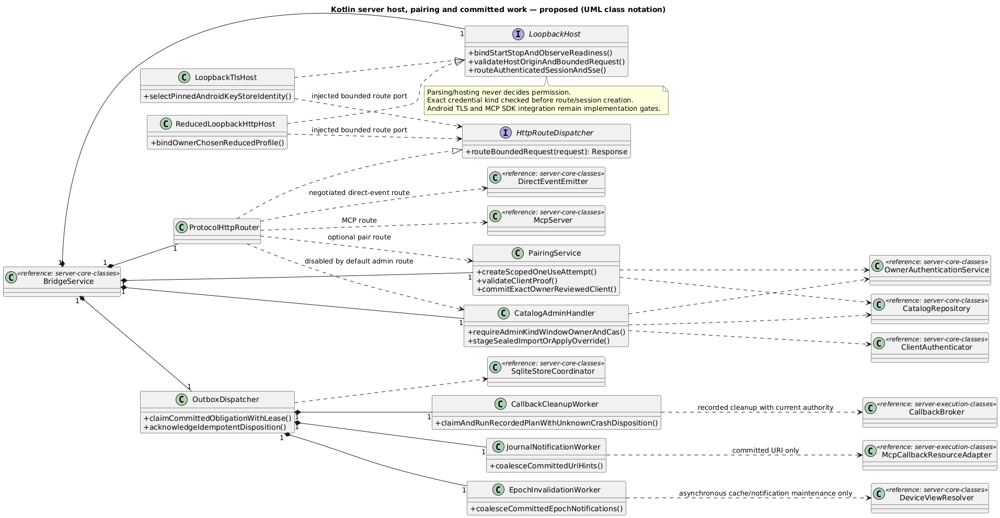

# C4 code-level detail, using UML class notation

Structurizr has no native class view. These editable inline PlantUML definitions are rendered locally and referenced by image views in workspace.dsl. They are proposed Kotlin classes/interfaces, not implemented Android code. Composition diamonds denote owned lifetime; dashed arrows denote dependency, and quoted labels denote multiplicity. All six blocks are app-scoped cross-component code views; their headings name their focal components and the crosswalk maps every owning component/project. Image views attach to bridge.app. Solid directed associations show references or message connections, not inheritance; dashed triangle arrows denote interface realization. Member lists show selected responsibilities, not every Kotlin member. A reference stub explicitly names its authoritative view; realizations inherit the full interface contract. Local epochs/generations are bridge metadata unless the pinned proto has the corresponding field.

## server-core-classes — bridge.app.transport and server ownership

```plantuml
@startuml
!pragma layout smetana
skinparam defaultFontName DejaVu Sans
skinparam classAttributeIconSize 0
skinparam shadowing false
skinparam backgroundColor white
<style>
title {
  Margin 0 0 96 0
}
</style>
title Kotlin server core — proposed ownership and contracts (UML class notation)
interface BackendAdapter <<reference: server-execution-classes>>
class AdbConnectionManager <<reference: server-execution-classes>>
class CallbackBroker <<reference: server-execution-classes>>
class ClientCredentialService <<reference: arc-controller-classes>>
left to right direction
interface LifecycleCommands {
  +requestStop()
  +observeImmutableHealth()
}
class BridgeService {
  +startDesiredState()
  +stopWithinDeadline()
  +observeReadiness(): StateFlow
}
class McpServer {
  +handlePost(request): Response
  +openNotificationStream(session, lastEventId)
  +readResource(principal, uri, limits)
}
class DirectStreamNegotiator {
  +negotiate(clientCaps, serverCaps): AgreedProfile
  +requireOwnedSession(principal, session)
}
class DirectEventEmitter {
  +openOwnedCommittedCursor(request)
  +closeOnOverflowRevocationOrLease()
}
note bottom of DirectEventEmitter
Explicit android.bridge.directEvents.v1 negotiation only.
Authenticated loopback GET /v1/subscriptions/{id}/events SSE.
Application cursor differs from MCP SSE Last-Event-ID.
No negotiation means standard resource journal only.
end note
McpServer ..> DirectStreamNegotiator
DirectStreamNegotiator ..> DirectEventEmitter
class HealthSnapshot {
  +revision: Long
  +serviceState
  +pauseReason: OwnerChallengeOrMigrationOrNull
  +desiredState
  +mcpListener
  +adbBackend
  +deviceView
  +catalogReadiness
  +arcListener
}
class ForegroundStatusNotifier {
  +renderSameSnapshot(health)
  +showPendingOwnerChallenge(challengeId, originalDeadline)
}
class BootCompletedReceiver {
  +recordWaitingForUnlock()
  +requestEligibleStart()
}
BridgeService ..|> LifecycleCommands
BridgeService ..> HealthSnapshot
BridgeService "1" *-- "1" ForegroundStatusNotifier
class DeviceProtectedBootMirror {
  +readNonsecretBootOptIn()
  +reconcileAfterUnlock(authoritativeConfig)
}
BootCompletedReceiver ..> DeviceProtectedBootMirror
BridgeService "1" *-- "1" DeviceProtectedBootMirror
BootCompletedReceiver ..> BridgeService
class McpSessionRegistry {
  +resolveOwnedSession(principal, id)
  +invalidateEpoch(epoch)
  +closeAffectedSessionsAndStreams(principal, epoch)
}
interface ClientAuthenticator {
  +authenticate(credential, expectedKind): Principal
  +onCommittedCredentialEpoch(facts)
}
class AdmissionGate {
  +admit(plan, pins): Admission
  +commitProtectedCommandCAS(command, challengeRef, revisions): Outcome
  +publishCommittedEpochsBeforeRelease(facts)
  +suspendSensitiveExposureAtBarrier()
  +recheck(admission): Decision
  +beginDispatch(admission): DispatchPermit
  +endDispatch(permit, outcome)
}
interface CatalogRepository {
  +streamEffectiveInventory(snapshot)
  +commitOverride(command, expectedRevision, challengeRef)
  +activateSealedView(pins)
  +commitSessionView(session, desiredSet, expectedEtag)
  +commitCredentialCAS(command, challengeRef, expectedRevision)
  +observePublications(): Flow
}
class SqliteStoreCoordinator {
  +writeSerialized(transaction)
  +readBoundedSnapshot(query, pins)
}
class SqliteCatalogRepository
class DeviceViewResolver {
  +resolve(facts, inventory): StagedView
  +activateCAS(expectedView, stagedView)
  +onPublication(epoch)
  +onCapabilityChanged(facts, expectedEpoch)
}
interface SessionInvalidator {
  +closeAffectedPrincipalSessions(principal, epoch)
}
interface PrincipalSessionSink {
  +closeAffectedPrincipalAndEpoch(principal, epoch)
}
class SessionInvalidationFanout
SessionInvalidationFanout ..|> SessionInvalidator
SessionInvalidationFanout "1" *-- "1..*" PrincipalSessionSink
McpSessionRegistry ..|> PrincipalSessionSink
McpSessionRegistry ..> DirectEventEmitter : closes authenticated direct streams as well as standard SSE
ClientAuthenticator ..> SessionInvalidator : injected close port; no protocol import
AdmissionGate ..> ClientAuthenticator : publish committed revocation before releasing barrier
class FunctionalGroupIndex {
  +discover(job, constraints, budget)
  +setActiveCAS(session, desiredSet, etag)
  +describePinned(groupId, revision, cursor, limits)
}
interface AuditLogger {
  +recordAdmission(principal, pins)
  +recordBoundedOutcome(result, logPolicy)
  +queryRedactedSnapshot(ownerContext, filters, cursor, limits)
  +exportApprovedSnapshot(command, ownerCapability)
}
class OwnerCommandFacade {
  +submit(command, challengeRef, etag)
  +requestChallenge(exactCommand, revisions)
  +deliverPlatformAuthCompletion(challengeRef, completion)
  +observeImmutableStatus()
  +observePendingExecutionChallenges()
  +resolveExecutionConsent(challengeRef, decision)
}
BridgeService "1" *-- "1" McpServer
BridgeService "1" *-- "1" DeviceViewResolver
class DeviceCapabilityCollector {
  +collectSupportedFacts(scope): FactSnapshot
  +observeRelevantCapabilityChanges(): Flow
}
BridgeService "1" *-- "1" DeviceCapabilityCollector
DeviceCapabilityCollector ..> DeviceViewResolver : supported observed semantic changes; no guessed private probing
DeviceCapabilityCollector ..> BackendAdapter : subscribes supported capability Flow
DeviceCapabilityCollector ..> AdbConnectionManager : subscribes verified identity/health Flow
BridgeService "1" *-- "1" SqliteCatalogRepository
McpServer "1" *-- "1" McpSessionRegistry
McpServer ..> ClientAuthenticator
McpServer ..> AdmissionGate
note bottom of McpSessionRegistry
Credential/policy owner publishes invalidation at the service barrier.
Registry closes affected sessions/SSE; every delivery also rechecks current epochs.
end note
note bottom of AdmissionGate
Owner challenge pending: all finite dispatch admission closed, prior finite permits drained.
ARC input/actions and every ADB/raw input path recheck the same gate.
Quiescence failure means no protected prompt.
end note
McpServer ..> FunctionalGroupIndex
class InvocationPlanner <<reference: server-execution-classes>>
class McpCallbackResourceAdapter <<reference: server-execution-classes>>
McpServer ..> InvocationPlanner : plan then dispatch admitted plan
McpServer ..> McpCallbackResourceAdapter : subscribe / bounded read / URI hint
class OwnerAuthenticationService {
  +issueChallenge(exactCommand, revisions, nonce)
  +consumeFreshBiometricResult(challenge): OwnerCapability
  +verifyAndConsume(capability, command, revisions)
  +quiesceRemoteInputWhilePending(challenge)
}
class RemoteInputQuiescer {
  +closeDispatchAdmissionAndDrain(deadline)
  +pauseSensitiveFrameTreeAndLogExposure()
  +reopenAfterLastChallenge()
}
OwnerAuthenticationService "1" *-- "1" RemoteInputQuiescer
RemoteInputQuiescer ..> AdmissionGate : denies every bridge-controlled input path
interface PendingOwnerNotifier {
  +showPendingOwnerChallenge(challengeId, originalDeadline)
}
ForegroundStatusNotifier ..|> PendingOwnerNotifier
OwnerAuthenticationService ..> PendingOwnerNotifier : no notification action may approve
class SessionCommandFacade {
  +submitSessionCommand(command, etag)
  +observeOwnedSessionStatus()
}
OwnerCommandFacade ..> OwnerAuthenticationService : verify and consume exact command capability
AdmissionGate ..> OwnerAuthenticationService : exact prepared Ask consent; fresh protected authentication, denial/timeout means no permit
interface OwnerCapabilityVerifier {
  +verifyAndConsumeExactAtCommit(command, revisions, challengeRef)
}
OwnerAuthenticationService ..|> OwnerCapabilityVerifier
SqliteCatalogRepository ..> OwnerCapabilityVerifier : injected port; same serialized CAS boundary
SessionCommandFacade ..> LifecycleCommands : bounded local stop/status port
OwnerCommandFacade ..> LifecycleCommands : immutable status only
SessionCommandFacade ..> AdmissionGate
note bottom of SessionCommandFacade
Service derives owned principal/session context.
No UI or JSON-supplied principal or owner assertion.
Protected transitions use OwnerCommandFacade.
end note
note bottom of OwnerAuthenticationService
Service-owned nonce, exact command/revisions and foreground Activity.
BiometricPrompt strong/device credential, max 30s, single use.
UI object or JSON principal is never owner authorization.
end note
BridgeService "1" *-- "1" AdmissionGate
BridgeService "1" *-- "1" ClientAuthenticator
BridgeService "1" *-- "1" SessionInvalidationFanout
BridgeService "1" *-- "1" ClientCredentialService
BridgeService "1" *-- "1" FunctionalGroupIndex
BridgeService "1" *-- "1" AuditLogger
BridgeService "1" *-- "1" OwnerCommandFacade
BridgeService "1" *-- "1" OwnerAuthenticationService
BridgeService "1" *-- "1" SessionCommandFacade
BridgeService "1" *-- "1" SqliteStoreCoordinator
BridgeService "1" *-- "1" DirectStreamNegotiator
BridgeService "1" *-- "1" DirectEventEmitter
SqliteCatalogRepository ..> SqliteStoreCoordinator
class SqliteAuditLogger
SqliteAuditLogger ..|> AuditLogger
SqliteAuditLogger ..> SqliteStoreCoordinator
SessionCommandFacade ..> AuditLogger : bounded redacted local-owner query
OwnerCommandFacade ..> AuditLogger : protected exact-snapshot export
BridgeService "1" *-- "1" InvocationPlanner
BridgeService "1" *-- "1" McpCallbackResourceAdapter
AdmissionGate ..> ClientAuthenticator
ClientAuthenticator ..> CatalogRepository
ClientAuthenticator ..> AuditLogger
AdmissionGate ..> CatalogRepository
AdmissionGate ..> DeviceViewResolver
AdmissionGate ..> AuditLogger
SqliteCatalogRepository ..|> CatalogRepository
note bottom of CatalogRepository
observePublications returns immutable committed epoch facts.
Repository never imports its application-layer consumer.
end note
DeviceViewResolver ..> CatalogRepository
FunctionalGroupIndex ..> CatalogRepository
FunctionalGroupIndex ..> DeviceViewResolver
FunctionalGroupIndex ..> AdmissionGate
OwnerCommandFacade ..> CallbackBroker : administrative cancel under exact owner command
OwnerCommandFacade ..> DeviceViewResolver : exact supported refresh command
OwnerCommandFacade ..> ClientCredentialService : issue/reveal/rotate only after exact local proof
OwnerCommandFacade ..> AdmissionGate
OwnerCommandFacade ..> CatalogRepository
note bottom of OwnerCommandFacade
Unexported bounded local Binder facade.
UI reference is not owner authorization.
Trusted same-process UI code remains within the disclosed process boundary.
end note
@enduml
```

## arc-controller-classes — bridge.app.arcController and local Compose controller UI

```plantuml
@startuml
!pragma layout smetana
skinparam defaultFontName DejaVu Sans
skinparam classAttributeIconSize 0
skinparam shadowing false
skinparam backgroundColor white
title Kotlin ARC controller UI and client — proposed (UML class notation)
interface PrincipalSessionSink <<reference: server-core-classes>>
ArcSessionManager ..|> PrincipalSessionSink
class ComposeRemoteControlViewModel {
  +selectTarget(profileId)
  +connectAndProbe()
  +requestApprovedInput(events)
  +disconnect()
}
class ArcSessionManager {
  +openOwnedSession(principal, targetPins)
  +validateCapabilitiesAndEpoch()
  +loadAdmittedTargetAuthorization(profile, pins)
  +cancelByClosingSocket()
}
class ArcClientAdapter {
  +sendUnary(method, typedPayload)
  +watchTypedResponses(method)
  +validateCommandResult()
}
class ArcFrameCodec <<reference: arc-ui-classes>>
class ArcProtocolModel <<reference: arc-ui-classes>>
class RemoteFrameState {
  +connectionEpoch
  +remoteRootGeneration: UnknownUnlessVersionedExtension
  +sequence: ULong
  +pixelAndLogicalBounds
  +renderScale
}
class AdmissionGate <<reference: server-core-classes>>
class SessionCommandFacade <<reference: server-core-classes>>
class CompatibleExternalArcTarget <<external>>
ComposeRemoteControlViewModel ..> SessionCommandFacade : bounded unexported Binder facade
SessionCommandFacade ..> ArcSessionManager : admitted target/session command
interface ArcClientPort {
  +invokeOrWatchApprovedPlan(plan)
  +closeOwnedConnection()
}
ArcClientAdapter ..|> ArcClientPort
interface ArcClientFactory {
  +openApprovedConnection(plan): ArcClientPort
}
class ProtocolArcClientFactory
ProtocolArcClientFactory ..|> ArcClientFactory
ProtocolArcClientFactory ..> ArcClientAdapter : constructs per-connection adapter from admitted plan
ArcSessionManager ..> ArcClientFactory : injected domain factory; no protocol import
ArcSessionManager "1" *-- "0..*" ArcClientPort
ArcClientAdapter "1" *-- "1" ArcFrameCodec
note bottom of ArcClientFactory
Android composition injects ProtocolArcClientFactory. Each client owns its codec.
Target credentials are loaded only through admitted CredentialVault access.
end note
class BridgeService <<reference: server-core-classes>>
BridgeService "1" *-- "1" ArcSessionManager
BridgeService "1" *-- "1" ProtocolArcClientFactory
interface CredentialVault {
  +storeVerifierAndEncryptedBackendReference(command)
  +loadAdmittedBackendAuthorization(profile, pins)
  +revealOnceForExactOwnerCommand(command)
}
class KeystoreCredentialVault
KeystoreCredentialVault ..|> CredentialVault
BridgeService "1" *-- "1" KeystoreCredentialVault
class ClientCredentialService {
  +createManualBearer(exactOwnerCommand)
  +revealOnce(exactOwnerCommand)
  +rotateCredential(exactOwnerCommand)
}
class CatalogRepository <<reference: server-core-classes>>
KeystoreCredentialVault ..> CatalogRepository : credential verifier writes use the single serialized repository writer
ClientCredentialService ..> CredentialVault
ArcSessionManager ..> CredentialVault : admitted outbound secret only, never UI frame state
ArcSessionManager ..> AdmissionGate
class ArcCompatibilityProfile <<reference: arc-ui-classes>>
ArcClientAdapter ..> ArcCompatibilityProfile : validate ID/version/status
ArcClientAdapter ..> ArcFrameCodec
ArcFrameCodec ..> ArcProtocolModel
ArcClientAdapter --> CompatibleExternalArcTarget : unchanged ARC TCP bytes
ArcClientAdapter --> RemoteFrameState : local connection epoch plus protocol frame sequence; remote root unknown
ComposeRemoteControlViewModel ..> RemoteFrameState
note bottom of ArcClientAdapter
No separate handshake. Capabilities-first is a convention.
Validate OK envelope AND CommandResult.succeeded.
Cancel enum8 is not a supported v1 command.
end note
@enduml
```

## server-execution-classes — bridge.app.invoke and bridge.app.callbacks

```plantuml
@startuml
!pragma layout smetana
skinparam defaultFontName DejaVu Sans
skinparam classAttributeIconSize 0
skinparam shadowing false
skinparam backgroundColor white
title Kotlin invocation and callback contracts — proposed (UML class notation)
interface EventJournal {
  +appendOrderedWithinQuota(event)
  +readOwnedPage(cursor, limits)
  +recordGapOrTerminal(reason)
}
class InvocationPlanner {
  +plan(bindingId, args, callbacks, pins)
  +dispatch(admission): BoundedResult
}
interface BackendAdapter {
  +invoke(verifiedPlan): Outcome
  +observeCapabilityEpoch()
}
class BinderBackend {
  +invoke(verifiedPlan): Outcome
  +observeCapabilityEpoch()
  +transact(verifiedWirePlan)
}
class AdbPhoneBackend {
  +invoke(verifiedPlan): Outcome
  +observeCapabilityEpoch()
  +screenState(scope)
  +tap(scope, displayId, physicalPixelCoordinates)
}
class AdbConnectionManager {
  +connectVerifiedPairedProfile(profile): ConnectionOrReason
  +observeHealthAndEpoch()
  +closeBoundedCollectors()
}
class BinderHandleProvider {
  +acquireVerifiedAccessProfile(descriptor): BinderOrReason
}
class WireContractVerifier {
  +verifyPinnedSchemaAndBackendEvidence(plan): VerifiedWirePlanOrReason
}
AdbPhoneBackend "1" *-- "1" AdbConnectionManager
BinderBackend "1" *-- "1" BinderHandleProvider
BinderBackend "1" *-- "1" WireContractVerifier
note bottom of AdbConnectionManager
Owns paired ADB identity, encrypted key, endpoint/TLS verification,
pair/connect discovery and bounded reconnect/unsupported reasons.
No unauthenticated 5555 or universal OEM access fallback.
end note
note bottom of WireContractVerifier
Trusted exact generated/imported codec proof plus current backend pins.
A caller JSON flag, source descriptor or API level is not wire proof.
Unsupported acquisition/codec remains explicit.
end note
interface CodecRegistry {
  +selectExact(schemaHash, wireProof)
}
class VerifiedCodecRegistry {
  +selectExact(schemaHash, wireProof)
  +rejectMissingAmbiguousOrStaleProof()
}
VerifiedCodecRegistry ..|> CodecRegistry
note bottom of VerifiedCodecRegistry
Immutable trusted generated codec table indexed by exact schema hash and wire proof.
Current backend/interface pins must match. No guessed transaction layout or dynamic compilation.
end note
class SdkBindingBackend {
  +preflight(plan): SupportedOrReason
  +invoke(verifiedPlan): Outcome
  +observeCapabilityEpoch()
}
SdkBindingBackend ..|> BackendAdapter
interface CallbackProxyFactory {
  +forInterface(descriptor)
  +forClass(descriptor): PrebuiltStubOrReason
  +forBinderEndpoint(descriptor): VerifiedStubOrReason
}
class VerifiedCallbackProxyFactory {
  +forInterface(descriptor)
  +forClass(descriptor): PrebuiltStubOrReason
  +forBinderEndpoint(descriptor): VerifiedStubOrReason
}
VerifiedCallbackProxyFactory ..|> CallbackProxyFactory
note bottom of VerifiedCallbackProxyFactory
SDK interfaces use reviewed proxy adapters; classes use prebuilt typed stubs.
Binder endpoints require exact verified transaction/codec tables.
Missing inherited methods or unsupported class construction remain explicit reasons.
end note
class CallbackBroker {
  +register(admission): SubscriptionHandle
  +receive(sender, method, payload)
  +onRegistrationResult(token, outcome, currentPins)
  +suppressUncertainEventAndRecordGap(token)
  +cancel(handle): CleanupOutcome
  +recoverOrphanedRegistrations()
  +onRegistrationEndpointDied(token)
}
class Subscription {
  +id: String
  +streamEpoch: String
  +revision: Long
  +state: RegistrationState
  +uncertainPhase: RegistrationOrCleanup
  +cleanupDisposition: CleanupDisposition
  +registrationAndCleanupPins
}
class DirectEventEmitter <<reference: server-core-classes>>
DirectEventEmitter ..> EventJournal : committed events only; same quotas and read authority
class SqliteEventJournal
class LocalReplyPolicy {
  +validateTypedFallback(evidence)
  +replyWithinDeadline(input)
}
class McpCallbackResourceAdapter {
  +subscribeOwnedUri(session, uri)
  +notifyUriOnly(uri)
  +readBoundedPage(principal, uri, cursor, limits)
}
class ArcTargetBackend {
  +invoke(verifiedPlan): Outcome
  +observeCapabilityEpoch()
}
class ArcSessionManager <<reference: arc-controller-classes>>
ArcTargetBackend ..|> BackendAdapter
ArcTargetBackend ..> ArcSessionManager
InvocationPlanner ..> AdmissionGate : beginDispatch atomically rechecks all pins and registers in-flight work
InvocationPlanner ..> BackendAdapter
class AuditLogger <<reference: server-core-classes>>
InvocationPlanner ..> AuditLogger
InvocationPlanner ..> CodecRegistry
InvocationPlanner ..> CallbackBroker
BinderBackend ..|> BackendAdapter
AdbPhoneBackend ..|> BackendAdapter
BinderBackend ..> CodecRegistry
class BridgeService <<reference: server-core-classes>>
BridgeService "1" *-- "1" CallbackBroker
BridgeService "1" *-- "1" SqliteEventJournal
BridgeService "1" *-- "1" VerifiedCodecRegistry
BridgeService ..> VerifiedCallbackProxyFactory : constructs and injects; CallbackBroker owns lifetime
BridgeService "1" *-- "1" BinderBackend
BridgeService "1" *-- "1" AdbPhoneBackend
BridgeService "1" *-- "1" SdkBindingBackend
BridgeService "1" *-- "1" ArcTargetBackend
class SqliteStoreCoordinator <<reference: server-core-classes>>
SqliteEventJournal ..> SqliteStoreCoordinator
CallbackBroker "1" *-- "0..*" Subscription
CallbackBroker "1" *-- "1" CallbackProxyFactory
class AdmissionGate <<reference: server-core-classes>>
CallbackBroker ..> AdmissionGate : recheck event/reply/cleanup authority
interface PrincipalSessionSink <<reference: server-core-classes>>
CallbackBroker ..|> PrincipalSessionSink
CallbackBroker ..> EventJournal
CallbackBroker "1" *-- "1" LocalReplyPolicy
SqliteEventJournal ..|> EventJournal
McpCallbackResourceAdapter ..> CallbackBroker
McpCallbackResourceAdapter ..> EventJournal
note bottom of LocalReplyPolicy
No network or agent roundtrip for sync return.
Deadline covers bounded local evaluation plus typed fallback selection.
Unknown valid deadline/default means unsupported.
end note
note bottom of Subscription
Durable handle/journal is not a durable OS registration.
Transport disconnect does not imply unregister.
Journal bounds and overflow/gap rules apply before every delivery.
Large frame/tree bytes are sealed owned blob references, not inline unbounded events.
end note
@enduml
```

## arc-ui-classes — bridge.app.arc, bridge.app.ui and ownerCommands

```plantuml
@startuml
!pragma layout smetana
skinparam defaultFontName DejaVu Sans
skinparam classAttributeIconSize 0
skinparam shadowing false
skinparam backgroundColor white
title Internal Kotlin ARC port and Compose boundary — proposed (UML class notation)
class CompatibleArcClient <<external; C4 Compatible ARC client>>
class ArcTcpTransport {
  +acceptLoopbackConnection()
  +readOneRequestAndStreamResponses()
  +closeOnPeerDisconnectOrServerRevocation()
}
class ArcFrameCodec {
  +maxFrameBytes: Int = 8388608
  +readExactSignedBigEndianLength()
  +decodeBoundedFrame(): BridgeRequest
  +writeFrame(response)
}
class ArcProtocolModel {
  +protocolVersion = "1.0"
  +transport = "arc-protobuf-v1"
  +preserveUnknownProtobufFields()
  +serializeRequest(request): ByteArray
  +parseResponse(bytes): BridgeResponse
  +parseRequest(bytes): BridgeRequest
  +serializeResponse(response): ByteArray
}
class ArcCompatibilityProfile {
  +validateVersionAndMethod(request)
  +validateResponseIdVersionStatus()
}
class ArcRequestHandler {
  +handleUnary(request): BridgeResponse
  +handleWatch(request, connectionContext): ResponseFlow
}
class ArcSessionRegistry {
  +pinConnectionPrincipalAndEpoch()
  +revokeAndCloseStreams()
}
class ClientAuthenticator <<reference: server-core-classes>>
ArcAuthenticator ..> ClientAuthenticator : authenticate expectedKind=arc; shared client registry
class ArcBearerAuthenticator
ArcBearerAuthenticator ..|> ArcAuthenticator
class KeystoreClientAuthenticator
KeystoreClientAuthenticator ..|> ClientAuthenticator
interface ArcAuthenticator {
  +authenticateEnvelopeBearer(): Principal
}
class ArcAuthorizationGate {
  +admitTargetOperation(principal, pins)
}
class ArcRuntime {
  +getCapabilities(principal)
  +invokeGuardedOperation(plan)
  +watchBoundedEvents(plan, connectionContext)
}
interface TargetAdapter {
  +snapshot(rootEpoch)
  +classifyRegisteredRoot(): RootSecurityClass
  +registerRoot(root, classification)
  +selectRegisteredRoot(rootId)
  +watchFramesWithinQuota(connectionContext, rootPins)
  +invokeApprovedAction(verifiedPlan)
  +sendInput(principalContext, currentRoot, events)
}
class ComposeTargetAdapter <<reference: arc-target-classes>>
class UiDispatcher {
  +executeBoundedOnMainThread(action)
}
class ComposeManagementViewModel {
  +observeStatusAndDrafts()
  +submitOwnerCommand(expectedRevision)
  +reviewExactExecutionConsent(challengeRef, decision)
}
class OwnerCommandFacade <<reference: server-core-classes>>
class AdmissionGate <<reference: server-core-classes>>
ArcAuthorizationGate ..> AdmissionGate : delegates admission / recheck; no parallel authority
CompatibleArcClient --> ArcTcpTransport : retained ARC wire
ArcTcpTransport "1" *-- "1" ArcSessionRegistry
class ArcConnectionSession {
  +principalAndCredentialEpoch
  +boundedResponseDeadline
  +closeOwnedStreams()
}
interface PrincipalSessionSink <<reference: server-core-classes>>
ArcSessionRegistry ..|> PrincipalSessionSink
ArcSessionRegistry "1" *-- "0..*" ArcConnectionSession
ArcTcpTransport ..> ArcFrameCodec
ArcFrameCodec ..> ArcProtocolModel
ArcTcpTransport ..> ArcRequestHandler
ArcRequestHandler ..> ArcCompatibilityProfile
ArcRequestHandler ..> ArcRuntime
ArcRuntime ..> AdmissionGate : beginDispatch/endDispatch around every finite target action; same quiescence permit
ArcRuntime ..> TargetAdapter
class BridgeService <<reference: server-core-classes>>
BridgeService "1" *-- "1" ArcTcpTransport
BridgeService "1" *-- "1" ArcRuntime
BridgeService "1" *-- "1" ComposeTargetAdapter
BridgeService "1" *-- "1" UiDispatcher
ArcTcpTransport "1" *-- "1" ArcFrameCodec
ArcTcpTransport "1" *-- "1" ArcRequestHandler
BridgeService "1" *-- "1" ArcCompatibilityProfile
ArcRequestHandler "1" *-- "1" ArcAuthorizationGate
ArcRequestHandler "1" *-- "1" ArcAuthenticator
ComposeTargetAdapter ..|> TargetAdapter
ComposeTargetAdapter ..> UiDispatcher
class SessionCommandFacade <<reference: server-core-classes>>
ComposeManagementViewModel ..> SessionCommandFacade : bounded start/stop/status route
ComposeManagementViewModel ..> OwnerCommandFacade : local only
note right of ArcTcpTransport
Plaintext loopback TCP; bearer authenticated in each ARC request envelope, no fake TLS.
One request/socket. Received Cancel 8 returns UNSUPPORTED then closes.
The controller cancels a watch by closing its own watch socket.
Zero-length frame is legal; negative/oversize is rejected before allocation.
Unknown methods (including 0) return UNSUPPORTED; Cancel 8 remains unsupported.
FPS field is parsed, not enforced upstream; local quotas are explicit port policy.
end note
note bottom of ComposeTargetAdapter
Classify every registration: management_readonly, ordinary_unprivileged or protected_excluded.
Select only first two; protected/secret roots can never be selected.
Node IDs are never reused within the process boot epoch; root replacement invalidates every old ID.
No input/actions on management roots; protected/secret roots are not selectable.
Protected approval/grant screens excluded.
Protected transition also suspends frame/tree/log delivery before the OS prompt.
Generic phone input uses separate AdbPhoneBackend.
end note
note bottom of OwnerCommandFacade
ARC principal cannot mint local owner approval.
The ViewModel is not the external ARC client.
end note
@enduml
```

## arc-target-classes — bridge.app.arc target/runtime adapter detail

```plantuml
@startuml
!pragma layout smetana
skinparam defaultFontName DejaVu Sans
skinparam classAttributeIconSize 0
skinparam shadowing false
skinparam backgroundColor white
title Kotlin ARC target adapter and UI execution — proposed (UML class notation)
interface TargetAdapter <<reference: arc-ui-classes>>
class ComposeTargetAdapter {
  +snapshot(rootEpoch)
  +classifyRegisteredRoot(): RootSecurityClass
  +registerRoot(root, classification)
  +selectRegisteredRoot(rootId)
  +watchFramesWithinQuota(connectionContext, rootPins)
  +invokeApprovedAction(verifiedPlan)
  +sendInput(principalContext, currentRoot, events)
  +observeRootGeneration()
  +excludeProtectedSelectedRoot()
}
class TargetNodeRegistry {
  +resolveNode(id, generation)
  +invalidateOnRootReplacement()
  +allocateNeverReusedBootScopedNodeId()
}
class ArcFrameCapture {
  +captureBoundedPng(root): FrameUpdate
  +rejectInvalidOrProtectedRoot(rootEpoch)
}
class ArcFrameStreamService {
  +streamWithinLocalRateAndByteQuota()
  +tryTerminalWithinWriteDeadlineElseCloseSocket()
}
class ArcInputDispatcher {
  +mapRootDipAndAvaloniaKeyNames(events)
  +dispatchOrderedApprovedBatch()
  +releasePressedStateOnLeaseEnd()
}
class ArcPropertyMutationService {
  +applyAllowlistedTypedProperty()
}
class ArcLogStreamService {
  +filterRedactAndReportDroppedCount()
}
class UiDispatcher <<reference: arc-ui-classes>>
class ArcAuthorizationGate <<reference: arc-ui-classes>>
class ArcConnectionSession <<reference: arc-ui-classes>>
class ArcInputLeaseRegistry {
  +acquireExclusive(principal, rootEpoch)
  +releaseOnIdleRevokeRootChangeOrOwnerChallenge()
}
class BridgeService <<reference: server-core-classes>>
BridgeService "1" *-- "1" ArcInputLeaseRegistry
interface PrincipalSessionSink <<reference: server-core-classes>>
ArcInputLeaseRegistry ..|> PrincipalSessionSink
ArcInputLeaseRegistry "1" *-- "0..1" ArcInputDispatcher
interface ArcStreamLease {
  +closeOwnedStreamWithinDeadline()
}
ArcFrameStreamService ..|> ArcStreamLease
ArcLogStreamService ..|> ArcStreamLease
ArcConnectionSession "1" *-- "0..1" ArcStreamLease
note bottom of ArcConnectionSession
Per-connection frame/log streams close with socket.
Input lease spans unary sockets; no wire lease ID or frame generation.
UiDispatcher and selected-root adapter are service singletons.
end note
ComposeTargetAdapter ..|> TargetAdapter
ComposeTargetAdapter "1" *-- "1" TargetNodeRegistry
ComposeTargetAdapter "1" *-- "1" ArcFrameCapture
ComposeTargetAdapter ..> ArcInputLeaseRegistry : principal plus current root; serialized cross-request input
ComposeTargetAdapter "1" *-- "1" ArcPropertyMutationService
ArcFrameStreamService ..> ArcFrameCapture
ArcFrameCapture ..> UiDispatcher
ArcInputDispatcher ..> UiDispatcher
ArcPropertyMutationService ..> UiDispatcher
ComposeTargetAdapter ..> ArcFrameStreamService : opens admitted per-connection stream
class ArcRuntime <<reference: arc-ui-classes>>
interface ArcLogSource {
  +openAdmittedFilteredStream(scope)
}
ArcLogStreamService ..|> ArcLogSource
ArcRuntime ..> ArcLogSource : injected stream source
ArcPropertyMutationService ..> ArcAuthorizationGate
ArcInputDispatcher ..> ArcAuthorizationGate
ArcFrameStreamService ..> ArcAuthorizationGate
ArcLogStreamService ..> ArcAuthorizationGate
note bottom of ArcInputDispatcher
Mouse/wheel/key/text only; no wire pointer ID or multitouch.
Key strings are not Android keycodes.
Target generation, policy epoch and protected-root gate rechecked.
end note
@enduml
```

## Code view mapping and editing

| Proposed class/interface | C4 component/system | Proposed Kotlin module (single owner) |
| --- | --- | --- |
| AdbConnectionManager | bridge.app.adb | bridge.android |
| AdbPhoneBackend | bridge.app.adb | bridge.android |
| AdmissionGate | bridge.app.policy | bridge.application |
| ArcAuthenticator | bridge.app.arc | bridge.domain |
| ArcAuthorizationGate | bridge.app.arc | bridge.application |
| ArcBearerAuthenticator | bridge.app.arc | bridge.application |
| ArcClientAdapter | bridge.app.arcController | bridge.protocol |
| ArcClientFactory | bridge.app.arcController | bridge.domain |
| ArcClientPort | bridge.app.arcController | bridge.domain |
| ArcCompatibilityProfile | bridge.app.arc | bridge.protocol |
| ArcConnectionSession | bridge.app.arc | bridge.protocol |
| ArcFrameCapture | bridge.app.arc | bridge.android |
| ArcFrameCodec | bridge.app.arc | bridge.protocol |
| ArcFrameStreamService | bridge.app.arc | bridge.android |
| ArcInputDispatcher | bridge.app.arc | bridge.android |
| ArcInputLeaseRegistry | bridge.app.arc | bridge.android |
| ArcLogSource | bridge.app.arc | bridge.domain |
| ArcLogStreamService | bridge.app.arc | bridge.android |
| ArcPropertyMutationService | bridge.app.arc | bridge.android |
| ArcProtocolModel | bridge.app.arc | bridge.protocol |
| ArcRequestHandler | bridge.app.arc | bridge.protocol |
| ArcRuntime | bridge.app.arc | bridge.application |
| ArcSessionManager | bridge.app.arcController | bridge.application |
| ArcSessionRegistry | bridge.app.arc | bridge.protocol |
| ArcStreamLease | bridge.app.arc | bridge.domain |
| ArcTargetBackend | bridge.app.invoke | bridge.application |
| ArcTcpTransport | bridge.app.arc | bridge.android |
| AuditLogger | bridge.app.audit | bridge.domain |
| BackendAdapter | bridge.app.invoke | bridge.domain |
| BinderBackend | bridge.app.invoke | bridge.android |
| BinderHandleProvider | bridge.app.invoke | bridge.android |
| BootCompletedReceiver | bridge.app.lifecycle | bridge.android |
| BridgeService | bridge.app.lifecycle | bridge.android |
| CallbackBroker | bridge.app.callbacks | bridge.application |
| CallbackCleanupWorker | bridge.app.callbacks | bridge.application |
| CallbackProxyFactory | bridge.app.callbacks | bridge.domain |
| CatalogAdminHandler | bridge.app.transport | bridge.protocol |
| CatalogRepository | bridge.app.catalog | bridge.domain |
| ClientAuthenticator | bridge.app.auth | bridge.domain |
| ClientCredentialService | bridge.app.auth | bridge.application |
| CodecRegistry | bridge.app.invoke | bridge.domain |
| CompatibleArcClient | arcClient | external |
| CompatibleExternalArcTarget | arcTarget | external |
| ComposeManagementViewModel | bridge.app.ui | bridge.ui |
| ComposeRemoteControlViewModel | bridge.app.ui | bridge.ui |
| ComposeTargetAdapter | bridge.app.arc | bridge.android |
| CredentialVault | bridge.app.auth | bridge.domain |
| DeviceCapabilityCollector | bridge.app.device | bridge.android |
| DeviceProtectedBootMirror | bridge.app.lifecycle | bridge.android |
| DeviceViewResolver | bridge.app.device | bridge.application |
| DirectEventEmitter | bridge.app.transport | bridge.protocol |
| DirectStreamNegotiator | bridge.app.transport | bridge.protocol |
| EpochInvalidationWorker | bridge.app.device | bridge.application |
| EventJournal | bridge.app.callbacks | bridge.domain |
| ForegroundStatusNotifier | bridge.app.lifecycle | bridge.android |
| FunctionalGroupIndex | bridge.app.groups | bridge.application |
| HealthSnapshot | bridge.app.lifecycle | bridge.domain |
| HttpRouteDispatcher | bridge.app.transport | bridge.domain |
| InvocationPlanner | bridge.app.invoke | bridge.application |
| JournalNotificationWorker | bridge.app.transport | bridge.protocol |
| KeystoreClientAuthenticator | bridge.app.auth | bridge.android |
| KeystoreCredentialVault | bridge.app.auth | bridge.android |
| LifecycleCommands | bridge.app.lifecycle | bridge.domain |
| LocalReplyPolicy | bridge.app.callbacks | bridge.domain |
| LoopbackHost | bridge.app.transport | bridge.domain |
| LoopbackTlsHost | bridge.app.transport | bridge.android |
| McpCallbackResourceAdapter | bridge.app.callbacks | bridge.protocol |
| McpServer | bridge.app.transport | bridge.protocol |
| McpSessionRegistry | bridge.app.transport | bridge.protocol |
| OutboxDispatcher | bridge.app.storage | bridge.android |
| OwnerAuthenticationService | bridge.app.policy | bridge.application |
| OwnerCapabilityVerifier | bridge.app.policy | bridge.domain |
| OwnerCommandFacade | bridge.app.ownerCommands | bridge.application |
| PairingService | bridge.app.transport | bridge.protocol |
| PendingOwnerNotifier | bridge.app.policy | bridge.domain |
| PrincipalSessionSink | bridge.app.auth | bridge.domain |
| ProtocolArcClientFactory | bridge.app.arcController | bridge.protocol |
| ProtocolHttpRouter | bridge.app.transport | bridge.protocol |
| ReducedLoopbackHttpHost | bridge.app.transport | bridge.android |
| RemoteFrameState | bridge.app.arcController | bridge.domain |
| RemoteInputQuiescer | bridge.app.policy | bridge.application |
| SdkBindingBackend | bridge.app.invoke | bridge.android |
| SessionCommandFacade | bridge.app.sessionCommands | bridge.application |
| SessionInvalidationFanout | bridge.app.auth | bridge.application |
| SessionInvalidator | bridge.app.auth | bridge.domain |
| SqliteAuditLogger | bridge.app.audit | bridge.storage.sqlite |
| SqliteCatalogRepository | bridge.app.catalog | bridge.storage.sqlite |
| SqliteEventJournal | bridge.app.callbacks | bridge.storage.sqlite |
| SqliteStoreCoordinator | bridge.app.storage | bridge.storage.sqlite |
| Subscription | bridge.app.callbacks | bridge.domain |
| TargetAdapter | bridge.app.arc | bridge.domain |
| TargetNodeRegistry | bridge.app.arc | bridge.android |
| UiDispatcher | bridge.app.arc | bridge.android |
| VerifiedCallbackProxyFactory | bridge.app.callbacks | bridge.android |
| VerifiedCodecRegistry | bridge.app.invoke | bridge.bindings |
| WireContractVerifier | bridge.app.invoke | bridge.bindings |

The machine-readable [module contract](module-contract.json) owns this mapping.
Dashed dependencies and composition references denote imports to that owner;
interface/value ports live in bridge.domain. Runtime composition is performed only
by bridge.android. The native shared ModuleGraphValidator checks every drawn class and dependency
against the permitted acyclic graph, including reference stubs. Concrete adapters
are injected through domain ports; a reverse Flow of values is not a source import.

Strong ETags are representation-specific opaque tokens, never a bare numeric revision.
The facade validates the supplied ETag against the pinned representation, deriving
typed ExpectedRevision facts for the repository. challengeRef is a nonsecret lookup
key to a service-owned single-use proof, not a capability value supplied by UI/JSON.
The injected OwnerCapabilityVerifier resolves/consumes it at the same CAS commit.
AdmissionGate owns authorization/barrier state; RemoteInputQuiescer orchestrates
drain/suspend/reopen using that gate and the exposure adapters. Neither has a second
authority. Resolver Flow and EpochInvalidationWorker notifications are idempotent
hints; only activateCAS can install a new device-view generation. Current epoch
comparison under admission remains authoritative even if either notification lags.
McpServer parses the application cursor from the exact resource URI; cursor is not
a separate MCP resources/read parameter.

SVG textLength attributes are renderer output; edit DSL/PlantUML sources and regenerate,
or remove those attributes before manual SVG text editing. No SVG is runtime app code.

## server-adapters-classes — bridge.app transport and committed-work adapters

The table and module-contract.json assign host/pair/admin adapters and committed workers individually; no class has multiple project owners. Persistence implements domain ports without importing application policy classes.
The platform adapters never implement an alternate authorization system.
