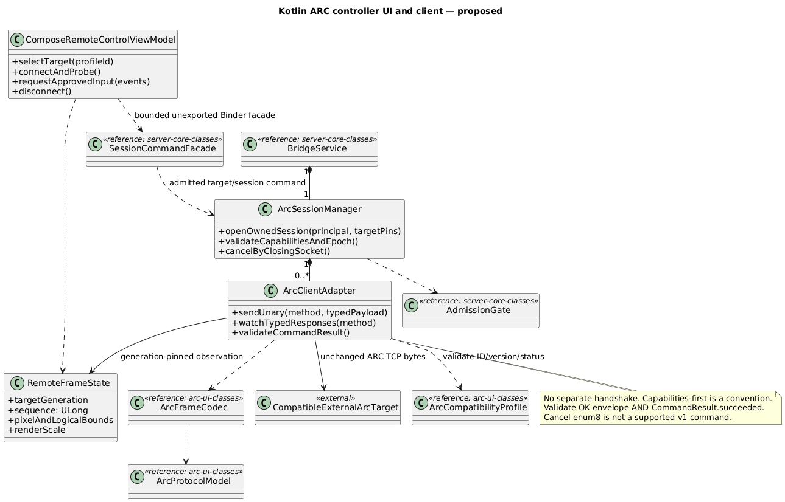
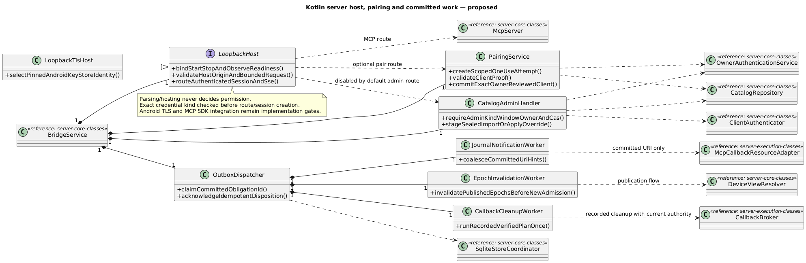

# C4 code-level detail, using UML class notation

Structurizr has no native class view. These editable inline PlantUML definitions are rendered locally and referenced by image views in workspace.dsl. They are proposed Kotlin classes/interfaces, not implemented Android code. Composition diamonds denote owned lifetime; dashed arrows denote dependency, and quoted labels denote multiplicity. Server blocks are app-scoped cross-component code views; the crosswalk below maps owning components/projects. Other blocks identify their scoped C4 components. Member lists show selected responsibilities, not every Kotlin member. A reference stub explicitly names its authoritative view; realizations inherit the full interface contract. Local epochs/generations are bridge metadata unless the pinned proto has the corresponding field.

## server-core-classes — bridge.app.transport and server ownership

```plantuml
@startuml
!pragma layout smetana
skinparam defaultFontName DejaVu Sans
skinparam classAttributeIconSize 0
skinparam shadowing false
skinparam backgroundColor white
title Kotlin server core — proposed ownership and contracts
left to right direction
class BridgeService {
  +startDesiredState()
  +stopWithinDeadline()
  +observeReadiness(): StateFlow
}
class McpServer {
  +handlePost(request): Response
  +openNotificationStream(session, lastEventId)
  +validateOrigin(request)
  +readResource(principal, uri, cursor, limits)
}
class DirectStreamNegotiator {
  +negotiate(clientCaps, serverCaps): AgreedProfile
  +requireOwnedSession(principal, session)
}
class DirectEventEmitter {
  +openOwnedCommittedCursor(request)
  +closeOnOverflowRevocationOrLease()
}
note bottom of DirectEventEmitter
Explicit android.bridge.directEvents.v1 negotiation only.
Authenticated loopback GET /v1/subscriptions/{id}/events SSE.
Application cursor differs from MCP SSE Last-Event-ID.
No negotiation means standard resource journal only.
end note
McpServer ..> DirectStreamNegotiator
DirectStreamNegotiator ..> DirectEventEmitter
class HealthSnapshot {
  +serviceState
  +desiredState
  +mcpListener
  +adbBackend
  +deviceView
  +catalogReadiness
  +arcListener
}
class ForegroundStatusNotifier {
  +renderSameSnapshot(health)
}
class BootCompletedReceiver {
  +recordWaitingForUnlock()
  +requestEligibleStart()
}
BridgeService ..> HealthSnapshot
BridgeService "1" *-- "1" ForegroundStatusNotifier
BootCompletedReceiver ..> BridgeService
class McpSessionRegistry {
  +resolveOwnedSession(principal, id)
  +invalidateEpoch(epoch)
}
interface ClientAuthenticator {
  +authenticate(credential, expectedKind): Principal
}
class AdmissionGate {
  +admit(plan, pins): Admission
  +recheck(admission): Decision
}
interface CatalogRepository {
  +streamEffectiveInventory(snapshot)
  +commitOverride(command, expectedRevision, ownerCapability)
  +activateSealedView(pins)
  +commitSessionView(session, desiredSet, expectedEtag)
  +observePublications(): Flow
}
class SqliteStoreCoordinator {
  +writeSerialized(transaction)
  +readBoundedSnapshot(query, pins)
}
class SqliteCatalogRepository
class DeviceViewResolver {
  +resolve(facts, inventory): StagedView
  +activateCAS(expectedView, stagedView)
  +onPublication(epoch)
}
class FunctionalGroupIndex {
  +discover(job, constraints, budget)
  +setActiveCAS(session, desiredSet, etag)
}
class AuditLogger {
  +recordAdmission(principal, pins)
  +recordBoundedOutcome(result, logPolicy)
  +queryRedactedSnapshot(ownerContext, filters, cursor, limits)
  +exportApprovedSnapshot(command, ownerCapability)
}
class OwnerCommandFacade {
  +submit(command, ownerCapability, etag)
  +observeImmutableStatus()
}
BridgeService "1" *-- "1" McpServer
BridgeService "1" *-- "1" DeviceViewResolver
BridgeService "1" *-- "1" SqliteCatalogRepository
McpServer "1" *-- "1" McpSessionRegistry
McpServer ..> ClientAuthenticator
McpServer ..> AdmissionGate
note bottom of AdmissionGate
Owner challenge pending: input admission closed, prior input drained.
ARC input/actions and every ADB/raw input path recheck the same gate.
Quiescence failure means no protected prompt.
end note
McpServer ..> FunctionalGroupIndex
class InvocationPlanner <<reference: server-execution-classes>>
class McpCallbackResourceAdapter <<reference: server-execution-classes>>
McpServer ..> InvocationPlanner : plan then dispatch admitted plan
McpServer ..> McpCallbackResourceAdapter : subscribe / bounded read / URI hint
class OwnerAuthenticationService {
  +issueChallenge(exactCommand, revisions, nonce)
  +consumeFreshBiometricResult(challenge): OwnerCapability
  +verifyAndConsume(capability, command, revisions)
  +quiesceRemoteInputWhilePending(challenge)
}
class RemoteInputQuiescer {
  +closeInputAdmissionAndDrain(deadline)
  +reopenAfterLastChallenge()
}
OwnerAuthenticationService "1" *-- "1" RemoteInputQuiescer
RemoteInputQuiescer ..> AdmissionGate : denies every bridge-controlled input path
class SessionCommandFacade {
  +submitSessionCommand(command, etag)
  +observeOwnedSessionStatus()
}
OwnerCommandFacade ..> OwnerAuthenticationService : verify and consume exact command capability
SqliteCatalogRepository ..> OwnerAuthenticationService : same serialized CAS boundary
SessionCommandFacade ..> AdmissionGate
note bottom of SessionCommandFacade
Service derives owned principal/session context.
No UI or JSON-supplied principal or owner assertion.
Protected transitions use OwnerCommandFacade.
end note
note bottom of OwnerAuthenticationService
Service-owned nonce, exact command/revisions and foreground Activity.
BiometricPrompt strong/device credential, max30s, single use.
UI object or JSON principal is never owner authorization.
end note
BridgeService "1" *-- "1" AdmissionGate
BridgeService "1" *-- "1" ClientAuthenticator
BridgeService "1" *-- "1" FunctionalGroupIndex
BridgeService "1" *-- "1" AuditLogger
BridgeService "1" *-- "1" OwnerCommandFacade
BridgeService "1" *-- "1" OwnerAuthenticationService
BridgeService "1" *-- "1" SessionCommandFacade
BridgeService "1" *-- "1" SqliteStoreCoordinator
BridgeService "1" *-- "1" DirectStreamNegotiator
BridgeService "1" *-- "1" DirectEventEmitter
SqliteCatalogRepository ..> SqliteStoreCoordinator
AuditLogger ..> SqliteStoreCoordinator
SessionCommandFacade ..> AuditLogger : bounded redacted local-owner query
OwnerCommandFacade ..> AuditLogger : protected exact-snapshot export
BridgeService "1" *-- "1" InvocationPlanner
BridgeService "1" *-- "1" McpCallbackResourceAdapter
AdmissionGate ..> ClientAuthenticator
ClientAuthenticator ..> CatalogRepository
ClientAuthenticator ..> AuditLogger
AdmissionGate ..> CatalogRepository
AdmissionGate ..> DeviceViewResolver
AdmissionGate ..> AuditLogger
SqliteCatalogRepository ..|> CatalogRepository
CatalogRepository ..> DeviceViewResolver : committed publication epoch flow
DeviceViewResolver ..> CatalogRepository
FunctionalGroupIndex ..> CatalogRepository
FunctionalGroupIndex ..> DeviceViewResolver
FunctionalGroupIndex ..> AdmissionGate
OwnerCommandFacade ..> AdmissionGate
OwnerCommandFacade ..> CatalogRepository
note bottom of OwnerCommandFacade
Unexported bounded local Binder facade.
UI reference is not owner authorization.
end note
@enduml
```

## arc-controller-classes — bridge.app.arcController and local Compose controller UI

## server-execution-classes — bridge.app.invoke and bridge.app.callbacks

```plantuml
@startuml
!pragma layout smetana
skinparam defaultFontName DejaVu Sans
skinparam classAttributeIconSize 0
skinparam shadowing false
skinparam backgroundColor white
title Kotlin invocation and callback contracts — proposed
class InvocationPlanner {
  +plan(bindingId, args, callbacks, pins)
  +dispatch(admission): BoundedResult
}
interface BackendAdapter {
  +invoke(verifiedPlan): Outcome
  +observeCapabilityEpoch()
}
class BinderBackend {
  +invoke(verifiedPlan): Outcome
  +observeCapabilityEpoch()
  +transact(verifiedWirePlan)
}
class AdbPhoneBackend {
  +invoke(verifiedPlan): Outcome
  +observeCapabilityEpoch()
  +screenState(scope)
  +tap(scope, coordinates)
}
class AdbConnectionManager {
  +connectVerifiedPairedProfile(profile): ConnectionOrReason
  +observeHealthAndEpoch()
  +closeBoundedCollectors()
}
class BinderHandleProvider {
  +acquireVerifiedAccessProfile(descriptor): BinderOrReason
}
class WireContractVerifier {
  +verifyPinnedSchemaAndBackendEvidence(plan): VerifiedWirePlanOrReason
}
AdbPhoneBackend "1" *-- "1" AdbConnectionManager
BinderBackend "1" *-- "1" BinderHandleProvider
BinderBackend "1" *-- "1" WireContractVerifier
note bottom of AdbConnectionManager
Owns paired ADB identity, encrypted key, endpoint/TLS verification,
pair/connect discovery and bounded reconnect/unsupported reasons.
No unauthenticated5555 or universal OEM access fallback.
end note
note bottom of WireContractVerifier
Trusted exact generated/imported codec proof plus current backend pins.
A caller JSON flag, source descriptor or API level is not wire proof.
Unsupported acquisition/codec remains explicit.
end note
class CodecRegistry {
  +selectExact(schemaHash, wireProof)
}
class SdkBindingBackend {
  +preflight(plan): SupportedOrReason
  +invoke(verifiedPlan): Outcome
  +observeCapabilityEpoch()
}
SdkBindingBackend ..|> BackendAdapter
class CallbackProxyFactory {
  +forInterface(descriptor)
  +forClass(descriptor): PrebuiltStubOrReason
  +forBinderEndpoint(descriptor): VerifiedStubOrReason
}
class CallbackBroker {
  +register(admission): SubscriptionHandle
  +receive(sender, method, payload)
  +onRegistrationResult(token, outcome, currentPins)
  +suppressUncertainEventAndRecordGap(token)
  +cancel(handle): CleanupOutcome
  +recoverOrphanedRegistrations()
  +onCalleeDied(token)
}
class Subscription {
  +id: String
  +streamEpoch: String
  +revision: Long
  +state: RegistrationState
  +uncertainPhase: RegistrationOrCleanup
  +cleanupDisposition: CleanupDisposition
  +registrationAndCleanupPins
}
class DirectEventEmitter <<reference: server-core-classes>>
DirectEventEmitter ..> EventJournal : committed events only; same quotas and read authority
interface EventJournal {
  +appendOrderedWithinQuota(event)
  +readOwnedPage(cursor, limits)
  +recordGapOrTerminal(reason)
}
class SqliteEventJournal
class LocalReplyPolicy {
  +validateTypedFallback(evidence)
  +replyWithinDeadline(input)
}
class McpCallbackResourceAdapter {
  +subscribeOwnedUri(session, uri)
  +notifyUriOnly(uri)
  +readBoundedPage(principal, uri, cursor, limits)
}
class ArcTargetBackend {
  +invoke(verifiedPlan): Outcome
  +observeCapabilityEpoch()
}
class ArcSessionManager <<reference: arc-controller-classes>>
ArcTargetBackend ..|> BackendAdapter
ArcTargetBackend ..> ArcSessionManager
InvocationPlanner ..> BackendAdapter
class AuditLogger <<reference: server-core-classes>>
InvocationPlanner ..> AuditLogger
InvocationPlanner ..> CodecRegistry
InvocationPlanner ..> CallbackBroker
BinderBackend ..|> BackendAdapter
AdbPhoneBackend ..|> BackendAdapter
BinderBackend ..> CodecRegistry
class BridgeService <<reference: server-core-classes>>
BridgeService "1" *-- "1" CallbackBroker
BridgeService "1" *-- "1" SqliteEventJournal
BridgeService "1" *-- "1" CodecRegistry
BridgeService "1" *-- "1" BinderBackend
BridgeService "1" *-- "1" AdbPhoneBackend
BridgeService "1" *-- "1" SdkBindingBackend
BridgeService "1" *-- "1" ArcTargetBackend
class SqliteStoreCoordinator <<reference: server-core-classes>>
SqliteEventJournal ..> SqliteStoreCoordinator
CallbackBroker "1" *-- "0..*" Subscription
CallbackBroker "1" *-- "1" CallbackProxyFactory
class AdmissionGate <<reference: server-core-classes>>
CallbackBroker ..> AdmissionGate : recheck event/reply/cleanup authority
CallbackBroker ..> EventJournal
CallbackBroker "1" *-- "1" LocalReplyPolicy
SqliteEventJournal ..|> EventJournal
McpCallbackResourceAdapter ..> CallbackBroker
McpCallbackResourceAdapter ..> EventJournal
note bottom of LocalReplyPolicy
No network or agent roundtrip for sync return.
Unknown valid deadline/default means unsupported.
end note
note bottom of Subscription
Durable handle/journal is not a durable OS registration.
Transport disconnect does not imply unregister.
end note
@enduml
```

## arc-ui-classes — bridge.app.arc, bridge.app.ui and ownerCommands

```plantuml
@startuml
!pragma layout smetana
skinparam defaultFontName DejaVu Sans
skinparam classAttributeIconSize 0
skinparam shadowing false
skinparam backgroundColor white
title Internal Kotlin ARC port and Compose boundary — proposed
class CompatibleArcClient <<external; C4 Compatible ARC client>>
class ArcTcpTransport {
  +acceptLoopbackConnection()
  +readOneRequestAndStreamResponses()
  +closeOnPeerDisconnectOrServerRevocation()
}
class ArcFrameCodec {
  +maxFrameBytes: Int = 8388608
  +readExactSignedBigEndianLength()
  +decodeBoundedFrame(): BridgeRequest
  +writeFrame(response)
}
class ArcProtocolModel {
  +protocolVersion = "1.0"
  +transport = "arc-protobuf-v1"
  +preserveUnknownProtobufFields()
  +serializeRequest(request): ByteArray
  +parseResponse(bytes): BridgeResponse
  +parseRequest(bytes): BridgeRequest
  +serializeResponse(response): ByteArray
}
class ArcCompatibilityProfile {
  +validateVersionAndMethod(request)
  +validateResponseIdVersionStatus()
}
class ArcRequestHandler {
  +handleUnary(request): BridgeResponse
  +handleWatch(request, connectionContext): ResponseFlow
}
class ArcSessionRegistry {
  +pinConnectionPrincipalAndEpoch()
  +revokeAndCloseStreams()
}
class ClientAuthenticator <<reference: server-core-classes>>
ArcAuthenticator ..> ClientAuthenticator : authenticate expectedKind=arc; shared client registry
class ArcBearerAuthenticator
ArcBearerAuthenticator ..|> ArcAuthenticator
class KeystoreClientAuthenticator
KeystoreClientAuthenticator ..|> ClientAuthenticator
interface ArcAuthenticator {
  +authenticateEnvelopeBearer(): Principal
}
class ArcAuthorizationGate {
  +admitTargetOperation(principal, pins)
}
class ArcRuntime {
  +getCapabilities(principal)
  +invokeGuardedOperation(plan)
  +watchBoundedEvents(plan, connectionContext)
}
interface TargetAdapter {
  +snapshot(rootGeneration)
  +watchFramesWithinQuota(connectionContext, rootPins)
  +invokeApprovedAction(verifiedPlan)
  +sendInput(principalContext, currentRoot, events)
}
class ComposeTargetAdapter <<reference: arc-target-classes>>
class UiDispatcher {
  +executeBoundedOnMainThread(action)
}
class ComposeManagementViewModel {
  +observeStatusAndDrafts()
  +submitOwnerCommand(expectedRevision)
}
class OwnerCommandFacade <<reference: server-core-classes>>
class AdmissionGate <<reference: server-core-classes>>
ArcAuthorizationGate ..> AdmissionGate : delegates admission / recheck; no parallel authority
CompatibleArcClient --> ArcTcpTransport : retained ARC wire
ArcTcpTransport "1" *-- "1" ArcSessionRegistry
class ArcConnectionSession {
  +principalAndCredentialEpoch
  +boundedResponseDeadline
  +closeOwnedStreams()
}
ArcSessionRegistry "1" *-- "0..*" ArcConnectionSession
ArcTcpTransport ..> ArcFrameCodec
ArcFrameCodec ..> ArcProtocolModel
ArcTcpTransport ..> ArcRequestHandler
ArcRequestHandler ..> ArcAuthenticator
ArcRequestHandler ..> ArcCompatibilityProfile
ArcRequestHandler ..> ArcAuthorizationGate
ArcRequestHandler ..> ArcRuntime
ArcRuntime ..> TargetAdapter
class BridgeService <<reference: server-core-classes>>
BridgeService "1" *-- "1" ArcTcpTransport
BridgeService "1" *-- "1" ArcRuntime
BridgeService "1" *-- "1" ComposeTargetAdapter
BridgeService "1" *-- "1" UiDispatcher
ArcTcpTransport "1" *-- "1" ArcFrameCodec
ArcTcpTransport "1" *-- "1" ArcRequestHandler
BridgeService "1" *-- "1" ArcCompatibilityProfile
ArcRequestHandler ..> ArcCompatibilityProfile
ArcRequestHandler "1" *-- "1" ArcAuthorizationGate
ArcRequestHandler "1" *-- "1" ArcAuthenticator
ComposeTargetAdapter ..|> TargetAdapter
ComposeTargetAdapter ..> UiDispatcher
ComposeManagementViewModel ..> OwnerCommandFacade : local only
note right of ArcTcpTransport
Authenticated plaintext loopback TCP, no fake TLS.
One request/socket. Received Cancel8 returns UNSUPPORTED then closes.
The controller cancels a watch by closing its own watch socket.
Zero-length frame is legal; negative/oversize is rejected before allocation.
Unknown methods (including0) return UNSUPPORTED; Cancel8 remains unsupported.
FPS field is parsed, not enforced upstream; local quotas are explicit port policy.
end note
note bottom of ComposeTargetAdapter
Selected ordinary root only.
Protected approval/grant screens excluded.
Generic phone input uses separate AdbPhoneBackend.
end note
note bottom of OwnerCommandFacade
ARC principal cannot mint local owner approval.
The ViewModel is not the external ARC client.
end note
@enduml
```

## arc-target-classes — bridge.app.arc target/runtime adapter detail

```plantuml
@startuml
!pragma layout smetana
skinparam defaultFontName DejaVu Sans
skinparam classAttributeIconSize 0
skinparam shadowing false
skinparam backgroundColor white
title Kotlin ARC target adapter and UI execution — proposed
interface TargetAdapter <<reference: arc-ui-classes>>
class ComposeTargetAdapter {
  +snapshot(rootGeneration)
  +watchFramesWithinQuota(connectionContext, rootPins)
  +invokeApprovedAction(verifiedPlan)
  +sendInput(principalContext, currentRoot, events)
  +observeRootGeneration()
  +excludeProtectedSelectedRoot()
}
class TargetNodeRegistry {
  +resolveNode(id, generation)
  +invalidateOnRootReplacement()
}
class ArcFrameCapture {
  +captureBoundedPng(root): FrameUpdate
  +rejectInvalidOrProtectedRoot(rootGeneration)
}
class ArcFrameStreamService {
  +streamWithinLocalRateAndByteQuota()
  +tryTerminalWithinWriteDeadlineElseCloseSocket()
}
class ArcInputDispatcher {
  +mapRootDipAndAvaloniaKeyNames(events)
  +dispatchOrderedApprovedBatch()
  +releasePressedStateOnLeaseEnd()
}
class ArcPropertyMutationService {
  +applyAllowlistedTypedProperty()
}
class ArcLogStreamService {
  +filterRedactAndReportDroppedCount()
}
class UiDispatcher <<reference: arc-ui-classes>>
class ArcAuthorizationGate <<reference: arc-ui-classes>>
class ArcConnectionSession <<reference: arc-ui-classes>>
class ArcInputLeaseRegistry {
  +acquireExclusive(principal, rootEpoch)
  +releaseOnIdleRevokeRootChangeOrOwnerChallenge()
}
class BridgeService <<reference: server-core-classes>>
BridgeService "1" *-- "1" ArcInputLeaseRegistry
ArcInputLeaseRegistry "1" *-- "0..1" ArcInputDispatcher
ArcConnectionSession "1" *-- "0..1" ArcFrameStreamService
ArcConnectionSession "1" *-- "0..1" ArcLogStreamService
note bottom of ArcConnectionSession
Per-connection frame/log streams close with socket.
Input lease spans unary sockets; no wire lease ID or frame generation.
UiDispatcher and selected-root adapter are service singletons.
end note
ComposeTargetAdapter ..|> TargetAdapter
ComposeTargetAdapter "1" *-- "1" TargetNodeRegistry
ComposeTargetAdapter "1" *-- "1" ArcFrameCapture
ComposeTargetAdapter ..> ArcInputLeaseRegistry : principal plus current root; serialized cross-request input
ComposeTargetAdapter "1" *-- "1" ArcPropertyMutationService
ArcFrameStreamService ..> ArcFrameCapture
ArcFrameCapture ..> UiDispatcher
ArcInputDispatcher ..> UiDispatcher
ArcPropertyMutationService ..> UiDispatcher
ComposeTargetAdapter ..> ArcFrameStreamService : opens admitted per-connection stream
class ArcRuntime <<reference: arc-ui-classes>>
ArcRuntime ..> ArcLogStreamService : opens admitted filtered stream
ArcPropertyMutationService ..> ArcAuthorizationGate
ArcInputDispatcher ..> ArcAuthorizationGate
ArcFrameStreamService ..> ArcAuthorizationGate
ArcLogStreamService ..> ArcAuthorizationGate
note bottom of ArcInputDispatcher
Mouse/wheel/key/text only; no wire pointer ID or multitouch.
Key strings are not Android keycodes.
Target generation, policy epoch and protected-root gate rechecked.
end note
@enduml
```

## Code view mapping and editing

| Class family | Authoritative C4 component | Gradle project |
| --- | --- | --- |
| BridgeService, BootCompletedReceiver, ForegroundStatusNotifier, HealthSnapshot | lifecycle | bridge.android |
| McpServer, McpSessionRegistry, DirectStreamNegotiator, DirectEventEmitter | transport | bridge.protocol |
| ClientAuthenticator, KeystoreClientAuthenticator | auth | bridge.application |
| AdmissionGate, OwnerAuthenticationService, RemoteInputQuiescer | policy | bridge.application |
| CatalogRepository, SqliteCatalogRepository, SqliteStoreCoordinator | catalog/storage | bridge.storage.sqlite |
| DeviceViewResolver | device | bridge.bindings |
| FunctionalGroupIndex | groups | bridge.application |
| InvocationPlanner, BackendAdapter, CodecRegistry, BinderBackend, SdkBindingBackend, ArcTargetBackend | invoke | bridge.bindings |
| AdbPhoneBackend, AdbConnectionManager | adb | bridge.android |
| CallbackBroker, CallbackProxyFactory, Subscription, LocalReplyPolicy, EventJournal, SqliteEventJournal, McpCallbackResourceAdapter | callbacks | bridge.application |
| AuditLogger | audit | bridge.storage.sqlite |
| OwnerCommandFacade, SessionCommandFacade | ownerCommands/sessionCommands | bridge.application |
| ArcSessionManager, ArcClientAdapter, RemoteFrameState | arcController | bridge.android |
| ArcTcpTransport, ArcFrameCodec, ArcProtocolModel, ArcCompatibilityProfile, ArcRequestHandler, ArcSessionRegistry, ArcConnectionSession, ArcAuthenticator, ArcBearerAuthenticator, ArcAuthorizationGate, ArcRuntime | arc | bridge.android |
| ComposeTargetAdapter, TargetAdapter, TargetNodeRegistry, ArcFrameCapture, ArcFrameStreamService, ArcInputDispatcher, ArcInputLeaseRegistry, ArcPropertyMutationService, ArcLogStreamService, UiDispatcher | arc target adapter | bridge.android / bridge.ui |
| ComposeManagementViewModel, ComposeRemoteControlViewModel | ui | bridge.ui |

SVG textLength attributes are renderer output; edit DSL/PlantUML sources and regenerate,
or remove those attributes before manual SVG text editing. No SVG is runtime app code.

## server-adapters-classes — bridge.app transport and committed-work adapters

Host/pair/admin adapters map to transport/auth/catalog in bridge.protocol,
bridge.application and bridge.android; committed workers map to callbacks/device
application services in bridge.application, with persistence in bridge.storage.sqlite.
The platform adapters never implement an alternate authorization system.
