# Kotlin Compose screen definitions and actor-aware storyboards

Canonical editable SVG source is ui-svg; Gradle copies identical bytes to docs/screens. Action targets are at least 48dp. Screen state/control contracts below are design specifications, not implemented Android UI.

## SCR01 — Dashboard

FR-KT-01 / FR-KT-03

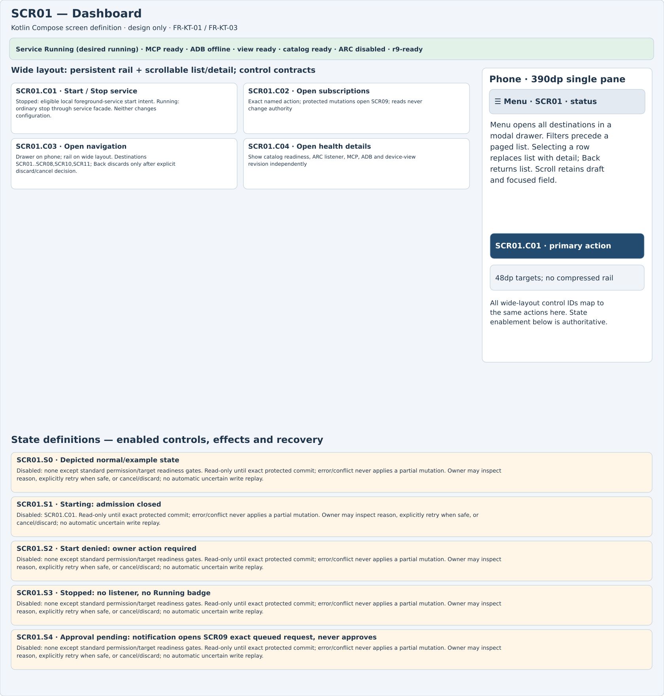

- `SCR01.C01` **Start / Stop service**: Stopped: eligible local foreground-service start intent. Running: ordinary stop through service facade. Neither changes configuration.
- `SCR01.C02` **Open subscriptions**: Exact named action; protected mutations open SCR09; reads never change authority
- `SCR01.C03` **Open navigation**: Drawer on phone; rail on wide layout. Destinations SCR01..SCR08,SCR10,SCR11; Back discards only after explicit discard/cancel decision.
- `SCR01.C04` **Open health details**: Show catalog readiness, ARC listener, MCP, ADB and device-view revision independently

Phone: Top AppBar menu opens modal drawer with all screen destinations; Back returns previous screen. SCR09 disables drawer and intercepts navigation until cancel/complete. Single-column scroll, 48dp actions, filters above results; detail/preview replaces list pane with Back; no compressed rail.

- `SCR01.S0`: Depicted normal/example state Disabled: standard admission/readiness gating only. Owner may inspect reason, explicitly retry when safe, or cancel/discard; no automatic uncertain write replay.
- `SCR01.S1`: Starting: admission closed Disabled: SCR01.C01. Owner may inspect reason, explicitly retry when safe, or cancel/discard; no automatic uncertain write replay.
- `SCR01.S2`: Start denied: owner action required Disabled: standard admission/readiness gating only. Owner may inspect reason, explicitly retry when safe, or cancel/discard; no automatic uncertain write replay.
- `SCR01.S3`: Stopped: no listener, no Running badge Disabled: standard admission/readiness gating only. Owner may inspect reason, explicitly retry when safe, or cancel/discard; no automatic uncertain write replay.
- `SCR01.S4`: Approval pending: notification opens SCR09 exact queued request, never approves Disabled: standard admission/readiness gating only. Owner may inspect reason, explicitly retry when safe, or cancel/discard; no automatic uncertain write replay.

## SCR02 — Clients and permissions

FR-KT-02 / canonical client grants

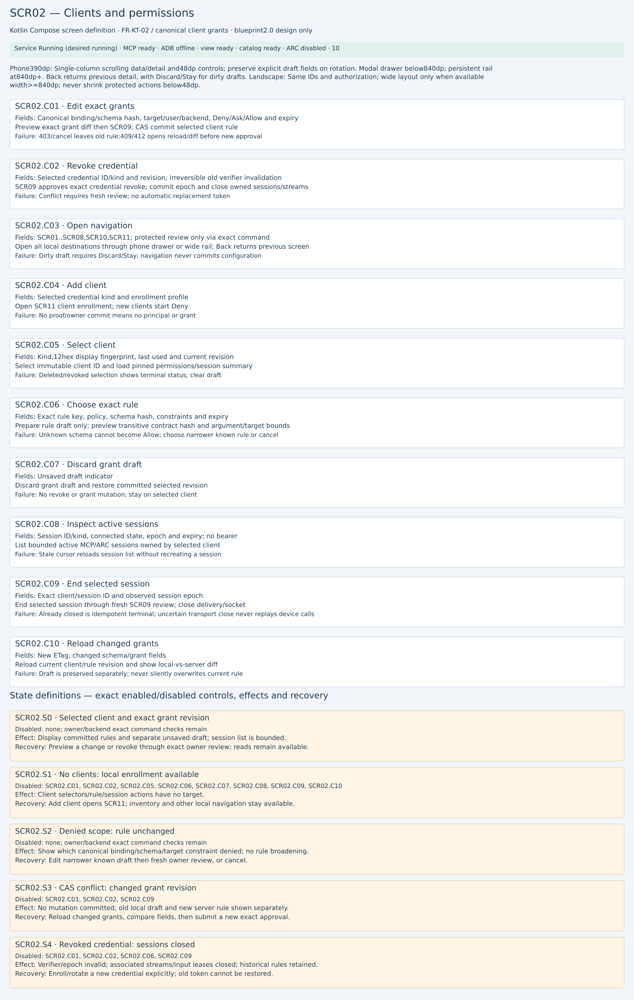

- `SCR02.C01` **Edit exact grants**: Exact named action; protected mutations open SCR09; reads never change authority
- `SCR02.C02` **Revoke credential**: Exact named action; protected mutations open SCR09; reads never change authority
- `SCR02.C03` **Open navigation**: Drawer on phone; rail on wide layout. Destinations SCR01..SCR08,SCR10,SCR11; Back discards only after explicit discard/cancel decision.
- `SCR02.C04` **Add client**: Open SCR11; also enabled in the no-client state
- `SCR02.C05` **Select client**: Stable client ID, credential kind and 12-hex display fingerprint
- `SCR02.C06` **Choose exact rule**: Deny / Ask / Allow; canonical binding/schema and target/user scope; draft only
- `SCR02.C07` **Discard grant draft**: Delete unsaved draft; no grant change

Phone: Top AppBar menu opens modal drawer with all screen destinations; Back returns previous screen. SCR09 disables drawer and intercepts navigation until cancel/complete. Single-column scroll, 48dp actions, filters above results; detail/preview replaces list pane with Back; no compressed rail.

- `SCR02.S0`: Depicted normal/example state Disabled: standard admission/readiness gating only. Owner may inspect reason, explicitly retry when safe, or cancel/discard; no automatic uncertain write replay.
- `SCR02.S1`: No clients: pair locally Disabled: SCR02.C01, SCR02.C02, SCR02.C05, SCR02.C06. Owner may inspect reason, explicitly retry when safe, or cancel/discard; no automatic uncertain write replay.
- `SCR02.S2`: Denied: explain exact scope Disabled: standard admission/readiness gating only. Owner may inspect reason, explicitly retry when safe, or cancel/discard; no automatic uncertain write replay.
- `SCR02.S3`: Conflict: reload changed revision Disabled: SCR02.C01, SCR02.C02. Owner may inspect reason, explicitly retry when safe, or cancel/discard; no automatic uncertain write replay.

## SCR03 — Full binding catalog

All bindings / FR-DEV-01

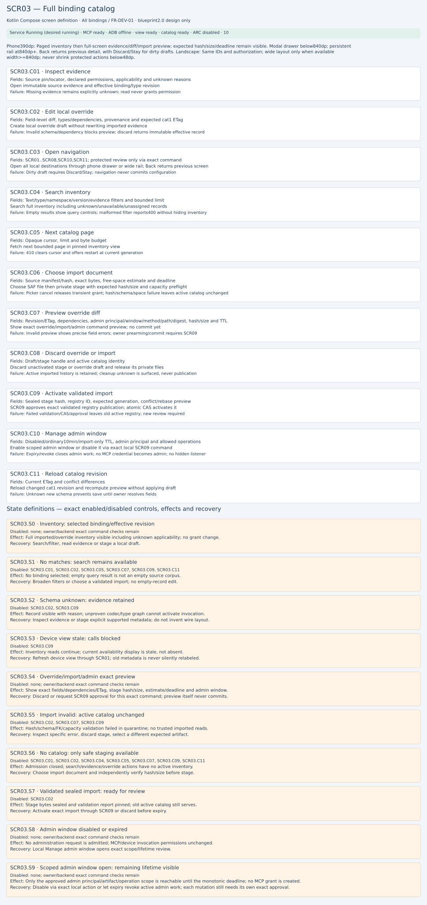

- `SCR03.C01` **Inspect evidence**: Exact named action; protected mutations open SCR09; reads never change authority
- `SCR03.C02` **Edit local override**: Exact named action; protected mutations open SCR09; reads never change authority
- `SCR03.C03` **Open navigation**: Drawer on phone; rail on wide layout. Destinations SCR01..SCR08,SCR10,SCR11; Back discards only after explicit discard/cancel decision.
- `SCR03.C04` **Search inventory**: Text/type/namespace/version/evidence filters; unknown and unavailable included
- `SCR03.C05` **Next catalog page**: Opaque snapshot cursor and configured byte/page bounds
- `SCR03.C06` **Choose import document**: Android SAF document; stage and validate before a protected activation review
- `SCR03.C07` **Preview override diff**: Exact field/schema/type dependency diff, revisions and CAS conflicts
- `SCR03.C08` **Discard override or import**: Delete unactivated staging/draft; immutable import remains history

Phone: Top AppBar menu opens modal drawer with all screen destinations; Back returns previous screen. SCR09 disables drawer and intercepts navigation until cancel/complete. Single-column scroll, 48dp actions, filters above results; detail/preview replaces list pane with Back; no compressed rail.

- `SCR03.S0`: Depicted normal/example state Disabled: standard admission/readiness gating only. Owner may inspect reason, explicitly retry when safe, or cancel/discard; no automatic uncertain write replay.
- `SCR03.S1`: No matches: broaden query Disabled: SCR03.C01, SCR03.C02, SCR03.C05, SCR03.C07. Owner may inspect reason, explicitly retry when safe, or cancel/discard; no automatic uncertain write replay.
- `SCR03.S2`: Schema unknown: reason visible Disabled: SCR03.C02, SCR03.C07. Owner may inspect reason, explicitly retry when safe, or cancel/discard; no automatic uncertain write replay.
- `SCR03.S3`: Stale device view: refresh required Disabled: SCR03.C02, SCR03.C07. Owner may inspect reason, explicitly retry when safe, or cancel/discard; no automatic uncertain write replay.
- `SCR03.S4`: Override/import preview: dependencies, exact diff, hash and CAS shown; not active Disabled: standard admission/readiness gating only. Owner may inspect reason, explicitly retry when safe, or cancel/discard; no automatic uncertain write replay.

## SCR04 — Groups for a job

FR-GRP-01 / 02 / 03

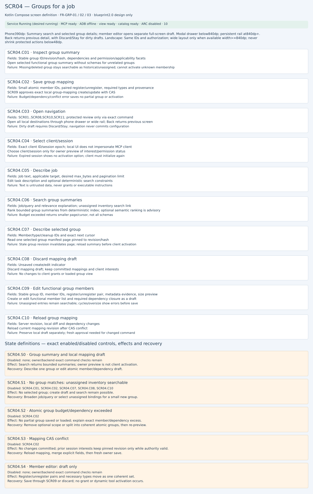

- `SCR04.C01` **Inspect group summary**: Exact named action; protected mutations open SCR09; reads never change authority
- `SCR04.C02` **Save group mapping**: Protected owner group-mapping override, preview exact revision then SCR09; this is not client-session set_active.
- `SCR04.C03` **Open navigation**: Drawer on phone; rail on wide layout. Destinations SCR01..SCR08,SCR10,SCR11; Back discards only after explicit discard/cancel decision.
- `SCR04.C04` **Select client/session**: Owner preview only; cannot impersonate an MCP client
- `SCR04.C05` **Describe job**: Task text plus optional constraints; summaries within max_bytes
- `SCR04.C06` **Search group summaries**: Deterministic labels/index by default; optional semantic ranking never grants
- `SCR04.C07` **Describe selected group**: Pinned revision/hash, cursor, max_bytes; fetch only requested manifest page
- `SCR04.C08` **Discard mapping draft**: No mapping or session activation change

Phone: Top AppBar menu opens modal drawer with all screen destinations; Back returns previous screen. SCR09 disables drawer and intercepts navigation until cancel/complete. Single-column scroll, 48dp actions, filters above results; detail/preview replaces list pane with Back; no compressed rail.

- `SCR04.S0`: Depicted normal/example state Disabled: standard admission/readiness gating only. Owner may inspect reason, explicitly retry when safe, or cancel/discard; no automatic uncertain write replay.
- `SCR04.S1`: Empty: unassigned entries searchable Disabled: standard admission/readiness gating only. Owner may inspect reason, explicitly retry when safe, or cancel/discard; no automatic uncertain write replay.
- `SCR04.S2`: Budget preview exceeded: save no partial group Disabled: SCR04.C02. Owner may inspect reason, explicitly retry when safe, or cancel/discard; no automatic uncertain write replay.
- `SCR04.S3`: Conflict: reload mapping revision Disabled: SCR04.C02. Owner may inspect reason, explicitly retry when safe, or cancel/discard; no automatic uncertain write replay.

## SCR05 — Callback subscriptions

FR-CB-01 / 02 / 03 / 04

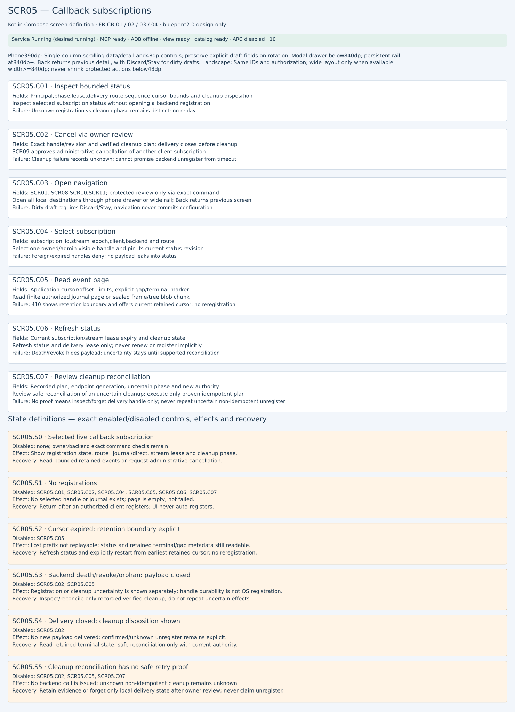

- `SCR05.C01` **Inspect bounded status**: Exact named action; protected mutations open SCR09; reads never change authority
- `SCR05.C02` **Cancel via owner review**: Request protected administrative cancellation in SCR09; mark delivery closed immediately after admitted commit; status/event terminal remains readable.
- `SCR05.C03` **Open navigation**: Drawer on phone; rail on wide layout. Destinations SCR01..SCR08,SCR10,SCR11; Back discards only after explicit discard/cancel decision.
- `SCR05.C04` **Select subscription**: Owner-filtered principal, stream epoch, state, cleanup phase and disposition
- `SCR05.C05` **Read event page**: Bounded owned journal cursor; gap/terminal status separate from payload
- `SCR05.C06` **Refresh status**: Status after owner cancellation, lease expiry, death or cleanup uncertainty

Phone: Top AppBar menu opens modal drawer with all screen destinations; Back returns previous screen. SCR09 disables drawer and intercepts navigation until cancel/complete. Single-column scroll, 48dp actions, filters above results; detail/preview replaces list pane with Back; no compressed rail.

- `SCR05.S0`: Depicted normal/example state Disabled: standard admission/readiness gating only. Owner may inspect reason, explicitly retry when safe, or cancel/discard; no automatic uncertain write replay.
- `SCR05.S1`: Empty: no registrations Disabled: SCR05.C01, SCR05.C02, SCR05.C04, SCR05.C05. Owner may inspect reason, explicitly retry when safe, or cancel/discard; no automatic uncertain write replay.
- `SCR05.S2`: Cursor expired: show retention boundary Disabled: standard admission/readiness gating only. Owner may inspect reason, explicitly retry when safe, or cancel/discard; no automatic uncertain write replay.
- `SCR05.S3`: Backend death/orphan/revoke: payload hidden; cleanup may be unknown Disabled: SCR05.C05. Owner may inspect reason, explicitly retry when safe, or cancel/discard; no automatic uncertain write replay.
- `SCR05.S4`: Closed delivery: show confirmed or unknown cleanup Disabled: SCR05.C02. Owner may inspect reason, explicitly retry when safe, or cancel/discard; no automatic uncertain write replay.

## SCR06 — Call logs

Per-client logging / FR-KT-02

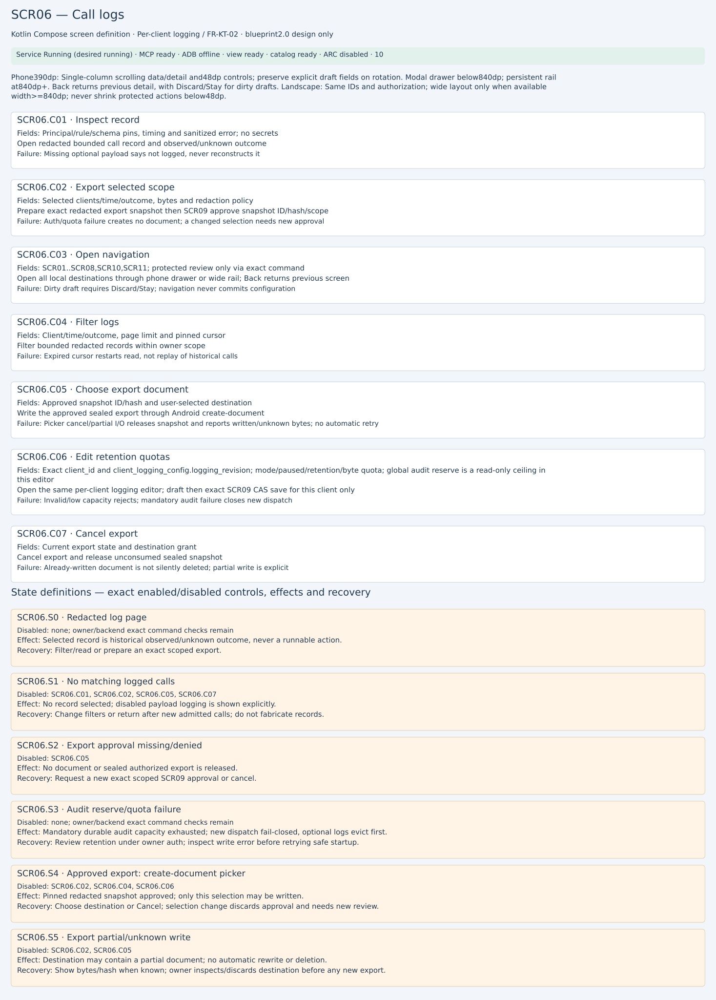

- `SCR06.C01` **Inspect record**: Exact named action; protected mutations open SCR09; reads never change authority
- `SCR06.C02` **Export selected scope**: Exact named action; protected mutations open SCR09; reads never change authority
- `SCR06.C03` **Open navigation**: Drawer on phone; rail on wide layout. Destinations SCR01..SCR08,SCR10,SCR11; Back discards only after explicit discard/cancel decision.
- `SCR06.C04` **Filter logs**: Owner selects client/time/outcome; redacted bounded snapshot
- `SCR06.C05` **Choose export document**: Android SAF create-document after protected exact-snapshot approval
- `SCR06.C06` **Edit retention quotas**: Protected settings review; mandatory audit reserve and optional-log quotas separate
- `SCR06.C07` **Cancel export**: No document written; release sealed export snapshot

Phone: Top AppBar menu opens modal drawer with all screen destinations; Back returns previous screen. SCR09 disables drawer and intercepts navigation until cancel/complete. Single-column scroll, 48dp actions, filters above results; detail/preview replaces list pane with Back; no compressed rail.

- `SCR06.S0`: Depicted normal/example state Disabled: standard admission/readiness gating only. Owner may inspect reason, explicitly retry when safe, or cancel/discard; no automatic uncertain write replay.
- `SCR06.S1`: Empty: no admitted calls Disabled: SCR06.C02, SCR06.C05. Owner may inspect reason, explicitly retry when safe, or cancel/discard; no automatic uncertain write replay.
- `SCR06.S2`: Denied: export needs owner auth Disabled: standard admission/readiness gating only. Owner may inspect reason, explicitly retry when safe, or cancel/discard; no automatic uncertain write replay.
- `SCR06.S3`: Disk quota: visible retention error Disabled: SCR06.C02, SCR06.C05. Owner may inspect reason, explicitly retry when safe, or cancel/discard; no automatic uncertain write replay.
- `SCR06.S4`: Export approved: Android create-document picker; cancel writes nothing Disabled: standard admission/readiness gating only. Owner may inspect reason, explicitly retry when safe, or cancel/discard; no automatic uncertain write replay.

## SCR07 — ARC session and control

FR-ARC-01 / 02 / 03 / 04

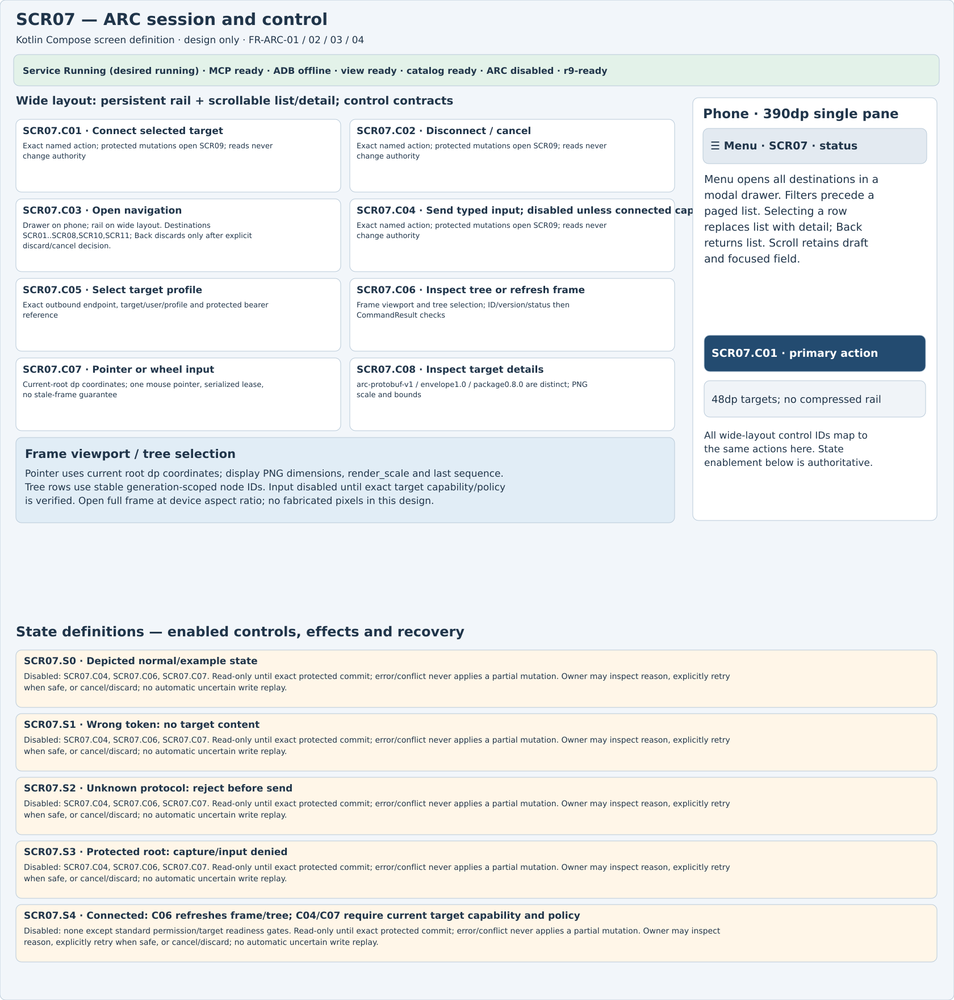

- `SCR07.C01` **Connect selected target**: Exact named action; protected mutations open SCR09; reads never change authority
- `SCR07.C02` **Disconnect / cancel**: Exact named action; protected mutations open SCR09; reads never change authority
- `SCR07.C03` **Open navigation**: Drawer on phone; rail on wide layout. Destinations SCR01..SCR08,SCR10,SCR11; Back discards only after explicit discard/cancel decision.
- `SCR07.C04` **Send typed input; disabled unless connected capability/policy permits**: Exact named action; protected mutations open SCR09; reads never change authority
- `SCR07.C05` **Select target profile**: Exact outbound endpoint, target/user/profile and protected bearer reference
- `SCR07.C06` **Inspect tree or refresh frame**: Frame viewport and tree selection; ID/version/status then CommandResult checks
- `SCR07.C07` **Pointer or wheel input**: Current-root dp coordinates; one mouse pointer, serialized lease, no stale-frame guarantee
- `SCR07.C08` **Inspect target details**: arc-protobuf-v1 / envelope1.0 / package0.8.0 are distinct; PNG scale and bounds

Phone: Top AppBar menu opens modal drawer with all screen destinations; Back returns previous screen. SCR09 disables drawer and intercepts navigation until cancel/complete. Single-column scroll, 48dp actions, filters above results; detail/preview replaces list pane with Back; no compressed rail.

- `SCR07.S0`: Depicted normal/example state Disabled: SCR07.C04, SCR07.C06, SCR07.C07. Owner may inspect reason, explicitly retry when safe, or cancel/discard; no automatic uncertain write replay.
- `SCR07.S1`: Wrong token: no target content Disabled: SCR07.C04, SCR07.C06, SCR07.C07. Owner may inspect reason, explicitly retry when safe, or cancel/discard; no automatic uncertain write replay.
- `SCR07.S2`: Unknown protocol: reject before send Disabled: SCR07.C04, SCR07.C06, SCR07.C07. Owner may inspect reason, explicitly retry when safe, or cancel/discard; no automatic uncertain write replay.
- `SCR07.S3`: Protected root: capture/input denied Disabled: SCR07.C04, SCR07.C06, SCR07.C07. Owner may inspect reason, explicitly retry when safe, or cancel/discard; no automatic uncertain write replay.
- `SCR07.S4`: Connected: C06 refreshes frame/tree; C04/C07 require current target capability and policy Disabled: standard admission/readiness gating only. Owner may inspect reason, explicitly retry when safe, or cancel/discard; no automatic uncertain write replay.

## SCR08 — Settings and backends

FR-KT-03 / persistent service / ADB

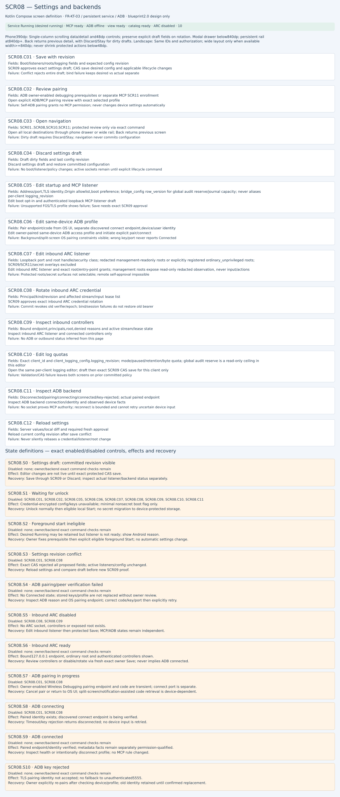

- `SCR08.C01` **Save with revision**: Exact named action; protected mutations open SCR09; reads never change authority
- `SCR08.C02` **Review pairing**: Exact named action; protected mutations open SCR09; reads never change authority
- `SCR08.C03` **Open navigation**: Drawer on phone; rail on wide layout. Destinations SCR01..SCR08,SCR10,SCR11; Back discards only after explicit discard/cancel decision.
- `SCR08.C04` **Discard settings draft**: Return to last committed revision without changing boot/listeners/grants
- `SCR08.C05` **Edit startup and MCP listener**: Boot opt-in, loopback address/port, exact Origin allowlist, TLS profile; all save protected
- `SCR08.C06` **Edit same-device ADB profile**: Device/user, pairing host/port/code and discovered connect port; no debugging toggle
- `SCR08.C07` **Edit inbound ARC listener**: Enabled, loopback bind/port, selected ordinary root, per-client action grants
- `SCR08.C08` **Rotate inbound ARC credential**: Fresh SCR09 review; invalidate credential epoch and active streams/leases
- `SCR08.C09` **Inspect inbound controllers**: Bound/listener state, authenticated principals, sessions, root and denied reasons
- `SCR08.C10` **Edit log quotas**: Optional payload retention, mandatory audit reserve and journal quotas; protected save

Phone: Top AppBar menu opens modal drawer with all screen destinations; Back returns previous screen. SCR09 disables drawer and intercepts navigation until cancel/complete. Single-column scroll, 48dp actions, filters above results; detail/preview replaces list pane with Back; no compressed rail.

- `SCR08.S0`: Depicted normal/example state Disabled: standard admission/readiness gating only. Owner may inspect reason, explicitly retry when safe, or cancel/discard; no automatic uncertain write replay.
- `SCR08.S1`: Locked: wait for unlock Disabled: SCR08.C01, SCR08.C02, SCR08.C08. Owner may inspect reason, explicitly retry when safe, or cancel/discard; no automatic uncertain write replay.
- `SCR08.S2`: Ineligible start: requires owner action Disabled: standard admission/readiness gating only. Owner may inspect reason, explicitly retry when safe, or cancel/discard; no automatic uncertain write replay.
- `SCR08.S3`: Stale settings revision: reject save Disabled: SCR08.C01, SCR08.C02, SCR08.C08. Owner may inspect reason, explicitly retry when safe, or cancel/discard; no automatic uncertain write replay.
- `SCR08.S4`: Pairing failed/peer unverified: no Connected state and no new MCP grant Disabled: standard admission/readiness gating only. Owner may inspect reason, explicitly retry when safe, or cancel/discard; no automatic uncertain write replay.
- `SCR08.S5`: Inbound ARC disabled: no socket, sessions or exposed root Disabled: standard admission/readiness gating only. Owner may inspect reason, explicitly retry when safe, or cancel/discard; no automatic uncertain write replay.
- `SCR08.S6`: Inbound ARC ready: bound127.0.0.1:port, approved ordinary root and controller list Disabled: standard admission/readiness gating only. Owner may inspect reason, explicitly retry when safe, or cancel/discard; no automatic uncertain write replay.

## SCR09 — Protected owner approval

FR-ARC-04 / canonical Ask approval

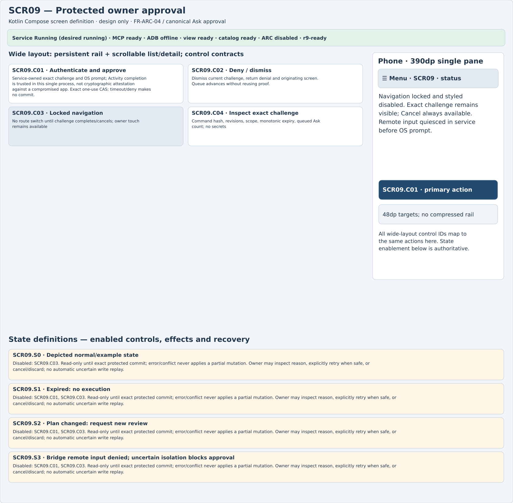

- `SCR09.C01` **Authenticate and approve**: Service-owned exact challenge and OS prompt; Activity completion is trusted in this single process, not cryptographic attestation against a compromised app. Exact one-use CAS; timeout/deny makes no commit.
- `SCR09.C02` **Deny / dismiss**: Dismiss current challenge, return denial and originating screen. Queue advances without reusing proof.
- `SCR09.C03` **Locked navigation**: No route switch until challenge completes/cancels; owner touch remains available
- `SCR09.C04` **Inspect exact challenge**: Command hash, revisions, scope, monotonic expiry, queued Ask count; no secrets

Phone: Top AppBar menu opens modal drawer with all screen destinations; Back returns previous screen. SCR09 disables drawer and intercepts navigation until cancel/complete. Single-column scroll, 48dp actions, filters above results; detail/preview replaces list pane with Back; no compressed rail.

- `SCR09.S0`: Depicted normal/example state Disabled: SCR09.C03. Owner may inspect reason, explicitly retry when safe, or cancel/discard; no automatic uncertain write replay.
- `SCR09.S1`: Expired: no execution Disabled: SCR09.C01, SCR09.C03. Owner may inspect reason, explicitly retry when safe, or cancel/discard; no automatic uncertain write replay.
- `SCR09.S2`: Plan changed: request new review Disabled: SCR09.C01, SCR09.C03. Owner may inspect reason, explicitly retry when safe, or cancel/discard; no automatic uncertain write replay.
- `SCR09.S3`: Bridge remote input denied; uncertain isolation blocks approval Disabled: SCR09.C01, SCR09.C03. Owner may inspect reason, explicitly retry when safe, or cancel/discard; no automatic uncertain write replay.

## SCR10 — Action required

FR-KT-03 / no fabricated readiness

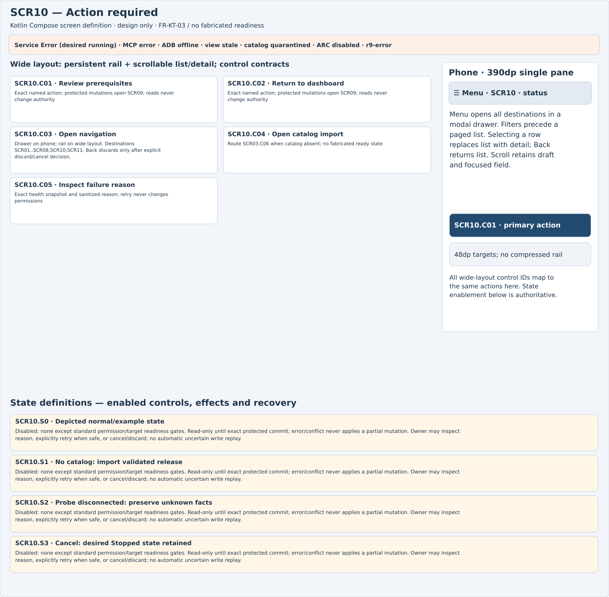

- `SCR10.C01` **Review prerequisites**: Exact named action; protected mutations open SCR09; reads never change authority
- `SCR10.C02` **Return to dashboard**: Exact named action; protected mutations open SCR09; reads never change authority
- `SCR10.C03` **Open navigation**: Drawer on phone; rail on wide layout. Destinations SCR01..SCR08,SCR10,SCR11; Back discards only after explicit discard/cancel decision.
- `SCR10.C04` **Open catalog import**: Route SCR03.C06 when catalog absent; no fabricated ready state
- `SCR10.C05` **Inspect failure reason**: Exact health snapshot and sanitized reason; retry never changes permissions

Phone: Top AppBar menu opens modal drawer with all screen destinations; Back returns previous screen. SCR09 disables drawer and intercepts navigation until cancel/complete. Single-column scroll, 48dp actions, filters above results; detail/preview replaces list pane with Back; no compressed rail.

- `SCR10.S0`: Depicted normal/example state Disabled: standard admission/readiness gating only. Owner may inspect reason, explicitly retry when safe, or cancel/discard; no automatic uncertain write replay.
- `SCR10.S1`: No catalog: import validated release Disabled: standard admission/readiness gating only. Owner may inspect reason, explicitly retry when safe, or cancel/discard; no automatic uncertain write replay.
- `SCR10.S2`: Probe disconnected: preserve unknown facts Disabled: standard admission/readiness gating only. Owner may inspect reason, explicitly retry when safe, or cancel/discard; no automatic uncertain write replay.
- `SCR10.S3`: Cancel: desired Stopped state retained Disabled: standard admission/readiness gating only. Owner may inspect reason, explicitly retry when safe, or cancel/discard; no automatic uncertain write replay.

## SCR11 — Client pairing

FR-KT-02 / canonical client identity

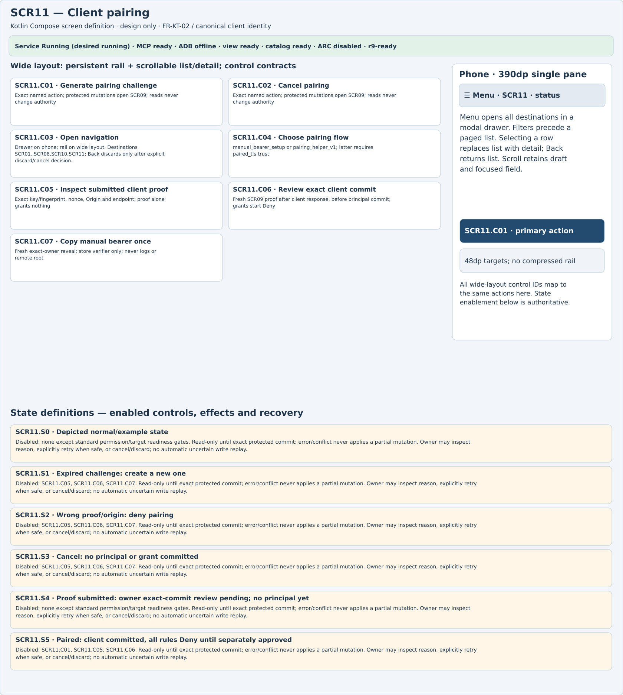

- `SCR11.C01` **Generate pairing challenge**: Exact named action; protected mutations open SCR09; reads never change authority
- `SCR11.C02` **Cancel pairing**: Exact named action; protected mutations open SCR09; reads never change authority
- `SCR11.C03` **Open navigation**: Drawer on phone; rail on wide layout. Destinations SCR01..SCR08,SCR10,SCR11; Back discards only after explicit discard/cancel decision.
- `SCR11.C04` **Choose pairing flow**: manual_bearer_setup or pairing_helper_v1; latter requires paired_tls trust
- `SCR11.C05` **Inspect submitted client proof**: Exact key/fingerprint, nonce, Origin and endpoint; proof alone grants nothing
- `SCR11.C06` **Review exact client commit**: Fresh SCR09 proof after client response, before principal commit; grants start Deny
- `SCR11.C07` **Copy manual bearer once**: Fresh exact-owner reveal; store verifier only; never logs or remote root

Phone: Top AppBar menu opens modal drawer with all screen destinations; Back returns previous screen. SCR09 disables drawer and intercepts navigation until cancel/complete. Single-column scroll, 48dp actions, filters above results; detail/preview replaces list pane with Back; no compressed rail.

- `SCR11.S0`: Depicted normal/example state Disabled: standard admission/readiness gating only. Owner may inspect reason, explicitly retry when safe, or cancel/discard; no automatic uncertain write replay.
- `SCR11.S1`: Expired challenge: create a new one Disabled: SCR11.C05, SCR11.C06, SCR11.C07. Owner may inspect reason, explicitly retry when safe, or cancel/discard; no automatic uncertain write replay.
- `SCR11.S2`: Wrong proof/origin: deny pairing Disabled: SCR11.C05, SCR11.C06, SCR11.C07. Owner may inspect reason, explicitly retry when safe, or cancel/discard; no automatic uncertain write replay.
- `SCR11.S3`: Cancel: no principal or grant committed Disabled: SCR11.C05, SCR11.C06, SCR11.C07. Owner may inspect reason, explicitly retry when safe, or cancel/discard; no automatic uncertain write replay.
- `SCR11.S4`: Proof submitted: owner exact-commit review pending; no principal yet Disabled: standard admission/readiness gating only. Owner may inspect reason, explicitly retry when safe, or cancel/discard; no automatic uncertain write replay.
- `SCR11.S5`: Paired: client committed, all rules Deny until separately approved Disabled: SCR11.C01, SCR11.C05, SCR11.C06. Owner may inspect reason, explicitly retry when safe, or cancel/discard; no automatic uncertain write replay.

## STB01 — Agent discovers groups, subscribes and owner cancels

External events are observed on the anchored UI control, not a remote press on that control. Protected mutations require exact local owner authentication; discovery/activation/pairing does not grant device authority. Self-ADB does not grant any MCP client capability.

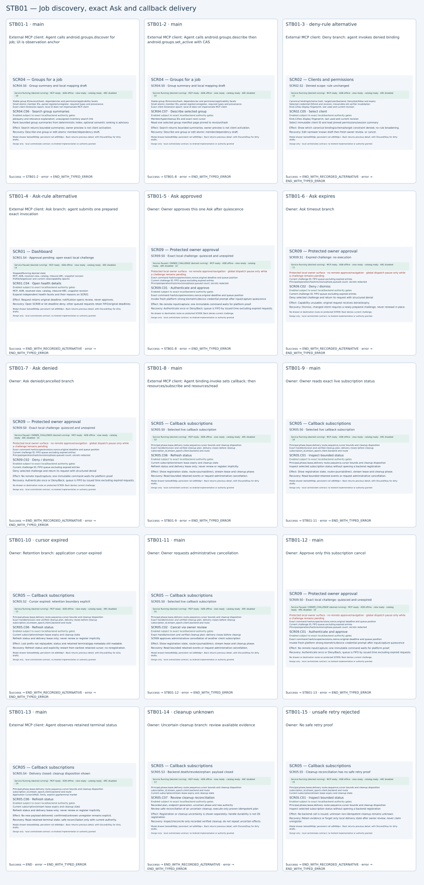

## STB02 — ARC select, inspect viewport, control and disconnect

External events are observed on the anchored UI control, not a remote press on that control. Protected mutations require exact local owner authentication; discovery/activation/pairing does not grant device authority. Self-ADB does not grant any MCP client capability.

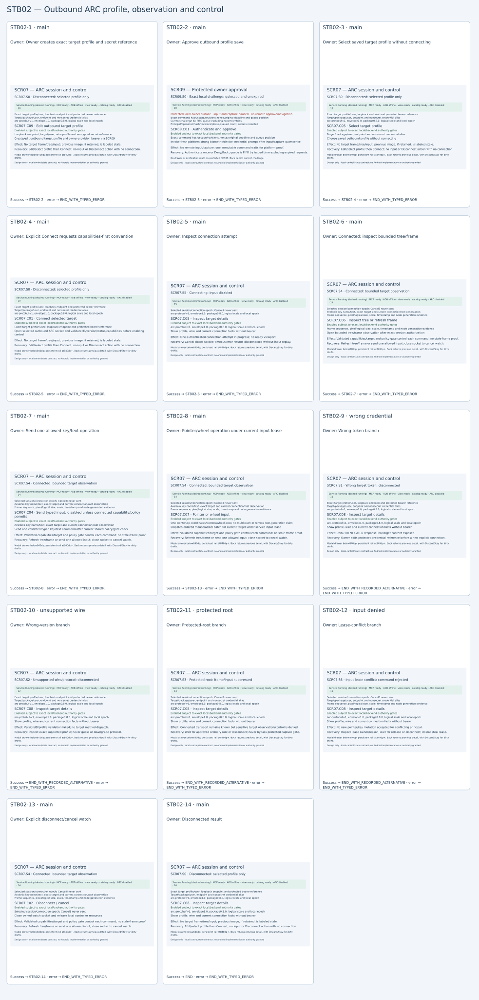

## STB03 — Protected configuration, start and truthful failure

External events are observed on the anchored UI control, not a remote press on that control. Protected mutations require exact local owner authentication; discovery/activation/pairing does not grant device authority. Self-ADB does not grant any MCP client capability.

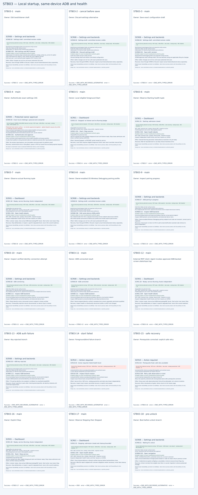

## STB04 — Pair proof, exact commit, grant and revoke

External events are observed on the anchored UI control, not a remote press on that control. Protected mutations require exact local owner authentication; discovery/activation/pairing does not grant device authority. Self-ADB does not grant any MCP client capability.

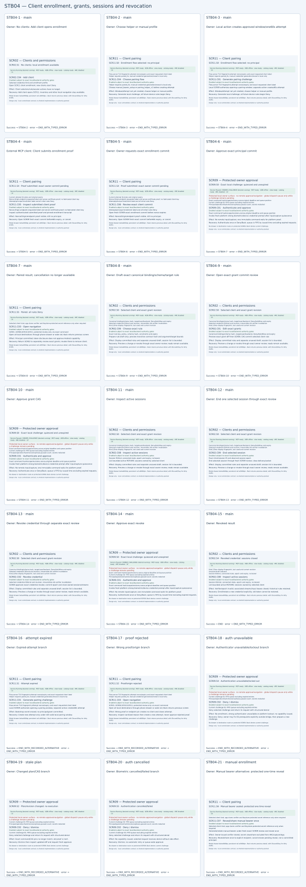

## STB05 — Catalog preview and scoped log export

External events are observed on the anchored UI control, not a remote press on that control. Protected mutations require exact local owner authentication; discovery/activation/pairing does not grant device authority. Self-ADB does not grant any MCP client capability.

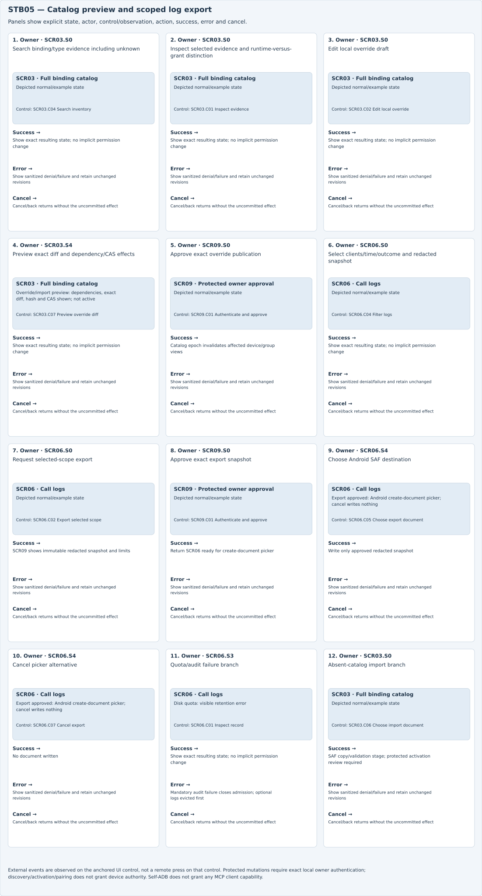

## STB06 — Pair self-ADB and inspect independent backend health

External events are observed on the anchored UI control, not a remote press on that control. Protected mutations require exact local owner authentication; discovery/activation/pairing does not grant device authority. Self-ADB does not grant any MCP client capability.

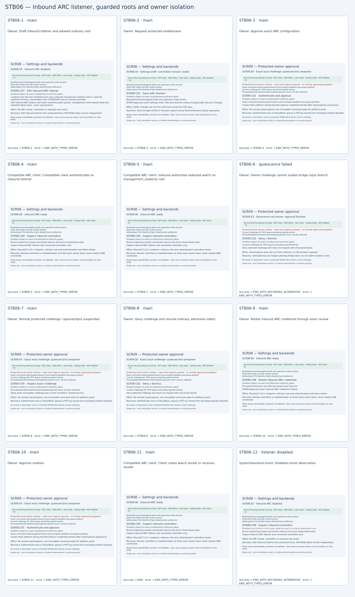

[Editable Marp deck](../storyboards/storyboard.md) · [Self-contained HTML](storyboards.html)
