<!-- _class: cover -->

# Kotlin Compose UI storyboards

Explicit actor, state, action and branch IDs. Alternatives are labeled, not automatic retries. Each panel depicts the named state. External events are observation anchors, never remote button presses. Exact owner authorization and self-ADB authority stay separate.

---

# STB01-1 · Agent calls android.groups.discover for job; UI is observation anchor

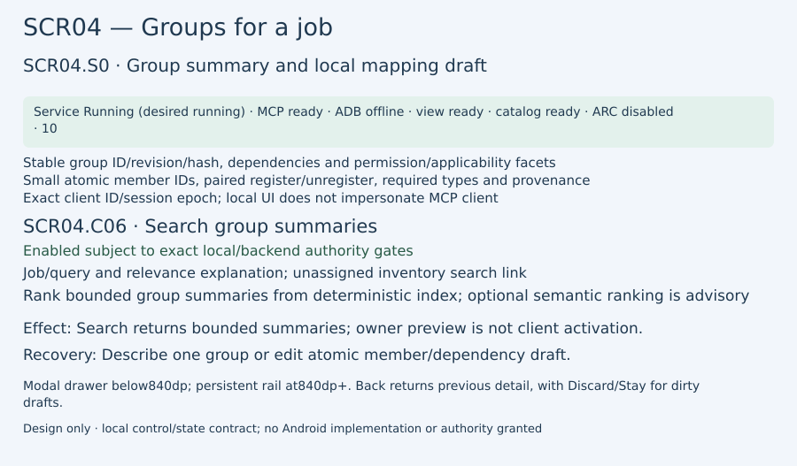

**External MCP client** · `SCR04.S0`

**Branch:** main

Observation: SCR04.C06 Search group summaries

**Success:** Ranked bounded summaries with permission/applicability facets; no authority granted

**Error:** Budget exceeded returns smaller page/cursor, not all schemas

**Cancel:** Cancel this bounded search; retain query draft and committed view, no remote mutation.

Next: STB01-2; error: END_WITH_TYPED_ERROR.

---

# STB01-2 · Agent calls android.groups.describe then android.groups.set_active with CAS

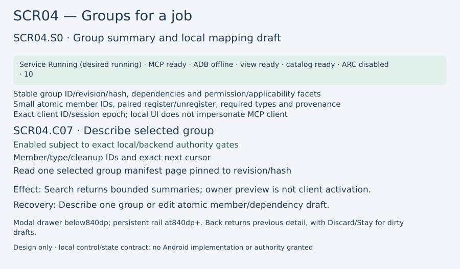

**External MCP client** · `SCR04.S0`

**Branch:** main

Observation: SCR04.C07 Describe selected group

**Success:** Small coherent interest view committed; generic binding.invoke remains; activation grants nothing

**Error:** Stale group revision invalidates page; reload summary before client activation

**Cancel:** Cancel this page read; keep previous valid cursor/status and require explicit next read.

Next: STB01-8; error: END_WITH_TYPED_ERROR.

---

# STB01-3 · Deny branch: agent invokes denied binding

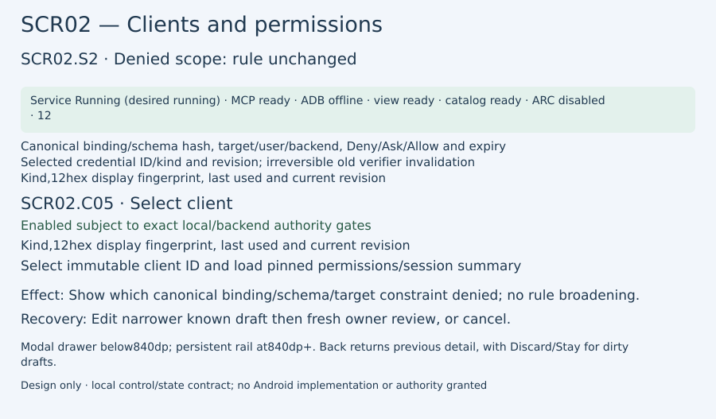

**External MCP client** · `SCR02.S2`

**Branch:** deny-rule alternative

Observation: SCR02.C05 Select client

**Success:** Structured invocation denial; no backend registration/input

**Error:** Deleted/revoked selection shows terminal status; clear draft

**Cancel:** Restore previous selection; selection does not connect, grant, activate or publish.

Next: END_WITH_RECORDED_ALTERNATIVE; error: END_WITH_TYPED_ERROR.

---

# STB01-4 · Ask branch: agent submits one prepared exact invocation

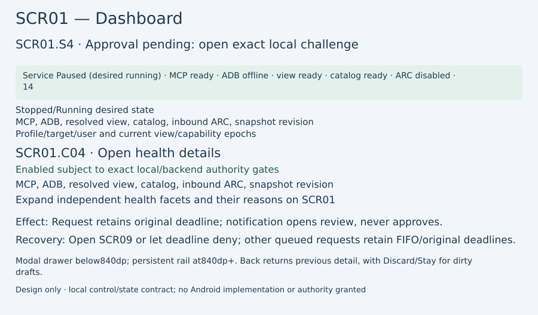

**External MCP client** · `SCR01.S4`

**Branch:** Ask-rule alternative

Observation: SCR01.C04 Open health details

**Success:** Pending local notification opens SCR09; original request deadline unchanged

**Error:** Missing facet is unknown, never inferred from another ready facet

**Cancel:** Close the read/detail. Cancelled read does not alter the represented resource or backend registration.

Next: END_WITH_RECORDED_ALTERNATIVE; error: END_WITH_TYPED_ERROR.

---

# STB01-5 · Owner approves this one Ask after quiescence

**Owner** · `SCR09.S0`

**Branch:** Ask approved

Action: SCR09.C01 Authenticate and approve

**Success:** Reserved proof consumed at beginDispatch; finite invocation response

**Error:** Expiry/CAS change/lockout/no enrollment/drain failure denies; only original exact approved command may commit

**Cancel:** Before exact commit, Deny/Back closes this challenge without applying it. After commit, no undo is implied; any reversal is a new exact owner command.

Next: STB01-8; error: END_WITH_TYPED_ERROR.

---

# STB01-6 · Ask timeout branch

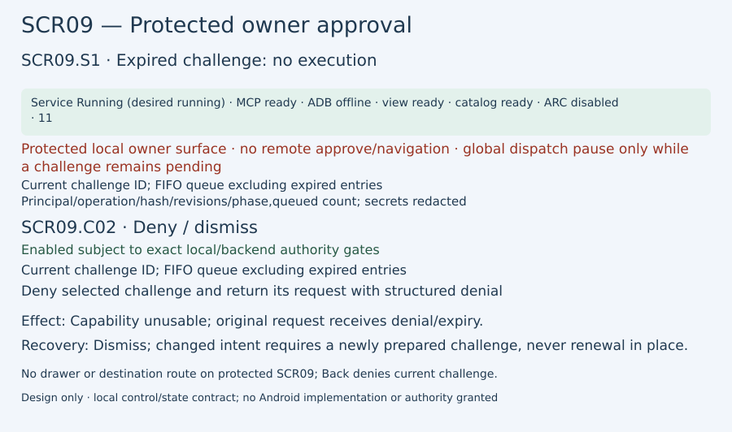

**Owner** · `SCR09.S1`

**Branch:** Ask expires

Action: SCR09.C02 Deny / dismiss

**Success:** Original request denied as expired; no side effect

**Error:** Back/system dismiss is the same denial; no side effect, no hidden next approval

**Cancel:** This action is the explicit cancellation/discard. Report its recorded disposition; do not imply reversal of an already committed external effect.

Next: END_WITH_RECORDED_ALTERNATIVE; error: END_WITH_TYPED_ERROR.

---

# STB01-7 · Ask denied/cancelled branch

**Owner** · `SCR09.S0`

**Branch:** Ask denied

Action: SCR09.C02 Deny / dismiss

**Success:** Only this prepared execution denied; no persistent grant change

**Error:** Back/system dismiss is the same denial; no side effect, no hidden next approval

**Cancel:** This action is the explicit cancellation/discard. Report its recorded disposition; do not imply reversal of an already committed external effect.

Next: END_WITH_RECORDED_ALTERNATIVE; error: END_WITH_TYPED_ERROR.

---

# STB01-8 · Agent binding.invoke sets callback; then resources/subscribe and resources/read

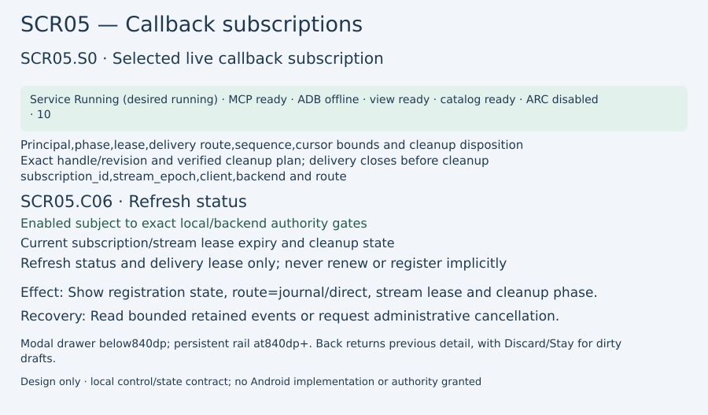

**External MCP client** · `SCR05.S0`

**Branch:** main

Observation: SCR05.C06 Refresh status

**Success:** Finite handle; URI-only update hints; finite journal pages and explicit route/lease

**Error:** Death/revoke hides payload; uncertainty stays until supported reconciliation

**Cancel:** Close the read/detail. Cancelled read does not alter the represented resource or backend registration.

Next: STB01-9; error: END_WITH_TYPED_ERROR.

---

# STB01-9 · Owner reads exact live subscription status

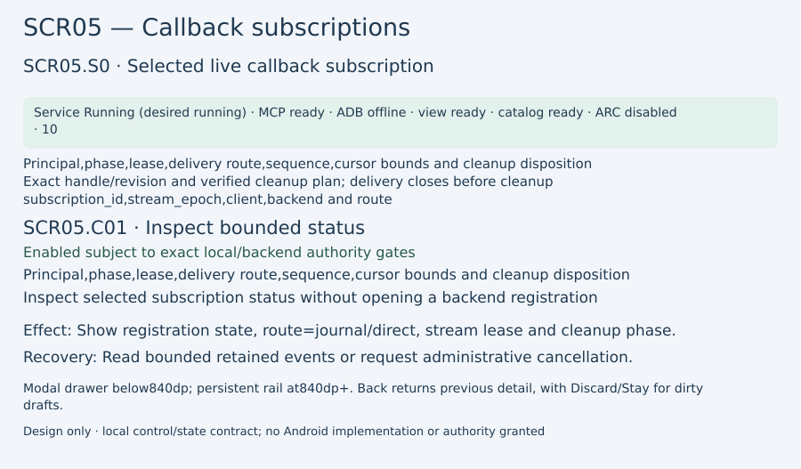

**Owner** · `SCR05.S0`

**Branch:** main

Action: SCR05.C01 Inspect bounded status

**Success:** Inspect selected subscription status without opening a backend registration

**Error:** Unknown registration vs cleanup phase remains distinct; no replay

**Cancel:** Close the read/detail. Cancelled read does not alter the represented resource or backend registration.

Next: STB01-11; error: END_WITH_TYPED_ERROR.

---

# STB01-10 · Retention branch: application cursor expired

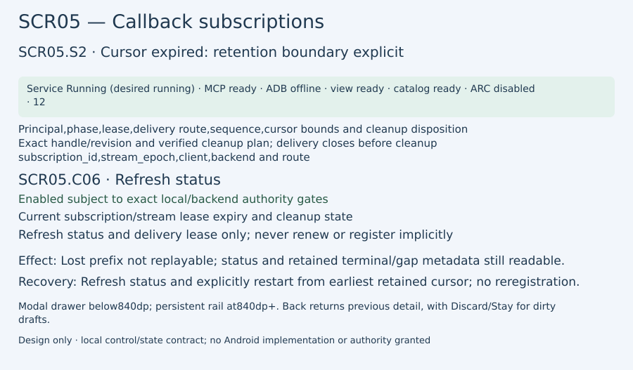

**Owner** · `SCR05.S2`

**Branch:** cursor expired

Action: SCR05.C06 Refresh status

**Success:** Show earliest retained cursor and gap; no automatic re-registration

**Error:** Death/revoke hides payload; uncertainty stays until supported reconciliation

**Cancel:** Close the read/detail. Cancelled read does not alter the represented resource or backend registration.

Next: END_WITH_RECORDED_ALTERNATIVE; error: END_WITH_TYPED_ERROR.

---

# STB01-11 · Owner requests administrative cancellation

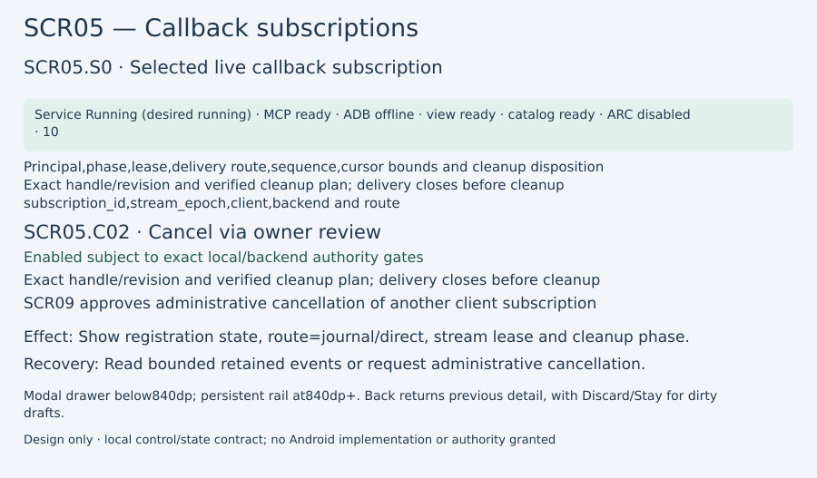

**Owner** · `SCR05.S0`

**Branch:** main

Action: SCR05.C02 Cancel via owner review

**Success:** SCR09 binds exact handle/revision and cleanup plan

**Error:** Cleanup failure records unknown; cannot promise backend unregister from timeout

**Cancel:** Before exact commit, Deny/Back closes this challenge without applying it. After commit, no undo is implied; any reversal is a new exact owner command.

Next: STB01-12; error: END_WITH_TYPED_ERROR.

---

# STB01-12 · Approve only this subscription cancel

**Owner** · `SCR09.S0`

**Branch:** main

Action: SCR09.C01 Authenticate and approve

**Success:** Delivery closes; verified cleanup attempted within deadline

**Error:** Expiry/CAS change/lockout/no enrollment/drain failure denies; only original exact approved command may commit

**Cancel:** Before exact commit, Deny/Back closes this challenge without applying it. After commit, no undo is implied; any reversal is a new exact owner command.

Next: STB01-13; error: END_WITH_TYPED_ERROR.

---

# STB01-13 · Agent observes retained terminal status

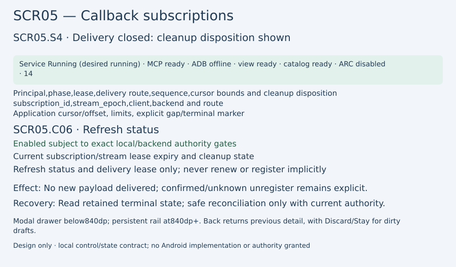

**External MCP client** · `SCR05.S4`

**Branch:** main

Observation: SCR05.C06 Refresh status

**Success:** callback.status returns closed with confirmed/unknown cleanup

**Error:** Death/revoke hides payload; uncertainty stays until supported reconciliation

**Cancel:** Close the read/detail. Cancelled read does not alter the represented resource or backend registration.

Next: END; error: END_WITH_TYPED_ERROR.

---

# STB01-14 · Uncertain cleanup branch: review available evidence

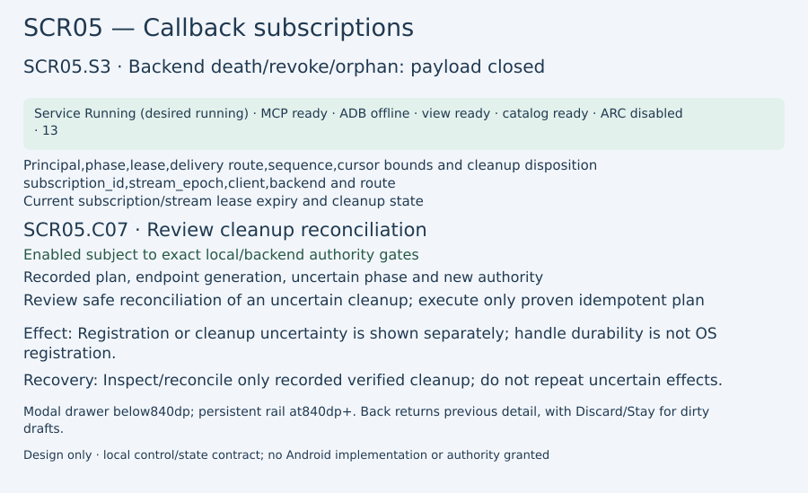

**Owner** · `SCR05.S3`

**Branch:** cleanup unknown

Action: SCR05.C07 Review cleanup reconciliation

**Success:** No replay without proven idempotence/current authority; phase remains cleanup

**Error:** No proof means inspect/forget delivery handle only; never repeat uncertain non-idempotent unregister

**Cancel:** Before exact commit, Deny/Back closes this challenge without applying it. After commit, no undo is implied; any reversal is a new exact owner command.

Next: END_WITH_RECORDED_ALTERNATIVE; error: END_WITH_TYPED_ERROR.

---

# STB01-15 · No safe retry proof

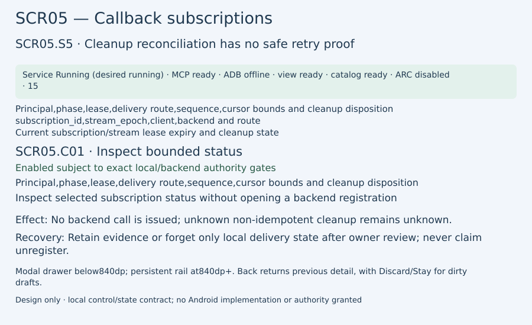

**Owner** · `SCR05.S5`

**Branch:** unsafe retry rejected

Action: SCR05.C01 Inspect bounded status

**Success:** Payload closed; unknown cleanup explicitly retained

**Error:** Unknown registration vs cleanup phase remains distinct; no replay

**Cancel:** Close the read/detail. Cancelled read does not alter the represented resource or backend registration.

Next: END_WITH_RECORDED_ALTERNATIVE; error: END_WITH_TYPED_ERROR.

---

# STB02-1 · Owner creates exact target profile and secret reference

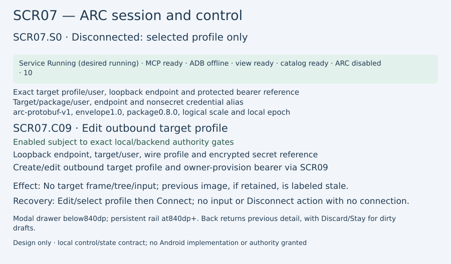

**Owner** · `SCR07.S0`

**Branch:** main

Action: SCR07.C09 Edit outbound target profile

**Success:** SCR09 reviews endpoint/target/user; secret never becomes remote root

**Error:** Secret fields are protected/not ARC roots; never put bearer in logs/exports/discovery

**Cancel:** Before exact commit, Deny/Back closes this challenge without applying it. After commit, no undo is implied; any reversal is a new exact owner command.

Next: STB02-2; error: END_WITH_TYPED_ERROR.

---

# STB02-2 · Approve outbound profile save

**Owner** · `SCR09.S0`

**Branch:** main

Action: SCR09.C01 Authenticate and approve

**Success:** Encrypted secret reference and exact target profile committed

**Error:** Expiry/CAS change/lockout/no enrollment/drain failure denies; only original exact approved command may commit

**Cancel:** Before exact commit, Deny/Back closes this challenge without applying it. After commit, no undo is implied; any reversal is a new exact owner command.

Next: STB02-3; error: END_WITH_TYPED_ERROR.

---

# STB02-3 · Select saved target profile without connecting

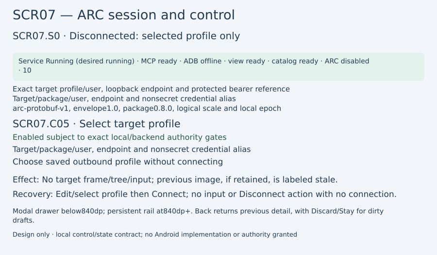

**Owner** · `SCR07.S0`

**Branch:** main

Action: SCR07.C05 Select target profile

**Success:** Choose saved outbound profile without connecting

**Error:** Missing secret/profile requires explicit owner profile edit; no default remote target

**Cancel:** Restore previous selection; selection does not connect, grant, activate or publish.

Next: STB02-4; error: END_WITH_TYPED_ERROR.

---

# STB02-4 · Explicit Connect requests capabilities-first convention

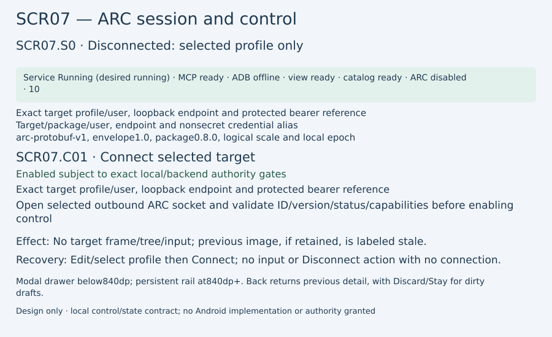

**Owner** · `SCR07.S0`

**Branch:** main

Action: SCR07.C01 Connect selected target

**Success:** Connecting state; no target input yet

**Error:** Wrong token/protocol/EOF shows disconnected state; never sends uncertain input again

**Cancel:** Cancel closes the owned pending transport/session action; report observed/unknown effects. Never resend uncertain input.

Next: STB02-5; error: END_WITH_TYPED_ERROR.

---

# STB02-5 · Inspect connection attempt

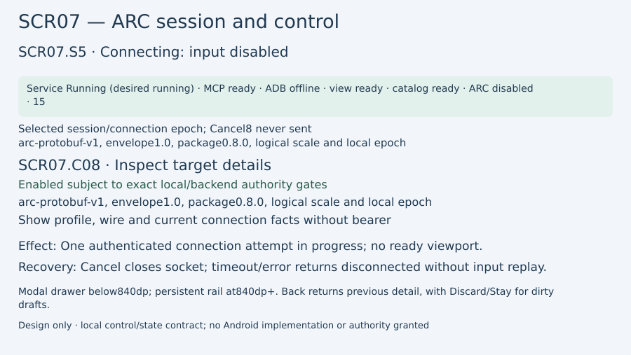

**Owner** · `SCR07.S5`

**Branch:** main

Action: SCR07.C08 Inspect target details

**Success:** UI displays connecting, exact target and wire profile

**Error:** Unknown remote root generation remains unknown

**Cancel:** Close the read/detail. Cancelled read does not alter the represented resource or backend registration.

Next: STB02-6; error: END_WITH_TYPED_ERROR.

---

# STB02-6 · Connected: inspect bounded tree/frame

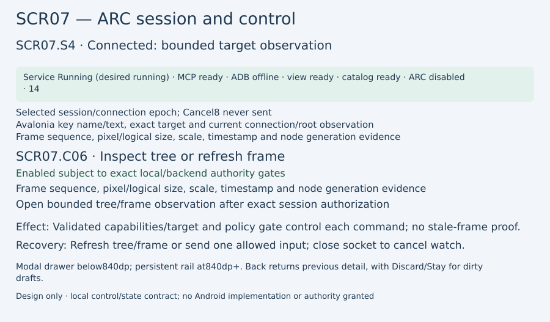

**Owner** · `SCR07.S4`

**Branch:** main

Action: SCR07.C06 Inspect tree or refresh frame

**Success:** Validate envelope version/request ID/status and payload; current frame geometry shown

**Error:** Disconnected/oversize/protected data denies; stale frame never becomes proof of intended coordinate

**Cancel:** Close the read/detail. Cancelled read does not alter the represented resource or backend registration.

Next: STB02-7; error: END_WITH_TYPED_ERROR.

---

# STB02-7 · Send one allowed key/text operation

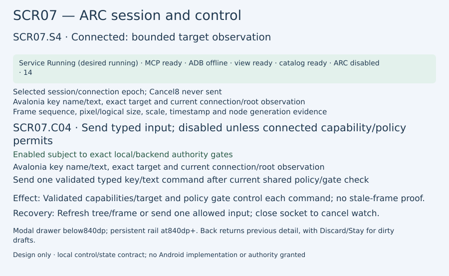

**Owner** · `SCR07.S4`

**Branch:** main

Action: SCR07.C04 Send typed input; disabled unless connected capability/policy permits

**Success:** Shared gate and local reply/input policy apply; inspect CommandResult.succeeded

**Error:** Unknown key/protected/root/policy failure shows CommandResult; no implicit grant or retry

**Cancel:** Cancel closes the owned pending transport/session action; report observed/unknown effects. Never resend uncertain input.

Next: STB02-8; error: END_WITH_TYPED_ERROR.

---

# STB02-8 · Pointer/wheel operation under current input lease

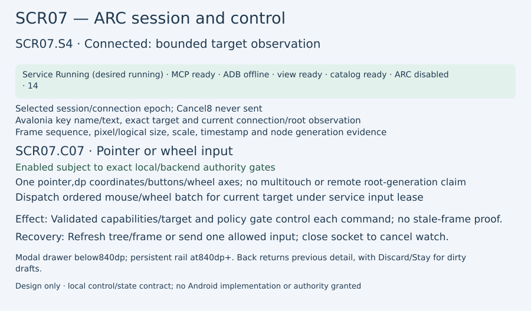

**Owner** · `SCR07.S4`

**Branch:** main

Action: SCR07.C07 Pointer or wheel input

**Success:** One pointer in logical coordinates; no remote generation or multitouch invented

**Error:** Lease conflict/protected root rejects; pressed state released on revoke/owner transition

**Cancel:** Stop submitting new input; release owned pressed state on explicit lease/session close. A delivered click/key cannot be undone.

Next: STB02-13; error: END_WITH_TYPED_ERROR.

---

# STB02-9 · Wrong-token branch

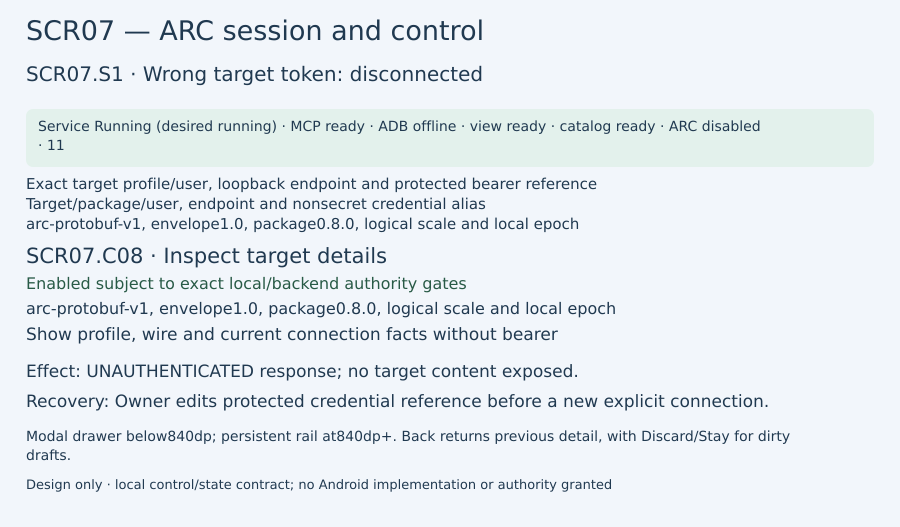

**Owner** · `SCR07.S1`

**Branch:** wrong credential

Action: SCR07.C08 Inspect target details

**Success:** UNAUTHENTICATED; content/input remain disabled

**Error:** Unknown remote root generation remains unknown

**Cancel:** Close the read/detail. Cancelled read does not alter the represented resource or backend registration.

Next: END_WITH_RECORDED_ALTERNATIVE; error: END_WITH_TYPED_ERROR.

---

# STB02-10 · Wrong-version branch

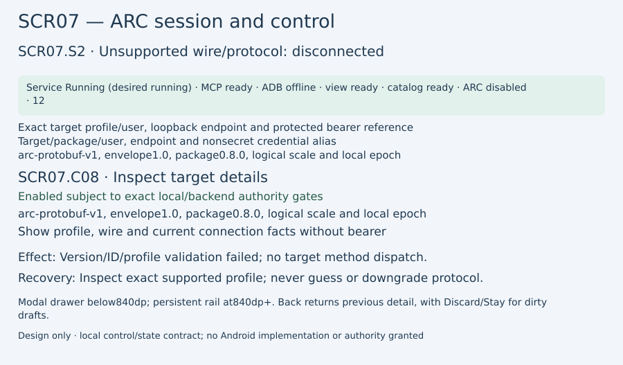

**Owner** · `SCR07.S2`

**Branch:** unsupported wire

Action: SCR07.C08 Inspect target details

**Success:** Unsupported wire rejected; no downgrade or target action

**Error:** Unknown remote root generation remains unknown

**Cancel:** Close the read/detail. Cancelled read does not alter the represented resource or backend registration.

Next: END_WITH_RECORDED_ALTERNATIVE; error: END_WITH_TYPED_ERROR.

---

# STB02-11 · Protected-root branch

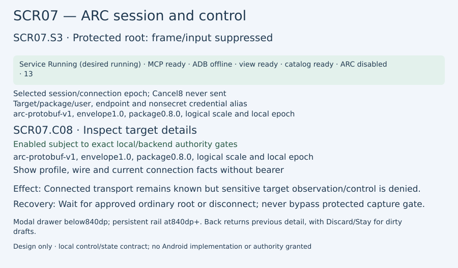

**Owner** · `SCR07.S3`

**Branch:** protected root

Action: SCR07.C08 Inspect target details

**Success:** Frame/tree/input suspended before protected capture

**Error:** Unknown remote root generation remains unknown

**Cancel:** Close the read/detail. Cancelled read does not alter the represented resource or backend registration.

Next: END_WITH_RECORDED_ALTERNATIVE; error: END_WITH_TYPED_ERROR.

---

# STB02-12 · Lease-conflict branch

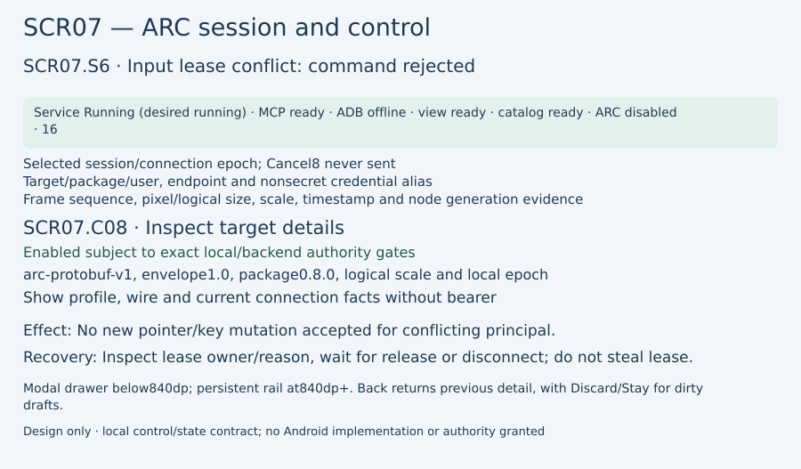

**Owner** · `SCR07.S6`

**Branch:** input denied

Action: SCR07.C08 Inspect target details

**Success:** Failed command; no competing input; inspect owner/reason

**Error:** Unknown remote root generation remains unknown

**Cancel:** Close the read/detail. Cancelled read does not alter the represented resource or backend registration.

Next: END_WITH_RECORDED_ALTERNATIVE; error: END_WITH_TYPED_ERROR.

---

# STB02-13 · Explicit disconnect/cancel watch

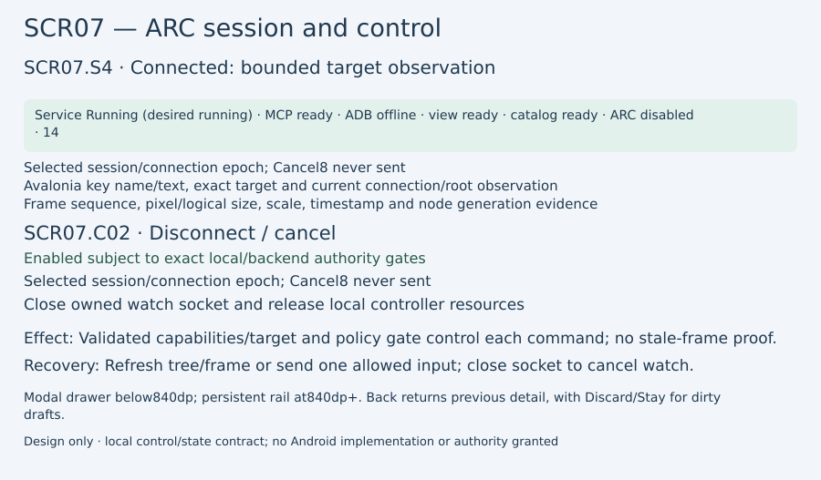

**Owner** · `SCR07.S4`

**Branch:** main

Action: SCR07.C02 Disconnect / cancel

**Success:** Close owned socket, no Cancel8; release local resources

**Error:** No final frame is assumed; old frame is visibly stale and input disabled

**Cancel:** Cancel closes the owned pending transport/session action; report observed/unknown effects. Never resend uncertain input.

Next: STB02-14; error: END_WITH_TYPED_ERROR.

---

# STB02-14 · Disconnected result

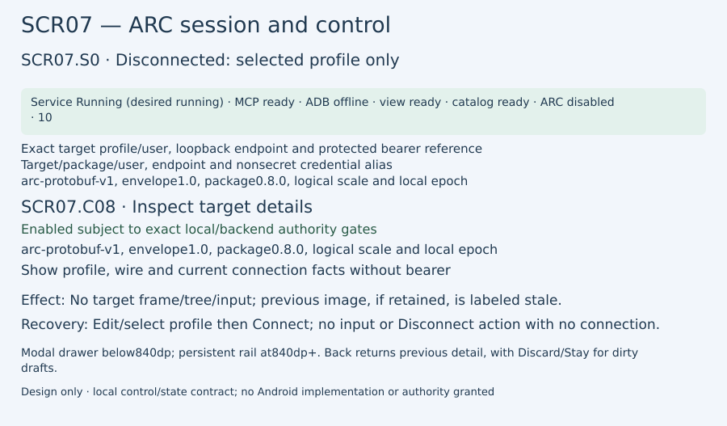

**Owner** · `SCR07.S0`

**Branch:** main

Action: SCR07.C08 Inspect target details

**Success:** Last frame labeled stale; no input or phantom Connected state

**Error:** Unknown remote root generation remains unknown

**Cancel:** Close the read/detail. Cancelled read does not alter the represented resource or backend registration.

Next: END; error: END_WITH_TYPED_ERROR.

---

# STB03-1 · Edit boot/listener draft

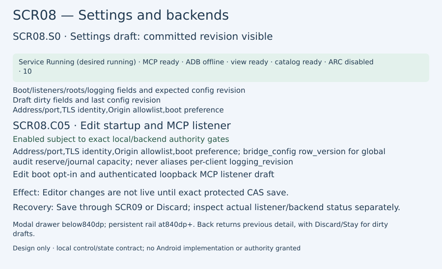

**Owner** · `SCR08.S0`

**Branch:** main

Action: SCR08.C05 Edit startup and MCP listener

**Success:** No committed config change; desired/actual status separate

**Error:** Unsupported FGS/TLS profile shows failure; Save needs exact SCR09 approval

**Cancel:** Discard only unsaved fields; committed configuration/revisions remain unchanged.

Next: STB03-3; error: END_WITH_TYPED_ERROR.

---

# STB03-2 · Discard-settings alternative

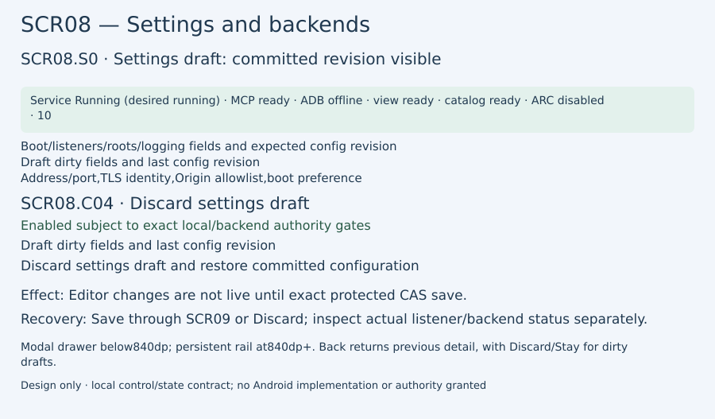

**Owner** · `SCR08.S0`

**Branch:** cancel before save

Action: SCR08.C04 Discard settings draft

**Success:** Previous boot/listener configuration retained

**Error:** No boot/listener/policy changes; active sockets remain until explicit lifecycle command

**Cancel:** This action is the explicit cancellation/discard. Report its recorded disposition; do not imply reversal of an already committed external effect.

Next: END_WITH_RECORDED_ALTERNATIVE; error: END_WITH_TYPED_ERROR.

---

# STB03-3 · Save exact configuration draft

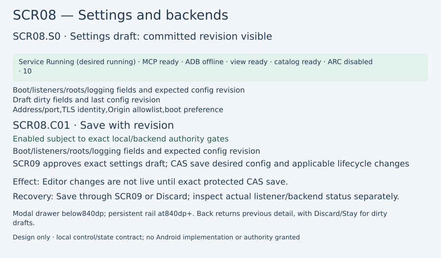

**Owner** · `SCR08.S0`

**Branch:** main

Action: SCR08.C01 Save with revision

**Success:** SCR09 shows fields/revisions and original expiry

**Error:** Conflict rejects entire draft; bind failure keeps desired vs actual separate

**Cancel:** Before exact commit, Deny/Back closes this challenge without applying it. After commit, no undo is implied; any reversal is a new exact owner command.

Next: STB03-4; error: END_WITH_TYPED_ERROR.

---

# STB03-4 · Authenticate exact settings CAS

**Owner** · `SCR09.S0`

**Branch:** main

Action: SCR09.C01 Authenticate and approve

**Success:** Commit revision; return SCR08 without implying listener ready

**Error:** Expiry/CAS change/lockout/no enrollment/drain failure denies; only original exact approved command may commit

**Cancel:** Before exact commit, Deny/Back closes this challenge without applying it. After commit, no undo is implied; any reversal is a new exact owner command.

Next: STB03-5; error: END_WITH_TYPED_ERROR.

---

# STB03-5 · Local eligible foreground Start

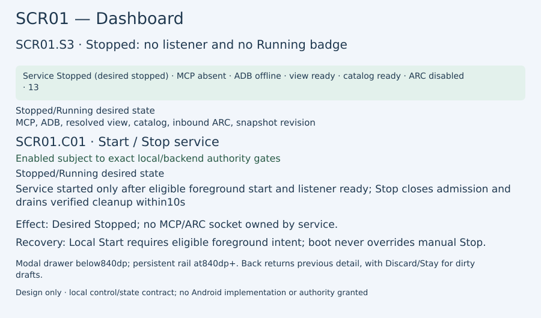

**Owner** · `SCR01.S3`

**Branch:** main

Action: SCR01.C01 Start / Stop service

**Success:** Starting; no device admission until listener/view readiness

**Error:** Start eligibility or bind failure shows Error; stop timeout shows unknown cleanup and closed admission

**Cancel:** During Start, explicit Stop closes admission; after Stop begins, cleanup remains bounded and is not rolled back into Running.

Next: STB03-6; error: END_WITH_TYPED_ERROR.

---

# STB03-6 · Observe Starting health tuple

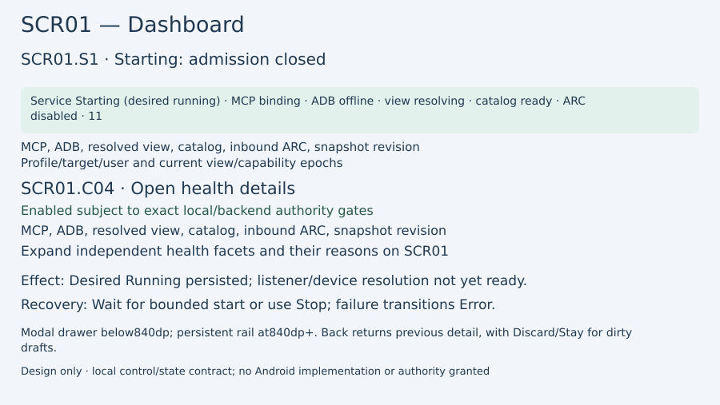

**Owner** · `SCR01.S1`

**Branch:** main

Action: SCR01.C04 Open health details

**Success:** Expand independent health facets and their reasons on SCR01

**Error:** Missing facet is unknown, never inferred from another ready facet

**Cancel:** Close the read/detail. Cancelled read does not alter the represented resource or backend registration.

Next: STB03-7; error: END_WITH_TYPED_ERROR.

---

# STB03-7 · Observe actual Running tuple

**Owner** · `SCR01.S0`

**Branch:** main

Action: SCR01.C04 Open health details

**Success:** MCP ready and ADB offline are separate facts

**Error:** Missing facet is unknown, never inferred from another ready facet

**Cancel:** Close the read/detail. Cancelled read does not alter the represented resource or backend registration.

Next: STB03-8; error: END_WITH_TYPED_ERROR.

---

# STB03-8 · Owner-enabled OS Wireless Debugging pairing profile

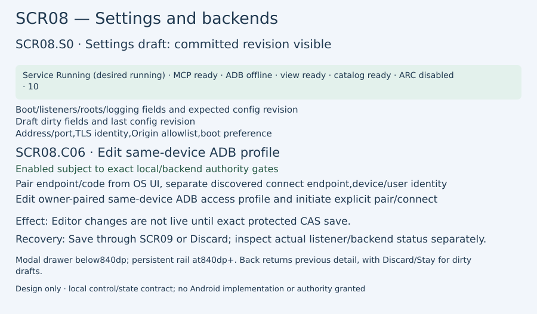

**Owner** · `SCR08.S0`

**Branch:** main

Action: SCR08.C06 Edit same-device ADB profile

**Success:** Pair endpoint/code separate from discovered connect endpoint; no device setting toggled

**Error:** Background/split-screen OS pairing constraints visible; wrong key/port never reports Connected

**Cancel:** Discard only unsaved fields; committed configuration/revisions remain unchanged.

Next: STB03-9; error: END_WITH_TYPED_ERROR.

---

# STB03-9 · Inspect pairing progress

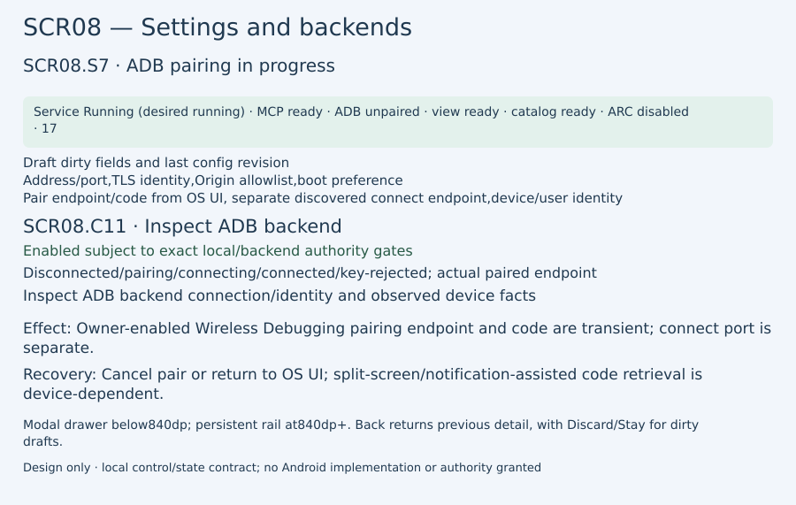

**Owner** · `SCR08.S7`

**Branch:** main

Action: SCR08.C11 Inspect ADB backend

**Success:** OS UI/split-screen availability disclosed; secrets not logged

**Error:** No socket proves MCP authority; reconnect is bounded and cannot retry uncertain device input

**Cancel:** Close the read/detail. Cancelled read does not alter the represented resource or backend registration.

Next: STB03-10; error: END_WITH_TYPED_ERROR.

---

# STB03-10 · Inspect verified identity connection attempt

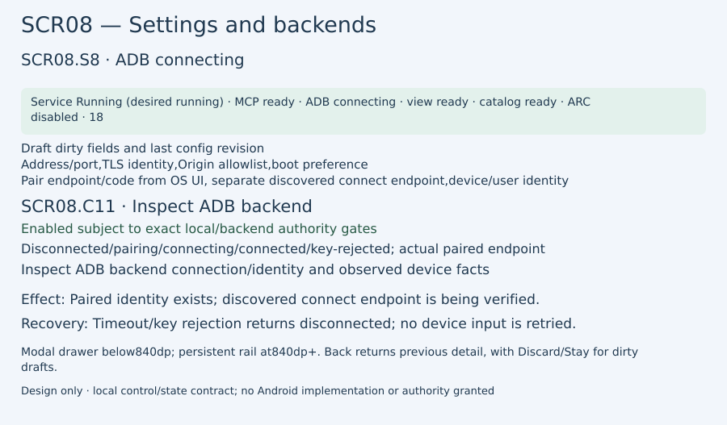

**Owner** · `SCR08.S8`

**Branch:** main

Action: SCR08.C11 Inspect ADB backend

**Success:** Inspect ADB backend connection/identity and observed device facts

**Error:** No socket proves MCP authority; reconnect is bounded and cannot retry uncertain device input

**Cancel:** Close the read/detail. Cancelled read does not alter the represented resource or backend registration.

Next: STB03-11; error: END_WITH_TYPED_ERROR.

---

# STB03-11 · ADB connected result

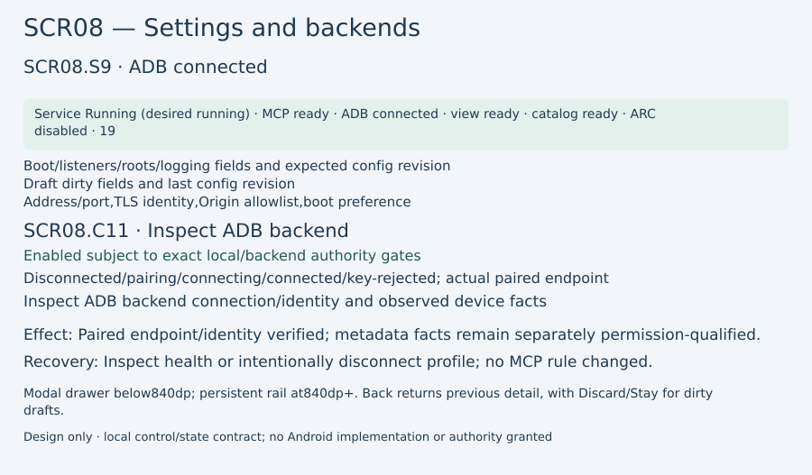

**Owner** · `SCR08.S9`

**Branch:** main

Action: SCR08.C11 Inspect ADB backend

**Success:** Paired verified endpoint only; no MCP grant created

**Error:** No socket proves MCP authority; reconnect is bounded and cannot retry uncertain device input

**Cancel:** Close the read/detail. Cancelled read does not alter the represented resource or backend registration.

Next: STB03-12; error: END_WITH_TYPED_ERROR.

---

# STB03-12 · Agent invokes approved ADB-backed screen.state/input.tap

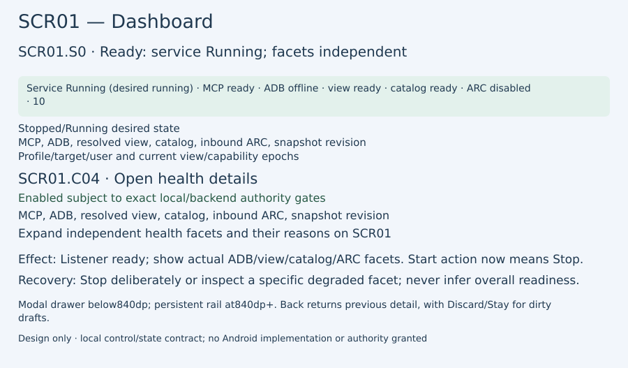

**External MCP client** · `SCR01.S0`

**Branch:** main

Observation: SCR01.C04 Open health details

**Success:** Single bounded observation/action through generic binding.invoke; no workflow scheduler

**Error:** Missing facet is unknown, never inferred from another ready facet

**Cancel:** Close the read/detail. Cancelled read does not alter the represented resource or backend registration.

Next: STB03-16; error: END_WITH_TYPED_ERROR.

---

# STB03-13 · Key-rejected branch

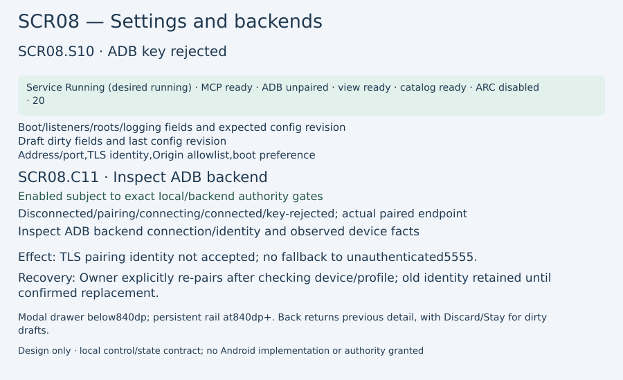

**Owner** · `SCR08.S10`

**Branch:** ADB auth failure

Action: SCR08.C11 Inspect ADB backend

**Success:** No unauthenticated5555 fallback; explicit owner re-pair required

**Error:** No socket proves MCP authority; reconnect is bounded and cannot retry uncertain device input

**Cancel:** Close the read/detail. Cancelled read does not alter the represented resource or backend registration.

Next: END_WITH_RECORDED_ALTERNATIVE; error: END_WITH_TYPED_ERROR.

---

# STB03-14 · Foreground/bind failure branch

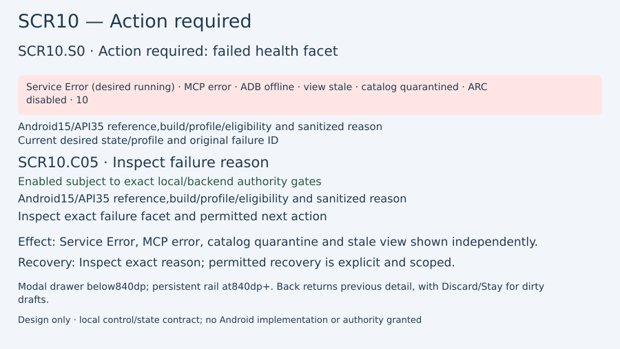

**Owner** · `SCR10.S0`

**Branch:** start failed

Action: SCR10.C05 Inspect failure reason

**Success:** Error facet and no Running chip; exact safe next action

**Error:** No universal permission fix or blind retry; unavailable evidence stays unknown

**Cancel:** Close the read/detail. Cancelled read does not alter the represented resource or backend registration.

Next: END_WITH_RECORDED_ALTERNATIVE; error: END_WITH_TYPED_ERROR.

---

# STB03-15 · Prerequisite corrected: explicit safe retry

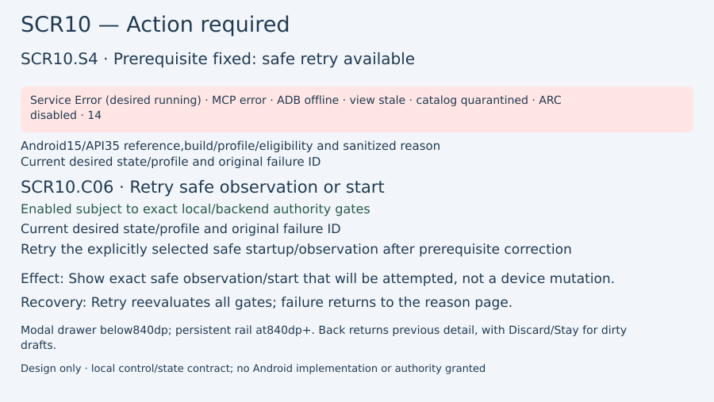

**Owner** · `SCR10.S4`

**Branch:** safe recovery

Action: SCR10.C06 Retry safe observation or start

**Success:** Reevaluate eligibility/profile; never retry uncertain device mutation

**Error:** Reevaluates eligibility/authority; cannot repeat uncertain device mutations

**Cancel:** Cancel closes the owned pending transport/session action; report observed/unknown effects. Never resend uncertain input.

Next: STB03-16; error: END_WITH_TYPED_ERROR.

---

# STB03-16 · Explicit Stop

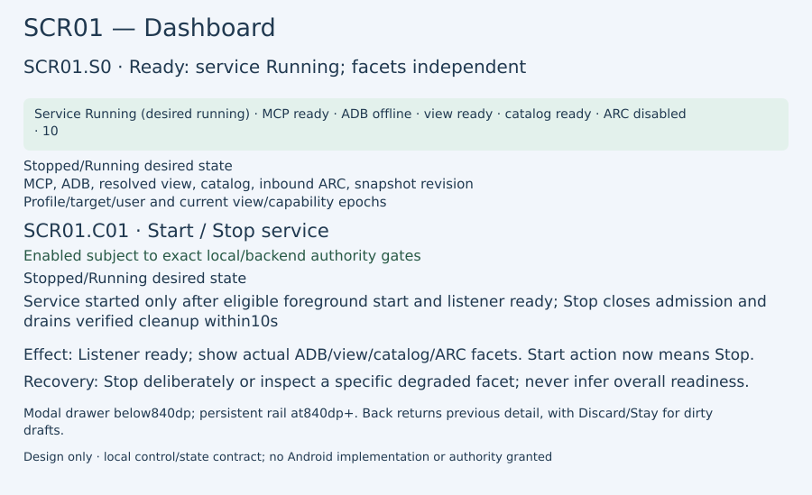

**Owner** · `SCR01.S0`

**Branch:** main

Action: SCR01.C01 Start / Stop service

**Success:** Admission/listeners close, bounded cleanup before store/backend close

**Error:** Start eligibility or bind failure shows Error; stop timeout shows unknown cleanup and closed admission

**Cancel:** During Start, explicit Stop closes admission; after Stop begins, cleanup remains bounded and is not rolled back into Running.

Next: STB03-17; error: END_WITH_TYPED_ERROR.

---

# STB03-17 · Observe Stopping then Stopped

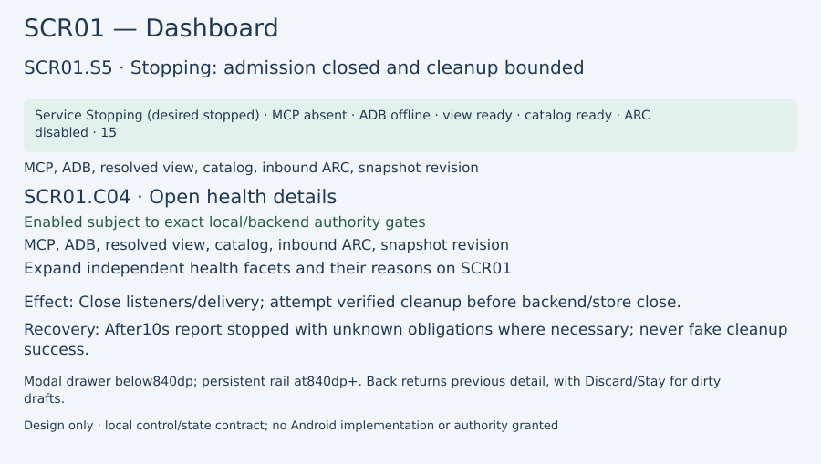

**Owner** · `SCR01.S5`

**Branch:** main

Action: SCR01.C04 Open health details

**Success:** Unknown cleanup retained; manual Stop suppresses boot restart

**Error:** Missing facet is unknown, never inferred from another ready facet

**Cancel:** Close the read/detail. Cancelled read does not alter the represented resource or backend registration.

Next: END; error: END_WITH_TYPED_ERROR.

---

# STB03-18 · Boot before unlock branch

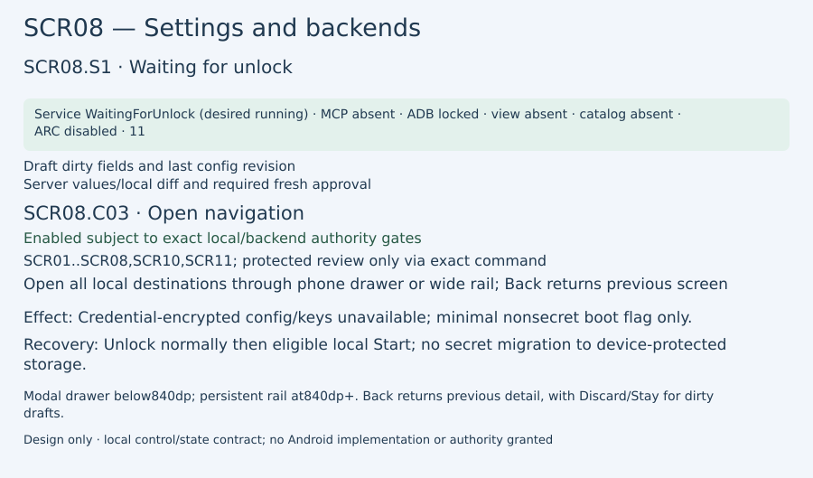

**Owner** · `SCR08.S1`

**Branch:** pre-unlock

Action: SCR08.C03 Open navigation

**Success:** Nonsecret boot flag only; no credentials copied to device-protected storage

**Error:** Dirty draft requires Discard/Stay; navigation never commits configuration

**Cancel:** Close drawer/Back to prior view. Dirty draft requires Discard or Stay; no save is implied.

Next: END_WITH_RECORDED_ALTERNATIVE; error: END_WITH_TYPED_ERROR.

---

# STB04-1 · No clients: Add client opens enrollment

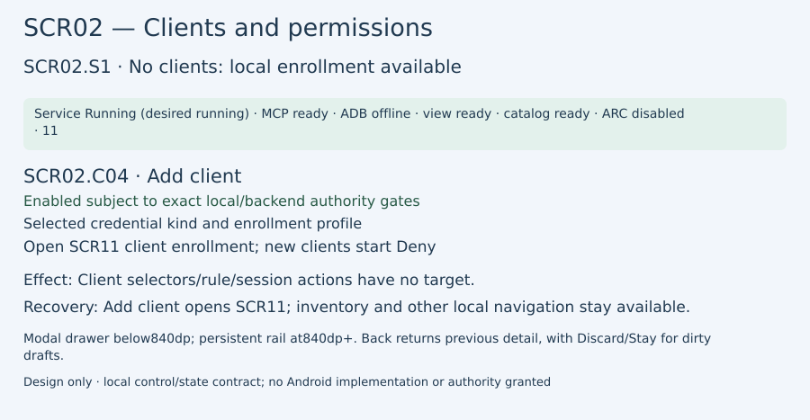

**Owner** · `SCR02.S1`

**Branch:** main

Action: SCR02.C04 Add client

**Success:** Open SCR11 client enrollment; new clients start Deny

**Error:** No proof/owner commit means no principal or grant

**Cancel:** Close drawer/Back to prior view. Dirty draft requires Discard or Stay; no save is implied.

Next: STB04-2; error: END_WITH_TYPED_ERROR.

---

# STB04-2 · Choose helper or manual profile

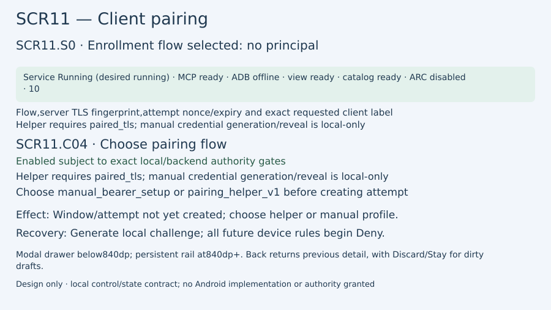

**Owner** · `SCR11.S0`

**Branch:** main

Action: SCR11.C04 Choose pairing flow

**Success:** Helper requires pinned TLS; no OAuth token endpoint implied

**Error:** Reduced HTTP cannot enable pairing; no implicit OAuth endpoint

**Cancel:** Restore previous selection; selection does not connect, grant, activate or publish.

Next: STB04-3; error: END_WITH_TYPED_ERROR.

---

# STB04-3 · Local action creates approved window/one60s attempt

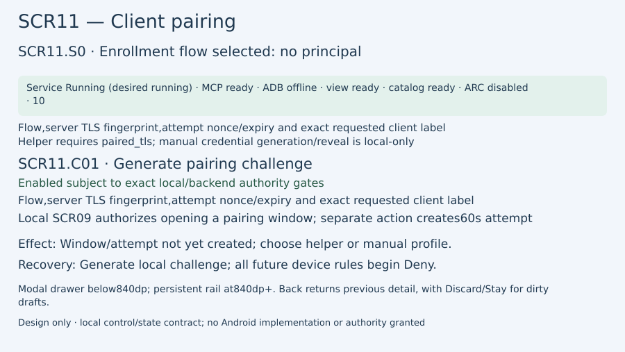

**Owner** · `SCR11.S0`

**Branch:** main

Action: SCR11.C01 Generate pairing challenge

**Success:** QR or explicit selected-recipient share; server fingerprint and nonce exact

**Error:** Window/attempt expiry closes it; no principal exists until proof and separate exact owner commit

**Cancel:** Before exact commit, Deny/Back closes this challenge without applying it. After commit, no undo is implied; any reversal is a new exact owner command.

Next: STB04-4; error: END_WITH_TYPED_ERROR.

---

# STB04-4 · Client submits enrollment proof

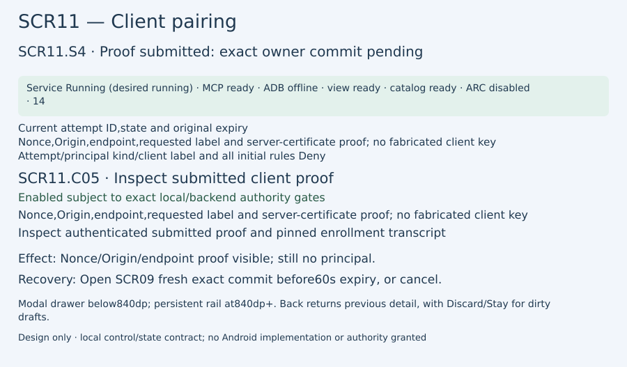

**External MCP client** · `SCR11.S4`

**Branch:** main

Observation: SCR11.C05 Inspect submitted client proof

**Success:** No principal yet; inspect nonce/Origin/endpoint and expiry

**Error:** Wrong proof/origin rejects attempt without creating client

**Cancel:** Close the read/detail. Cancelled read does not alter the represented resource or backend registration.

Next: STB04-5; error: END_WITH_TYPED_ERROR.

---

# STB04-5 · Owner requests exact enrollment commit

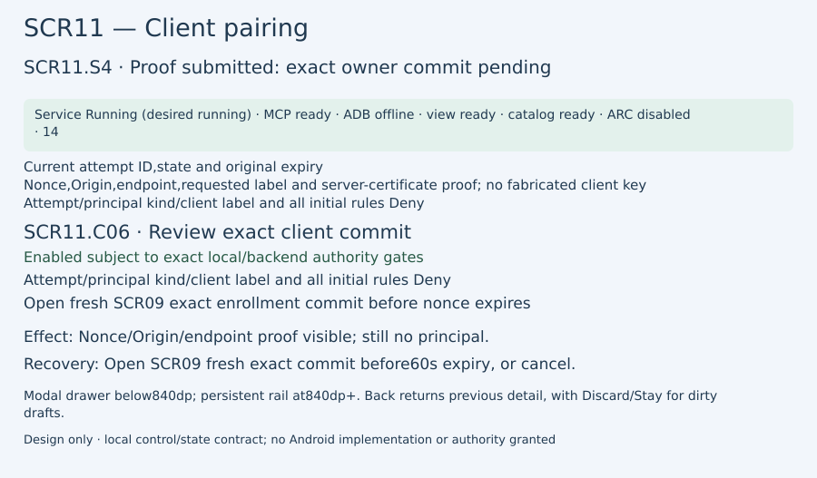

**Owner** · `SCR11.S4`

**Branch:** main

Action: SCR11.C06 Review exact client commit

**Success:** Fresh SCR09 review distinct from opening window

**Error:** Expiry/changed proof requires new attempt; approval never directly grants device calls

**Cancel:** Before exact commit, Deny/Back closes this challenge without applying it. After commit, no undo is implied; any reversal is a new exact owner command.

Next: STB04-6; error: END_WITH_TYPED_ERROR.

---

# STB04-6 · Approve exact principal commit

**Owner** · `SCR09.S0`

**Branch:** main

Action: SCR09.C01 Authenticate and approve

**Success:** Client committed with every device rule Deny

**Error:** Expiry/CAS change/lockout/no enrollment/drain failure denies; only original exact approved command may commit

**Cancel:** Before exact commit, Deny/Back closes this challenge without applying it. After commit, no undo is implied; any reversal is a new exact owner command.

Next: STB04-7; error: END_WITH_TYPED_ERROR.

---

# STB04-7 · Paired result; cancellation no longer available

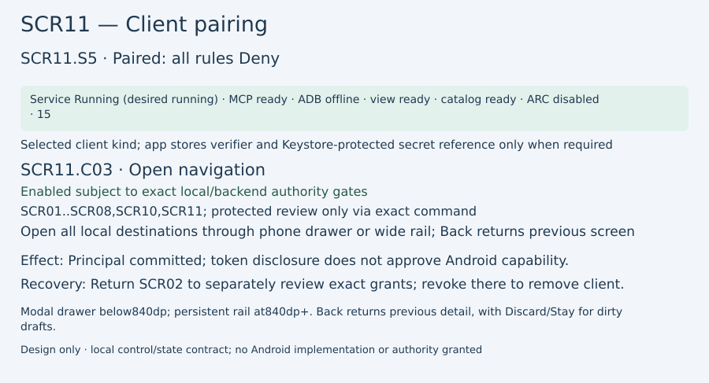

**Owner** · `SCR11.S5`

**Branch:** main

Action: SCR11.C03 Open navigation

**Success:** Return SCR02; explicit revoke is needed to remove principal

**Error:** Dirty draft requires Discard/Stay; navigation never commits configuration

**Cancel:** Close drawer/Back to prior view. Dirty draft requires Discard or Stay; no save is implied.

Next: STB04-8; error: END_WITH_TYPED_ERROR.

---

# STB04-8 · Draft exact canonical binding/schema/target rule

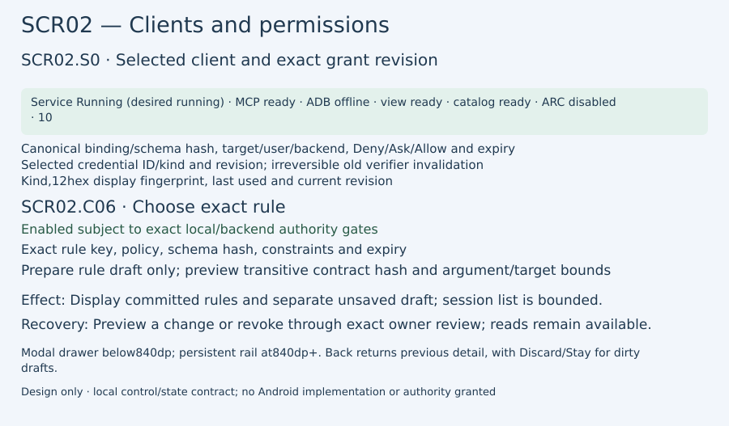

**Owner** · `SCR02.S0`

**Branch:** main

Action: SCR02.C06 Choose exact rule

**Success:** Deny/Ask/Allow draft only; unknown schema cannot become Allow

**Error:** Unknown schema cannot become Allow; choose narrower known rule or cancel

**Cancel:** Discard only unsaved fields; committed configuration/revisions remain unchanged.

Next: STB04-9; error: END_WITH_TYPED_ERROR.

---

# STB04-9 · Open exact grant commit review

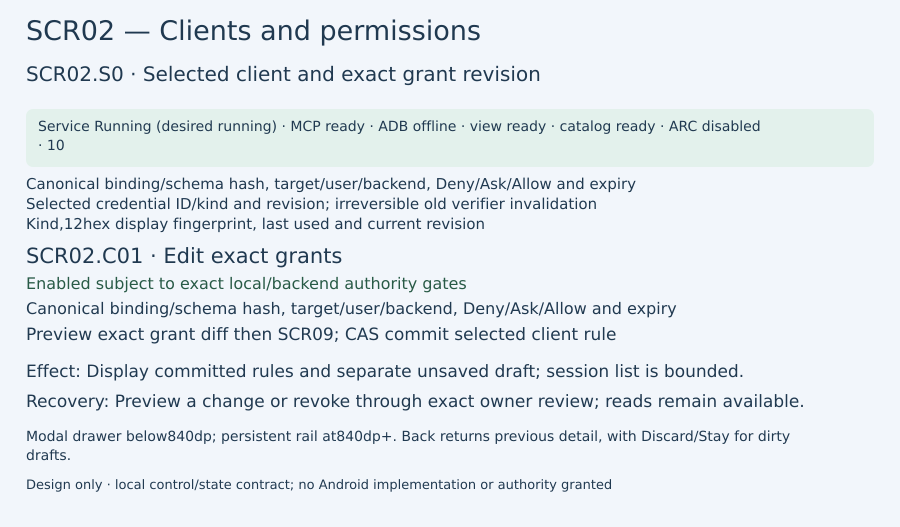

**Owner** · `SCR02.S0`

**Branch:** main

Action: SCR02.C01 Edit exact grants

**Success:** Preview exact grant diff then SCR09; CAS commit selected client rule

**Error:** 403/cancel leaves old rule;409/412 opens reload/diff before new approval

**Cancel:** Before exact commit, Deny/Back closes this challenge without applying it. After commit, no undo is implied; any reversal is a new exact owner command.

Next: STB04-10; error: END_WITH_TYPED_ERROR.

---

# STB04-10 · Approve grant CAS

**Owner** · `SCR09.S0`

**Branch:** main

Action: SCR09.C01 Authenticate and approve

**Success:** Rule epoch committed; one exact rule gains stated policy only

**Error:** Expiry/CAS change/lockout/no enrollment/drain failure denies; only original exact approved command may commit

**Cancel:** Before exact commit, Deny/Back closes this challenge without applying it. After commit, no undo is implied; any reversal is a new exact owner command.

Next: STB04-11; error: END_WITH_TYPED_ERROR.

---

# STB04-11 · Inspect active sessions

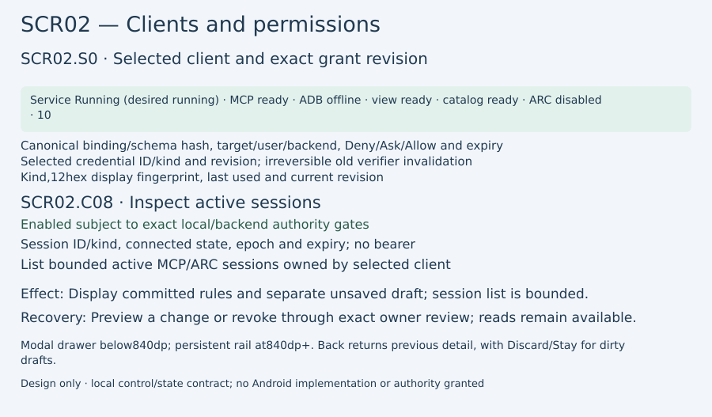

**Owner** · `SCR02.S0`

**Branch:** main

Action: SCR02.C08 Inspect active sessions

**Success:** List bounded active MCP/ARC sessions owned by selected client

**Error:** Stale cursor reloads session list without recreating a session

**Cancel:** Close the read/detail. Cancelled read does not alter the represented resource or backend registration.

Next: STB04-12; error: END_WITH_TYPED_ERROR.

---

# STB04-12 · End one selected session through exact review

**Owner** · `SCR02.S0`

**Branch:** main

Action: SCR02.C09 End selected session

**Success:** SCR09 approves session close, not credential revoke

**Error:** Already closed is idempotent terminal; uncertain transport close never replays device calls

**Cancel:** Before exact commit, Deny/Back closes this challenge without applying it. After commit, no undo is implied; any reversal is a new exact owner command.

Next: STB04-13; error: END_WITH_TYPED_ERROR.

---

# STB04-13 · Revoke credential through separate exact review

**Owner** · `SCR02.S0`

**Branch:** main

Action: SCR02.C02 Revoke credential

**Success:** SCR09 approves exact credential revoke; commit epoch and close owned sessions/streams

**Error:** Conflict requires fresh review; no automatic replacement token

**Cancel:** Before exact commit, Deny/Back closes this challenge without applying it. After commit, no undo is implied; any reversal is a new exact owner command.

Next: STB04-14; error: END_WITH_TYPED_ERROR.

---

# STB04-14 · Approve exact revoke

**Owner** · `SCR09.S0`

**Branch:** main

Action: SCR09.C01 Authenticate and approve

**Success:** Verifier/epoch invalid; session/stream/input delivery closes

**Error:** Expiry/CAS change/lockout/no enrollment/drain failure denies; only original exact approved command may commit

**Cancel:** Before exact commit, Deny/Back closes this challenge without applying it. After commit, no undo is implied; any reversal is a new exact owner command.

Next: STB04-15; error: END_WITH_TYPED_ERROR.

---

# STB04-15 · Revoked result

**Owner** · `SCR02.S4`

**Branch:** main

Action: SCR02.C08 Inspect active sessions

**Success:** Historical record retained; old bearer cannot reconnect

**Error:** Stale cursor reloads session list without recreating a session

**Cancel:** Close the read/detail. Cancelled read does not alter the represented resource or backend registration.

Next: END; error: END_WITH_TYPED_ERROR.

---

# STB04-16 · Expired-attempt branch

**Owner** · `SCR11.S1`

**Branch:** attempt expired

Action: SCR11.C01 Generate pairing challenge

**Success:** Old bootstrap secret erased; new attempt has new nonce

**Error:** Window/attempt expiry closes it; no principal exists until proof and separate exact owner commit

**Cancel:** Before exact commit, Deny/Back closes this challenge without applying it. After commit, no undo is implied; any reversal is a new exact owner command.

Next: END_WITH_RECORDED_ALTERNATIVE; error: END_WITH_TYPED_ERROR.

---

# STB04-17 · Wrong proof/origin branch

**Owner** · `SCR11.S2`

**Branch:** proof rejected

Action: SCR11.C03 Open navigation

**Success:** No principal or grant committed

**Error:** Dirty draft requires Discard/Stay; navigation never commits configuration

**Cancel:** Close drawer/Back to prior view. Dirty draft requires Discard or Stay; no save is implied.

Next: END_WITH_RECORDED_ALTERNATIVE; error: END_WITH_TYPED_ERROR.

---

# STB04-18 · Authenticator unavailable/lockout branch

**Owner** · `SCR09.S4`

**Branch:** auth unavailable

Action: SCR09.C02 Deny / dismiss

**Success:** No owner capability; fix prerequisite outside bridge if desired

**Error:** Back/system dismiss is the same denial; no side effect, no hidden next approval

**Cancel:** This action is the explicit cancellation/discard. Report its recorded disposition; do not imply reversal of an already committed external effect.

Next: END_WITH_RECORDED_ALTERNATIVE; error: END_WITH_TYPED_ERROR.

---

# STB04-19 · Changed plan/CAS branch

**Owner** · `SCR09.S2`

**Branch:** stale plan

Action: SCR09.C02 Deny / dismiss

**Success:** Old approval inert; inspect new exact diff

**Error:** Back/system dismiss is the same denial; no side effect, no hidden next approval

**Cancel:** This action is the explicit cancellation/discard. Report its recorded disposition; do not imply reversal of an already committed external effect.

Next: END_WITH_RECORDED_ALTERNATIVE; error: END_WITH_TYPED_ERROR.

---

# STB04-20 · Biometric cancelled/failed branch

**Owner** · `SCR09.S5`

**Branch:** auth cancelled

Action: SCR09.C02 Deny / dismiss

**Success:** Only selected request denied; FIFO queue next request needs own proof

**Error:** Back/system dismiss is the same denial; no side effect, no hidden next approval

**Cancel:** This action is the explicit cancellation/discard. Report its recorded disposition; do not imply reversal of an already committed external effect.

Next: END_WITH_RECORDED_ALTERNATIVE; error: END_WITH_TYPED_ERROR.

---

# STB04-21 · Manual bearer alternative: protected one-time reveal

**Owner** · `SCR11.S6`

**Branch:** manual enrollment

Action: SCR11.C07 Reveal/share manual bearer once

**Success:** Owner-approved share to selected recipient; no log/capture/remote root

**Error:** Protected reveal is not an ARC root; copy uses explicit selected-recipient share, never logs; cancel before reveal erases pending secret

**Cancel:** Before exact commit, Deny/Back closes this challenge without applying it. After commit, no undo is implied; any reversal is a new exact owner command.

Next: END_WITH_RECORDED_ALTERNATIVE; error: END_WITH_TYPED_ERROR.

---

# STB05-1 · Catalog absent: open safe import flow

**Owner** · `SCR10.S1`

**Branch:** main

Action: SCR10.C04 Open catalog import

**Success:** Open SCR03 import flow when catalog missing/quarantined

**Error:** Quarantined imported bytes are never queried as trusted data

**Cancel:** Close drawer/Back to prior view. Dirty draft requires Discard or Stay; no save is implied.

Next: STB05-2; error: END_WITH_TYPED_ERROR.

---

# STB05-2 · Choose expected validated release via SAF

**Owner** · `SCR03.S6`

**Branch:** main

Action: SCR03.C06 Choose import document

**Success:** Hash/size/capacity/deadline preview; active catalog unchanged

**Error:** Picker cancel releases transient grant; hash/schema/space failure leaves active catalog unchanged

**Cancel:** Picker cancel releases transient URI grant and pending unactivated snapshot/stage. If a write already began, show partial/unknown destination state.

Next: STB05-4; error: END_WITH_TYPED_ERROR.

---

# STB05-3 · Import validation failure branch

**Owner** · `SCR03.S5`

**Branch:** invalid import

Action: SCR03.C01 Inspect evidence

**Success:** Hash/schema/FK/space reason; never query quarantined bytes as trusted

**Error:** Missing evidence remains explicitly unknown; read never grants permission

**Cancel:** Close the read/detail. Cancelled read does not alter the represented resource or backend registration.

Next: END_WITH_RECORDED_ALTERNATIVE; error: END_WITH_TYPED_ERROR.

---

# STB05-4 · Validated sealed import preview

**Owner** · `SCR03.S7`

**Branch:** main

Action: SCR03.C07 Preview override diff

**Success:** Show registry/hash/size/revision/conflicts and stage expiry

**Error:** Invalid preview shows precise field errors; owner prearming/commit requires SCR09

**Cancel:** Discard only unsaved fields; committed configuration/revisions remain unchanged.

Next: STB05-5; error: END_WITH_TYPED_ERROR.

---

# STB05-5 · Request exact registry activation

**Owner** · `SCR03.S7`

**Branch:** main

Action: SCR03.C09 Activate validated import

**Success:** SCR09 approves exact validated registry publication; atomic CAS activates it

**Error:** Failed validation/CAS/approval leaves old active registry; new review required

**Cancel:** Before exact commit, Deny/Back closes this challenge without applying it. After commit, no undo is implied; any reversal is a new exact owner command.

Next: STB05-6; error: END_WITH_TYPED_ERROR.

---

# STB05-6 · Approve exact import publication CAS

**Owner** · `SCR09.S0`

**Branch:** main

Action: SCR09.C01 Authenticate and approve

**Success:** Atomic registry/overlay generation switch or explicit conflict

**Error:** Expiry/CAS change/lockout/no enrollment/drain failure denies; only original exact approved command may commit

**Cancel:** Before exact commit, Deny/Back closes this challenge without applying it. After commit, no undo is implied; any reversal is a new exact owner command.

Next: STB05-7; error: END_WITH_TYPED_ERROR.

---

# STB05-7 · Inspect active imported evidence

**Owner** · `SCR03.S0`

**Branch:** main

Action: SCR03.C01 Inspect evidence

**Success:** Open immutable source evidence and effective binding/type revision

**Error:** Missing evidence remains explicitly unknown; read never grants permission

**Cancel:** Close the read/detail. Cancelled read does not alter the represented resource or backend registration.

Next: STB05-8; error: END_WITH_TYPED_ERROR.

---

# STB05-8 · Draft local override

**Owner** · `SCR03.S0`

**Branch:** main

Action: SCR03.C02 Edit local override

**Success:** Immutable import retained; changed dependency/hash preview

**Error:** Invalid schema/dependency blocks preview; discard returns immutable effective record

**Cancel:** Discard only unsaved fields; committed configuration/revisions remain unchanged.

Next: STB05-9; error: END_WITH_TYPED_ERROR.

---

# STB05-9 · Preview exact override/admin command fields

**Owner** · `SCR03.S4`

**Branch:** main

Action: SCR03.C07 Preview override diff

**Success:** Show exact override/import/admin command preview; no commit yet

**Error:** Invalid preview shows precise field errors; owner prearming/commit requires SCR09

**Cancel:** Discard only unsaved fields; committed configuration/revisions remain unchanged.

Next: STB05-10; error: END_WITH_TYPED_ERROR.

---

# STB05-10 · Approve exact override commit

**Owner** · `SCR09.S0`

**Branch:** main

Action: SCR09.C01 Authenticate and approve

**Success:** CAS commit one new overlay revision; old approval invalidated on conflict

**Error:** Expiry/CAS change/lockout/no enrollment/drain failure denies; only original exact approved command may commit

**Cancel:** Before exact commit, Deny/Back closes this challenge without applying it. After commit, no undo is implied; any reversal is a new exact owner command.

Next: STB05-12; error: END_WITH_TYPED_ERROR.

---

# STB05-11 · Discard alternative before commit

**Owner** · `SCR03.S4`

**Branch:** cancel draft

Action: SCR03.C08 Discard override or import

**Success:** Draft/private unactivated stage removed; active import retained

**Error:** Active imported history is retained; cleanup unknown is surfaced, never publication

**Cancel:** This action is the explicit cancellation/discard. Report its recorded disposition; do not imply reversal of an already committed external effect.

Next: END_WITH_RECORDED_ALTERNATIVE; error: END_WITH_TYPED_ERROR.

---

# STB05-12 · Create small functional mapping draft from searchable unassigned entries

**Owner** · `SCR04.S1`

**Branch:** main

Action: SCR04.C09 Edit functional group members

**Success:** Create or edit functional member list and required dependency closure as a draft

**Error:** Unassigned entries remain searchable; cycles/oversize show errors before save

**Cancel:** Discard only unsaved fields; committed configuration/revisions remain unchanged.

Next: STB05-13; error: END_WITH_TYPED_ERROR.

---

# STB05-13 · Save coherent mapping through exact owner review

**Owner** · `SCR04.S4`

**Branch:** main

Action: SCR04.C02 Save group mapping

**Success:** SCR09 approves exact local group-mapping create/update with CAS

**Error:** Budget/dependency/conflict error saves no partial group or activation

**Cancel:** Before exact commit, Deny/Back closes this challenge without applying it. After commit, no undo is implied; any reversal is a new exact owner command.

Next: STB05-14; error: END_WITH_TYPED_ERROR.

---

# STB05-14 · Approve functional mapping CAS

**Owner** · `SCR09.S0`

**Branch:** main

Action: SCR09.C01 Authenticate and approve

**Success:** One group mapping revision; no client interest/permission change

**Error:** Expiry/CAS change/lockout/no enrollment/drain failure denies; only original exact approved command may commit

**Cancel:** Before exact commit, Deny/Back closes this challenge without applying it. After commit, no undo is implied; any reversal is a new exact owner command.

Next: STB05-17; error: END_WITH_TYPED_ERROR.

---

# STB05-15 · Oversized/dependency failure branch

**Owner** · `SCR04.S2`

**Branch:** budget exceeded

Action: SCR04.C09 Edit functional group members

**Success:** Edit member closure; no partial mapping saved

**Error:** Unassigned entries remain searchable; cycles/oversize show errors before save

**Cancel:** Discard only unsaved fields; committed configuration/revisions remain unchanged.

Next: END_WITH_RECORDED_ALTERNATIVE; error: END_WITH_TYPED_ERROR.

---

# STB05-16 · Mapping conflict branch

**Owner** · `SCR04.S3`

**Branch:** CAS conflict

Action: SCR04.C10 Reload group mapping

**Success:** Reload diff then new exact review

**Error:** Preserve local draft separately; fresh approval needed for changed command

**Cancel:** Close the read/detail. Cancelled read does not alter the represented resource or backend registration.

Next: END_WITH_RECORDED_ALTERNATIVE; error: END_WITH_TYPED_ERROR.

---

# STB05-17 · Local enable import-only HTTP admin window

**Owner** · `SCR03.S8`

**Branch:** main

Action: SCR03.C10 Manage admin window

**Success:** SCR09 binds admin principal, artifact and configured lifetime

**Error:** Expiry/revoke closes admin work; no MCP credential becomes admin; no hidden listener

**Cancel:** Before exact commit, Deny/Back closes this challenge without applying it. After commit, no undo is implied; any reversal is a new exact owner command.

Next: STB05-18; error: END_WITH_TYPED_ERROR.

---

# STB05-18 · Prearm exact external HTTP upload/import request

**Owner** · `SCR03.S4`

**Branch:** main

Action: SCR03.C07 Preview override diff

**Success:** Transfer nonsecret challenge reference; HTTP cannot open approval prompt

**Error:** Invalid preview shows precise field errors; owner prearming/commit requires SCR09

**Cancel:** Discard only unsaved fields; committed configuration/revisions remain unchanged.

Next: STB05-19; error: END_WITH_TYPED_ERROR.

---

# STB05-19 · Choose redacted call-log export scope

**Owner** · `SCR06.S0`

**Branch:** main

Action: SCR06.C04 Filter logs

**Success:** Filter bounded redacted records within owner scope

**Error:** Expired cursor restarts read, not replay of historical calls

**Cancel:** Cancel this bounded search; retain query draft and committed view, no remote mutation.

Next: STB05-20; error: END_WITH_TYPED_ERROR.

---

# STB05-20 · Request exact snapshot export approval

**Owner** · `SCR06.S0`

**Branch:** main

Action: SCR06.C02 Export selected scope

**Success:** Prepare exact redacted export snapshot then SCR09 approve snapshot ID/hash/scope

**Error:** Auth/quota failure creates no document; a changed selection needs new approval

**Cancel:** Before exact commit, Deny/Back closes this challenge without applying it. After commit, no undo is implied; any reversal is a new exact owner command.

Next: STB05-21; error: END_WITH_TYPED_ERROR.

---

# STB05-21 · Approve only sealed export snapshot

**Owner** · `SCR09.S0`

**Branch:** main

Action: SCR09.C01 Authenticate and approve

**Success:** Invoke fresh platform strong biometric/device credential prompt after input/capture quiescence

**Error:** Expiry/CAS change/lockout/no enrollment/drain failure denies; only original exact approved command may commit

**Cancel:** Before exact commit, Deny/Back closes this challenge without applying it. After commit, no undo is implied; any reversal is a new exact owner command.

Next: STB05-22; error: END_WITH_TYPED_ERROR.

---

# STB05-22 · Create-document picker writes approved snapshot

**Owner** · `SCR06.S4`

**Branch:** main

Action: SCR06.C05 Choose export document

**Success:** Write the approved sealed export through Android create-document

**Error:** Picker cancel/partial I/O releases snapshot and reports written/unknown bytes; no automatic retry

**Cancel:** Picker cancel releases transient URI grant and pending unactivated snapshot/stage. If a write already began, show partial/unknown destination state.

Next: STB05-25; error: END_WITH_TYPED_ERROR.

---

# STB05-23 · Picker-cancel alternative

**Owner** · `SCR06.S4`

**Branch:** cancel export

Action: SCR06.C07 Cancel export

**Success:** Release snapshot; no automatic reuse of approval

**Error:** Already-written document is not silently deleted; partial write is explicit

**Cancel:** This action is the explicit cancellation/discard. Report its recorded disposition; do not imply reversal of an already committed external effect.

Next: END_WITH_RECORDED_ALTERNATIVE; error: END_WITH_TYPED_ERROR.

---

# STB05-24 · Partial-write branch

**Owner** · `SCR06.S5`

**Branch:** export I/O failure

Action: SCR06.C01 Inspect record

**Success:** Show partial/unknown bytes; never silently delete destination

**Error:** Missing optional payload says not logged, never reconstructs it

**Cancel:** Close the read/detail. Cancelled read does not alter the represented resource or backend registration.

Next: END_WITH_RECORDED_ALTERNATIVE; error: END_WITH_TYPED_ERROR.

---

# STB05-25 · Edit logging/retention quotas

**Owner** · `SCR06.S0`

**Branch:** main

Action: SCR06.C06 Edit retention quotas

**Success:** Same per-client client_id/logging_revision editor; global capacity separately uses bridge_config row_version

**Error:** Invalid/low capacity rejects; mandatory audit failure closes new dispatch

**Cancel:** Discard only unsaved fields; committed configuration/revisions remain unchanged.

Next: END; error: END_WITH_TYPED_ERROR.

---

# STB05-26 · Mandatory audit reserve exhausted branch

**Owner** · `SCR06.S3`

**Branch:** audit durability failure

Action: SCR06.C01 Inspect record

**Success:** New dispatch fail-closed; dashboard SCR01.S6 shows runtime Error with separate actual MCP health

**Error:** Missing optional payload says not logged, never reconstructs it

**Cancel:** Close the read/detail. Cancelled read does not alter the represented resource or backend registration.

Next: END_WITH_RECORDED_ALTERNATIVE; error: END_WITH_TYPED_ERROR.

---

# STB05-27 · Inspect runtime admission failure on dashboard

**Owner** · `SCR01.S6`

**Branch:** runtime error alternative

Action: SCR01.C04 Open health details

**Success:** Mandatory audit/store/backend consistency failure closes new device dispatch; listener health remains independently observed.

**Error:** Missing facet is unknown, never inferred from another ready facet

**Cancel:** Close the read/detail. Cancelled read does not alter the represented resource or backend registration.

Next: END_WITH_RECORDED_ALTERNATIVE; error: END_WITH_TYPED_ERROR.

---

# STB06-1 · Draft inbound listener and allowed ordinary root

**Owner** · `SCR08.S5`

**Branch:** main

Action: SCR08.C07 Edit inbound ARC listener

**Success:** Edit inbound ARC listener/root and per-client entry-point action grants

**Error:** Protected roots/secret surfaces not selectable; remote self-approval impossible

**Cancel:** Discard only unsaved fields; committed configuration/revisions remain unchanged.

Next: STB06-2; error: END_WITH_TYPED_ERROR.

---

# STB06-2 · Request protected enable/save

**Owner** · `SCR08.S0`

**Branch:** main

Action: SCR08.C01 Save with revision

**Success:** SCR09 approves exact settings draft; CAS save desired config and applicable lifecycle changes

**Error:** Conflict rejects entire draft; bind failure keeps desired vs actual separate

**Cancel:** Before exact commit, Deny/Back closes this challenge without applying it. After commit, no undo is implied; any reversal is a new exact owner command.

Next: STB06-3; error: END_WITH_TYPED_ERROR.

---

# STB06-3 · Approve exact ARC configuration

**Owner** · `SCR09.S0`

**Branch:** main

Action: SCR09.C01 Authenticate and approve

**Success:** Bind only after commit; listener actual state independent from desired enabled

**Error:** Expiry/CAS change/lockout/no enrollment/drain failure denies; only original exact approved command may commit

**Cancel:** Before exact commit, Deny/Back closes this challenge without applying it. After commit, no undo is implied; any reversal is a new exact owner command.

Next: STB06-4; error: END_WITH_TYPED_ERROR.

---

# STB06-4 · Compatible client authenticates to inbound listener

**Compatible ARC client** · `SCR08.S6`

**Branch:** main

Observation: SCR08.C09 Inspect inbound controllers

**Success:** expected_kind=arc; bounded controller/session list; retained wire1.0

**Error:** No ADB or outbound status inferred from this page

**Cancel:** Close the read/detail. Cancelled read does not alter the represented resource or backend registration.

Next: STB06-5; error: END_WITH_TYPED_ERROR.

---

# STB06-5 · Inbound authorized redacted watch on management_readonly root

**Compatible ARC client** · `SCR08.S6`

**Branch:** main

Observation: SCR08.C09 Inspect inbound controllers

**Success:** Finite authorized observation/watch only; management click/focus/property/input returns failed CommandResult

**Error:** Denied root/policy/auth closes or rejects with the documented retained ARC status; no management action is dispatched

**Cancel:** Close the read/detail. Cancelled read does not alter the represented resource or backend registration.

Next: STB06-7; error: END_WITH_TYPED_ERROR.

---

# STB06-6 · Owner challenge cannot isolate bridge input branch

**Owner** · `SCR09.S3`

**Branch:** quiescence failed

Action: SCR09.C02 Deny / dismiss

**Success:** No OS prompt; bridge capture/input stays blocked

**Error:** Back/system dismiss is the same denial; no side effect, no hidden next approval

**Cancel:** This action is the explicit cancellation/discard. Report its recorded disposition; do not imply reversal of an already committed external effect.

Next: END_WITH_RECORDED_ALTERNATIVE; error: END_WITH_TYPED_ERROR.

---

# STB06-7 · Normal protected challenge: capture/input suspended

**Owner** · `SCR09.S0`

**Branch:** main

Action: SCR09.C04 Inspect exact challenge

**Success:** No secret/approval surface enters any frame/tree/log queue

**Error:** Changed plan terminates review; owner must open a newly issued challenge

**Cancel:** Close the read/detail. Cancelled read does not alter the represented resource or backend registration.

Next: STB06-8; error: END_WITH_TYPED_ERROR.

---

# STB06-8 · Deny challenge and resume ordinary admission safely

**Owner** · `SCR09.S0`

**Branch:** main

Action: SCR09.C02 Deny / dismiss

**Success:** No configuration mutation or remote approval

**Error:** Back/system dismiss is the same denial; no side effect, no hidden next approval

**Cancel:** This action is the explicit cancellation/discard. Report its recorded disposition; do not imply reversal of an already committed external effect.

Next: STB06-9; error: END_WITH_TYPED_ERROR.

---

# STB06-9 · Rotate inbound ARC credential through exact review

**Owner** · `SCR08.S6`

**Branch:** main

Action: SCR08.C08 Rotate inbound ARC credential

**Success:** SCR09 approves exact inbound ARC credential rotation

**Error:** Commit revokes old verifier/epoch; bind/session failures do not restore old bearer

**Cancel:** Before exact commit, Deny/Back closes this challenge without applying it. After commit, no undo is implied; any reversal is a new exact owner command.

Next: STB06-10; error: END_WITH_TYPED_ERROR.

---

# STB06-10 · Approve rotation

**Owner** · `SCR09.S0`

**Branch:** main

Action: SCR09.C01 Authenticate and approve

**Success:** Old streams/input leases close at epoch barrier

**Error:** Expiry/CAS change/lockout/no enrollment/drain failure denies; only original exact approved command may commit

**Cancel:** Before exact commit, Deny/Back closes this challenge without applying it. After commit, no undo is implied; any reversal is a new exact owner command.

Next: STB06-11; error: END_WITH_TYPED_ERROR.

---

# STB06-11 · Client closes watch socket or receives revoke

**Compatible ARC client** · `SCR08.S6`

**Branch:** main

Observation: SCR08.C09 Inspect inbound controllers

**Success:** No Cancel8 command and no guaranteed terminal on peer close

**Error:** No ADB or outbound status inferred from this page

**Cancel:** Close the read/detail. Cancelled read does not alter the represented resource or backend registration.

Next: END; error: END_WITH_TYPED_ERROR.

---

# STB06-12 · Disabled-result observation

**System/backend event** · `SCR08.S5`

**Branch:** listener disabled

Observation: SCR08.C09 Inspect inbound controllers

**Success:** No listener/socket/controller root; no phantom Ready

**Error:** No ADB or outbound status inferred from this page

**Cancel:** Close the read/detail. Cancelled read does not alter the represented resource or backend registration.

Next: END_WITH_RECORDED_ALTERNATIVE; error: END_WITH_TYPED_ERROR.
