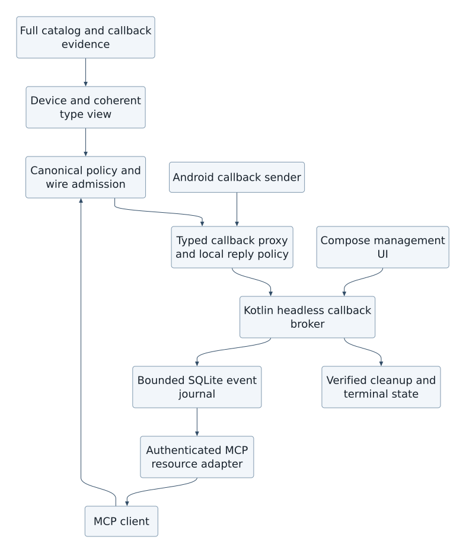
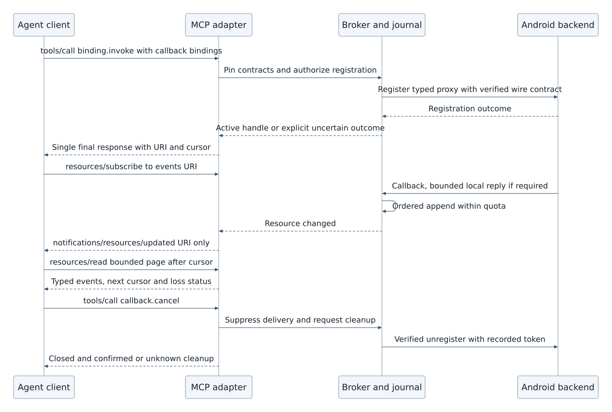
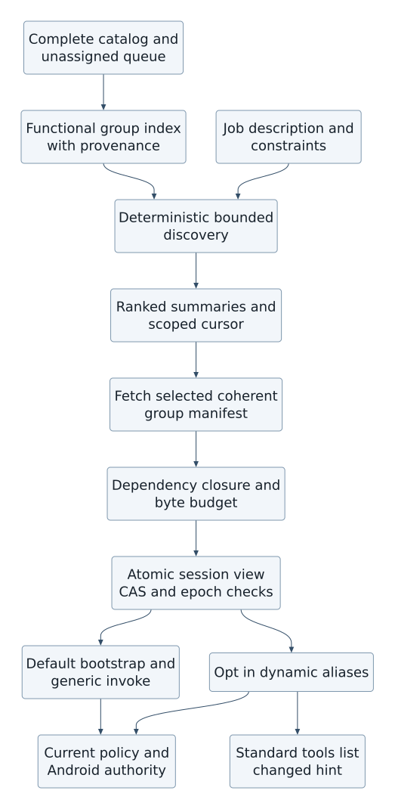

## Catalog-driven callbacks and bounded event delivery

This extension records the user's callback and functional tool-group requirements. It is a design and catalog contract, with offline reference validation planned below; it does not claim a deployed subscription service or complete callback extraction. It preserves the complete inventory, startup device resolution, existing authority gates, Avalonia12 management UI, headless service, SQLite configuration, ADB convenience operations and optional Android RemoteControl integration.

### Callback inventory and evidence

Every imported binding and type receives a callback-classification disposition: proven callback, candidate, proven non-callback, or unknown with a reason. The global index retains unclassified and unreachable records. Extract all source-declared callback interfaces, listener/delegate types and abstract callback classes, their inherited methods, and methods accepting or returning them. Binder one-way syntax proves call semantics; a name ending in Listener or Callback alone proves only a candidate. An ordinary synchronous Binder interface can also be a callback. Registration patterns inferred from names remain candidates until supported by signature, documentation, annotations, implementation direction or explicit reviewed source evidence. HIDL generates clauses describe RPC completion results and must not automatically become durable subscriptions.

Each versioned CallbackDescriptor records stable callback-type and method IDs; normalized type and method schema hashes; declaration/source locator and immutable import hash; platform, extension, module and interface applicability; role and confidence; argument direction and zero-based formal argument position; registration, replacement and cleanup binding IDs; and registration-token/receiver identity mapping. A relationship may be many-to-many or unresolved. Overloads use canonical IDs, never names alone. Registration/cleanup pair evidence must establish token ownership and argument mapping; unsupported, ambiguous and unknown cases remain searchable. No absent evidence is converted into an Android availability claim. Callback metadata follows immutable imports plus provenance-qualified local overrides, revisions, history and ETag/CAS rules used by other catalog entries. Overrides cannot manufacture runtime wire proof or Android authority.

The device-resolved view includes callback types and the coherent closure of event argument types, response types, registration results and cleanup arguments. Callback roles are independent from existence, reachability, verified codec/wire contract, OS authority and MCP client grants. The same canonical permission plan covers generated, generic and raw invocation, callback registration, event reception, local reply policy and cleanup. A generic raw transaction cannot bypass that plan by supplying a callback object as an opaque argument. Unknown callback ABI, return semantics, cleanup mapping or sender-verification requirements yield an explicit unsupported reason for registration; their source records remain in the inventory.

### Invocation and subscription lifecycle

The existing binding.invoke tool adds an optional callback_bindings array. Each item identifies the formal parameter position, CallbackDescriptor ID/revision/hash, selected callback method IDs, delivery policy, retention limits, lease, and a bounded local response policy when needed. Supplying arbitrary executable code, an external callback URL or an untyped Binder object is not supported. The resolved registration/cleanup/type/wire contracts and the client's current grants are checked before proxy creation. The backend validates the callback sender using its supported UID/endpoint capability checks; inability to establish the required sender boundary is explicit, not inferred from a client-supplied identity.

Registration is a bounded operation with one final tools/call response. The response includes registration outcome (active, failed or outcome_unknown), the ordinary invocation result, and subscription descriptors. An active descriptor contains subscription_id, stream_epoch, events_uri, initial application cursor, cancellation handle, lease expiry, effective buffer quotas and schema pins. The URI and handle are opaque locators, not bearer authority. Registration idempotency keys are scoped to client principal, credential epoch, target/user/backend epoch and exact contract hash; reuse with different arguments conflicts. If a device transaction may have executed but its reply is lost, persist outcome_unknown and do not blindly register again. Callbacks arriving during registration enter a provisional bounded journal and become visible only with an active registration; a failed or uncertain registration retains a restricted diagnostic disposition and cleanup obligation.

The persistent headless service owns CallbackBroker and the journal; closing the Avalonia window does not stop it. Subscription records and retained events may survive transport reconnect and bridge restart. Android callback registrations generally do not survive bridge/device/backend death. Recovery marks those registrations orphaned, records the reason and attempts only verified cleanup/reconciliation; it does not claim a durable live Binder proxy or automatically replay a side-effecting registration. Lifecycle states are registering, active, cancelling, closed, orphaned and outcome_unknown. Every transition has a revision and reason. Terminal states cannot be silently reactivated; a new registration gets a new stream epoch/handle.

An explicit callback.cancel tool performs idempotent cancellation and verified unregister/dispose using the recorded token mapping. Its result distinguishes locally closed delivery from confirmed remote cleanup and cleanup_unknown. Binder death, target uninstall, device/backend epoch change, permission revocation and lease expiry invalidate delivery. Authorization is rechecked on reads and before event publication; revocation immediately suppresses payload access and queues least-privileged recorded cleanup. It never authorizes an arbitrary new operation on behalf of a revoked client. Transport disconnect alone is not cancellation. A configured lease/grace bounds disconnected retention; a client must explicitly renew within its authorized maximum. resources/unsubscribe stops resource-update hints only; it does not unregister the Android callback. Deactivating a tool group does not orphan subscriptions: the bootstrap cancel/status tools remain available.

### MCP2025-11-25 transport contract

The interoperable baseline uses standard MCP resources. The server advertises resources.subscribe support. The invocation result returns a resource link and events_uri such as android-callback://subscription-id/events. The client may subscribe to that exact URI with resources/subscribe. A coalescible notifications/resources/updated notification contains the URI only. The client then uses resources/read on the advertised URI template android-callback://subscription-id/events{?cursor,limit,max_bytes} to obtain a finite application/json journal page. The no-query URI reads the earliest retained page. A page contains events, next_cursor, has_more, oldest_retained_cursor, terminal state and any explicit loss range. The implementation validates and canonicalizes the URI, checks ownership, enforces fixed maxima, and never treats path/query values as SQL or file paths. Cursors bind subscription, stream epoch, principal/credential scope and retention revision; they are integrity-protected and opaque. An expired cursor returns cursor_expired with the available retention boundary, never a fabricated contiguous replay.

On StreamableHTTP, standard notifications can arrive on the client's GET SSE stream; on stdio they are ordinary MCP notification messages. A POST tools/call may use SSE while registration runs, then produces its single final JSON-RPC response and normally terminates that request stream. Callback events do not become additional final responses or indefinite progress updates. Clients lacking resource-subscription support can explicitly perform bounded reads; this is caller-driven retrieval, not a bridge business-monitoring scheduler. A resource link is not a promise that every MCP host automatically subscribes or inserts payloads into agent context.

Direct payload SSE is optional and disabled by default. A future implementation may expose a separately authenticated subscription stream, or a fully documented mutually negotiated experimental extension. It must advertise its exact transport, authorization, schema, limits and cancellation rules and retain the standard resource-read fallback. No custom method is represented as an MCP standard notification. The baseline requires no extension and does not depend on an LLM host implementing one.

Transport Last-Event-ID is an MCP stream-replay token, subject to session/stream routing and server retention; it is distinct from the callback application's journal cursor. Reconnecting transport may replay a resource-update hint but does not advance or acknowledge journal consumption. Client deduplication uses (subscription_id, stream_epoch, sequence), not the SSE event ID. Standard progress tokens stop with the original operation and are not used as permanent subscription channels. These are application patterns composed from the pinned standard, not new MCP guarantees. Sources: [MCP transports](https://modelcontextprotocol.io/specification/2025-11-25/basic/transports), [MCP resources](https://modelcontextprotocol.io/specification/2025-11-25/server/resources), [MCP tools](https://modelcontextprotocol.io/specification/2025-11-25/server/tools), [MCP progress](https://modelcontextprotocol.io/specification/2025-11-25/basic/utilities/progress).

### Event envelope, bounds and synchronous replies

Each accepted event has subscription_id, stream_epoch, a decimal-string sequence, event_id, callback method ID, immutable schema hash, registration correlation ID, observed UTC timestamp, monotonic capture offset and either typed payload, scoped payload-resource reference, or typed error. Sequence order is assigned atomically when appending within one subscription across concurrent Binder threads; it is not a claim about physical ordering across threads, callbacks or subscriptions. Replay is at-least-once for retained accepted journal events; Android source delivery and crashes before durable acceptance are not exactly-once guarantees. Source omissions and known loss ranges are exposed. No acknowledgement deletes another consumer's events; any explicit acknowledgement is consumer-scoped and retention still honors the shared bounded quota.

Default proposed limits are 256 events or1MiB per subscription (whichever comes first), 64KiB inline event, 64 events/128KiB per read, 10-minute journal retention, 5-minute renewable lease and a global per-client journal quota. These are configurable engineering defaults pending Android measurement, not published platform limits. Admission reserves space for terminal/loss metadata and applies the lower server/client quota. Payload-resource references consume the same quota and cannot bypass it. The default overflow policy closes delivery and reports buffer_overflow; optional drop_oldest/drop_newest is explicitly chosen and reports exact lost sequence ranges. Coalescing requires semantic evidence and opt-in, otherwise it can erase meaningful events. Oversized/unsupported payloads produce a bounded typed error or scoped resource, never silent truncation. Binder threads release native resources promptly; no producer waits for a remote consumer to drain the buffer. Disk-full marks durability_failed and closes the stream; it does not acknowledge a durable append. Reads and resource hints do not log payloads by default.

For return-valued synchronous callbacks, the reply path is local. Registration must select an allowlisted typed constant or bounded deterministic handler with method-specific evidence that the response is valid. It must also declare a monotonic deadline no longer than the verified caller allowance and an approved typed timeout/error/default policy. There is no universal safe default or universal Binder deadline. Unknown deadlines/default semantics or unbounded handlers mean unsupported_synchronous_reply. The event may still report the locally selected reply and reason after completion. A remote agent may update a future policy only by a separate authorized CAS mutation; no current synchronous call blocks on network, model inference, resource reads or agent approval. Void/one-way callbacks enqueue and return promptly; HIDL RPC completion adapters retain their finite call correlation and are not mislabeled as subscriptions.

SQLite stores subscription metadata/revisions, exact contract pins, lease state, journal records keyed by subscription/epoch/sequence, per-client quotas, cleanup obligations and bounded replay cursors. Event-journal persistence is functional data storage, distinct from configurable call logging. Both use app-private storage, owner-controlled retention and per-client disclosure. Logging can record correlation/size/errors without payload; sensitive payload logging requires that client's explicit configuration. No callback can execute an app-specific decision workflow in the bridge.

## Small functional tool groups and job-based discovery

The complete catalog remains available, but an agent starts with a small stable bootstrap tool set: android.groups.discover, android.groups.describe, android.groups.set_active, binding.invoke, callback.status and callback.cancel. Generic invocation accepts canonical IDs and validates the exact contract. Full schema enumeration is an explicit bounded operation. The management UI provides functional groups, current activation, estimated context cost, required grants, availability reasons and per-client logging controls alongside the existing client configuration. Discovery can locate unknown/unavailable capabilities without granting access to their invocation or revealing another client's private overrides/configuration.

Groups represent a small coherent job capability, such as display brightness read/write, location subscription lifecycle, audio volume control, package metadata inspection or rendered-screen input. These are illustrative group shapes, not a curated allowlist or a claim that these source mappings are implemented. A group is neither one Java package nor an entire Android subsystem. Every entry has one or more provenance-qualified group memberships or an explicit unassigned reason and remains searchable by canonical ID/type/source. Shared types and permissions live in the global index, not duplicated as conflicting per-group definitions. Do not semantically re-shard the physical catalog as part of this design change.

FunctionalGroup records stable group_id, revision, content hash, title, bounded description, searchable labels, immutable import provenance and override lineage; canonical binding memberships; required type closure; dependencies and optional related groups; lifecycle invariants; and measured serialized descriptor bytes plus an explicitly labeled token estimate. Registration/unregistration/replacement and token/type dependencies form one atomic lifecycle unit. A group cannot advertise registration while hiding the required cleanup operation. Unknown cleanup remains visible and blocks activation of that unsafe registration unit. Large coherent units can stay generic-invoke-only with an oversize reason; they cannot be partially loaded to satisfy a context budget. Dependencies use immutable revisions/hashes, cycle validation and bounded closure; unresolved dependency metadata is explicit.

android.groups.discover accepts a task/job description, optional capability/backend/device constraints, availability and permission filters, maximum groups, maximum response bytes and optional estimated-token budget. The server deterministically searches normalized labels, descriptions, canonical symbols and source-derived functional annotations, then ranks stable ties by group ID. Optional semantic ranking may improve relevance only; the deterministic index remains usable without an LLM, and ranking never changes grants or device authority. Descriptions, user overrides and job text are untrusted data, never instructions executed by the bridge. The result returns ranked small summaries, IDs/revisions/hashes, relevant capability IDs, dependency counts, applicability/permission status with reasons and a scoped continuation cursor. It omits all full tool/type schemas. Bounded ranking is over the full index, not a preselected functional subset. Search bounds may stop work with an explicit partial-search flag and cursor; the response never claims exhaustive job suitability when a search was truncated.

For example, “observe location changes, then stop” can return a location-subscription group summary including register/unregister/callback lifecycle and location payload-type dependency. The agent describes that group for exact contracts, asks to activate the coherent unit within its budget, invokes registration, consumes its bounded resource journal and cancels. The bridge makes no travel, app-specific or timing decision. If permission is denied or applicability unknown, discovery reports that status and activation cannot grant the missing authority.

### Activation, concurrency and host compatibility

Interest/activation is scoped to authenticated client, credential epoch and MCP session. It is separate from per-client permission grants and from the device's resolved availability. android.groups.set_active submits the entire desired group-ID/revision/hash set plus expected view ETag and byte/token-estimate budgets. The transaction resolves dependencies and types, checks current catalog/device/policy epochs, serializes the proposed descriptors and atomically accepts the complete set or returns a conflict/budget/unknown-dependency error without partial activation. Deactivation uses the same CAS operation. Stable tool names include canonical binding identity; names cannot be reused for different contracts after refresh. View cursors bind owner/session, activation revision, catalog/device/policy epochs and expiry. Foreign, stale or mismatched cursors are rejected. No client sees another session's activation or private mappings.

There are two explicit presentation modes. The default portable mode exposes only the stable bootstrap tools through tools/list; active groups supply bounded schema manifests for generic binding.invoke. This prevents bridge-side eager exposure of thousands of generated tools even if a host exhausts tools/list pagination. A host that supports an explicitly negotiated group-view feature may opt into dynamic aliases for its active groups. In that mode, tools/list enumerates exactly the current session's coherent activated aliases plus bootstrap tools, with bounded pages and a revision-scoped cursor. Changes emit the standard notifications/tools/list_changed when advertised. This custom session-view feature and its cache contract are documented as an opt-in application feature, not a standard MCP selective-context guarantee. Unknown hosts use portable mode.

Pagination alone cannot prevent an eager host fetching every page. list_changed support also does not guarantee that a host refreshes its cache or evicts old schemas from the model context. The bridge can bound its response sizes and exposed set; actual host context usage is a measured integration property. A client unable to apply dynamic changes retains bootstrap/generic-invoke mode and explicitly fetches only the required manifest pages. Token estimates are labeled with estimator/version and never treated as an exact host-model tokenizer budget. A strict UTF-8 serialized-byte maximum is enforced independently, including descriptions and dependency/type metadata; a single oversize unit is refused for alias loading.

Catalog import, override revision, group mapping edits, device/backend change and permission revocation invalidate the matching caches. In-flight calls pin their admitted complete contract/type/policy plan. A harmless activation view change alone does not invalidate an already admitted call or live callback handle; a contract, capability or authority change revalidates or rejects it with stale_contract/revoked/epoch_changed. No cached schema grants continuing authority. Subscriptions retain explicit cancellation/status through bootstrap even when their group is removed. Safe descriptor-only group changes may preserve handles when their exact registration, callback and cleanup pins are unchanged; incompatible changes require explicit cancellation/re-registration, not silent retargeting.

### Management, CRUD and component responsibilities

The catalog CRUD contract adds immutable imported CallbackDescriptor and FunctionalGroup resources, append-only evidence, separate local overlays and CAS history. GET/list support bounded filters and stable cursors. Owner-authenticated PUT/PATCH/DELETE affects local mappings or tombstones; imported evidence is never rewritten. Deleting a referenced group mapping is rejected while an active view pins it or creates a new revision used only after explicit activation; existing evidence remains retrievable by revision. Activation is a session operation, not an import mutation. Client permission changes keep their existing independent grant API and immediately invalidate affected admission/cache epochs.

Avalonia12 presents a functional-group editor and searchable unassigned queue, source/default versus local override provenance, dependency and callback pair inspection, context budget previews, active session views and subscription status/cancellation. UI edits use the same CAS APIs. It distinguishes source evidence, device applicability, permission denial and current activation. The persistent service remains operational independently of this UI, retains its running indicator and separate MCP/ADB health, and applies existing Android foreground-service and boot limits.

| Component | Responsibility |
| --- | --- |
| ICallbackCatalogClassifier | Exhaustive disposition and evidence-qualified role/pair/type metadata; unknowns retained. |
| ICallbackAdmissionPlanner | Pin coherent registration/event/reply/cleanup contracts and apply canonical policy, OS and wire gates. |
| ICallbackProxyAdapter | Verify supported sender boundary, decode typed callbacks and provide bounded local synchronous replies. |
| ICallbackBroker / ISubscriptionJournal | Atomic ordered append, quotas, leases, replay, loss/terminal markers and cleanup obligations in the headless service. |
| IMcpCallbackResourceAdapter | Standard subscribe/update/read URI mapping, exact authorization and bounded pages; no custom standard notifications. |
| IFunctionalGroupIndex | Full-catalog searchable memberships/unassigned records and deterministic job ranking. |
| IGroupActivationPlanner | Complete dependency closure, serialized-byte budgeting and session-scoped CAS view activation. |
| IMcpToolViewAdapter | Stable bootstrap fallback; opt-in dynamic aliases and standard list_changed notification. |

### Requirement and acceptance traceability

| Requirement | Technical contract | Acceptance criteria and offline verification |
| --- | --- | --- |
| FR-CB-01 identify all callbacks | TR-CB-01 exhaustive evidence-qualified dispositions, inherited methods, source/version pins, unresolved pair reasons | AC-CB-01 every input binding/type accounted for; overloaded/inherited/listener/Binder/HIDL completion fixtures preserve uncertain records without false classification. |
| FR-CB-02 invoke with callback bindings | TR-CB-02 typed parameter mapping and atomic admission; finite registration outcome and subscription descriptor | AC-CB-02 foreign descriptor/type/contract/target mismatch fails; uncertain registration is not duplicated; paired cleanup and type closure are tested. |
| FR-CB-03 consume bounded streaming events | TR-CB-03 standard resource journal protocol, application cursors, independent transport replay and quotas | AC-CB-03 finite page/read limits, replay/dedup, concurrent sequence allocation, cursor expiry, explicit gaps and overflow are tested; notification contains URI only. |
| FR-CB-04 safe callback lifecycle | TR-CB-04 cancel/death/revoke/disconnect/restart/lease semantics and bounded local synchronous policy | AC-CB-04 idempotent cancel, cleanup_unknown, revocation suppression, orphan recovery, deadline/default rejection and no remote synchronous reply are tested. |
| FR-GRP-01 small functional groups without catalog omission | TR-GRP-01 stable mappings/provenance and coherent lifecycle/type closure with searchable unassigned entries | AC-GRP-01 full membership accounting, callback-pair atomicity, dependency cycles, overrides and oversized-unit refusal fixtures. |
| FR-GRP-02 locate capabilities for a job | TR-GRP-02 deterministic bounded discovery plus optional ranking, summaries and scoped pagination | AC-GRP-02 stable ordering, byte limits, unknown/denied status, filters and cross-client cursor isolation; discovery cannot change grants. |
| FR-GRP-03 activate a bounded session view | TR-GRP-03 CAS/epochs, atomic set/dependency budget and portable bootstrap mode | AC-GRP-03 concurrent stale-CAS rejection, no partial activation, cached-schema revocation, handle continuity and static-host fallback fixtures. |
| FR-GRP-04 manageable mappings and visibility | TR-GRP-04 SQLite import/overlay/history and Avalonia group/subscription editors | AC-GRP-04 immutable imports, override history and ETag conflicts tested offline; actual Avalonia/MCP host behavior remains a future implementation acceptance gate. |

Validation status: these newly added requirements are not covered by the frozen round012 review. Latest completed independent overall agreement remains93% accuracy/80% completeness, NOT_READY; its design category is94/95 and contracts95/94. New callback/group contracts, producers, lifecycle reference fixtures and host interoperability require a fresh frozen review. The disclosed full-catalog semantic/coverage and bounded-memory resolution gaps remain open; this design update does not reclassify them as complete.
