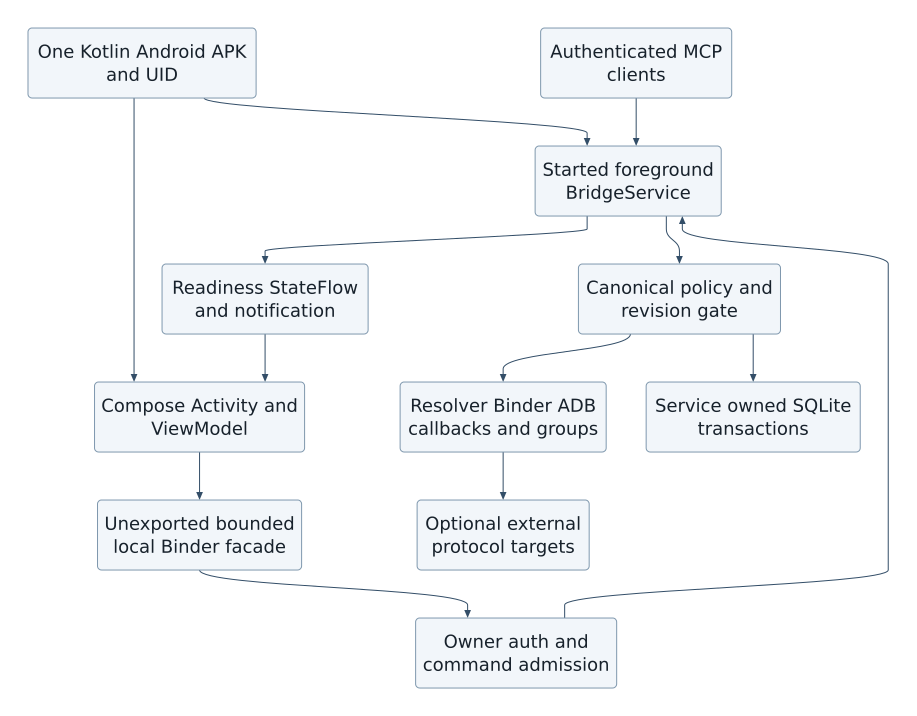

## Kotlin server and Jetpack Compose management UI

The user's latest language decisions supersede the original Avalonia12/.NET management-stack requirement: both the MCP server and management UI are Kotlin. Ship one Android APK, one application UID and initially one application process. A Kotlin started foreground BridgeService owns the server and all authoritative state; a Kotlin ComponentActivity hosts Jetpack Compose presentation. The activity binds to the already-started service through an unexported local Binder facade, never through an unauthenticated loopback admin endpoint. This same-process facade is not a new privilege boundary. There is no managed runtime, C# server, .NET UI or Kestrel requirement. Python extraction and offline reference models remain build/validation tooling, not delivered Kotlin server implementation.

BridgeService owns MCP initialization/transport/authentication, persistent listener and notification lifecycle, client policy/approval admission, catalog and SQLite transactions, version/type resolution, Binder/ADB adapters, callback journal/cleanup and functional discovery/activation. Only its repositories open the writable configuration database; the activity submits typed commands with expected revisions and observes immutable state. SQLite platform APIs and prepared statements provide the executable-DDL path; any alternative persistence layer must pass the same constraints, migrations and transactions. Do not assume an ORM automatically preserves trigger behavior. Catalog snapshots are read-only handles after validation; replacement uses the established staging/activation protocol.

The local facade exposes bounded operations for status, paginated catalog/group/subscription reads and authorized owner commands. It accepts no arbitrary SQL, reflection, raw object graph or universal service reference. The Compose ViewModel uses lifecycle-aware asynchronous state collection, and long work runs in service-owned coroutine scopes on bounded IO/worker executors. Activity destruction cancels observers and pending presentation work, not accepted server operations or the foreground service. Client disconnect/BindService disconnect yields reconnecting/stale UI state, not a false Running indication. The app does not equate possession of an in-process UI reference with authorization: owner-sensitive commands require the existing fresh authenticated owner approval bound to nonce, exact operation, expected revisions and expiry. Remote tool calls cannot submit that local approval capability. Same UID and same process are not evidence of physical touch or user intent; the remote-input quiescence and owner-authentication gates still apply.

Startup validates config migration, desired-state and keystore availability, obtains an eligible foreground-service start, begins its foreground notification within platform deadlines, loads trusted catalog/capability snapshots and admits only a ready device view. Listener bind/initialization determines Running. A bound activity alone does not start or preserve server readiness. Stop persists desired state first, closes admission, suppresses callback delivery, performs bounded recorded cleanup, closes transports/journals/storage and reports any uncertain remote outcomes before stopSelf; it cannot wait indefinitely for a device. Activity and notification Stop actions enter the same service command path. The service owns notification updates; the Compose AppBar renders the same state stream with separate MCP and ADB health. Optional boot/restart remains subject to all previously documented Android restrictions.

The Compose UI preserves client pairing, grants, logging controls, catalog CRUD/overrides/history, full inventory and permission fields, device availability, functional-group editor/job search, loaded-session budgets, subscriptions and cancellation, protected approvals, connection profiles and status. Config CAS commits atomically update storage, policy/cache epochs and a transactional outbox; the service publishes state and standard MCP change hints only after commit. Simultaneous activity and MCP catalog edits either commit against the expected revision or conflict, never silently overwrite. Pending owner approvals bind the exact server plan and are invalidated by relevant revision/identity changes. UI-side validation is a convenience; the server repeats authoritative validation.

Generic phone/app control remains the authorized ADB screen.state/input.tap path, independent of Compose internals. The bridge's ordinary Kotlin UI can be inspected/controlled by that same permitted rendered-screen path, subject to protected-owner-surface restrictions; a Compose semantics/test API is not exposed as a production remote-control bypass. SharpNinja.Avalonia.RemoteControl remains only an optional protocol-compatible external-target adapter for apps that deliberately embed its Android Runtime/Protocol. It is not a bridge UI dependency and requires no .NET runtime inside the Kotlin bridge. A Kotlin adapter would implement the pinned framing/protobuf protocol and target-authentication contract directly; if no verified implementation is present, report adapter_unsupported rather than imply cross-runtime method calls.

| Requirement | Kotlin ownership and acceptance |
| --- | --- |
| FR-KT-01 Kotlin MCP server | TR-KT-01 BridgeService owns transport, policy, storage, resolution and backends. AC-KT-01 architecture/build checks reject a managed/C# server host; Kotlin contract tests apply the same canonical policy and schema fixtures as offline tooling. |
| FR-KT-02 Kotlin management UI | TR-KT-02 Compose Activity/ViewModel uses a bounded unexported local facade. AC-KT-02 activity recreation/unbind does not stop admitted service work; direct SQL/unauthorized owner commands are rejected; UI shows stale/disconnected health truthfully. |
| FR-KT-03 coherent lifecycle/config | TR-KT-03 service coroutine and database ownership, post-commit state/outbox publication and bounded shutdown. AC-KT-03 concurrent CAS conflict, migration failure, delayed callback cleanup, start denial, process death and notification/AppBar transitions are verified in Kotlin/instrumentation acceptance tests. |
| FR-KT-04 preserve remote control | TR-KT-04 ADB generic control plus optional external protocol target. AC-KT-04 ordinary Compose screens work through approved generic input; protected approvals cannot be remotely granted; missing external adapter remains explicitly unsupported. |

These are new design decisions and acceptance plans, not a Kotlin application implemented by this task. The current deliverables remain design, catalog/schema/extractor tooling and offline executable references. Primary platform references: [Jetpack Compose](https://developer.android.com/compose), [started and bound services](https://developer.android.com/develop/background-work/services/bound-services), [Binder/AIDL threading](https://developer.android.com/develop/background-work/services/aidl).

