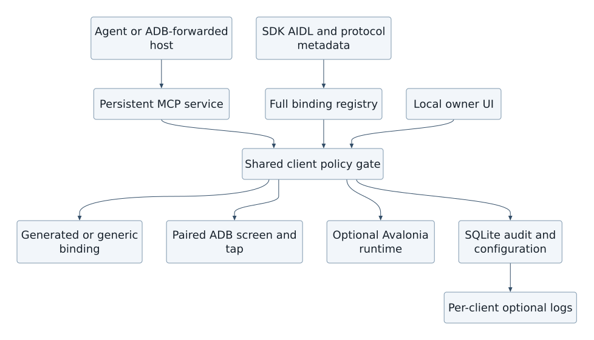
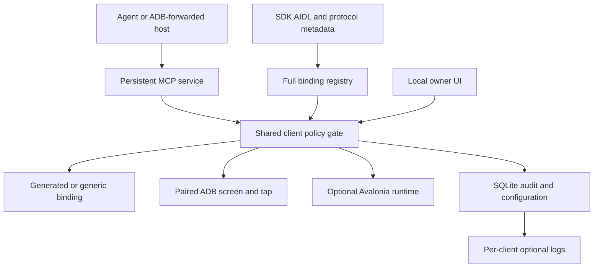
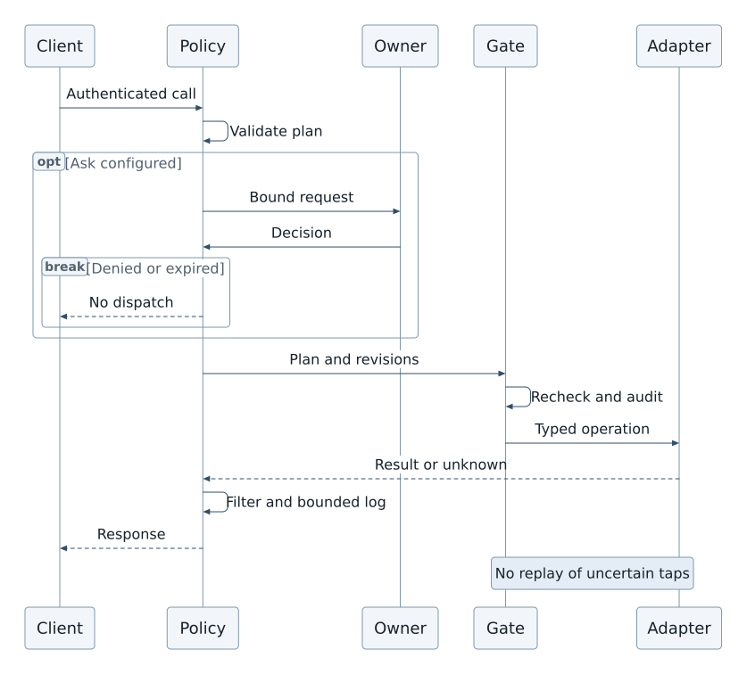
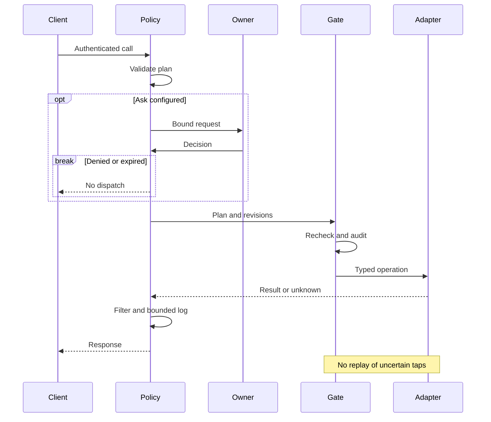

# Android MCP bridge design

Avalonia 12 permission management and SQLite client configuration

Design proposal  •  26 October 2026  •  For architecture and implementation planning


# 1 Recommended design

Build an Android application that maps the full declared Android binding surface, rather than a curated list of hand-written bindings, and exposes it through MCP. The MCP server runs in a persistent foreground service independently of the UI, with optional start on boot. It exposes generated and schema-driven tools to on-device agents through authenticated loopback Streamable HTTP. Owner-paired ADB provides app-agnostic, on-demand rendered screen state and coordinate taps for uninstrumented Android apps. The calling agent decides when to poll, how to interpret pixels and where to tap; the bridge contains no app-specific workflows or scheduler. Public Android APIs, known Binder AIDL interfaces and optional Avalonia.RemoteControl cover narrower integrations. Avalonia 12 manages permissions; SQLite stores client, target, connection and logging configuration.

The bridge is a comprehensive binding gateway and a security boundary. Inventory completeness is separate from permission to invoke a binding. Native API and Binder calls use the bridge UID; authorized ADB commands normally use the Android shell identity. Neither preserves the MCP caller identity. Authenticate and authorize every client before dispatch. Effective authority is the intersection of bridge policy, adapter constraints and the selected backend’s actual Android authority. Root and hidden-API bypass are not assumed. A separately permissioned low-level Binder transaction interface exposes reachable endpoints without promising that Android will authorize every call.

| Layer | Responsibility and boundary |
| --- | --- |
| On device MCP clients | Untrusted agent processes. A credential identifies a client; names and package headers do not. |
| Loopback transport | Authenticate each HTTP request, validate host and origin, enforce resource limits and isolate sessions. |
| Bridge application core | Validate typed arguments, evaluate policy, obtain request specific approval and admit execution. |
| Binding registry and executors | Generated SDK/AIDL/protocol inventory, generic invocation and optional low-level Binder transactions; ADB and Avalonia executors. Mapping is not a grant. |
| Android platform and services | Final OS permission checks, target application permissions and lifecycle constraints. |


## Design commitments

- Deny by default. A new tool, client or widened schema never inherits an Allow rule.

- Deny, Ask and Allow are policy choices. OS unavailable is a separate observed capability state, not a fourth policy setting.

- Expose the complete declared binding inventory with mapping and availability reasons. Per-client policy governs invocation, not whether a binding exists in the inventory.

- Permission edits and revocation have a defined dispatch boundary; already dispatched irreversible work cannot be recalled.

This is a proposed design, not a tested Android implementation. Section 2 lists compatibility gates; Section 19 defines the evidence required before shipping. Sections 14 to 18 specify per-client logging and authorized ADB/remote-control modes; the binding coverage and registry sections define comprehensive exposure. Sources identify platform facts; limits and component boundaries are design decisions.


# 2 Components and compatibility gates

Use one Android application process and UID initially. A persistent foreground service owns the MCP listener and recovery state while the Avalonia activity owns presentation; closing the activity must not stop the server. They call the same application interfaces in process; creating another Binder hop solely for UI control adds no security boundary. Keep internal Android services and receivers unexported; any deliberately exported Binder entry point independently checks caller identity before async handoff. A separate service process is a later reliability option, not a privilege boundary by itself.

| Proposed project | Contains | Must not contain |
| --- | --- | --- |
| Bridge.Domain | Client identities, typed policy, canonical requests, decisions, revision values | Android or UI dependencies |
| Bridge.Application | Pairing, policy changes, approvals, admission gate, audit coordination | Direct Binder transactions |
| Bridge.Protocol | MCP mapping, paginated catalog and transport independent session dispatch | Permission decisions hidden in handlers |
| Bridge.Bindings | SDK/AIDL metadata ingestion, versioned schemas, code generation and generic marshalling | Assumed schemas for unknown private services |
| Bridge.Storage.Sqlite | Repositories, migrations and transactional outbox | Raw bearer secrets |
| Bridge.Android | Android lifecycle, Keystore, capability probes and native, ADB and optional Avalonia remote adapters | Policy bypass through reflection or raw dispatch |
| Bridge.UI | Avalonia views, view models, local admin workflows | Direct SQL writes or implicit catalog-admin authority |
| Bridge.Tests | Pure policy tests, contract clients, fake adapters, Android instrumentation | Assumptions that mocks prove OS access |


## Baseline and release gates

Avalonia 12 supports Android on .NET 10; target net10.0-android and pin a tested, consistent 12.x package set. Select minimum Android API and supported devices from product needs and current support tiers, not from a generic old template. [S1]

| Gate | Evidence required before choosing packages or shipping |
| --- | --- |
| Android hosting | Release build runs an Android compatible HTTP engine with the MCP protocol layer. Do not assume ASP.NET Core or Kestrel works on Android; hide the engine behind ILoopbackHost. |
| MCP compatibility | Pin the 2025-11-25 wire baseline and a compatible SDK release after a real client exchange. Later SDK protocol revisions require a separate review; never mix initialization or session semantics. |
| SQLite native load | Prove selected provider on each shipped ABI, trimmed release and chosen AOT mode. Microsoft.Data.Sqlite defaults to SQLitePCLRaw.bundle_e_sqlite3; this does not prove this app deployment works. [S2] |
| Persistent service | Prove truthful foreground service type, boot/start eligibility, notification behavior and restart recovery. Persistent hosting is required; an OS-blocked start is an explicit failure state, not a silent downgrade. [S3] |
| Trusted local endpoint | Prove paired server identity and credential setup in target MCP clients. TLS pinning and manual bearer support vary by client; do not silently downgrade. |


# 3 Transport and request lifecycle

Compatibility target: MCP 2025-11-25 Streamable HTTP at one /mcp endpoint. This names a deliberate baseline, not a claim that it is the latest specification. Implement its initialization, protocol version negotiation, POST handling and optional GET SSE behavior as a coherent profile. Prefer the official protocol implementation behind an Android proven host adapter. [S4]


## Endpoint protections

- Bind explicitly to 127.0.0.1 and, only if tested, ::1. Never 0.0.0.0, public interfaces or automatic remote tunneling. Validate Host against the bound endpoint; reject unexpected Origin values and all browser origins by default. An absent Origin is not authentication.

- Authenticate every POST, GET, DELETE and SSE reconnection. A session identifier is not a credential. Bind sessions and event cursors to client, credential epoch and server boot identifier. Reject cross client session reuse.

- Prefer paired loopback HTTPS with pinned bridge identity. Plain HTTP with a reusable bearer token has residual local port impersonation risk: another app can listen when the bridge is stopped. A bound before sharing ephemeral port helps but does not authenticate the server. If retained for compatibility, label this lower assurance mode and require explicit enablement; disable sensitive and state changing tools. Never disable certificate validation globally or install a system CA as a shortcut. Pairing trust is app specific and requires client support, so wire compatibility does not guarantee a drop in client setup.

- Suggested initial limits: 256 KiB request body, JSON nesting 32, 4 active calls per client, 64 globally, bounded SSE queues and per client rate limits. Tune with tests; fail with explicit overload rather than unbounded memory growth.


## One tool call

1. Parse a bounded UTF-8 JSON-RPC message; authenticate the transport credential and resolve the internal client record. Validate session ownership and negotiated protocol.

1. Resolve the generated binding/tool ID and exact schema hash from the active versioned registry, or the explicitly scoped low-level transaction contract. Reject unknown fields, invalid types and out of range values. Materialize defaults before canonicalization.

1. Resolve a validated invocation plan with binding ID, owned object/Binder handles, output fields, limits and service or ADB identity. Generic/raw calls use their own explicit schemas and scopes; caller-supplied transaction codes never bypass policy. SQL is never an execution transport.

1. Evaluate current policy and Android capability. If Ask applies, suspend without dispatch and request local approval. Timeout, dismissal or absence of UI means no execution.

1. Under the admission gate, recheck identity, revisions, scope, capability and approval; atomically consume one use approval and record execution admission. Dispatch outside the SQLite transaction.

1. Invoke the adapter off the UI thread. Recheck before every subsequent effect or result emission; sanitize and bound output. Record a minimal outcome and return a normal MCP result or a sanitized error.


## Discovery and streams

bindings.search/list/get expose every entry in the declared source coverage, including denied, unavailable and schema-unknown entries with reasons. Generated per-binding MCP tools are paginated; binding.invoke provides a generic route to the same registry rather than requiring a giant tool prompt. If a client needs a filtered callable-tool view, keep the complete inventory separately accessible. Deny/Ask/Allow never removes a binding from the inventory, and discovery never grants execution. Pin cursors to registry/policy snapshots; reject stale cursors. Send negotiated list-change notifications after registry changes. SSE is transport, not a new subscription grant.


# 4 Pairing and client identity

The authenticated principal is an immutable, random internal client_id resolved from a credential. MCP clientInfo.name, a display label, IP address, Android package text and user agent strings are untrusted metadata. HTTP alone cannot establish the calling Android package or UID. A copied bearer credential impersonates its owner; this is an explicit residual risk of the manual client profile.


## Manual pairing flow

1. The owner opens Clients and selects Add client. The bridge creates an expiring pairing attempt in memory while its listener is already bound. Show endpoint, server identity fingerprint and a one time high entropy bootstrap secret; never use a short numeric code as the only credential.

1. The owner enters this configuration in the intended agent. The agent proves possession of the bootstrap secret and presents a proposed label. The bridge UI displays a request fingerprint and identifies the label as client supplied. Require local confirmation before activation.

1. Issue a cryptographically random per client bearer secret with at least 256 bits of entropy. Return it once over the authenticated pairing channel. The owner chooses a least privilege preset or starts with all tools denied. Pairing never grants all existing or future tools.

1. Store only a verifier and nonsecret credential identifier. Consume the bootstrap secret on success; expire after a proposed two minute window or repeated failed attempts. If delivery fails, revoke the issued credential and pair again rather than redisplay it.

Use an explicit pairing surface outside the MCP method catalog and enabled only during a local pairing window. Do not expose admin methods, policy mutation or token creation as agent tools. Manual preconfigured bearer authentication is an interoperability profile, not a claim of full MCP OAuth authorization compliance. A standards based authorization adapter may be added when target clients require it. [S5]


## Optional package aware pairing

A dedicated, narrowly scoped Android pairing entry point can verify a real Binder calling UID and the associated signing identity. Do not accept the package name from request JSON. Resolve multi package UIDs, signing lineage and package changes deliberately. This grants no authority beyond owner approved policy; do not require it for generic MCP clients.


## Credential lifecycle

| Action | Required effect |
| --- | --- |
| Rotate | Create a new credential and show it once. Owner may permit a short overlap. At its end, atomically revoke old, increment client epoch and move retained replacement to that epoch. Invalidate all client sessions and approvals. |
| Disable client | Persist disabled state and revision, cancel approvals and reject new admissions. Preserve policy for review; reenable requires local owner action. |
| Revoke | Persist revocation, increment credential epoch and close affected streams. Reuse is permanently rejected even if a client session remains open. |
| Restore backup | Restore client labels and rules as disabled templates only. Never restore active credentials, sessions, approvals or server identity. Require fresh pairing. |


# 5 Permission model and evaluation

Use one policy evaluator over canonical binding identities and exact schema hashes, with Deny, Ask or Allow plus typed constraints. A required entry-point tool rule can only restrict binding authority. No wildcard tools, rule priorities, inherited Allow or regular expression permission language. Presets only populate explicit rules after preview; newly registered tools remain denied.

| Order | Check | Result when it fails |
| --- | --- | --- |
| 1 | Valid credential, active client, bridge running | Reject; no capability or policy details to unauthenticated callers |
| 2 | Known binding or explicit low-level contract and accepted schema version | Unavailable or invalid tool |
| 3 | Global emergency deny or tool disabled | Deny, regardless of client choice |
| 4 | Every canonical binding has an exact schema-bound client rule and the entry-point rule exists; no rule denies | Deny by default |
| 5 | Arguments and requested output fit all scope constraints | Deny; Ask cannot expand the scope |
| 6 | Current backend authority, device state and target availability | OS unavailable; never treat Allow as an OS grant |
| 7 | Rule is Ask or global tool floor requires Ask | Require a valid one use request bound approval |
| 8 | Versions and capability still valid at admission | Admit, otherwise reevaluate or reject |


## Scope semantics

Each adapter defines a closed constraint schema. Allowed resource identifiers and fields are exact sets; numeric caps are maximums; requested time ranges must fit the allowed interval. Within one rule all constraints are ANDed. Global, client and adapter bounds intersect. Empty sets mean no access, not unrestricted access. Unknown constraint keys or schema versions fail closed. Scope is evaluated on canonical resolved identifiers, never display strings or path prefix comparisons.

Example: contacts.list may permit only displayName for selected contact identifiers, at most 20 rows and no phone or email fields. Requesting phone is denied, not silently upgraded to Ask. An approved document handle identifies one selected document and mode; a caller supplied content URI or filesystem path is not an equivalent grant. UI constraints and adapter enforcement use the same typed model.

```
evaluate(principal, plan, snapshot):
  require active(principal) and currentCredential(principal)
  resolve generated, generic and known raw calls to identical canonical bindings
  reject known raw calls that cannot decode and validate the canonical arguments
  require a schema-bound binding rule for EVERY binding; absence or stale hash denies
  unknown raw calls require an explicit broad raw backend/service grant and tool rule
  collect binding rules, required entry-point rule and global/adapter guardrails
  if any deny or unknown semantics or arguments outside ANY constraint: DENY
  if not capabilityAvailableNow(plan): OS_UNAVAILABLE
  if any ask or globalAskFloor(plan): require validOneUseApproval(principal, plan, snapshot)
  recheck credential, registry/schema/target/policy versions at admission
  return ADMIT_CANDIDATE  // commit admission before dispatch
```


## Why capability inventory is separate

Capability inventory records adapter presence, supported Android level, native permissions or ADB pairing state, AppOps/special access, hardware state, target binding health and check time. It is observed state, not policy. Store a diagnostic cache only; check required state again at execution. A permission callback or UI resume triggers refresh, but stale snapshots cannot guarantee a call will succeed. Native app grants and paired ADB shell authority are distinct; neither is root. Android remains the final authority. [S6]


# 6 Request specific approval

Ask means approval of one prepared execution, not consent to an unbounded future conversation. The UI is a trusted local management surface, not a dialog rendered by the MCP client. Treat client names, arguments and returned service data as untrusted text. Do not let a tool result, deep link or notification action approve a request by itself.


## Approval binding

Compute a versioned canonical digest after strict JSON validation, default insertion and typed resource resolution. Reject duplicate keys, nonfinite numbers and ambiguous encodings. Define deterministic object key ordering and numeric/string handling; preserve semantically significant text rather than normalizing it casually. Include all behavior affecting arguments and output filters, not just the tool name.

```
approvalBinding = Hash(
  canonicalizationVersion, serverBootId, requestNonce,
  clientId, credentialEpoch, toolId, adapterSchemaVersion,
  canonicalArguments, resolvedResourceIds, targetIdentity,
  expectedResourceVersion, policyRevision, registryRevision,
  capabilityGeneration, monotonicExpiry
)
```

Use a monotonic deadline within the current boot and a UTC timestamp only for display/audit. Proposed approval lifetime is 60 seconds, capped by the caller deadline. Wall clock rollback must not extend it. The raw arguments and any sensitive preview remain memory only. A changed resource version, target identity, policy revision or capability generation invalidates the approval and requires reevaluation.

| State | Allowed transition |
| --- | --- |
| Pending | Approved, denied, expired, canceled or invalidated; no adapter call |
| Approved | Consumed once at admission if every binding still matches; otherwise invalidated |
| Consumed | Execution may begin; a retry cannot reuse this approval |
| Terminal | Denied, expired, canceled or invalidated cannot return to Approved |


## Interaction and race handling

- Show client identity/fingerprint, exact action, recipient or resource, relevant values, requested output, side effect warning and expiry. Default focus is Deny. Allow once is separate from Edit policy; persistent permission changes use the normal Apply flow.

- If the app is not in the foreground, use a privacy preserving notification that opens the app, subject to Android permission and background launch restrictions. Do not launch arbitrary activities silently. No available approval UI means expiry, not auto approval.

- Keep the MCP request pending with bounded transport time and negotiated progress if available. No custom approval polling method is required for the baseline. If the request is canceled or times out before admission, cancel approval. Socket disconnection alone is not MCP cancellation; the original deadline still applies. [S4]

- At admission, serialize approval consumption with revocation and policy commits. Atomically require status Approved and an exact revision match. Never hold a database transaction or a global lock while waiting for a human or while executing Binder work.


# 7 Revocation and Android lifecycle


## A precise execution boundary

A single application admission coordinator orders permission commits, revocations and execution admissions. Under its short gate, persist the mutation or admission, update the immutable policy snapshot and signal affected work before releasing the gate. A policy commit must not acknowledge success while another thread can still admit against an old snapshot. SQLite serializes durable writes; the coordinator additionally orders in memory dispatch decisions.

Define admission as the linearization point. Work admitted before revocation may already be in progress and can have irreversible effects. Recheck immediately before the adapter call to narrow the gap, but do not promise atomic revocation across a remote Binder service. Later steps in a multi step adapter need new checks. Prefer single effect adapters; require target supported transactions if a multi effect atomic operation is promised.

| Situation | Behavior |
| --- | --- |
| Policy becomes narrower | Invalidate pending approvals; reevaluate queued calls and active output. Stop future disallowed effects and disclosures. Do not reuse cached discovery as authority. |
| Client revoked | Reject new requests and admission; cancel cooperatively, drop queued events, close its streams and prevent replay to the old principal. |
| Effect already dispatched | Attempt documented cancellation if safe. Record completed, canceled or outcome unknown honestly. Revocation is not rollback. |
| Connection reconnects | Authenticate again and validate ownership and revisions. Default v1 has no durable event replay; client retries cannot recreate an approval. |


## Persistent server requirement

The MCP server must remain running independently of the Avalonia activity. Implement an Android foreground service with a persistent notification, explicit start/stop commands and a restart strategy such as START_STICKY where eligible. Persistence is the required operating mode, not an optional optimization. Android can still kill or restrict the process; there is no unconditional uptime guarantee on every device. WorkManager is not the listener host.

Select a truthful foreground service type and meet its prerequisites. Evaluate specialUse with a declared subtype and any required distribution review, or connectedDevice only when the real use and prerequisites fit. Do not label an indefinite MCP server dataSync. Android background-start and boot restrictions remain release gates. A denied start exposes Error or Start requires owner action rather than pretending the server is running. [S3, S7]

Persist desired_state running/stopped and start_on_boot separately from observed listener health. Start sets desired running; explicit Stop sets stopped before shutdown. A crash keeps desired running for recovery. START_STICKY recreation may supply a null Intent, so restore configuration from durable state rather than replaying the previous command. Keep stopWithTask disabled; task swipe and force-stop are different events. Stop closes admission/listeners, invalidates approvals, cancels supported work and releases only owned connections. Never turn a deliberate stop into an automatic restart.


# Service boot recovery and status indicators


## Optional boot start

A manifest boot receiver reads only a minimal nonsecret boot preference, then requests eligible service startup; it does not perform database migrations or network work inline. Prefer full startup after user unlock, when credential-encrypted SQLite and Keystore material are available. Do not move client credentials, ADB keys or policy data into device-protected storage to bypass unlock. Persist a small boot preference mirror only, reconcile it with the authoritative configuration after unlock, and default off if inconsistent.

Enable Start on boot only through local configuration. A prior manual Stop suppresses restart until Start is chosen again. Boot preference does not override force-stop, Android user-stopped state, device policy or denied foreground-service eligibility. A blocked or pre-unlock start is reported as Waiting for unlock or Start requires owner action. Android 15 limits BOOT_COMPLETED starts for several service types, including dataSync, camera, media playback, phone call, media projection and microphone; do not route around those limits. [S27]


## Independent server and backend health

On recovery create a new boot ID, reopen and validate storage, restore policy, bind the authenticated endpoint, then report Running. Old sessions and approvals expire; admitted operations become interrupted or unknown and are never replayed. Reconnect ADB and Binder independently with bounded backoff and identity checks. The MCP server remains running even when self-ADB needs re-pairing or a target is offline; catalog entries report the backend unavailable.

Keystore unavailability, migration failure or integrity failure cannot yield a permissive server. Remain paused or in an explicit error state with owner remediation. Binder death invalidates object handles and relevant approvals. ADB disconnect invalidates pending capture references and prevents new ADB admissions, but does not silently stop the MCP listener.


## AppBar and Android status icon

Show a matching MCP server icon in the Avalonia top AppBar and the Android foreground-service notification/status bar. Derive both from actual listener readiness: Starting, Running, Stopping, Stopped or Error. Running begins only after bind and initialization succeed. ADB offline adds a separate backend warning while the MCP Running icon remains. Opening the notification shows server status; its explicit Stop action updates desired state before stopping and removes the foreground-service notification/icon. The in-app indicator changes to Stopped.

Use a dedicated notification channel and Android monochrome small icon, with accessible text and no secret identifiers. Request notification permission where applicable. On Android 13+, denial can suppress the normal drawer/status-bar notification even though the foreground service appears in system task management; channel settings and system UI also control visibility. The app cannot guarantee or override the system icon when notifications are disabled. Keep in-app status truthful. [S28]

Acceptance: close/rotate the activity without losing MCP service; kill the process and recover without replay; verify manual Stop and force-stop remain stopped; test reboot with boot enabled/disabled, pre-unlock and denied starts, listener bind failure, notification denial and ADB offline while MCP stays Running.


# 8 Avalonia management interface

Use an Android single view application with MVVM and compiled bindings. Keep navigation state in view models and platform activity concerns behind services. Use a narrow phone layout below a proposed 720 device independent pixel breakpoint and a two pane layout above it; validate the breakpoint on actual devices and with large text.


## Wide layout permission editor

| Clients | Client permissions for Research agent |
| --- | --- |
| Search clients | Active  •  fingerprint 6F2A  •  policy revision 18 |
| Research agent / Personal assistant / Test client | Permissions   Logging   Approvals   Connection |
| Add client / Disable client / Revoke credentials | Search all bindings  \|  Policy  \|  Mapping status |


| Tool | Policy choice | Scope | Android status |
| --- | --- | --- | --- |
| screen.state | Deny  [Ask]  Allow | Whole display | ADB connected |
| settings.brightness.set | Deny  [Ask]  Allow | Raw range 16 to 240 / Manual mode only | Special access missing |
| document.read | [Deny]  Ask  Allow | No document handles | No selection |
| input.tap | [Deny]  Ask  Allow | Device wide input | ADB connected |


Draft changes 2    Discard    Review and apply


## Phone layout without a compressed grid

| Research agent | Permission detail |
| --- | --- |
| Search tools / Brightness write / Ask  •  OS access missing | Policy / Deny    [Ask]    Allow / Scope / Raw range 16 to 240    Edit |
| Device battery / Allow  •  Available | Android access / WRITE_SETTINGS not granted / Manage Android access |
| 2 draft changes | Discard    Review and apply |


Wireframes are functional layouts, not final visual styling. On a phone, the detail pane is a separate page. Permission choices remain editable even while OS access is unavailable, but the UI states clearly that the rule cannot execute until Android access is separately granted. Granting Android permission never changes client policy.

Use touch targets of at least a proposed 48 dp, text labels as well as colors, screen reader names, logical focus order and scalable text. Persist draft state across rotation without persisting secrets or pending approval payloads. Never place a real credential in clipboard automatically, diagnostic screenshots or notification text.


# 9 Editing and approval workflows


## Navigation and screen responsibilities

| Screen | Primary content and actions |
| --- | --- |
| Overview | Runtime mode, endpoint identity, active sessions, approval count, capability issues and explicit Start or Stop. |
| Clients | Labels, credential fingerprints, active or disabled status, last seen metadata. Add, rotate, disable and revoke with clear consequences. |
| Permissions | Tool catalog, Deny Ask Allow controls, scope editor, effective policy explanation and separate OS capability state. |
| Approvals | Pending requests ordered by expiry. Open detail, review exact effect, Deny or Allow once; no bulk approval. |
| Logging and activity | Per-client Off/Metadata/Redacted diagnostic mode, expiry, quotas, purge/export and minimal audit. No raw payload inspection. |
| Settings | Persistent server health and AppBar icon, Start on boot, connections, notification settings, retention, export/restore and diagnostics. |


## Draft then apply

1. Load client config with row_version and global policy_revision. Edits only change a local draft. Show a dirty indicator and warn before leaving. Inline scope validation uses the adapter schema.

1. Review shows old and new decisions and scope deltas, especially widened resource sets, output fields and limits. Bulk changes require a per tool preview and cannot include future tools. Never bulk convert unavailable tools to Allow silently.

1. Apply submits expected row_version and policy_revision to the application service. Inside one transaction, reject a mismatch; otherwise write rules, increment revisions, append minimal audit and outbox records. Under the admission gate install the new snapshot and invalidate approvals before acknowledging success.

1. On conflict, show the latest saved state alongside the draft. The user may reload or explicitly reapply a reviewed merge. Never use last writer wins for permission grants. Read the committed state back through the application service to update the UI.


## Approval detail

Example: “Research agent wants to read display names for 3 selected contacts. No phone numbers or email addresses will be returned. Permission policy revision 18. Expires in 42 seconds.” Show stable client fingerprint and selected resource summary. Ask the owner to unlock or authenticate locally for sensitive approvals if the chosen security profile requires it.

Deny is immediate. Allow once is enabled only while the binding and deadline remain valid. If scope, resource revision or policy changes, replace the button with “Request changed — review again.” The UI must never rewrite the pending request and approve a different one. Closing the page does not approve anything.


## Android access and recovery

Manage Android access opens an appropriate Android permission or settings flow through a platform abstraction while the activity is visible. Explain why it is needed and respect denial. Returning refreshes the capability inventory. Show remediation for denied permission, unavailable hardware, locked device, missing target service, unsupported OS and bridge stopped separately; do not collapse all into a gray Allow control.


# 10 SQLite schema and invariants

Use one app private SQLite database for configuration and minimal durable state. Client, credential, execution and audit IDs are opaque random TEXT values; binding_id and entry_id are the same SHA-256 canonical source-signature identity defined in catalog/README.md, independent of source occurrence; timestamps are UTC integer milliseconds; revisions and epochs are nonnegative INTEGER values. All required fields are NOT NULL. Use explicit CHECK, UNIQUE and foreign key constraints; validate structured scope data in the application even if JSON checks are available.

| Table and key | Fields and required constraints |
| --- | --- |
| clients / PK client_id | display_name; state CHECK active/disabled/revoked; credential_epoch >= 0; row_version >= 1; created_at; updated_at; last_seen_at nullable. Names are not unique identities. |
| credentials / PK credential_id | client_id FK clients RESTRICT; verifier BLOB length 32; key_alias; state CHECK active/revoked; created_at; expires_at nullable; revoked_at nullable; epoch >= 0. UNIQUE(verifier). No raw tokens. |
| tools / PK tool_id | schema_version; adapter_version; capability_key; scope_schema_version; risk_class; registry_revision. binding associations through tool_binding_aliases; registry is generated from versioned sources. This table is a reconciled catalog, not executable imported code. |
| client_tool_rules / PK client_id, tool_id | client_id FK clients CASCADE; tool_id FK tools RESTRICT; tool_schema_version; effect CHECK deny/ask/allow; scope_json; scope_schema_version; updated_at. One exact rule per client/tool; schema mismatch is denied. |
| policy_state / PK singleton_id = 1 | policy_revision >= 1; registry_revision >= 1; emergency_deny CHECK 0/1; updated_at. Monotonic increments on every authorization relevant mutation. |
| tool_guardrails / PK tool_id | tool_id FK tools RESTRICT; disabled CHECK 0/1; require_ask CHECK 0/1; scope_json; scope_schema_version. These restrictions intersect client rules and cannot grant access. |
| executions / PK execution_id | client_id FK clients RESTRICT; credential_id FK credentials RESTRICT; tool_id FK tools RESTRICT; request_digest BLOB; boot_id; policy_revision; state CHECK admitted/dispatched/completed/failed/canceled/unknown; admitted_at; completed_at nullable; idempotency_key nullable. |
| audit_events / PK event_id | occurred_at; client_id nullable; tool_id nullable; operation; decision; reason_code; policy_revision; execution_id nullable; duration_ms nullable. No raw arguments, tokens, contacts or result text. |
| change_outbox / PK change_id | policy_revision; change_kind; affected_client_id nullable; created_at; delivered_at nullable. Written in the same transaction as policy changes; delivery is idempotent. |
| schema_migrations / PK version | checksum; applied_at. Exactly ordered migrations; app also checks PRAGMA user_version before opening the runtime. |


Pending approvals, pairing attempts, sessions and raw arguments/results stay in memory and die on restart. Optional allowlisted diagnostic projections follow Section 14, never raw payload persistence. Persist only redacted terminal approval events in audit_events. Keep revoked clients and credential tombstones until related executions age out; physical deletion is a separate retention operation, never a route to reenable old credentials.


# 11 Storage transactions and secret protection

| Table and key | Additional configuration records |
| --- | --- |
| resource_grants / PK handle_id | client_id FK clients CASCADE; exact_uri_ciphertext; key_alias; modes CHECK read/write/read_write; enabled CHECK 0/1; revision >= 1; created_at. Index(client_id, enabled). Opaque per client handle; never a caller supplied URI. |
| bridge_config / PK singleton_id = 1 | row_version >= 1; desired_state CHECK running/stopped; start_on_boot CHECK 0/1; last_stop_reason nullable; fgs_type; transport_profile CHECK paired_tls/reduced_http; loopback_address; port_preference; server_identity_key_alias; retention_days >= 0; audit_size_cap > 0. No secret or private key bytes. |


Persisted Android URI grants belong to the bridge app; resource_grants is the narrower per client mapping. Recheck the actual OS grant and exact document identity on each use. Scope never relies on URI prefix matching. Disable missing grants; after restore the owner reselects resources. Config or handle changes that affect authorization increment policy_revision under the same admission gate.


## Indexes and connection policy

Index credentials(client_id, state), client_tool_rules(tool_id), executions(client_id, admitted_at), audit_events(client_id, occurred_at), audit_events(occurred_at) and change_outbox(delivered_at, change_id). Add a partial unique index on executions(client_id, tool_id, idempotency_key) WHERE idempotency_key IS NOT NULL. Generate keys per intended operation, not per HTTP retry; reject reuse with a different request digest.

Enable PRAGMA foreign_keys=ON for every connection and verify it. Use WAL on app private local storage, a bounded busy timeout, short transactions and a single application writer queue. Readers use short snapshots so they do not pin the WAL indefinitely. Start with synchronous=FULL for security relevant mutations; benchmark before changing durability. Schedule bounded checkpoints and monitor database, WAL and free disk sizes. [S8, S9]


## Permission commit and execution admission

```
with admissionGate:
  BEGIN IMMEDIATE
  assert client.row_version == expectedClientVersion
  assert policy_state.policy_revision == expectedPolicyRevision
  validate entire proposed rule set
  write rules; increment client.row_version and policy_revision
  append audit_event and change_outbox
  COMMIT
  install new immutable snapshot; invalidate old approvals
  signal affected calls and streams
// Acknowledge Apply only after the gate has published the commit
```

Execution admission uses the same gate: reevaluate the current snapshot, reserve/consume an in memory one use approval, insert the admitted execution and commit before dispatch. On persistence failure no call is issued; a reserved approval is invalidated rather than restored optimistically. Crash after commit but before or during Binder execution yields unknown, not automatic retry. SQLite cannot atomically commit a remote Android side effect.


# Secret protection and storage recovery


## Secrets and privacy

For token format credential_id.secret, look up the nonsecret ID and compare a constant time HMAC-SHA-256 verifier of the full token with a nonexportable Android Keystore key. SQLite stores the verifier and key alias, never the token or HMAC key. Separate keys protect transport server identity and any encrypted metadata. Hardware backing is checked, not assumed; Keystore protects extraction but a compromised app process may still invoke its keys. [S10]

Do not store caller secrets in SQLite connection strings, preferences, logs, analytics or crash attachments. Sensitive scope labels and identifiers may require application level encryption under a Keystore wrapped key, depending on threat model. Base SQLite is not encrypted by default. An encrypted provider is an additional dependency and deployment gate, not an implicit property of SQLite.


## Migrations and backup

Pause the listener for migrations, check schema/version and available space, apply each transactional migration and record its checksum only on success. Run foreign key and integrity checks. If a migration fails or the schema is newer than supported, remain stopped with a recovery message; do not reset the database or weaken policy. Use SQLite backup APIs or a tested consistent export, never copy only the live .db while WAL is active. [S11]

Exclude secrets, the live database and sidecars, approvals and sessions from both cloud backup and device transfer. Validate Android extraction rules on supported devices; allowBackup=false alone is not a universal device transfer guarantee. [S14] Export a versioned, integrity checked configuration package with scope review; encrypt exports containing private identifiers. Restore into a staging database, validate, preview changes, then activate atomically with all clients disabled, fresh revisions and fresh pairing. Keystore keys are not assumed portable.


# 12 Convenience tool contracts

These convenience wrappers do not limit the exposed binding surface. Every generated binding also has a stable ID, exact schemas, provenance and dispatch contract. Tool annotations are not authorization. Generic calls validate method/schema identity and client-owned handles; the separately granted low-level Binder path validates its transaction contract. Hand-written wrappers are optional ergonomic layers, not the inventory authority.

| Tool | Input and output | Adapter and policy |
| --- | --- | --- |
| settings.brightness.get | Input {}. Output rawValue observed int32 plus withinDocumentedRange; documented range1..255, mode manual/automatic and observedAt. | Settings.System wrapper. Read current value and mode; do not promise physical luminance or device independent perceived brightness. [S15] |
| settings.brightness.set | Input rawValue integer 1..255 and expectedMode manual. Output observed value or conflict. | Require Settings.System.canWrite special access (WRITE_SETTINGS), plus policy/Ask. Refuse automatic mode rather than silently changing it; no arbitrary setting keys. [S15] |
| sensors.list / sensors.read | List allowed sensor types only. Read: sensorHandle, rateHz and durationMs. Return bounded samples with units, timestamps and accuracy. | SensorManager wrapper; exact sensor allowlist, proposed cap 20 Hz and 5 seconds. Respect runtime permissions, foreground restrictions and device limits; unregister on finish, cancellation, revocation or failure. [S16] |
| device.battery.read | Input {}. Output levelPercent, isCharging and observedAt; omit fields not permitted by policy. | Public Android battery API wrapper. Read only; no custom AIDL needed. Available data depends on platform state. |
| contacts.list | Input contactIds[], fields[], limit 1..100. Output bounded records plus an opaque scoped cursor. | ContactsContract / ContentResolver wrapper; READ_CONTACTS plus selected ID/field scope. No raw query, projection or selection string. [S12] |
| document.read | Input documentHandle, offset and maxBytes. Output bounded content of an allowed media type. | Handle minted from an owner selected persisted URI grant; bind it to client, exact URI, access mode and revision. Never accept arbitrary file paths. |
| partner.status.read | Input accountHandle. Output a versioned status record. | Illustrative integration with a known partner AIDL service, explicit component and pinned signing identity. Requires a real partner contract; not an existing Android platform API. |


# Tool exchanges and result behavior


## Settings and sensor semantics

Brightness write uses the documented raw 1 to 255 range, with a narrower default policy range such as 16 to 240. Check manual mode before dispatch and read back afterward; Settings.System does not provide an atomic compare and set across external actors. Do not change automatic mode or undo another actor’s change. Report a conflict or uncertain outcome honestly. Sensor rates are requested ceilings, not promised delivery timing; bound sample count and bytes, report actual timestamps, and always unregister listeners. [S15, S16]


## Example MCP exchange

```
POST /mcp
Authorization: Bearer <credential_id.secret>
MCP-Protocol-Version: 2025-11-25
Mcp-Session-Id: <bound-session-if-negotiated>
Content-Type: application/json
Accept: application/json, text/event-stream

{"jsonrpc":"2.0","id":42,"method":"tools/call",
 "params":{"name":"contacts.list","arguments":{
   "contactIds":["contact_7"],
   "fields":["displayName"],"limit":1}}}

{"jsonrpc":"2.0","id":42,"result":{
 "content":[{"type":"text","text":"1 contact returned"}],
 "structuredContent":{"contacts":[{
   "id":"contact_7","displayName":"Example person"}]},
 "isError":false}}
```

This example assumes initialization, pairing, OS grant, scoped permission and any Ask approval already succeeded. The displayed contact is fictitious. Discovery advertises the matching output schema; the adapter validates and minimizes output before serialization. Cursors are opaque, client bound and invalidated by policy changes; they do not bypass field or row scope.


## Error contract and retries

Use protocol errors for malformed or unsupported JSON-RPC/MCP requests; use a tool result with isError for a valid call that cannot execute, with stable sanitized codes such as POLICY_DENIED, APPROVAL_EXPIRED, OS_PERMISSION_REQUIRED, SERVICE_UNAVAILABLE, RATE_LIMITED or OUTCOME_UNKNOWN. Authentication failures stay at HTTP. Never return stack traces, Binder parcels or existence details to unauthorized callers. Read retries may be safe; write retries require adapter supported idempotency or explicit user review.


# 13 Threat model and operational limits

Protect user data, Android capabilities, approval integrity, credentials and policy history against malicious local apps, prompt injected agents, hostile websites reaching loopback, stolen client credentials and buggy target services. Device root or full bridge process compromise is outside the default trust guarantee; document this residual risk rather than implying Keystore or SQLite prevents it.

| Threat | Required mitigation and residual limit |
| --- | --- |
| Confused deputy | Resolve client identity before dispatch; authorize exact tool, resource and output. Native services see the bridge UID; ADB uses shell authority, not the original MCP principal. |
| Local port impersonation | Pin paired server identity with HTTPS where supported. Do not claim random ports or localhost authenticate the bridge. Plain HTTP mode is reduced assurance. |
| DNS rebinding or browser attack | Loopback only binding, Host and Origin validation, no permissive CORS, no cookie auth, per request bearer verification. No browser page can pair silently. |
| Prompt injection or consent spoofing | Agent text cannot grant policy. Local UI renders escaped text, bounded previews and trusted action labels; approval is bound to an immutable canonical plan. |
| Credential theft or replay | High entropy secrets, Keystore backed verifier, short setup window, redaction, rotation and immediate revocation. Bearer possession remains impersonation until revoked. |
| Scope escape | Resolve exact resources, schema hashes and owned handles. Generic and raw Binder calls use the same per-client gate, bounded marshalling and service identity checks; no unvalidated pointer or SQL pass-through. |
| Revocation race | Serialized admission boundary, revision recheck, invalidated approvals, canceled streams and no stale replay. Cannot undo a previously dispatched external effect. |
| Memory or Binder denial of service | Bound request sizes, nested JSON, concurrent calls, pending approvals, output and event buffers. Use deadlines and bounded worker pools, not UI or Binder thread blocking. |
| Backup or diagnostic leakage | Private app storage, protected exports, no secrets or raw-payload logging, disabled clients after restore and opt in redacted diagnostics. |
| Database tampering or downgrade | Constrained schema, integrity checks, version checks and fail closed restore. App sandbox is the baseline; full OS compromise is not solved by these checks. |


## Logging and data retention

Log opaque execution and client IDs, tool name, decision category, reason code, policy revision, latency and sanitized outcome. Never log Authorization headers, pairing secrets, full arguments, content URIs, contact names, document contents, raw Binder exceptions or SSE payloads. A request digest may itself enable correlation; retain only when needed, preferably keyed, and do not treat it as anonymous data.

Optional call logging follows Section 14, with Off, Metadata and expiring Redacted diagnostic modes. Suggested mandatory audit default: 7 days of local redacted audit metadata and a fixed storage cap with owner controlled deletion. Configuration change audit should be durable; if it cannot be recorded, reject that mutation. For tool dispatch, failure to record admission fails closed. Logging is not tamper proof against full app compromise. Metrics and support exports are opt in and previewed before sharing.


# 14 Configurable call logging per client

The local owner configures optional call logging independently for every authenticated client. Off means no optional call records, not zero security records: the minimal permission, revocation and execution-admission audit remains mandatory. A remote client cannot enable its own diagnostics, change retention or export logs.

| Mode | Captured data and limits |
| --- | --- |
| Off | No optional call records. Mandatory minimal security/admission audit still applies. |
| Metadata default | Server-generated call ID, client ID, tool/backend ID, timestamps, duration, bounded decision/outcome code and revision numbers. No headers, targets, argument values or free-text errors. |
| Redacted diagnostic | Explicit per-client, time-limited opt-in. Add only adapter-defined, schema-validated derived fields such as counts, enum state and rounded timings. Redact before buffering. Never raw arguments, full results, screenshots, UI text, credentials, shell text or Binder parcels. |


## Logging tab and owner controls

Clients > selected client > Logging shows mode, diagnostic expiry, retention, storage used/cap, per-record cap and dropped-record count. Proposed defaults: Metadata, 7-day retention, 10 MiB per client, 100 MiB total and a 4 KiB maximum diagnostic projection; a diagnostic session expires after 15 minutes. These are tunable design defaults, always bounded by global limits. Show a preview of the exact fields each tool may record before enabling diagnostics.

Apply uses expected logging_revision, with the same draft/review/conflict experience as permissions. Pause stops future optional capture without deleting history. Purge optional logs deletes this client’s optional records and queued projections, not the security audit. Export is an explicit local-owner action over a bounded, redacted snapshot; warn that exported copies are outside later expiry or purge enforcement. RemoteControl and ADB input must not trigger these controls.


## SQLite extension

| Table and key | Fields and invariants |
| --- | --- |
| client_logging_config / PK client_id | FK clients CASCADE; mode CHECK off/metadata/diagnostic; paused CHECK 0/1; logging_revision >= 1; retention_seconds >= 0; byte_quota >= 0; record_byte_cap >= 0; diagnostic_expires_at nullable; diagnostic_boot_id nullable; redaction_profile_version; updated_at. Diagnostic expires on restart. |
| client_call_logs / PK log_id | client_id FK clients CASCADE; call_id; tool_id; backend_kind; started_at; finished_at nullable; decision_code; outcome_code; policy_revision; logging_revision; expires_at; size_bytes >= 0; payload_ciphertext nullable; key_alias nullable. No raw payload columns. |
| logging_counters / PK client_id | FK clients CASCADE; optional_dropped_count >= 0; quota_dropped_count >= 0; last_drop_at nullable. Bounded aggregate counters, not one error row per failed log write. |


Index client_call_logs(client_id, started_at), client_call_logs(expires_at) and client_call_logs(client_id, expires_at). Enforce each client quota and the global budget in the writer transaction; expire/evict oldest eligible optional records before rejecting new optional records. Keep a reserved, bounded budget for required security audit. Do not let a diagnostic flood consume all device storage.


# Logging lifecycle and failure semantics

Keep logging_revision separate from authorization policy_revision. Ordinary logging changes do not broaden tool authority or invalidate otherwise unchanged Ask approvals. At request admission, capture the permitted logging ceiling; before every optional emission and commit, intersect that ceiling with current client settings and current global limits.

```
effectiveCapture = admissionLoggingCeiling
                   INTERSECT currentClientLoggingConfig
                   INTERSECT currentGlobalLimits
// Enabling more capture affects new calls only.
// Reductions, expiry and revocation affect queued writes immediately.
```

Enabling diagnostics during a call never reconstructs prior inputs or expands that call’s captured fields. Pausing, lowering the level, diagnostic expiry or client revocation suppresses further optional capture and discards now-disallowed buffers. Serialize queued writes against logging reductions so a stale snapshot cannot commit afterward. Shorter retention also reduces expiry of existing records; longer retention does not silently extend their original expiry.


## Security and data handling

- Encrypt diagnostic projections with keys protected by Android Keystore. Use an independently destroyable per-client log-domain key if cryptographic deletion is required. Never reuse the mandatory-audit key for optional-log deletion. Plain SQLite is not encryption.

- Adapter-defined allowlists are primary; regex redaction is only a secondary defense. Credentials, authorization headers, pairing codes, ADB private keys, target runtime tokens, clipboard/text input, UI text, file contents and screen images are always excluded, even when diagnostics are enabled.

- Known authenticated denied calls may be attributed to that client and logged according to its settings, without denied argument values. Unauthenticated attempts have no trustworthy client ownership: use a separate rate-limited security aggregate, never an attacker-supplied client ID.

- Log admitted, dispatched, completed, failed, canceled and outcome unknown distinctly. Admission does not prove a side effect happened. Extend executions.state with dispatched and record dispatch time when observable; process death can still make the true outcome unknown.


## Failure and deletion behavior

Optional logger failures drop bounded optional records and increment aggregate counters; they neither permit a denied action nor block an already authorized action merely to preserve diagnostics. Required pre-dispatch admission-audit failure remains fail closed for all execution admissions. A completion-audit failure after an irreversible effect cannot undo that effect: report the audit gap/unknown status and never reexecute solely to obtain a log.

Purge must clear queued projections, committed rows, indexes/caches and prepared local exports. Ordinary SQLite deletion does not guarantee immediate physical erasure from WAL files, backups or flash storage. Checkpoint/vacuum policies and independently destroyable encryption keys address different risks; do not promise secure erasure without evidence.


## Logging acceptance checks

Test client isolation; Off-to-diagnostic during a call; diagnostic-to-Off/expiry/revocation racing a queued write; secret canaries; per-client/global quota pressure; retention shortening; export review; purge versus mandatory audit; disk-full drop counting; and post-effect audit failure without duplicate execution.


# 15 Authorized ADB execution architecture

The primary arbitrary-app control path is App A agent -> authenticated MCP bridge -> typed ADB adapter -> owner-paired adbd -> the visible UI of App B. App B does not need Avalonia or embedded instrumentation for on-demand screen.state and input.tap operations. Optional UI hierarchy is a separately permissioned capability, not a prerequisite. This is reusable visible-UI access, not private-data access or full debugging of every application.


## Three distinct backend modes

| Mode | Connection and trust |
| --- | --- |
| Self ADB primary | An embedded/native ADB client connects from the bridge app to this device’s owner-enabled Wireless Debugging service. Android 11+ is the starting compatibility target, subject to device support. Owner explicitly enables and pairs it. LADB demonstrates feasibility, not a selected dependency or license approval. [S17, S18] |
| External ADB host | An already-authorized USB or securely paired wireless host forwards its localhost socket to a phone loopback endpoint. Keep the host ADB server and forwards local. This is separate from the same-device ADB client profile. [S19] |
| Avalonia runtime optional | A target app embeds an opted-in Avalonia.RemoteControl runtime. A new Android protocol adapter controls only its exposed Avalonia root. This specialized route is not required for arbitrary-app ADB automation. [S20] |


MCP client identity, ADB paired-host identity and target-app identity are different principals. A paired ADB key establishes backend access, not a per-agent permission grant. Every MCP call still passes the bridge policy engine. Ordinary adbd commands use shell authority, not root and not the bridge UID. Device policy, user/profile boundaries, protected windows and platform restrictions remain upper bounds.


## Pairing and lifecycle

1. In local Settings > Connections, create a Self ADB profile. Explain the broad shell authority and require the owner to enable Wireless Debugging and confirm its pairing code in Android settings. Never enable debugging, accept a pairing prompt or change security settings silently.

1. Use the pairing endpoint only for pairing, then discover the authenticated connect endpoint. Ports may differ and change after reboot, debugging toggle or network changes. Track Unpaired, Paired offline, Connecting, Connected, Locked and Revoked separately.

1. Persist the ADB key encrypted under a Keystore-protected wrapping key and exclude it from backup/export/logs. A native ADB implementation may need plaintext key material in process; do not claim the ADB private key is nonexportable or hardware backed unless proven.

1. On disconnect, stop admissions that need ADB, cancel bounded collectors and mark dispatched unknown outcomes honestly. Reconnect with the same trusted profile only after endpoint rediscovery and peer verification; never fall back to unauthenticated tcpip 5555.

Owner Disconnect pauses this connection. Revoke deletes local key material and requires Android-side revocation/forgetting of the paired identity to remove device trust fully. A stored local status must not claim the Android pairing was revoked without confirmation. Device reboot or force-stop recovery is best effort, not an always-on guarantee.


# ADB connection records and remote host loopback


## SQLite connection and target profiles

| Table and key | Fields and required constraints |
| --- | --- |
| connection_profiles / PK profile_id | backend_kind CHECK self_adb/external_adb/avalonia_runtime; display_name; enabled CHECK 0/1; row_version >= 1; device_serial_or_binding nullable; android_user_id; endpoint_metadata_json; peer_fingerprint nullable; verification_strength; secret_ciphertext nullable; wrapping_key_alias nullable; paired_at nullable; revoked_at nullable. No plaintext key or token. |
| target_app_profiles / PK target_id | connection_profile_id FK connection_profiles RESTRICT; package_name; signing_identity nullable; identity_verification_method; runtime_protocol nullable; runtime_endpoint nullable; server_identity nullable; enabled CHECK 0/1; row_version >= 1. An HTTP/TCP package header is never verified identity. |
| Existing table extensions | tools.executor_kind CHECK native/adb/avalonia; executions.connection_profile_id and target_id nullable, backend_kind and dispatch_time nullable. Rule scope references exact profile/target IDs, Android user and display; global-input authority is a separate explicit scope. |


Index target_app_profiles(connection_profile_id, enabled) and executions(connection_profile_id, admitted_at). Enable/disable, target identity and backend-scope mutations increment policy_revision and invalidate bound approvals. Endpoints and observed connection health are dynamic capability data, not grants. Credentials for outgoing ADB/runtime authentication must be reversibly encrypted; incoming MCP bearer credentials remain nonreversible verifiers.


## External host forwarding

For host-to-phone connections use adb forward, not adb reverse. Select an explicit authorized serial and allocate a free host port; record ownership of the mapping and remove only that mapping on stop. Create separate mappings for MCP HTTPS and an optional target-runtime endpoint. [S19]

```
adb -s SERIAL forward --no-rebind tcp:0 tcp:MCP_DEVICE_PORT
# Capture the allocated host port for the MCP client.
adb -s SERIAL forward --no-rebind tcp:0 tcp:RUNTIME_DEVICE_PORT
# Optional separately authorized runtime debug connection.
adb -s SERIAL forward --remove tcp:OWNED_HOST_PORT
```

Both phone listeners and host forwards remain loopback-only. Do not use adb -a, expose port 5037, enable tcpip 5555, bind 0.0.0.0 or create an Internet tunnel. Verify actual listening addresses on the selected platform-tools build. ADB transport does not replace MCP authentication or paired HTTPS server verification; forwarded port changes must work with the client’s trust profile without disabling certificate validation.

The host machine may itself be remotely operated through a separately secured environment, but ADB forwarding alone does not create Internet remote access. Host access and ADB authorization are powerful trust decisions outside ordinary MCP client scopes; a hostile independently authorized ADB host is not constrained by this bridge’s policy engine.


# 16 On demand screen state and coordinate taps

The arbitrary-app convenience surface has two primary tools: screen.state and input.tap, alongside the complete generated binding inventory. It has no app-specific decision logic, automatic polling scheduler, offer handling or autonomous multi-step workflow. An agent supplies timing and interpretation. Existing settings, files and sensors remain reusable native capabilities; optional hierarchy is separate from pixel capture.

| Tool | Contract and authorization boundary |
| --- | --- |
| screen.state | Input: connectionProfileId, displayId. Return a bounded PNG image plus width, height, displayId, rotation, captureId and capturedAt; identify the coordinate-space version. Capture only the currently rendered display, not hidden app state. Require an explicit screen-read scope; secure surfaces can be blank/blocked. No persisted screenshot logs. [S21] |
| input.tap | Input: x, y, displayId and optional referenceCaptureId, with an approved connection profile. Coordinates are integer physical display pixels in the published coordinate space. Reject out-of-bounds or unsupported displays. Require explicit device-wide input scope; Deny/Ask/Allow is configurable per client. |
| Optional context | Hierarchy and foreground/window context require separately enabled capabilities. Return their own timestamps and availability/error status; they are not an atomic snapshot with the screenshot. Missing hierarchy does not fabricate app semantics. |


## Coordinate and freshness contract

A screen.state image is returned at its stated pixel dimensions; if an implementation scales or crops it, it must expose an explicit image-to-display transform and coordinateSpaceVersion. The client must map preview coordinates before input.tap. Never infer coordinates from CSS sizing, density-independent pixels or an unspecified screenshot scale.

When referenceCaptureId is provided, require an unexpired capture belonging to this client, connection and display, and unchanged rotation, dimensions and coordinate-space version. Reject stale or mismatched references rather than remapping silently. Set a configurable short maximum age. A reference proves which coordinate frame was used, not that app content has stayed unchanged.

Without a reference, direct-coordinate mode intentionally targets the current display geometry. Validate bounds and capability immediately before dispatch; record that no freshness reference was used. The client may receive Allow for on-demand taps without a new prompt every time. Ask prompts only when configured, and an approval never overrides stale coordinates or scope limits.


## Dispatch and outcome

Translate into a fixed reviewed ADB operation with validated numeric arguments, bounded duration and no caller-supplied shell text. Host-side argument arrays alone do not solve device shell parsing. Return dispatched/completed/failed or outcome unknown with the call ID. A successful injection does not prove any particular app action occurred; the agent may request another screen.state. Do not retry a tap automatically after timeout or disconnect.

Android input is display-wide, not package-addressed. Package or foreground checks may be optional best-effort guards, never a hard target-app boundary: focus can change between check and injection. Capture likewise sees the rendered screen, not two hidden app UIs at once. Shell authority is not root; private files, nondebuggable debugger access and secure-window bypass are not provided. [S23–S25]

No app-specific workflow or polling scheduler is included. Additional operations exposed by the full binding inventory use their generated/generic contracts and client grants, not newly invented convenience workflows.


# 17 Optional Avalonia RemoteControl integration

For an opted-in Avalonia target, use SharpNinja.Avalonia.RemoteControl.Runtime, not the desktop ASP.NET Core/Kestrel Server package. Upstream documentation describes Avalonia 12 and an Android runtime using AddAvaloniaRemoteControlRuntime, IRemoteControlRootProvider and RemoteControlBridgeTcpListener. The listener uses length-prefixed protobuf with arc-protobuf-v1, not MCP or HTTP. Pin an exact reviewed release/commit after integration tests; the inspected README labels release 0.8.0. [S20]

Same-device path: App A -> bridge remotecontrol tool -> new Android protocol client -> App B’s opted-in runtime. The protocol package targets Android, but the inspected client project is not a published Android-ready client; the Android adapter is new integration work. App B’s runtime surface exposes its Avalonia visual tree/root, frames and permitted actions, not the whole Android phone.


## Target pairing and trust gates

- App B must explicitly opt in, enforce enabled/session lifecycle before starting its listener, bind only loopback and require authentication. Leave IsAdbTunnel=false for direct same-device use; do not set it to impersonate an ADB tunnel.

- The inspected listener uses plain NetworkStream. Loopback and a token do not authenticate the server or prove its package identity. Production use requires a verified server-proof/TLS or trusted pairing design, implemented and tested on both sides; never label it existing upstream protection.

- Normal App A cannot read App B’s private connection marker. A local-owner pairing/handoff or a real signature-aware Binder broker is new work. Do not use a world-readable file, logcat token or run-as in production. Upstream debug marker discovery via adb shell run-as is for debuggable builds and a trusted ADB operator only.

- Store target ID, explicit endpoint/protocol, verification strength and encrypted outbound token in approved profiles. Distinguish claimed package names from signing identity actually verified through a trusted Android channel. Reverify on target update/reinstall and invalidate stale approvals.


## Per-client policy must also guard the runtime route

Define separate remotecontrol.tree.read, frame.read, input and constrained property/action capabilities scoped to target and exposed root. Upstream global AllowRemoteActions/AllowRemoteInput switches are not this design’s per-client policy engine. Propagate the authenticated remote principal and authorize every sensitive domain command, including commands reached by clicks or property changes. Do not map remote input to local owner authority.

Until interception, identity propagation and consent isolation are proven, keep this integration disabled or limited to a sanitized read-only root. Existing upstream MCP tooling does not imply every bridge protocol operation is already an MCP tool. For an external authorized host, IsAdbTunnel=true and a dedicated loopback forward are a separate debug profile, still authenticated and not a shortcut around bridge/target policy.


# 18 Protected consent and integration acceptance


## Protect management and approval from remote input

Both device-wide ADB input and Avalonia injected input can otherwise click their own permission approvals. Make pairing, credential reveal/rotation, permission grants, logging export and Ask approvals local-owner security transitions. Quiesce input before opening these surfaces, invalidate queued gestures, reject further remote input, suppress capture/tree/property exposure and require fresh owner authentication where supported. Do not rely solely on hiding a button or a client-supplied source flag.

A protected Avalonia management surface must be outside the remote root and excluded from tree, properties and pixel frames; sensitive-name redaction does not redact pixels. At the application state transition, verify the owner-authentication requirement again. For ADB, foreground/focus observations race and shell input can look like ordinary touch. This design does not claim perfect proof of physical origin; production write mode remains gated on a verified consent-protection strategy. No secure-surface, lockscreen, biometric or consent bypass is supported.


## Required integration evidence

| Gate | Acceptance evidence |
| --- | --- |
| Self ADB packaging | Actual Android native client/pairing implementation, .NET 10 interop, shipped ABIs, licensing, TLS/key handling and distribution eligibility. LADB is feasibility evidence only. |
| Pairing and lifecycle | Pair/connect endpoint distinction, changed ports, reboot, debugging toggle, device lock, network changes, disconnect, key deletion and Android-side revocation. No unauthenticated fallback. |
| Device-wide policy | Input without explicit global-device grant is denied. Profile/user/display mismatches fail. Reference-capture requests reject stale captures, rotation/dimension mismatch and cross-client references; direct-coordinate mode is tested separately. |
| Protected consent | Queued tap/property events cannot enable a client, approve Ask, reveal tokens or export logs. Captures show no protected data. Failure of isolation disables remote mutation. |
| Native versus shell authority | Tests prove bridge UID grants and ADB shell rights are separate. Nondebuggable private-data/debugger access and secure-window capture remain blocked. |
| Avalonia target mode | Two separate app UIDs pair deliberately. Wrong target identity, token, protocol or signing/version change fails. Per-principal hooks and all action routes are tested; no reliance on global toggles. |
| ADB forwards | Multiple authorized devices use explicit serials. Ports are loopback-only, --no-rebind prevents takeover, stop removes only owned forwards, and reconnect never trusts a stale endpoint. |
| Optional logging | Cross-client isolation, mode-change races, quota/retention enforcement and purge/export tested for ADB and runtime calls as well as native tools; screenshots, UI text and secrets never enter diagnostic logs. |


This revision enables no real ADB connection, remote listener, credential or Android setting. It specifies an implementation and validation plan; completion requires the gates above as well as the general acceptance suite.


# Full binding coverage and generic invocation

Coverage means every package, type, member and interface present in the declared versioned input sources receives an inventory entry; it does not mean every OEM/private interface is discoverable or callable. Build the registry from Android SDK/.NET binding metadata such as api.xml, versioned AOSP AIDL, and owner-imported third-party/OEM AIDL or protocol schemas. Import the complete source surface, not a hand-selected allowlist. Preserve unsupported, missing-schema and platform-inaccessible entries with reasons. [S29–S32]

| Surface | Mapping and execution contract |
| --- | --- |
| SDK and Java bindings | Record classes, constructors, fields/properties, methods, overloads, argument/return types, API range and annotations. Generate invocation wrappers where required by trimming/AOT; reflection or JNI may be used where supported, not as a hidden-API bypass. |
| Binder and AIDL | Import interface descriptor, methods, parameter direction, parcelable layout, transaction mapping and version/hash where supplied. Bind only reachable endpoints with verified identity. IBinder does not enumerate every remote method or its parameter schema. |
| Unknown or restricted interface | Keep descriptor-known/schema-unknown or platform-blocked entries. A schema import can add the method map. Do not infer transaction layouts from a descriptor or claim private service enumeration is complete. |
| Low-level Binder option | Expose binder.transact under an explicit per-client low-level grant, scoped to connection/handle, transaction-code range and flags. Validate bounded parcel construction and reference types; raw reference-free bytes may be supported separately. Android authorization still applies. |


## Common invocation path

bindings.search/list/get provides searchable, paginated metadata and source coverage reports. Generated MCP tools and binding.invoke(bindingId, schemaHash, targetHandle, arguments) resolve the same execution plan. Generic invocation must not bypass a Deny on the corresponding generated tool: evaluate a canonical binding permission key regardless of entry point. For known interfaces, resolve service, interface version and transaction code to the same canonical binding key even through binder.transact; apply its Deny and argument constraints, decoding with the known schema or rejecting if validation is impossible. Unknown-schema raw access is a separate broad backend/service authority, clearly displayed as unable to enforce unknown method semantics or argument scopes; it is never silently inferred from an ordinary method grant.

Marshal primitives, enums, nullability, arrays, parcelables and in/out parameters using imported type definitions. Represent object instances, Binder references, callbacks, file descriptors and streams by expiring, client-owned opaque handles with explicit lifetime/dispose rules. Reject foreign/stale handles, invalid sizes and unsupported marshalling instead of silently truncating. Never accept process addresses or pointer values from a client.

Callbacks and returned handles are new capability-bearing surfaces: authorize registration, bind them to the principal, cap queues and lifetimes, filter output and revoke them with the client. one-way Binder calls report accepted/dispatched, not completed effects. Platform exceptions are sanitized; transaction failure and uncertain side effects are not automatically retried.


# Binding registry storage and completeness tests

| Table and key | Fields and invariants |
| --- | --- |
| catalog.sources / source_details PK source_id | Immutable kind/path/URL/revision/hash/retrieval/license evidence with per-source details and parse reports. registry_sources associates each immutable source with a registry. Trusted source installation is a local-owner operation; metadata is not executable plugin code. |
| binding_definitions PK binding_id | Same identity as catalog.bindings.binding_id/entry_id; canonical source signature UNIQUE. Source presence is occurrences(binding_id,source_id,line), with immutable per-source declarations and permission ASTs. Runtime mappings are separately keyed by binding_id plus schema_hash; unknown codecs or dispatch remain visible and noninvocable. |
| client_binding_rules PK client_id plus binding_id | client_id FK clients CASCADE; binding_id FK binding_definitions RESTRICT; schema_hash; effect CHECK deny/ask/allow; constraints_json; row_version >= 1. Exact schema-bound grants; absence denies invocation, never inventory visibility. |
| tool_binding_aliases PK tool_id plus binding_id | tool_id FK tools RESTRICT; binding_id FK binding_definitions RESTRICT; canonicalization_version; argument_mapping_hash. Generated tools, convenience plans and generic dispatch resolve the same canonical binding IDs. |
| binding_type_schemas PK type_schema_id | schema_hash UNIQUE; format_version; canonical_schema_json; validation_state. Closed typed definitions include directions, object-reference kinds, sizes and supported marshalling strategy. |
| binding_availability PK binding_id plus target_key | Nonnullable target_key identifies a platform or target instance; binding_id FK binding_definitions. Observed availability/reason, OS/build identity and checked_at. Cache only, never authority. Per-client grants reference binding IDs/source versions and allowed argument/target constraints. |


## Catalog artifact import contract

Accept a versioned SQLite catalog with equivalent JSON/JSONL export and a machine-readable source/coverage manifest. Require format version, exact source revisions and hashes, API/build applicability, schema hashes, permission evidence and mapping-state totals. Validate offline into staging and atomically publish a registry revision; no imported file supplies executable code or bypasses live Android checks. Dataset aggregation and completeness certification are separate deliverables, not implied by this design.


# Binding permissions metadata and validation

Authorization evaluates the resolved binding IDs, not the route name. client_binding_rules is authoritative for method access; client_tool_rules can additionally restrict a convenience/entry-point tool but cannot widen a binding grant. Every required binding must be granted. Any matching global, binding or entry-point Deny wins; otherwise Ask dominates Allow and all constraints intersect. Unknown/missing binding rules deny. The UI previews canonical grants and all affected aliases when applying changes, avoiding a hidden shadow policy.

Import declared Android requirements with provenance: RequiresPermission value/allOf/anyOf/conditional and read/write variants; AIDL EnforcePermission, PermissionManuallyEnforced and RequiresNoPermission where present. Absence means unknown, not no permission. Preserve the source/API version and annotation location. AppOps, runtime state and manual service checks can add requirements, so annotations are evidence, not a complete authorization oracle. [S33–S35]

Publish a complete source manifest and a reconciliation report: source member count = mapped plus codec-unsupported plus schema-unknown entries, with no silent drops and exactly one mapping state per member. Runtime availability is a separate axis: a mapped member may be OS unavailable and is not counted twice. Distinguish source coverage from runtime endpoint reachability and actual authorized invocation. Android non-SDK restrictions can block reflection/JNI even when a signature is known; ordinary apps cannot enumerate or use every private system service. [S29–S32]

In Avalonia, add an All bindings browser with package/interface tree, search, version/source filters and separate columns for Mapped, Codec unsupported and Schema unknown, plus a separate runtime-availability column. Show declared Android requirements, observed backend/OS access and client MCP permission in three separate fields; an Android annotation never grants a client access. Bulk permission edits preview the exact versioned member set and do not silently grant future imports. The complete inventory remains visible even when invocation is denied.

Stage imports, validate recursive type limits and duplicate IDs, generate/verify dispatch artifacts, then atomically publish a new registry revision and invalidate affected approvals. A failed generator or Android marshalling gate leaves entries visible as unsupported; it must not fall back to arbitrary unvalidated parcels. Do not execute imported source code, deserialize arbitrary runtime types or silently widen a previously granted schema.


## Acceptance evidence

Compare every source member with the published registry; round-trip overloads and parcelables; test callbacks, handles, files and one-way methods; reject malformed recursive schemas and cross-client handles. Verify generated versus generic entry points share policy, and raw access never masquerades as method-isolated permission. Test annotation allOf/anyOf/conditional/read-write handling, absent metadata as unknown, SDK/OEM version drift, missing AIDL, non-SDK denial and pagination across imports. Add real Android instrumentation after mock marshalling and policy tests.


# Catalog compatibility and administration API

Treat the runtime catalog as a versioned data product. A companion SQLite DDL, JSON Schema and OpenAPI 3.1 contract define the machine interface. Keep catalog format version, source snapshot revision, entry revision, API version and published registry revision distinct. Stable entry IDs identify namespace plus logical qualified signature; schema/content hashes detect changed contracts. Never recycle deleted IDs or reinterpret an old schema version silently.


## Forward compatible catalog records

Use an extensible permission expression tree: permission, allOf, anyOf, conditional, read/write, manual enforcement, declared none and unknown, each with provenance and applicability. Preserve x- properties on known semantic nodes for round-trip storage, but report them unsupported for evaluation; unknown is never equivalent to permission-free. Readers reject unsupported major formats and negotiate documented additive minor changes. Migrations retain immutable source history.

| Storage record | Purpose |
| --- | --- |
| registries / registry_sources / registry_entries | Immutable imported source set, source revisions/hashes, format version, coverage manifest and import status. Google-imported facts are never overwritten in place. |
| overlays | Stable entry ID, base snapshot/hash, overlay revision, local additions or patches, tombstone flag and provenance. Effective entries combine the selected immutable base with validated owner changes. |
| entry_history / registry_events / registry_outbox | Actor, request ID, before/after revision, change kind, timestamp and publish result. Minimal audit; never store credentials or device-call payloads here. |


## Separate catalog CRUD API

`catalog/contracts/openapi.json` and `catalog/API-CONTRACT.md` are authoritative. There is one route family; no PATCH alias.

| API shape | Behavior |
| --- | --- |
| GET /v1/catalog/entries | Search pinned registry/overlay view; expired cursor 410. |
| GET /v1/catalog/entries/{entry_id} | Effective entry and current cat1 ETag; conflicts visible, tombstone 410 with current ETag. |
| POST /v1/catalog/entries | Create local entry; canonical ID collision 409; Idempotency-Key required. |
| PUT /v1/catalog/entries/{entry_id} | If-Match current cat1 ETag, including conflicts/tombstones. Overlay mutation, restore or explicit rebase; no imported mutation. |
| DELETE /v1/catalog/entries/{entry_id} | If-Match; suppression/deletion tombstone; conflict requires explicit resolution first (409). |
| GET /v1/catalog/entries/{entry_id}/history | Immutable history and current administrative ETag for CAS. |
| POST /v1/catalog/imports | Idempotent immutable staging and validation, no active view change. |
| GET /v1/catalog/registries/{registry_id} | Registry metadata, state and validation evidence. |
| POST /v1/catalog/registries/{registry_id}/publish | Idempotent atomic publication of validated registry, overlay rebase/conflicts, generation increment and approval invalidation. |

Executable catalog DDL, configuration DDL, offline dispatch manifest generator and contract fixtures accompany this design. They specify and validate contracts; Android hosting and dispatch remain release gates requiring actual implementation/runtime evidence.

Catalog administration uses a distinct authenticated admin scope and explicit owner authorization, never an ordinary device-call permission. Reuse authenticated loopback transport protections or a separately approved management transport; localhost alone is not trusted. CRUD does not grant invocation rights and exposes no client credential or permission mutation as a normal agent tool. No administration endpoint is enabled by this design document.

Test source refresh with overlays, tombstone persistence, referenced-entry deletion, concurrent ETag edits, rollback, import/export round trips, unknown extension nodes, major-version rejection and no privilege gain after CRUD. Publishing altered schemas invalidates affected approvals and schema-bound grants until reevaluated.


# 19 Acceptance tests and delivery sequence

Build mock first, then prove the Android boundary. Passing policy tests alone does not establish compatibility, permissions, lifecycle reliability or store eligibility. Every gate produces retained test evidence and a pinned dependency manifest; there is no implementation claim in this proposal.

| Test area | Acceptance evidence |
| --- | --- |
| Policy properties | Unknown client/tool/schema, empty scopes and unknown constraint keys deny. Global deny dominates. Ask never widens scope. Output fields and pagination remain constrained. |
| Approval binding | Changing any argument, target, output field, credential epoch, policy revision or schema invalidates approval. Concurrent double use admits once. Expiry survives clock rollback; restart invalidates all approvals. |
| Authorization races | Barrier tests race Apply/Revoke with admission and SSE emission. No request admitted after the revocation commit uses old authority. In flight outcomes are labeled accurately. |
| Identity and transport | Spoofed clientInfo or package header cannot choose another principal. Missing auth, cross client session IDs, hostile Origin/Host, reconnect and oversized JSON are rejected. |
| Endpoint identity | A fake listener on the old port cannot obtain a credential in the preferred paired TLS profile. Compatibility clients and any lower assurance mode are explicitly documented. |
| SQLite durability | Constraint failures roll back all rule changes. Conflict edits never overwrite silently. Crash injection covers migration, policy commit, admission and outbox delivery; no permissive fallback. |
| Android integration | Release build invokes actual public API and a test AIDL service. Test runtime permission denial/revocation, WRITE_SETTINGS loss, brightness mode races, sensor cleanup, service death, signer/version change and Keystore invalidation. |
| Lifecycle | Test rotation, activity recreation, backgrounding, process kill, force stop, reboot, device lock and approved foreground service mode across supported Android versions and vendor devices. |
| UI accessibility | Phone and tablet, large text, screen reader and keyboard navigation work. Deny/Ask/Allow remains distinct from OS status. Dirty drafts, conflicts, revocation and expiry are understandable. |
| Privacy and performance | Automated secret canaries never appear in logs/exports. Limits stop queue growth. Measure request overhead, DB contention, memory and battery before setting service level targets. |


## Delivery sequence and exit criteria

1. Compatibility spike: prove Avalonia 12 Android release build, persistent/boot service, HTTP host, MCP baseline, SQLite, Keystore and full-source registry generation. Exit with supported device/client matrix and exact pinned versions.

1. Security core: implement policy shared by generated/generic/raw paths, marshalling, handle ownership, approvals, transactional edits and fake adapters. Exit with deterministic race and property tests passing.

1. Vertical slice: pair one MCP client and a self-ADB profile, read screen.state and issue one authorized input.tap against a test app. Verify image coordinates, stale-reference rejection, direct mode, unknown outcomes and configured Allow versus Ask.

1. Complete generic capabilities: validate settings/files/sensors and optional partner AIDL, per-client logging, external-host forwarding and any enabled Avalonia runtime adapter. Exit after restore, lifecycle and security gates; app-specific workflows remain outside the bridge.


# 20 Decisions and source references


## Decisions to settle before implementation

| Decision | Recommended starting point |
| --- | --- |
| Exposed surface | Complete declared SDK/AIDL/protocol inventory with generated and generic invocation; screen.state/input.tap and native wrappers are conveniences, not a curated limit. |
| Client authentication | Manual paired bearer profile for compatible on device agents; preferred pinned loopback TLS. Add standards based authorization only when required by target clients. |
| Runtime availability | Persistent foreground MCP service independent of UI, optional boot start, truthful AppBar/status notification, restart recovery and explicit OS-blocked states. |
| Android support floor | Set after compatibility spike and intended device inventory. Test real supported devices; do not infer support from successful desktop tests. |
| Privacy level | Local minimal audit and disabled client restore. Decide whether sensitive scope identifiers require encrypted storage and exports. |
| Partner Binder integration | Native Binder needs a known contract. Arbitrary-app UI control uses authorized ADB; optional Avalonia.RemoteControl requires an instrumented target and extra integration gates. |


## Primary references

Platform facts were checked against the following primary documentation on 26 October 2026. References are linked by title. Numeric limits, project names, UI layouts and policy semantics in this document are proposed design choices, not vendor requirements.

[[S1] Avalonia 12 breaking changes and Android .NET requirement](https://docs.avaloniaui.net/docs/avalonia12-breaking-changes)

[[S2] Microsoft Data Sqlite custom versions and native providers](https://learn.microsoft.com/en-us/dotnet/standard/data/sqlite/custom-versions)

[[S3] Android foreground service types and prerequisites](https://developer.android.com/develop/background-work/services/fgs/service-types)

[[S4] MCP 2025 11 25 Streamable HTTP transport specification](https://modelcontextprotocol.io/specification/2025-11-25/basic/transports)

[[S5] MCP 2025 11 25 authorization specification](https://modelcontextprotocol.io/specification/2025-11-25/basic/authorization)

[[S6] Android security checklist and application permissions](https://developer.android.com/privacy-and-security/security-tips)

[[S7] Android foreground service background start restrictions](https://developer.android.com/develop/background-work/services/fgs/restrictions-bg-start)

[[S8] SQLite foreign key support and connection settings](https://www.sqlite.org/foreignkeys.html)

[[S9] SQLite write ahead logging and checkpointing](https://www.sqlite.org/wal.html)

[[S10] Android Keystore security properties](https://developer.android.com/privacy-and-security/keystore)

[[S11] SQLite online backup API](https://www.sqlite.org/backup.html)

[[S12] Android Contacts Provider overview](https://developer.android.com/identity/providers/contacts-provider)

[[S13] Android AIDL contracts and threading](https://developer.android.com/develop/background-work/services/aidl)

[[S14] Android backup and device transfer rules](https://developer.android.com/identity/data/autobackup)

[[S15] Android Settings System brightness and write permission](https://developer.android.com/reference/android/provider/Settings.System)

[[S16] Android sensors framework and lifecycle](https://developer.android.com/develop/sensors-and-location/sensors/sensors_overview)


# Integration source references

Additional sources for the authorized ADB and specialized Avalonia runtime designs. Upstream implementation details describe the inspected source, not an established compatibility guarantee for this bridge.

[[S17] LADB local Android Debug Bridge feasibility example](https://github.com/tytydraco/LADB)

[[S18] Android wireless debugging architecture and pairing](https://android.googlesource.com/platform/packages/modules/adb/+/HEAD/docs/dev/adb_wifi.md)

[[S19] AOSP adb command manual and forwarding](https://android.googlesource.com/platform/packages/modules/adb/+/HEAD/docs/user/adb.1.md)

[[S20] Avalonia RemoteControl Android bridge architecture](https://github.com/sharpninja/Avalonia.RemoteControl/blob/master/docs/architecture/android-bridge-transport.md)

[[S21] Android secure activity and capture protections](https://developer.android.com/security/fraud-prevention/activities)

[[S23] AOSP input shell command implementation](https://android.googlesource.com/platform/frameworks/base/+/master/services/core/java/com/android/server/input/InputShellCommand.java)

[[S24] Android debugger eligibility and setup](https://developer.android.com/studio/debug)

[[S25] AOSP run as command restrictions](https://android.googlesource.com/platform/system/core.git/+/refs/heads/master/run-as/run-as.cpp)

[[S26] Pele renderer API](https://pele.run/api)

[[S27] Android 15 foreground service changes](https://developer.android.com/about/versions/15/behavior-changes-15)

[[S28] Android notification runtime permission](https://developer.android.com/develop/ui/views/notifications/notification-permission)

[[S29] .NET Android Java binding metadata](https://learn.microsoft.com/en-us/dotnet/android/binding-libs/customizing-bindings/java-bindings-metadata)

[[S30] Android IBinder interface](https://developer.android.com/reference/android/os/IBinder)

[[S31] Stable AIDL version and hash](https://source.android.com/docs/core/architecture/aidl/stable-aidl)

[[S32] Android non SDK interface restrictions](https://developer.android.com/guide/app-compatibility/restrictions-non-sdk-interfaces)

[[S33] Android RequiresPermission annotation](https://developer.android.com/reference/androidx/annotation/RequiresPermission)

[[S34] AOSP AIDL permission annotation definitions](https://android.googlesource.com/platform/system/tools/aidl/+/b4c7f74eef3a44858749ea3400412c7f258fe476/aidl_language.cpp)

[[S35] AOSP AppOps design and permission interactions](https://android.googlesource.com/platform/frameworks/base/+/refs/heads/main/core/java/android/app/AppOps.md)

Diagrams are rendered locally with Pele 1.10.0, pinned to the verified npm distribution. The portable bundle includes SVGs and editable Mermaid sources. Links and external images are disabled; colors are resolved into standalone SVG values, so no CDN or external stylesheet is needed.

## Architecture diagram



Editable source follows.




## Request and approval sequence



Editable source follows.




## Remediation contract precedence

This revision resolves recovered findings F-01–F-08 against current artifacts. Stable source-signature IDs are shared across imported occurrences and local overrides; registry schema/permission changes are revisions, not new random identities. No universal OEM/private introspection is promised: unsupported declarations and schemas remain discoverable with evidence and reasons. Catalog metadata is distinct from OS authority and MCP grants. `catalog/API-CONTRACT.md` defines all CRUD states, CAS and cursor rules; `catalog/bridge-config.sql` makes configuration invariants executable; `catalog/tooling/policy_reference.py` and `dispatch_manifest.py` provide offline contract fixtures, not a running bridge. Existing section diagrams remain editable Mermaid; Pele 1.10.0 rendering is a separate packaging check.

The catalog SQL and bridge-config.sql can coexist in the same app-private SQLite database; the offline catalog may also be distributed as an immutable standalone file. A serving administration service must use one transactional database for active registry, overlays, policy epochs and audit/outbox, avoiding cross-database atomicity claims. registry_entries stores immutable (registry_id, entry_id) variants; effective_entries selects only active_registry. Publication switches that pointer and increments registry_generation atomically. Raw unknown calls consult explicit client_raw_grants keyed by connection/descriptor and bounded transaction codes/flags, with ordinary binding grants unable to widen that authority.


The raw grant DDL is client_raw_grants(client_id, connection_id, descriptor, code_min, code_max, flags_mask, contract_hash, effect, constraints_json, row_version). constraints_json is scope-only (allowed_targets, allowed_handles, allowed_displays, max_items); connection, descriptor, inclusive code range, flags mask, contract hash and effect are authoritative SQL columns. Empty scope sets deny, and there is no implicit wildcard. Resolve known transactions before checking raw grants: a raw grant can never substitute for a known binding rule. Unknown raw access is a broad authority with explicitly limited observability; ask/allow is available only within every stated bound.


## Canonical permission entry points and retained unknown metadata

Generated per-binding MCP tool names and binding.invoke share the single policy tool_id `binding.invoke`. The protocol alias name is stored separately in tool_binding_aliases.alias_name; tools/client_tool_rules represent the shared policy entry point, not135,000 independent shadow permission rows. Editing a generated alias in the UI edits its canonical client_binding_rules row. Convenience wrappers have their own restrictive entry-point rules in addition to every required binding grant. A known binder.transact call must also satisfy binding.invoke and its canonical binding rules, then the extra binder.transact restriction; unknown raw calls use their separate explicit raw grants and binder.transact rule. Equal route constraints produce equal decisions; an extra route-specific restriction can only narrow access.

PermissionExpression accepts only known op values. Future x- properties on known nodes are retained; an unrecognized semantic node is quarantined as a known unknown wrapper with reason plus exact parsed JSON value in x-raw-node (and required_semantics as appropriate), never interpreted as permission-free. Original imported bytes remain in versioned evidence. Unsupported major versions stay unsupported for invocation.

settings.brightness.get reports the actual observed signed32-bit rawValue without clamping, plus withinDocumentedRange and the cited documentedRange1..255. An out-of-range observation (including0 on a differing device) is returned with an anomaly flag, rather than fabricated as a valid documented setting or rejected by the output range. The write policy remains bounded to the documented range with default16..240; no automatic mode change is implied.

Native availability uses the reserved target_key platform:local; app/runtime targets must exist in target_app_profiles. Audit retention is a separate authenticated local-owner maintenance transaction: set bridge_config.audit_retention_authorized=1, perform bounded retention deletes, append maintenance audit evidence, reset the flag to0 before commit. Startup resets a stale flag before admitting calls. No remote catalog or MCP device endpoint can enable maintenance or issue SQL. Optional client-log purge remains separate from mandatory audit retention.


permission_reader.read is the offline future semantic-node reader: unknown operators become validated unknown wrappers with x-raw-node, preserving the parsed JSON value; original lexical bytes remain in immutable source/import evidence. Known malformed ASTs are rejected. Generated extractor AST validation remains strict. No extension/raw node is interpreted as authority. Runtime/HTTP reader integration remains a release gate for bridge implementation.

Offline catalog source occurrences are occurrences(binding_id,source_id,line), joined to binding_declarations at the same key. The separate bridge-config.sql projection is binding_occurrences(binding_id,source_id,locator,record_hash,provenance_json): its locator is `line:<positive physical source line>` for an imported declaration, record_hash is that declaration's record_sha256, and provenance_json retains the source evidence. This projection shares IDs and never replaces the immutable catalog occurrences. External annotation_evidence uses its own source_id/locator key. Every new owner CRUD mutation persists its reason in append-only entry_history_reasons(entry_id,revision,reason), in the same transaction as entry_history; HistoryEvent joins and returns it. Legacy/system events without supplied justification omit the optional reason rather than fabricate one.
