# Android MCP bridge design

Kotlin MCP service, Jetpack Compose management UI and SQLite client configuration

Design specification  •  27 October 2026  •  Architecture, catalog and reference implementation; Android runtime not deployed


# 1 Recommended design

Build an Android application that maps the full declared Android binding surface, rather than a curated list of hand-written bindings, and exposes it through MCP. The Kotlin MCP server runs in a persistent foreground service independently of the UI, with optional start on boot. It exposes generated and schema-driven tools to on-device agents through authenticated loopback Streamable HTTP. Owner-paired ADB provides app-agnostic, on-demand rendered screen state and coordinate taps for uninstrumented Android apps. The calling agent decides when to poll, how to interpret pixels and where to tap; the bridge contains no app-specific workflows or scheduler. Public Android APIs, known Binder AIDL interfaces and optional Avalonia.RemoteControl cover narrower integrations. Jetpack Compose manages permissions through the Kotlin service; SQLite stores client, target, connection and logging configuration.

At startup, resolve the running device's version-compatible bindings and types into an atomic view, retaining the complete inventory with unavailable/unknown reasons. Generic Binder invocation requires verified wire contracts and codecs plus the shared policy/admission gate; availability never grants authority.

Expose a small stable discovery and invocation surface by default. Agents locate small functional tool groups for their job and activate coherent manifests within explicit context budgets. The complete catalog remains searchable. Catalog-driven callback registration returns a subscription handle and a bounded MCP resource journal, with explicit cancellation and local policies for synchronous callback replies; the callback and grouping contracts below extend this architecture without adding app-specific workflows.

The bridge is a comprehensive binding gateway and a security boundary. Inventory completeness is separate from permission to invoke a binding. Native API and Binder calls use the bridge UID; authorized ADB commands normally use the Android shell identity. Neither preserves the MCP caller identity. Authenticate and authorize every client before dispatch. Effective authority is the intersection of bridge policy, adapter constraints and the selected backend’s actual Android authority. Root and hidden-API bypass are not assumed. A separately permissioned low-level Binder transaction interface exposes reachable endpoints without promising that Android will authorize every call.

| Layer | Responsibility and boundary |
| --- | --- |
| On device MCP clients | Untrusted agent processes. A credential identifies a client; names and package headers do not. |
| Loopback transport | Authenticate each HTTP request, validate host and origin, enforce resource limits and isolate sessions. |
| Bridge application core | Validate typed arguments, evaluate policy, obtain request specific approval and admit execution. |
| Binding registry and executors | Generated SDK/AIDL/protocol inventory, generic invocation and optional low-level Binder transactions; ADB and Avalonia executors. Mapping is not a grant. |
| Android platform and services | Final OS permission checks, target application permissions and lifecycle constraints. |


## Design commitments

- Deny by default. A new tool, client or widened schema never inherits an Allow rule.

- Deny, Ask and Allow are policy choices. OS unavailable is a separate observed capability state, not a fourth policy setting.

- Expose the complete declared binding inventory with mapping and availability reasons. Per-client policy governs invocation, not whether a binding exists in the inventory.

- Permission edits and revocation have a defined dispatch boundary; already dispatched irreversible work cannot be recalled.

This is a proposed design, not a tested Android implementation. Section 2 lists compatibility gates; Section 19 defines the evidence required before shipping. Sections 14 to 18 specify per-client logging and authorized ADB/remote-control modes; the binding coverage and registry sections define comprehensive exposure. Sources identify platform facts; limits and component boundaries are design decisions.


# 2 Components and compatibility gates

Use one Kotlin Android APK, application process and UID initially. A persistent foreground service owns the MCP listener and recovery state while the Compose activity owns presentation; closing the activity must not stop the server. The Compose activity uses a bounded unexported local Binder facade into the Kotlin service; both run in the same process and this is not a privilege boundary. Keep internal Android services and receivers unexported; any deliberately exported Binder entry point independently checks caller identity before async handoff. A separate service process is a later reliability option, not a privilege boundary by itself.

| Proposed project | Contains | Must not contain |
| --- | --- | --- |
| bridge.domain (Kotlin) | Client identities, typed policy, canonical requests, decisions, revision values | Android or UI dependencies |
| bridge.application (Kotlin) | Pairing, policy changes, approvals, admission gate, audit coordination | Direct Binder transactions |
| bridge.protocol (Kotlin) | MCP mapping, paginated catalog and transport independent session dispatch | Permission decisions hidden in handlers |
| bridge.bindings (Kotlin runtime) | Offline-generated SDK/AIDL metadata ingestion, versioned schemas and generic marshalling; no runtime bytecode generation | Assumed schemas for unknown private services |
| bridge.storage.sqlite (Kotlin) | Repositories, migrations and transactional outbox | Raw bearer secrets |
| bridge.android (Kotlin) | Android lifecycle, Keystore, capability probes and native, ADB and optional Avalonia remote adapters | Policy bypass through reflection or raw dispatch |
| bridge.ui (Kotlin Compose) | Kotlin Compose views, ViewModels, local admin workflows | Direct SQL writes or implicit catalog-admin authority |
| bridge.tests (Kotlin plus offline tooling) | Pure policy tests, contract clients, fake adapters, Android instrumentation | Assumptions that mocks prove OS access |


## Baseline and release gates

Both the MCP server and management UI are Kotlin by the user's latest decision. Use a Kotlin Android foreground service and Jetpack Compose Activity; pin a tested compatible Kotlin/Android/Compose package set. No .NET runtime is required by the bridge. Select minimum Android API and supported devices from product needs and current support tiers, not from a generic old template. [S1]

| Gate | Evidence required before choosing packages or shipping |
| --- | --- |
| Android hosting | Kotlin release build runs an Android-compatible HTTP engine behind the Kotlin LoopbackHost interface, with pinned MCP wire contracts and bounded IO. No ASP.NET Core/Kestrel host is used. |
| MCP compatibility | Pin the 2025-11-25 wire baseline and a compatible SDK release after a real client exchange. Later SDK protocol revisions require a separate review; never mix initialization or session semantics. |
| SQLite native load | Use service-owned Android SQLite access with prepared statements and executable DDL. Prove constraints, triggers, migrations, transactions and catalog scale on every supported Android/ABI profile. [S2] |
| Persistent service | Prove truthful foreground service type, boot/start eligibility, notification behavior and restart recovery. Persistent hosting is required; an OS-blocked start is an explicit failure state, not a silent downgrade. [S3] |
| Trusted local endpoint | Prove paired server identity and credential setup in target MCP clients. TLS pinning and manual bearer support vary by client; do not silently downgrade. |


# 3 Transport and request lifecycle

Compatibility target: MCP 2025-11-25 Streamable HTTP at one /mcp endpoint. This names a deliberate baseline, not a claim that it is the latest specification. Implement its initialization, protocol version negotiation, POST handling and optional GET SSE behavior as a coherent profile. Prefer the official protocol implementation behind an Android proven host adapter. [S4]


## Endpoint protections

- Bind explicitly to 127.0.0.1 and, only if tested, ::1. Never 0.0.0.0, public interfaces or automatic remote tunneling. Validate Host against the bound endpoint; reject unexpected Origin values and all browser origins by default. An absent Origin is not authentication.

- Authenticate every POST, GET, DELETE and SSE reconnection. A session identifier is not a credential. Bind sessions and event cursors to client, credential epoch and server boot identifier. Reject cross client session reuse.

- Prefer paired loopback HTTPS with pinned bridge identity. Plain HTTP with a reusable bearer token has residual local port impersonation risk: another app can listen when the bridge is stopped. A bound before sharing ephemeral port helps but does not authenticate the server. If retained for compatibility, label this lower assurance mode and require explicit enablement; disable sensitive and state changing tools. Never disable certificate validation globally or install a system CA as a shortcut. Pairing trust is app specific and requires client support, so wire compatibility does not guarantee a drop in client setup.

- Suggested initial limits: 256 KiB request body, JSON nesting 32, 4 active calls per client, 64 globally, bounded SSE queues and per client rate limits. Tune with tests; fail with explicit overload rather than unbounded memory growth.


## One tool call

1. Parse a bounded UTF-8 JSON-RPC message; authenticate the transport credential and resolve the internal client record. Validate session ownership and negotiated protocol.

1. Resolve the generated binding/tool ID and exact schema hash from the active versioned registry, or the explicitly scoped low-level transaction contract. Reject unknown fields, invalid types and out of range values. Materialize defaults before canonicalization.

1. Resolve a validated invocation plan with binding ID, owned object/Binder handles, output fields, limits and service or ADB identity. Generic/raw calls use their own explicit schemas and scopes; caller-supplied transaction codes never bypass policy. SQL is never an execution transport.

1. Evaluate current policy and Android capability. If Ask applies, suspend without dispatch and request local approval. Timeout, dismissal or absence of UI means no execution.

1. Under the admission gate, recheck identity, revisions, scope, capability and approval; atomically consume one use approval and record execution admission. Dispatch outside the SQLite transaction.

1. Invoke the adapter off the UI thread. Recheck before every subsequent effect or result emission; sanitize and bound output. Record a minimal outcome and return a normal MCP result or a sanitized error.


## Discovery and streams

bindings.search/list/get expose every entry in the declared source coverage, including denied, unavailable and schema-unknown entries with reasons. Generated per-binding aliases appear in tools/list only in the opt-in dynamic alias mode defined in the functional-group section; binding.invoke provides a generic route to the same registry rather than requiring a giant tool prompt. If a client needs a filtered callable-tool view, keep the complete inventory separately accessible. Deny/Ask/Allow never removes a binding from the inventory, and discovery never grants execution. Pin cursors to registry/policy snapshots; reject stale cursors. Send negotiated list-change notifications after registry changes. SSE is transport, not a new subscription grant.


# 4 Pairing and client identity

The authenticated principal is an immutable, random internal client_id resolved from a credential. MCP clientInfo.name, a display label, IP address, Android package text and user agent strings are untrusted metadata. HTTP alone cannot establish the calling Android package or UID. A copied bearer credential impersonates its owner; this is an explicit residual risk of the manual client profile.


## Manual pairing flow

1. The owner opens Clients and selects Add client. The bridge creates an expiring pairing attempt in memory while its listener is already bound. Show endpoint, server identity fingerprint and a one time high entropy bootstrap secret; never use a short numeric code as the only credential.

1. The owner enters this configuration in the intended agent. The agent proves possession of the bootstrap secret and presents a proposed label. The bridge UI displays a request fingerprint and identifies the label as client supplied. Require local confirmation before activation.

1. Issue a cryptographically random per client bearer secret with at least 256 bits of entropy. Return it once over the authenticated pairing channel. The owner chooses a least privilege preset or starts with all tools denied. Pairing never grants all existing or future tools.

1. Store only a verifier and nonsecret credential identifier. Consume the bootstrap secret on success; expire after a proposed two minute window or repeated failed attempts. If delivery fails, revoke the issued credential and pair again rather than redisplay it.

Use an explicit pairing surface outside the MCP method catalog and enabled only during a local pairing window. Do not expose admin methods, policy mutation or token creation as agent tools. Manual preconfigured bearer authentication is an interoperability profile, not a claim of full MCP OAuth authorization compliance. A standards based authorization adapter may be added when target clients require it. [S5]


## Optional package aware pairing

A dedicated, narrowly scoped Android pairing entry point can verify a real Binder calling UID and the associated signing identity. Do not accept the package name from request JSON. Resolve multi package UIDs, signing lineage and package changes deliberately. This grants no authority beyond owner approved policy; do not require it for generic MCP clients.


## Credential lifecycle

| Action | Required effect |
| --- | --- |
| Rotate | Create a new credential and show it once. Owner may permit a short overlap. At its end, atomically revoke old, increment client epoch and move retained replacement to that epoch. Invalidate all client sessions and approvals. |
| Disable client | Persist disabled state and revision, cancel approvals and reject new admissions. Preserve policy for review; reenable requires local owner action. |
| Revoke | Persist revocation, increment credential epoch and close affected streams. Reuse is permanently rejected even if a client session remains open. |
| Restore backup | Restore client labels and rules as disabled templates only. Never restore active credentials, sessions, approvals or server identity. Require fresh pairing. |


# 5 Permission model and evaluation

Use one policy evaluator over canonical binding identities and exact schema hashes, with Deny, Ask or Allow plus typed constraints. A required entry-point tool rule can only restrict binding authority. No wildcard tools, rule priorities, inherited Allow or regular expression permission language. Presets only populate explicit rules after preview; newly registered tools remain denied.

| Order | Check | Result when it fails |
| --- | --- | --- |
| 1 | Valid credential, active client, bridge running | Reject; no capability or policy details to unauthenticated callers |
| 2 | Known binding or explicit low-level contract and accepted schema version | Unavailable or invalid tool |
| 3 | Global emergency deny or tool disabled | Deny, regardless of client choice |
| 4 | Every canonical binding has an exact schema-bound client rule and the entry-point rule exists; no rule denies | Deny by default |
| 5 | Arguments and requested output fit all scope constraints | Deny; Ask cannot expand the scope |
| 6 | Current backend authority, device state and target availability | OS unavailable; never treat Allow as an OS grant |
| 7 | Rule is Ask or global tool floor requires Ask | Require a valid one use request bound approval |
| 8 | Versions and capability still valid at admission | Admit, otherwise reevaluate or reject |


## Scope semantics

Each adapter defines a closed constraint schema. Allowed resource identifiers and fields are exact sets; numeric caps are maximums; requested time ranges must fit the allowed interval. Within one rule all constraints are ANDed. Global, client and adapter bounds intersect. Empty sets mean no access, not unrestricted access. Unknown constraint keys or schema versions fail closed. Scope is evaluated on canonical resolved identifiers, never display strings or path prefix comparisons.

Example: contacts.list may permit only displayName for selected contact identifiers, at most 20 rows and no phone or email fields. Requesting phone is denied, not silently upgraded to Ask. An approved document handle identifies one selected document and mode; a caller supplied content URI or filesystem path is not an equivalent grant. UI constraints and adapter enforcement use the same typed model.

```
evaluate(principal, plan, snapshot):
  require active(principal) and currentCredential(principal)
  resolve generated, generic and known raw calls to identical canonical bindings
  reject known raw calls that cannot decode and validate the canonical arguments
  require a schema-bound binding rule for EVERY binding; absence or stale hash denies
  unknown raw calls require an explicit broad raw backend/service grant and tool rule
  collect binding rules, required entry-point rule and global/adapter guardrails
  if any deny or unknown semantics or arguments outside ANY constraint: DENY
  if not capabilityAvailableNow(plan): OS_UNAVAILABLE
  if any ask or globalAskFloor(plan): require validOneUseApproval(principal, plan, snapshot)
  recheck credential, registry/schema/target/policy versions at admission
  return ADMIT_CANDIDATE  // commit admission before dispatch
```


## Why capability inventory is separate

Capability inventory records adapter presence, supported Android level, native permissions or ADB pairing state, AppOps/special access, hardware state, target binding health and check time. It is observed state, not policy. Store a diagnostic cache only; check required state again at execution. A permission callback or UI resume triggers refresh, but stale snapshots cannot guarantee a call will succeed. Native app grants and paired ADB shell authority are distinct; neither is root. Android remains the final authority. [S6]


# 6 Request specific approval

Ask means approval of one prepared execution, not consent to an unbounded future conversation. The UI is a trusted local management surface, not a dialog rendered by the MCP client. Treat client names, arguments and returned service data as untrusted text. Do not let a tool result, deep link or notification action approve a request by itself.


## Approval binding

Compute a versioned canonical digest after strict JSON validation, default insertion and typed resource resolution. Reject duplicate keys, nonfinite numbers and ambiguous encodings. Define deterministic object key ordering and numeric/string handling; preserve semantically significant text rather than normalizing it casually. Include all behavior affecting arguments and output filters, not just the tool name.

```
approvalBinding = Hash(
  canonicalizationVersion, serverBootId, requestNonce,
  clientId, credentialEpoch, toolId, adapterSchemaVersion,
  canonicalArguments, resolvedResourceIds, targetIdentity,
  expectedResourceVersion, policyRevision, registryRevision,
  capabilityGeneration, monotonicExpiry
)
```

Use a monotonic deadline within the current boot and a UTC timestamp only for display/audit. Proposed approval lifetime is 60 seconds, capped by the caller deadline. Wall clock rollback must not extend it. The raw arguments and any sensitive preview remain memory only. A changed resource version, target identity, policy revision or capability generation invalidates the approval and requires reevaluation.

| State | Allowed transition |
| --- | --- |
| Pending | Approved, denied, expired, canceled or invalidated; no adapter call |
| Approved | Consumed once at admission if every binding still matches; otherwise invalidated |
| Consumed | Execution may begin; a retry cannot reuse this approval |
| Terminal | Denied, expired, canceled or invalidated cannot return to Approved |


## Interaction and race handling

- Show client identity/fingerprint, exact action, recipient or resource, relevant values, requested output, side effect warning and expiry. Default focus is Deny. Allow once is separate from Edit policy; persistent permission changes use the normal Apply flow.

- If the app is not in the foreground, use a privacy preserving notification that opens the app, subject to Android permission and background launch restrictions. Do not launch arbitrary activities silently. No available approval UI means expiry, not auto approval.

- Keep the MCP request pending with bounded transport time and negotiated progress if available. No custom approval polling method is required for the baseline. If the request is canceled or times out before admission, cancel approval. Socket disconnection alone is not MCP cancellation; the original deadline still applies. [S4]

- At admission, serialize approval consumption with revocation and policy commits. Atomically require status Approved and an exact revision match. Never hold a database transaction or a global lock while waiting for a human or while executing Binder work.


# 7 Revocation and Android lifecycle


## A precise execution boundary

A single application admission coordinator orders permission commits, revocations and execution admissions. Under its short gate, persist the mutation or admission, update the immutable policy snapshot and signal affected work before releasing the gate. A policy commit must not acknowledge success while another thread can still admit against an old snapshot. SQLite serializes durable writes; the coordinator additionally orders in memory dispatch decisions.

Define admission as the linearization point. Work admitted before revocation may already be in progress and can have irreversible effects. Recheck immediately before the adapter call to narrow the gap, but do not promise atomic revocation across a remote Binder service. Later steps in a multi step adapter need new checks. Prefer single effect adapters; require target supported transactions if a multi effect atomic operation is promised.

| Situation | Behavior |
| --- | --- |
| Policy becomes narrower | Invalidate pending approvals; reevaluate queued calls and active output. Stop future disallowed effects and disclosures. Do not reuse cached discovery as authority. |
| Client revoked | Reject new requests and admission; cancel cooperatively, drop queued events, close its streams and prevent replay to the old principal. |
| Effect already dispatched | Attempt documented cancellation if safe. Record completed, canceled or outcome unknown honestly. Revocation is not rollback. |
| Connection reconnects | Authenticate again and validate ownership and revisions. Default v1 has no durable transport SSE replay; separately retained callback journals are read through resources/read; client retries cannot recreate an approval. |


## Persistent server requirement

The MCP server must remain running independently of the Compose activity. Implement an Android foreground service with a persistent notification, explicit start/stop commands and a restart strategy such as START_STICKY where eligible. Persistence is the required operating mode, not an optional optimization. Android can still kill or restrict the process; there is no unconditional uptime guarantee on every device. WorkManager is not the listener host.

Select a truthful foreground service type and meet its prerequisites. Evaluate specialUse with a declared subtype and any required distribution review, or connectedDevice only when the real use and prerequisites fit. Do not label an indefinite MCP server dataSync. Android background-start and boot restrictions remain release gates. A denied start exposes Error or Start requires owner action rather than pretending the server is running. [S3, S7]

Persist desired_state running/stopped and start_on_boot separately from observed listener health. Start sets desired running; explicit Stop sets stopped before shutdown. A crash keeps desired running for recovery. START_STICKY recreation may supply a null Intent, so restore configuration from durable state rather than replaying the previous command. Keep stopWithTask disabled; task swipe and force-stop are different events. Stop closes admission/listeners, invalidates approvals, cancels supported work and releases only owned connections. Never turn a deliberate stop into an automatic restart.


# Service boot recovery and status indicators


## Optional boot start

A manifest boot receiver reads only a minimal nonsecret boot preference, then requests eligible service startup; it does not perform database migrations or network work inline. Prefer full startup after user unlock, when credential-encrypted SQLite and Keystore material are available. Do not move client credentials, ADB keys or policy data into device-protected storage to bypass unlock. Persist a small boot preference mirror only, reconcile it with the authoritative configuration after unlock, and default off if inconsistent.

Enable Start on boot only through local configuration. A prior manual Stop suppresses restart until Start is chosen again. Boot preference does not override force-stop, Android user-stopped state, device policy or denied foreground-service eligibility. A blocked or pre-unlock start is reported as Waiting for unlock or Start requires owner action. Android 15 limits BOOT_COMPLETED starts for several service types, including dataSync, camera, media playback, phone call, media projection and microphone; do not route around those limits. [S26]


## Independent server and backend health

On recovery create a new boot ID, reopen and validate storage, restore policy, bind the authenticated endpoint, then report Running. Old sessions and approvals expire; admitted operations become interrupted or unknown and are never replayed. Reconnect ADB and Binder independently with bounded backoff and identity checks. The MCP server remains running even when self-ADB needs re-pairing or a target is offline; catalog entries report the backend unavailable.

Keystore unavailability, migration failure or integrity failure cannot yield a permissive server. Remain paused or in an explicit error state with owner remediation. Binder death invalidates object handles and relevant approvals. ADB disconnect invalidates pending capture references and prevents new ADB admissions, but does not silently stop the MCP listener.


## AppBar and Android status icon

Show a matching MCP server icon in the Compose top AppBar and the Android foreground-service notification/status bar. Derive both from actual listener readiness: Starting, Running, Stopping, Stopped or Error. Running begins only after bind and initialization succeed. ADB offline adds a separate backend warning while the MCP Running icon remains. Opening the notification shows server status; its explicit Stop action updates desired state before stopping and removes the foreground-service notification/icon. The in-app indicator changes to Stopped.

Use a dedicated notification channel and Android monochrome small icon, with accessible text and no secret identifiers. Request notification permission where applicable. On Android 13+, denial can suppress the normal drawer/status-bar notification even though the foreground service appears in system task management; channel settings and system UI also control visibility. The app cannot guarantee or override the system icon when notifications are disabled. Keep in-app status truthful. [S27]

Acceptance: close/rotate the activity without losing MCP service; kill the process and recover without replay; verify manual Stop and force-stop remain stopped; test reboot with boot enabled/disabled, pre-unlock and denied starts, listener bind failure, notification denial and ADB offline while MCP stays Running.


# 8 Kotlin Compose management interface

Use one ComponentActivity hosting Jetpack Compose with ViewModel-held UI state and state hoisting. Navigation/saved state lives in ViewModels; platform concerns stay behind service-owned interfaces reached through the bounded local facade. Use a narrow phone layout below a proposed 720 device independent pixel breakpoint and a two pane layout above it; validate the breakpoint on actual devices and with large text.


## Wide layout permission editor

| Clients | Client permissions for Research agent |
| --- | --- |
| Search clients | Active  •  fingerprint 6F2A  •  policy revision 18 |
| Research agent / Personal assistant / Test client | Permissions   Logging   Approvals   Connection |
| Add client / Disable client / Revoke credentials | Search all bindings  \|  Policy  \|  Mapping status |


| Tool | Policy choice | Scope | Android status |
| --- | --- | --- | --- |
| screen.state | Deny  [Ask]  Allow | Whole display | ADB connected |
| settings.brightness.set | Deny  [Ask]  Allow | Raw range 16 to 240 / Manual mode only | Special access missing |
| document.read | [Deny]  Ask  Allow | No document handles | No selection |
| input.tap | [Deny]  Ask  Allow | Device wide input | ADB connected |


Draft changes 2    Discard    Review and apply


## Phone layout without a compressed grid

| Research agent | Permission detail |
| --- | --- |
| Search tools / Brightness write / Ask  •  OS access missing | Policy / Deny    [Ask]    Allow / Scope / Raw range 16 to 240    Edit |
| Device battery / Allow  •  Available | Android access / WRITE_SETTINGS not granted / Manage Android access |
| 2 draft changes | Discard    Review and apply |


Wireframes are functional layouts, not final visual styling. On a phone, the detail pane is a separate page. Permission choices remain editable even while OS access is unavailable, but the UI states clearly that the rule cannot execute until Android access is separately granted. Granting Android permission never changes client policy.

Use touch targets of at least a proposed 48 dp, text labels as well as colors, screen reader names, logical focus order and scalable text. Persist draft state across rotation without persisting secrets or pending approval payloads. Never place a real credential in clipboard automatically, diagnostic screenshots or notification text.


# 9 Editing and approval workflows


## Navigation and screen responsibilities

| Screen | Primary content and actions |
| --- | --- |
| Overview | Runtime mode, endpoint identity, active sessions, approval count, capability issues and explicit Start or Stop. |
| Clients | Labels, credential fingerprints, active or disabled status, last seen metadata. Add, rotate, disable and revoke with clear consequences. |
| Permissions | Tool catalog, Deny Ask Allow controls, scope editor, effective policy explanation and separate OS capability state. |
| Approvals | Pending requests ordered by expiry. Open detail, review exact effect, Deny or Allow once; no bulk approval. |
| Logging and activity | Per-client Off/Metadata/Redacted diagnostic mode, expiry, quotas, purge/export and minimal audit. No raw payload inspection. |
| Settings | Persistent server health and AppBar icon, Start on boot, connections, notification settings, retention, export/restore and diagnostics. |


## Draft then apply

1. Load client config with row_version and global policy_revision. Edits only change a local draft. Show a dirty indicator and warn before leaving. Inline scope validation uses the adapter schema.

1. Review shows old and new decisions and scope deltas, especially widened resource sets, output fields and limits. Bulk changes require a per tool preview and cannot include future tools. Never bulk convert unavailable tools to Allow silently.

1. Apply submits expected row_version and policy_revision to the application service. Inside one transaction, reject a mismatch; otherwise write rules, increment revisions, append minimal audit and outbox records. Under the admission gate install the new snapshot and invalidate approvals before acknowledging success.

1. On conflict, show the latest saved state alongside the draft. The user may reload or explicitly reapply a reviewed merge. Never use last writer wins for permission grants. Read the committed state back through the application service to update the UI.


## Approval detail

Example: “Research agent wants to read display names for 3 selected contacts. No phone numbers or email addresses will be returned. Permission policy revision 18. Expires in 42 seconds.” Show stable client fingerprint and selected resource summary. Ask the owner to unlock or authenticate locally for sensitive approvals if the chosen security profile requires it.

Deny is immediate. Allow once is enabled only while the binding and deadline remain valid. If scope, resource revision or policy changes, replace the button with “Request changed — review again.” The UI must never rewrite the pending request and approve a different one. Closing the page does not approve anything.


## Android access and recovery

Manage Android access opens an appropriate Android permission or settings flow through a platform abstraction while the activity is visible. Explain why it is needed and respect denial. Returning refreshes the capability inventory. Show remediation for denied permission, unavailable hardware, locked device, missing target service, unsupported OS and bridge stopped separately; do not collapse all into a gray Allow control.


# 10 SQLite schema and invariants

Use one app private SQLite database for configuration and minimal durable state. Client, credential, execution and audit IDs are opaque random TEXT values; binding_id and entry_id are the same SHA-256 canonical source-signature identity defined in catalog/README.md, independent of source occurrence; timestamps are UTC integer milliseconds; revisions and epochs are nonnegative INTEGER values. All required fields are NOT NULL. Use explicit CHECK, UNIQUE and foreign key constraints; validate structured scope data in the application even if JSON checks are available.

| Table and key | Fields and required constraints |
| --- | --- |
| clients / PK client_id | display_name; state CHECK active/disabled/revoked; credential_epoch >= 0; row_version >= 1; created_at; updated_at; last_seen_at nullable. Names are not unique identities. |
| credentials / PK credential_id | client_id FK clients RESTRICT; verifier BLOB length 32; kind CHECK mcp/admin; key_alias; state CHECK active/revoked; created_at; expires_at nullable; revoked_at nullable; epoch >= 0. UNIQUE(verifier). No raw tokens. |
| tools / PK tool_id | schema_version; adapter_version; capability_key; scope_schema_version; risk_class; registry_revision. binding associations through tool_binding_aliases; registry is generated from versioned sources. This table is a reconciled catalog, not executable imported code. |
| client_tool_rules / PK client_id, tool_id | client_id FK clients CASCADE; tool_id FK tools RESTRICT; tool_schema_version; effect CHECK deny/ask/allow; scope_json; scope_schema_version; updated_at. One exact rule per client/tool; schema mismatch is denied. |
| policy_state / PK singleton_id = 1 | policy_revision >= 1; registry_revision >= 1; emergency_deny CHECK 0/1; updated_at. Monotonic increments on every authorization relevant mutation. |
| tool_guardrails / PK tool_id | tool_id FK tools RESTRICT; disabled CHECK 0/1; require_ask CHECK 0/1; scope_json; scope_schema_version. These restrictions intersect client rules and cannot grant access. |
| executions / PK execution_id | client_id FK clients RESTRICT; credential_id FK credentials RESTRICT; tool_id FK tools RESTRICT; request_digest BLOB; boot_id; policy_revision; state CHECK admitted/dispatched/completed/failed/canceled/unknown; admitted_at; completed_at nullable; idempotency_key nullable. |
| audit_events / PK event_id | occurred_at; client_id nullable; tool_id nullable; operation; decision; reason_code; policy_revision; execution_id nullable; duration_ms nullable. No raw arguments, tokens, contacts or result text. |
| change_outbox / PK change_id | policy_revision; change_kind; affected_client_id nullable; created_at; delivered_at nullable. Written in the same transaction as policy changes; delivery is idempotent. |
| schema_migrations / PK version | checksum; applied_at. Exactly ordered migrations; app also checks PRAGMA user_version before opening the runtime. |


Pending ordinary approvals, pairing attempts, MCP sessions and ordinary call arguments/results stay in memory and die on restart. The explicitly authorized bounded callback event journal and consumed registration-consent pins are functional storage exceptions defined below; they do not restore a pending owner approval or live OS registration. Optional allowlisted diagnostic projections follow Section 14, never raw payload persistence. Persist only redacted terminal approval events in audit_events. Keep revoked clients and credential tombstones until related executions age out; physical deletion is a separate retention operation, never a route to reenable old credentials.


# 11 Storage transactions and secret protection

| Table and key | Additional configuration records |
| --- | --- |
| resource_grants / PK handle_id | client_id FK clients CASCADE; exact_uri_ciphertext; key_alias; modes CHECK read/write/read_write; enabled CHECK 0/1; revision >= 1; created_at. Index(client_id, enabled). Opaque per client handle; never a caller supplied URI. |
| bridge_config / PK singleton_id = 1 | row_version >= 1; desired_state CHECK running/stopped; start_on_boot CHECK 0/1; last_stop_reason nullable; fgs_type; transport_profile CHECK paired_tls/reduced_http; loopback_address; port_preference; server_identity_key_alias; retention_days >= 0; audit_size_cap > 0. No secret or private key bytes. |


Persisted Android URI grants belong to the bridge app; resource_grants is the narrower per client mapping. Recheck the actual OS grant and exact document identity on each use. Scope never relies on URI prefix matching. Disable missing grants; after restore the owner reselects resources. Config or handle changes that affect authorization increment policy_revision under the same admission gate.


## Indexes and connection policy

Index credentials(client_id, state), client_tool_rules(tool_id), executions(client_id, admitted_at), audit_events(client_id, occurred_at), audit_events(occurred_at) and change_outbox(delivered_at, change_id). Add a partial unique index on executions(client_id, tool_id, idempotency_key) WHERE idempotency_key IS NOT NULL. Generate keys per intended operation, not per HTTP retry; reject reuse with a different request digest.

Enable PRAGMA foreign_keys=ON for every connection and verify it. Use WAL on app private local storage, a bounded busy timeout, short transactions and a single application writer queue. Readers use short snapshots so they do not pin the WAL indefinitely. Start with synchronous=FULL for security relevant mutations; benchmark before changing durability. Schedule bounded checkpoints and monitor database, WAL and free disk sizes. [S8, S9]


## Permission commit and execution admission

```
with admissionGate:
  BEGIN IMMEDIATE
  assert client.row_version == expectedClientVersion
  assert policy_state.policy_revision == expectedPolicyRevision
  validate entire proposed rule set
  write rules; increment client.row_version and policy_revision
  append audit_event and change_outbox
  COMMIT
  install new immutable snapshot; invalidate old approvals
  signal affected calls and streams
// Acknowledge Apply only after the gate has published the commit
```

Execution admission uses the same gate: reevaluate the current snapshot, reserve/consume an in memory one use approval, insert the admitted execution and commit before dispatch. On persistence failure no call is issued; a reserved approval is invalidated rather than restored optimistically. Crash after commit but before or during Binder execution yields unknown, not automatic retry. SQLite cannot atomically commit a remote Android side effect.


# Secret protection and storage recovery


## Secrets and privacy

For token format credential_id.secret, look up the nonsecret ID and compare a constant time HMAC-SHA-256 verifier of the full token with a nonexportable Android Keystore key. SQLite stores the verifier and key alias, never the token or HMAC key. Separate keys protect transport server identity and any encrypted metadata. Hardware backing is checked, not assumed; Keystore protects extraction but a compromised app process may still invoke its keys. [S10]

Do not store caller secrets in SQLite connection strings, preferences, logs, analytics or crash attachments. Sensitive scope labels and identifiers may require application level encryption under a Keystore wrapped key, depending on threat model. Base SQLite is not encrypted by default. An encrypted provider is an additional dependency and deployment gate, not an implicit property of SQLite.


## Migrations and backup

Pause the listener for migrations, check schema/version and available space, apply each transactional migration and record its checksum only on success. Run foreign key and integrity checks. If a migration fails or the schema is newer than supported, remain stopped with a recovery message; do not reset the database or weaken policy. Use SQLite backup APIs or a tested consistent export, never copy only the live .db while WAL is active. [S11]

Exclude secrets, the live database and sidecars, approvals and sessions from both cloud backup and device transfer. Validate Android extraction rules on supported devices; allowBackup=false alone is not a universal device transfer guarantee. [S14] Export a versioned, integrity checked configuration package with scope review; encrypt exports containing private identifiers. Restore into a staging database, validate, preview changes, then activate atomically with all clients disabled, fresh revisions and fresh pairing. Keystore keys are not assumed portable.


# 12 Convenience tool contracts

These convenience wrappers do not limit the exposed binding surface. Every generated binding also has a stable ID, exact schemas, provenance and dispatch contract. Tool annotations are not authorization. Generic calls validate method/schema identity and client-owned handles; the separately granted low-level Binder path validates its transaction contract. Hand-written wrappers are optional ergonomic layers, not the inventory authority.

| Tool | Input and output | Adapter and policy |
| --- | --- | --- |
| settings.brightness.get | Input {}. Output rawValue observed int32 plus withinDocumentedRange; documented range1..255, mode manual/automatic and observedAt. | Settings.System wrapper. Read current value and mode; do not promise physical luminance or device independent perceived brightness. [S15] |
| settings.brightness.set | Input rawValue integer 1..255 and expectedMode manual. Output observed value or conflict. | Require Settings.System.canWrite special access (WRITE_SETTINGS), plus policy/Ask. Refuse automatic mode rather than silently changing it; no arbitrary setting keys. [S15] |
| sensors.list / sensors.read | List allowed sensor types only. Read: sensorHandle, rateHz and durationMs. Return bounded samples with units, timestamps and accuracy. | SensorManager wrapper; exact sensor allowlist, proposed cap 20 Hz and 5 seconds. Respect runtime permissions, foreground restrictions and device limits; unregister on finish, cancellation, revocation or failure. [S16] |
| device.battery.read | Input {}. Output levelPercent, isCharging and observedAt; omit fields not permitted by policy. | Public Android battery API wrapper. Read only; no custom AIDL needed. Available data depends on platform state. |
| contacts.list | Input contactIds[], fields[], limit 1..100. Output bounded records plus an opaque scoped cursor. | ContactsContract / ContentResolver wrapper; READ_CONTACTS plus selected ID/field scope. No raw query, projection or selection string. [S12] |
| document.read | Input documentHandle, offset and maxBytes. Output bounded content of an allowed media type. | Handle minted from an owner selected persisted URI grant; bind it to client, exact URI, access mode and revision. Never accept arbitrary file paths. |
| partner.status.read | Input accountHandle. Output a versioned status record. | Illustrative integration with a known partner AIDL service, explicit component and pinned signing identity. Requires a real partner contract; not an existing Android platform API. |


# Tool exchanges and result behavior


## Settings and sensor semantics

Brightness write uses the documented raw 1 to 255 range, with a narrower default policy range such as 16 to 240. Check manual mode before dispatch and read back afterward; Settings.System does not provide an atomic compare and set across external actors. Do not change automatic mode or undo another actor’s change. Report a conflict or uncertain outcome honestly. Sensor rates are requested ceilings, not promised delivery timing; bound sample count and bytes, report actual timestamps, and always unregister listeners. [S15, S16]


## Example MCP exchange

```
POST /mcp
Authorization: Bearer <credential_id.secret>
MCP-Protocol-Version: 2025-11-25
Mcp-Session-Id: <required-initialized-owned-session>
Content-Type: application/json
Accept: application/json, text/event-stream

{"jsonrpc":"2.0","id":42,"method":"tools/call",
 "params":{"name":"contacts.list","arguments":{
   "contactIds":["contact_7"],
   "fields":["displayName"],"limit":1}}}

{"jsonrpc":"2.0","id":42,"result":{
 "content":[{"type":"text","text":"1 contact returned"}],
 "structuredContent":{"contacts":[{
   "id":"contact_7","displayName":"Example person"}]},
 "isError":false}}
```

This example assumes initialization, pairing, OS grant, scoped permission and any Ask approval already succeeded. The displayed contact is fictitious. Discovery advertises the matching output schema; the adapter validates and minimizes output before serialization. Cursors are opaque, client bound and invalidated by policy changes; they do not bypass field or row scope.


## Error contract and retries

Use protocol errors for malformed or unsupported JSON-RPC/MCP requests; use a tool result with isError for a valid call that cannot execute, with stable sanitized codes such as POLICY_DENIED, APPROVAL_EXPIRED, OS_PERMISSION_REQUIRED, SERVICE_UNAVAILABLE, RATE_LIMITED or OUTCOME_UNKNOWN. Authentication failures stay at HTTP. Never return stack traces, Binder parcels or existence details to unauthorized callers. Read retries may be safe; write retries require adapter supported idempotency or explicit user review.


# 13 Threat model and operational limits

Protect user data, Android capabilities, approval integrity, credentials and policy history against malicious local apps, prompt injected agents, hostile websites reaching loopback, stolen client credentials and buggy target services. Device root or full bridge process compromise is outside the default trust guarantee; document this residual risk rather than implying Keystore or SQLite prevents it.

| Threat | Required mitigation and residual limit |
| --- | --- |
| Confused deputy | Resolve client identity before dispatch; authorize exact tool, resource and output. Native services see the bridge UID; ADB uses shell authority, not the original MCP principal. |
| Local port impersonation | Pin paired server identity with HTTPS where supported. Do not claim random ports or localhost authenticate the bridge. Plain HTTP mode is reduced assurance. |
| DNS rebinding or browser attack | Loopback only binding, Host and Origin validation, no permissive CORS, no cookie auth, per request bearer verification. No browser page can pair silently. |
| Prompt injection or consent spoofing | Agent text cannot grant policy. Local UI renders escaped text, bounded previews and trusted action labels; approval is bound to an immutable canonical plan. |
| Credential theft or replay | High entropy secrets, Keystore backed verifier, short setup window, redaction, rotation and immediate revocation. Bearer possession remains impersonation until revoked. |
| Scope escape | Resolve exact resources, schema hashes and owned handles. Generic and raw Binder calls use the same per-client gate, bounded marshalling and service identity checks; no unvalidated pointer or SQL pass-through. |
| Revocation race | Serialized admission boundary, revision recheck, invalidated approvals, canceled streams and no stale replay. Cannot undo a previously dispatched external effect. |
| Memory or Binder denial of service | Bound request sizes, nested JSON, concurrent calls, pending approvals, output and event buffers. Use deadlines and bounded worker pools, not UI or Binder thread blocking. |
| Backup or diagnostic leakage | Private app storage, protected exports, no secrets or raw-payload logging, disabled clients after restore and opt in redacted diagnostics. |
| Database tampering or downgrade | Constrained schema, integrity checks, version checks and fail closed restore. App sandbox is the baseline; full OS compromise is not solved by these checks. |


## Logging and data retention

Log opaque execution and client IDs, tool name, decision category, reason code, policy revision, latency and sanitized outcome. Never log Authorization headers, pairing secrets, full arguments, content URIs, contact names, document contents, raw Binder exceptions or SSE payloads. A request digest may itself enable correlation; retain only when needed, preferably keyed, and do not treat it as anonymous data.

Optional call logging follows Section 14, with Off, Metadata and expiring Redacted diagnostic modes. Suggested mandatory audit default: 7 days of local redacted audit metadata and a fixed storage cap with owner controlled deletion. Configuration change audit should be durable; if it cannot be recorded, reject that mutation. For tool dispatch, failure to record admission fails closed. Logging is not tamper proof against full app compromise. Metrics and support exports are opt in and previewed before sharing.


# 14 Configurable call logging per client

The local owner configures optional call logging independently for every authenticated client. Off means no optional call records, not zero security records: the minimal permission, revocation and execution-admission audit remains mandatory. A remote client cannot enable its own diagnostics, change retention or export logs.

| Mode | Captured data and limits |
| --- | --- |
| Off | No optional call records. Mandatory minimal security/admission audit still applies. |
| Metadata default | Server-generated call ID, client ID, tool/backend ID, timestamps, duration, bounded decision/outcome code and revision numbers. No headers, targets, argument values or free-text errors. |
| Redacted diagnostic | Explicit per-client, time-limited opt-in. Add only adapter-defined, schema-validated derived fields such as counts, enum state and rounded timings. Redact before buffering. Never raw arguments, full results, screenshots, UI text, credentials, shell text or Binder parcels. |


## Logging tab and owner controls

Clients > selected client > Logging shows mode, diagnostic expiry, retention, storage used/cap, per-record cap and dropped-record count. Proposed defaults: Metadata, 7-day retention, 10 MiB per client, 100 MiB total and a 4 KiB maximum diagnostic projection; a diagnostic session expires after 15 minutes. These are tunable design defaults, always bounded by global limits. Show a preview of the exact fields each tool may record before enabling diagnostics.

Apply uses expected logging_revision, with the same draft/review/conflict experience as permissions. Pause stops future optional capture without deleting history. Purge optional logs deletes this client’s optional records and queued projections, not the security audit. Export is an explicit local-owner action over a bounded, redacted snapshot; warn that exported copies are outside later expiry or purge enforcement. RemoteControl and ADB input must not trigger these controls.


## SQLite extension

| Table and key | Fields and invariants |
| --- | --- |
| client_logging_config / PK client_id | FK clients CASCADE; mode CHECK off/metadata/diagnostic; paused CHECK 0/1; logging_revision >= 1; retention_seconds >= 0; byte_quota >= 0; record_byte_cap >= 0; diagnostic_expires_at nullable; diagnostic_boot_id nullable; redaction_profile_version; updated_at. Diagnostic expires on restart. |
| client_call_logs / PK log_id | client_id FK clients CASCADE; call_id; tool_id; backend_kind; started_at; finished_at nullable; decision_code; outcome_code; policy_revision; logging_revision; expires_at; size_bytes >= 0; payload_ciphertext nullable; key_alias nullable. No raw payload columns. |
| logging_counters / PK client_id | FK clients CASCADE; optional_dropped_count >= 0; quota_dropped_count >= 0; last_drop_at nullable. Bounded aggregate counters, not one error row per failed log write. |


Index client_call_logs(client_id, started_at), client_call_logs(expires_at) and client_call_logs(client_id, expires_at). Enforce each client quota and the global budget in the writer transaction; expire/evict oldest eligible optional records before rejecting new optional records. Keep a reserved, bounded budget for required security audit. Do not let a diagnostic flood consume all device storage.


# Logging lifecycle and failure semantics

Keep logging_revision separate from authorization policy_revision. Ordinary logging changes do not broaden tool authority or invalidate otherwise unchanged Ask approvals. At request admission, capture the permitted logging ceiling; before every optional emission and commit, intersect that ceiling with current client settings and current global limits.

```
effectiveCapture = admissionLoggingCeiling
                   INTERSECT currentClientLoggingConfig
                   INTERSECT currentGlobalLimits
// Enabling more capture affects new calls only.
// Reductions, expiry and revocation affect queued writes immediately.
```

Enabling diagnostics during a call never reconstructs prior inputs or expands that call’s captured fields. Pausing, lowering the level, diagnostic expiry or client revocation suppresses further optional capture and discards now-disallowed buffers. Serialize queued writes against logging reductions so a stale snapshot cannot commit afterward. Shorter retention also reduces expiry of existing records; longer retention does not silently extend their original expiry.


## Security and data handling

- Encrypt diagnostic projections with keys protected by Android Keystore. Use an independently destroyable per-client log-domain key if cryptographic deletion is required. Never reuse the mandatory-audit key for optional-log deletion. Plain SQLite is not encryption.

- Adapter-defined allowlists are primary; regex redaction is only a secondary defense. Credentials, authorization headers, pairing codes, ADB private keys, target runtime tokens, clipboard/text input, UI text, file contents and screen images are always excluded, even when diagnostics are enabled.

- Known authenticated denied calls may be attributed to that client and logged according to its settings, without denied argument values. Unauthenticated attempts have no trustworthy client ownership: use a separate rate-limited security aggregate, never an attacker-supplied client ID.

- Log admitted, dispatched, completed, failed, canceled and outcome unknown distinctly. Admission does not prove a side effect happened. executions.state already includes dispatched; extend its diagnostic metadata and record dispatch time when observable; process death can still make the true outcome unknown.


## Failure and deletion behavior

Optional logger failures drop bounded optional records and increment aggregate counters; they neither permit a denied action nor block an already authorized action merely to preserve diagnostics. Required pre-dispatch admission-audit failure remains fail closed for all execution admissions. A completion-audit failure after an irreversible effect cannot undo that effect: report the audit gap/unknown status and never reexecute solely to obtain a log.

Purge must clear queued projections, committed rows, indexes/caches and prepared local exports. Ordinary SQLite deletion does not guarantee immediate physical erasure from WAL files, backups or flash storage. Checkpoint/vacuum policies and independently destroyable encryption keys address different risks; do not promise secure erasure without evidence.


## Logging acceptance checks

Test client isolation; Off-to-diagnostic during a call; diagnostic-to-Off/expiry/revocation racing a queued write; secret canaries; per-client/global quota pressure; retention shortening; export review; purge versus mandatory audit; disk-full drop counting; and post-effect audit failure without duplicate execution.


# 15 Authorized ADB execution architecture

The primary arbitrary-app control path is App A agent -> authenticated MCP bridge -> typed ADB adapter -> owner-paired adbd -> the visible UI of App B. App B does not need Avalonia or embedded instrumentation for on-demand screen.state and input.tap operations. Optional UI hierarchy is a separately permissioned capability, not a prerequisite. This is reusable visible-UI access, not private-data access or full debugging of every application.


## Three distinct backend modes

| Mode | Connection and trust |
| --- | --- |
| Self ADB primary | An embedded/native ADB client connects from the bridge app to this device’s owner-enabled Wireless Debugging service. Android 11+ is the starting compatibility target, subject to device support. Owner explicitly enables and pairs it. LADB demonstrates feasibility, not a selected dependency or license approval. [S17, S18] |
| External ADB host | An already-authorized USB or securely paired wireless host forwards its localhost socket to a phone loopback endpoint. Keep the host ADB server and forwards local. This is separate from the same-device ADB client profile. [S19] |
| Avalonia runtime optional | A target app embeds an opted-in Avalonia.RemoteControl runtime. A new Android protocol adapter controls only its exposed Avalonia root. This specialized route is not required for arbitrary-app ADB automation. [S20] |


MCP client identity, ADB paired-host identity and target-app identity are different principals. A paired ADB key establishes backend access, not a per-agent permission grant. Every MCP call still passes the bridge policy engine. Ordinary adbd commands use shell authority, not root and not the bridge UID. Device policy, user/profile boundaries, protected windows and platform restrictions remain upper bounds.


## Pairing and lifecycle

1. In local Settings > Connections, create a Self ADB profile. Explain the broad shell authority and require the owner to enable Wireless Debugging and confirm its pairing code in Android settings. Never enable debugging, accept a pairing prompt or change security settings silently.

1. Use the pairing endpoint only for pairing, then discover the authenticated connect endpoint. Ports may differ and change after reboot, debugging toggle or network changes. Track Unpaired, Paired offline, Connecting, Connected, Locked and Revoked separately.

1. Persist the ADB key encrypted under a Keystore-protected wrapping key and exclude it from backup/export/logs. A native ADB implementation may need plaintext key material in process; do not claim the ADB private key is nonexportable or hardware backed unless proven.

1. On disconnect, stop admissions that need ADB, cancel bounded collectors and mark dispatched unknown outcomes honestly. Reconnect with the same trusted profile only after endpoint rediscovery and peer verification; never fall back to unauthenticated tcpip 5555.

Owner Disconnect pauses this connection. Revoke deletes local key material and requires Android-side revocation/forgetting of the paired identity to remove device trust fully. A stored local status must not claim the Android pairing was revoked without confirmation. Device reboot or force-stop recovery is best effort, not an always-on guarantee.


# ADB connection records and remote host loopback


## SQLite connection and target profiles

| Table and key | Fields and required constraints |
| --- | --- |
| connection_profiles / PK profile_id | backend_kind CHECK self_adb/external_adb/avalonia_runtime; display_name; enabled CHECK 0/1; row_version >= 1; device_serial_or_binding nullable; android_user_id; endpoint_metadata_json; peer_fingerprint nullable; verification_strength; secret_ciphertext nullable; wrapping_key_alias nullable; paired_at nullable; revoked_at nullable. No plaintext key or token. |
| target_app_profiles / PK target_id | connection_profile_id FK connection_profiles RESTRICT; package_name; signing_identity nullable; identity_verification_method; runtime_protocol nullable; runtime_endpoint nullable; server_identity nullable; enabled CHECK 0/1; row_version >= 1. An HTTP/TCP package header is never verified identity. |
| Existing table extensions | tools.executor_kind CHECK native/adb/avalonia; executions.connection_profile_id and target_id nullable, backend_kind and dispatch_time nullable. Rule scope references exact profile/target IDs, Android user and display; global-input authority is a separate explicit scope. |


Index target_app_profiles(connection_profile_id, enabled) and executions(connection_profile_id, admitted_at). Enable/disable, target identity and backend-scope mutations increment policy_revision and invalidate bound approvals. Endpoints and observed connection health are dynamic capability data, not grants. Credentials for outgoing ADB/runtime authentication must be reversibly encrypted; incoming MCP bearer credentials remain nonreversible verifiers.


## External host forwarding

For host-to-phone connections use adb forward, not adb reverse. Select an explicit authorized serial and allocate a free host port; record ownership of the mapping and remove only that mapping on stop. Create separate mappings for MCP HTTPS and an optional target-runtime endpoint. [S19]

```
adb -s SERIAL forward --no-rebind tcp:0 tcp:MCP_DEVICE_PORT
# Capture the allocated host port for the MCP client.
adb -s SERIAL forward --no-rebind tcp:0 tcp:RUNTIME_DEVICE_PORT
# Optional separately authorized runtime debug connection.
adb -s SERIAL forward --remove tcp:OWNED_HOST_PORT
```

Both phone listeners and host forwards remain loopback-only. Do not use adb -a, expose port 5037, enable tcpip 5555, bind 0.0.0.0 or create an Internet tunnel. Verify actual listening addresses on the selected platform-tools build. ADB transport does not replace MCP authentication or paired HTTPS server verification; forwarded port changes must work with the client’s trust profile without disabling certificate validation.

The host machine may itself be remotely operated through a separately secured environment, but ADB forwarding alone does not create Internet remote access. Host access and ADB authorization are powerful trust decisions outside ordinary MCP client scopes; a hostile independently authorized ADB host is not constrained by this bridge’s policy engine.


# 16 On demand screen state and coordinate taps

The arbitrary-app convenience group provides screen.state and input.tap through a bounded portable manifest or opt-in dynamic aliases; these are not additional default bootstrap tools. The complete inventory remains separately searchable. It has no app-specific decision logic, automatic polling scheduler, offer handling or autonomous multi-step workflow. An agent supplies timing and interpretation. Existing settings, files and sensors remain reusable native capabilities; optional hierarchy is separate from pixel capture.

| Tool | Contract and authorization boundary |
| --- | --- |
| screen.state | Input: connectionProfileId, displayId. Return a bounded PNG image plus width, height, displayId, rotation, captureId and capturedAt; identify the coordinate-space version. Capture only the currently rendered display, not hidden app state. Require an explicit screen-read scope; secure surfaces can be blank/blocked. No persisted screenshot logs. [S21] |
| input.tap | Input: x, y, displayId and optional referenceCaptureId, with an approved connection profile. Coordinates are integer physical display pixels in the published coordinate space. Reject out-of-bounds or unsupported displays. Require explicit device-wide input scope; Deny/Ask/Allow is configurable per client. |
| Optional context | Hierarchy and foreground/window context require separately enabled capabilities. Return their own timestamps and availability/error status; they are not an atomic snapshot with the screenshot. Missing hierarchy does not fabricate app semantics. |


## Coordinate and freshness contract

A screen.state image is returned at its stated pixel dimensions; if an implementation scales or crops it, it must expose an explicit image-to-display transform and coordinateSpaceVersion. The client must map preview coordinates before input.tap. Never infer coordinates from CSS sizing, density-independent pixels or an unspecified screenshot scale.

When referenceCaptureId is provided, require an unexpired capture belonging to this client, connection and display, and unchanged rotation, dimensions and coordinate-space version. Reject stale or mismatched references rather than remapping silently. Set a configurable short maximum age. A reference proves which coordinate frame was used, not that app content has stayed unchanged.

Without a reference, direct-coordinate mode intentionally targets the current display geometry. Validate bounds and capability immediately before dispatch; record that no freshness reference was used. The client may receive Allow for on-demand taps without a new prompt every time. Ask prompts only when configured, and an approval never overrides stale coordinates or scope limits.


## Dispatch and outcome

Translate into a fixed reviewed ADB operation with validated numeric arguments, bounded duration and no caller-supplied shell text. Host-side argument arrays alone do not solve device shell parsing. Return dispatched/completed/failed or outcome unknown with the call ID. A successful injection does not prove any particular app action occurred; the agent may request another screen.state. Do not retry a tap automatically after timeout or disconnect.

Android input is display-wide, not package-addressed. Package or foreground checks may be optional best-effort guards, never a hard target-app boundary: focus can change between check and injection. Capture likewise sees the rendered screen, not two hidden app UIs at once. Shell authority is not root; private files, nondebuggable debugger access and secure-window bypass are not provided. [S22–S24]

No app-specific workflow or polling scheduler is included. Additional operations exposed by the full binding inventory use their generated/generic contracts and client grants, not newly invented convenience workflows.


# 17 Internal Kotlin ARC engine and compatible external targets

Port the ARC protocol/runtime behavior internally to Kotlin as specified in the detailed port contract below. The Compose target adapter and controller session UI use the same authorized services as MCP. Generic phone/app control remains the separate owner-paired ADB backend. Keep the retained arc-protobuf-v1 framing, protobuf tags and version1.0; do not embed a managed Avalonia server in the bridge. Protected local owner grants/approvals are excluded from every remote tree/frame/input path. The original external-only integration proposal is superseded; compatible external ARC targets remain supported by the planned Kotlin client adapter.

# 18 Protected consent and integration acceptance


## Protect management and approval from remote input

Both device-wide ADB input and Avalonia injected input can otherwise click their own permission approvals. Make pairing, credential reveal/rotation, permission grants, logging export and Ask approvals local-owner security transitions. Quiesce input before opening these surfaces, invalidate queued gestures, reject further remote input, suppress capture/tree/property exposure and require fresh owner authentication where supported. Do not rely solely on hiding a button or a client-supplied source flag.

A protected Compose management surface must be outside the remote root and excluded from tree, properties and pixel frames; sensitive-name redaction does not redact pixels. At the application state transition, verify the owner-authentication requirement again. For ADB, foreground/focus observations race and shell input can look like ordinary touch. This design does not claim perfect proof of physical origin; production write mode remains gated on a verified consent-protection strategy. No secure-surface, lockscreen, biometric or consent bypass is supported.


## Required integration evidence

| Gate | Acceptance evidence |
| --- | --- |
| Self ADB packaging | Actual Android native client/pairing implementation, Kotlin/JNI boundary where native ADB code is required, shipped ABIs, licensing, TLS/key handling and distribution eligibility. LADB is feasibility evidence only. |
| Pairing and lifecycle | Pair/connect endpoint distinction, changed ports, reboot, debugging toggle, device lock, network changes, disconnect, key deletion and Android-side revocation. No unauthenticated fallback. |
| Device-wide policy | Input without explicit global-device grant is denied. Profile/user/display mismatches fail. Reference-capture requests reject stale captures, rotation/dimension mismatch and cross-client references; direct-coordinate mode is tested separately. |
| Protected consent | Queued tap/property events cannot enable a client, approve Ask, reveal tokens or export logs. Captures show no protected data. Failure of isolation disables remote mutation. |
| Native versus shell authority | Tests prove bridge UID grants and ADB shell rights are separate. Nondebuggable private-data/debugger access and secure-window capture remain blocked. |
| Avalonia target mode | Two separate app UIDs pair deliberately. Wrong target identity, token, protocol or signing/version change fails. Per-principal hooks and all action routes are tested; no reliance on global toggles. |
| ADB forwards | Multiple authorized devices use explicit serials. Ports are loopback-only, --no-rebind prevents takeover, stop removes only owned forwards, and reconnect never trusts a stale endpoint. |
| Optional logging | Cross-client isolation, mode-change races, quota/retention enforcement and purge/export tested for ADB and runtime calls as well as native tools; screenshots, UI text and secrets never enter diagnostic logs. |


This revision enables no real ADB connection, remote listener, credential or Android setting. It specifies an implementation and validation plan; completion requires the gates above as well as the general acceptance suite.


# Full binding coverage and generic invocation

Coverage means every package, type, member and interface present in the declared versioned input sources receives an inventory entry; it does not mean every OEM/private interface is discoverable or callable. Build the registry from Android SDK/.NET binding metadata such as api.xml, versioned AOSP AIDL, and owner-imported third-party/OEM AIDL or protocol schemas. Import the complete source surface, not a hand-selected allowlist. Preserve unsupported, missing-schema and platform-inaccessible entries with reasons. [S28–S31]

| Surface | Mapping and execution contract |
| --- | --- |
| SDK and Java bindings | Record classes, constructors, fields/properties, methods, overloads, argument/return types, API range and annotations. Resolve public members through java.lang.reflect or supported MethodHandles from pinned JVM signatures; offline tooling alone generates metadata and reviewed adapters. R8 keep rules preserve required bridge entry points. Non-SDK blocks are explicit, never bypassed. |
| Binder and AIDL | Import interface descriptor, methods, parameter direction, parcelable layout, transaction mapping and version/hash where supplied. Bind only reachable endpoints with verified identity. IBinder does not enumerate every remote method or its parameter schema. |
| Unknown or restricted interface | Keep descriptor-known/schema-unknown or platform-blocked entries. A schema import can add the method map. Do not infer transaction layouts from a descriptor or claim private service enumeration is complete. |
| Low-level Binder option | Expose binder.transact under an explicit per-client low-level grant, scoped to connection/handle, transaction-code range and flags. Validate bounded parcel construction and reference types; raw reference-free bytes may be supported separately. Android authorization still applies. |


## Common invocation path

bindings.search/list/get provides searchable, paginated metadata and source coverage reports. Generated MCP tools and binding.invoke(bindingId, schemaHash, targetHandle, arguments) resolve the same execution plan. Generic invocation must not bypass a Deny on the corresponding generated tool: evaluate a canonical binding permission key regardless of entry point. For known interfaces, resolve service, interface version and transaction code to the same canonical binding key even through binder.transact; apply its Deny and argument constraints, decoding with the known schema or rejecting if validation is impossible. Unknown-schema raw access is a separate broad backend/service authority, clearly displayed as unable to enforce unknown method semantics or argument scopes; it is never silently inferred from an ordinary method grant.

Marshal primitives, enums, nullability, arrays, parcelables and in/out parameters using imported type definitions. Represent object instances, Binder references, callbacks, file descriptors and streams by expiring, client-owned opaque handles with explicit lifetime/dispose rules. Reject foreign/stale handles, invalid sizes and unsupported marshalling instead of silently truncating. Never accept process addresses or pointer values from a client.

Callbacks and returned handles are new capability-bearing surfaces: authorize registration, bind them to the principal, cap queues and lifetimes, filter output and revoke them with the client. one-way Binder calls report accepted/dispatched, not completed effects. Platform exceptions are sanitized; transaction failure and uncertain side effects are not automatically retried.


# Binding registry storage and completeness tests

| Table and key | Fields and invariants |
| --- | --- |
| catalog.sources / source_details PK source_id | Immutable kind/path/URL/revision/hash/retrieval/license evidence with per-source details and parse reports. registry_sources associates each immutable source with a registry. Trusted source installation is a local-owner operation; metadata is not executable plugin code. |
| binding_definitions PK binding_id | Same identity as catalog.bindings.binding_id/entry_id; canonical source signature UNIQUE. Source presence is occurrences(binding_id,source_id,line), with immutable per-source declarations and permission ASTs. Runtime mappings are separately keyed by binding_id plus schema_hash; unknown codecs or dispatch remain visible and noninvocable. |
| client_binding_rules PK client_id plus binding_id | client_id FK clients CASCADE; binding_id FK binding_definitions RESTRICT; schema_hash; effect CHECK deny/ask/allow; constraints_json; row_version >= 1. Exact schema-bound grants; absence denies invocation, never inventory visibility. |
| tool_binding_aliases PK alias_name plus binding_id | tool_id FK tools RESTRICT; binding_id FK binding_definitions RESTRICT; canonicalization_version; argument_mapping_hash; index(tool_id,binding_id); trigger enforcing one policy tool_id for every alias_name. Generated tools, convenience plans and generic dispatch resolve the same canonical binding IDs. |
| binding_type_schemas PK type_schema_id | schema_hash UNIQUE; format_version; canonical_schema_json; validation_state. Closed typed definitions include directions, object-reference kinds, sizes and supported marshalling strategy. |
| binding_availability read-only projection | Derived from the exact fresh active device view, scoped by profile/target/user/backend/device and view/epoch/generation. Exposes binding state, all reason codes, selected schema and graph digest; stale views yield no callable rows. resolved_device_catalog also exposes types. Historical standalone cache values never authorize calls. Client grants remain independent. |


## Catalog artifact import contract

Accept a versioned SQLite catalog with equivalent JSON/JSONL export and a machine-readable source/coverage manifest. Require format version, exact source revisions and hashes, API/build applicability, schema hashes, permission evidence and mapping-state totals. Validate offline into staging and atomically publish a registry revision; no imported file supplies executable code or bypasses live Android checks. Dataset aggregation and completeness certification are separate deliverables, not implied by this design.


# Binding permissions metadata and validation

Authorization evaluates the resolved binding IDs, not the route name. client_binding_rules is authoritative for method access; client_tool_rules can additionally restrict a convenience/entry-point tool but cannot widen a binding grant. Every required binding must be granted. Any matching global, binding or entry-point Deny wins; otherwise Ask dominates Allow and all constraints intersect. Unknown/missing binding rules deny. The UI previews canonical grants and all affected aliases when applying changes, avoiding a hidden shadow policy.

Import declared Android requirements with provenance: RequiresPermission value/allOf/anyOf/conditional and read/write variants; AIDL EnforcePermission, PermissionManuallyEnforced and RequiresNoPermission where present. Absence means unknown, not no permission. Preserve the source/API version and annotation location. AppOps, runtime state and manual service checks can add requirements, so annotations are evidence, not a complete authorization oracle. [S32–S34]

Publish a complete source manifest and a reconciliation report: source member count = mapped plus codec-unsupported plus schema-unknown entries, with no silent drops and exactly one mapping state per member. Runtime availability is a separate axis: a mapped member may be OS unavailable and is not counted twice. Distinguish source coverage from runtime endpoint reachability and actual authorized invocation. Android non-SDK restrictions can block reflection/JNI even when a signature is known; ordinary apps cannot enumerate or use every private system service. [S28–S31]

In Compose, add an All bindings browser with package/interface tree, search, version/source filters and separate columns for Mapped, Codec unsupported and Schema unknown, plus a separate runtime-availability column. Show declared Android requirements, observed backend/OS access and client MCP permission in three separate fields; an Android annotation never grants a client access. Bulk permission edits preview the exact versioned member set and do not silently grant future imports. The complete inventory remains visible even when invocation is denied.

Stage imports, validate recursive type limits and duplicate IDs, generate/verify dispatch artifacts, then atomically publish a new registry revision and invalidate affected approvals. A failed generator or Android marshalling gate leaves entries visible as unsupported; it must not fall back to arbitrary unvalidated parcels. Do not execute imported source code, deserialize arbitrary runtime types or silently widen a previously granted schema.


## Acceptance evidence

Compare every source member with the published registry; round-trip overloads and parcelables; test callbacks, handles, files and one-way methods; reject malformed recursive schemas and cross-client handles. Verify generated versus generic entry points share policy, and raw access never masquerades as method-isolated permission. Test annotation allOf/anyOf/conditional/read-write handling, absent metadata as unknown, SDK/OEM version drift, missing AIDL, non-SDK denial and pagination across imports. Add real Android instrumentation after mock marshalling and policy tests.


# Catalog compatibility and administration API

Treat the runtime catalog as a versioned data product. A companion SQLite DDL, JSON Schema and OpenAPI 3.1 contract define the machine interface. Keep catalog format version, source snapshot revision, entry revision, API version and published registry revision distinct. Stable entry IDs identify namespace plus logical qualified signature; schema/content hashes detect changed contracts. Never recycle deleted IDs or reinterpret an old schema version silently.


## Forward compatible catalog records

Use an extensible permission expression tree: permission, allOf, anyOf, conditional, read/write, manual enforcement, declared none and unknown, each with provenance and applicability. Preserve x- properties on known semantic nodes for round-trip storage, but report them unsupported for evaluation; unknown is never equivalent to permission-free. Readers reject unsupported major formats and negotiate documented additive minor changes. Migrations retain immutable source history.

| Storage record | Purpose |
| --- | --- |
| registries / registry_sources / registry_entries | Immutable imported source set, source revisions/hashes, format version, coverage manifest and import status. Google-imported facts are never overwritten in place. |
| overlays | Stable entry ID, base snapshot/hash, overlay revision, local additions or patches, tombstone flag and provenance. Effective entries combine the selected immutable base with validated owner changes. |
| entry_history / registry_events / registry_outbox | Actor, request ID, before/after revision, change kind, timestamp and publish result. Minimal audit; never store credentials or device-call payloads here. |


## Separate catalog CRUD API

`catalog/contracts/openapi.json` and `catalog/API-CONTRACT.md` are authoritative. There is one route family; no PATCH alias.

| API shape | Behavior |
| --- | --- |
| GET /v1/catalog/entries | Search pinned registry/overlay view; expired cursor 410. |
| GET /v1/catalog/entries/{entry_id} | Effective entry and current cat1 ETag; conflicts visible, tombstone 410 with current ETag. |
| POST /v1/catalog/entries | Create local entry; canonical ID collision 409; Idempotency-Key required. |
| PUT /v1/catalog/entries/{entry_id} | If-Match current cat1 ETag, including conflicts/tombstones. Overlay mutation, restore or explicit rebase; no imported mutation. |
| DELETE /v1/catalog/entries/{entry_id} | If-Match; suppression/deletion tombstone; conflict requires explicit resolution first (409). |
| GET /v1/catalog/entries/{entry_id}/history | Immutable history and current administrative ETag for CAS. |
| POST /v1/catalog/imports | Idempotent immutable staging and validation, no active view change. |
| GET /v1/catalog/registries/{registry_id} | Registry metadata, state and validation evidence. |
| POST /v1/catalog/registries/{registry_id}/publish | Idempotent atomic publication of validated registry, overlay rebase/conflicts, generation increment and approval invalidation. |

Executable catalog DDL, configuration DDL, offline dispatch manifest generator and contract fixtures accompany this design. They specify and validate contracts; Android hosting and dispatch remain release gates requiring actual implementation/runtime evidence.

Catalog administration uses a distinct authenticated admin scope and explicit owner authorization, never an ordinary device-call permission. Reuse authenticated loopback transport protections or a separately approved management transport; localhost alone is not trusted. CRUD does not grant invocation rights and exposes no client credential or permission mutation as a normal agent tool. No administration endpoint is enabled by this design document.

Test source refresh with overlays, tombstone persistence, referenced-entry deletion, concurrent ETag edits, rollback, import/export round trips, unknown extension nodes, major-version rejection and no privilege gain after CRUD. Publishing altered schemas invalidates affected approvals and schema-bound grants until reevaluated.


# Startup device-resolved bindings, types and generic Binder execution

At startup the headless service resolves a device-specific view of both bindings and types before admitting device calls. The immutable catalog remains the full inventory: unavailable, unknown, historical and future entries are retained with reasons. A filtered available view is a projection, never a replacement import or a curated catalog. Service reachability, version applicability, verified wire support, OS/backend authority and MCP client grants are separate facts. An available entry never grants invocation.

## Capability capture and version evidence

The capability collector uses only supported metadata operations within an already configured backend's authority. It records platform SDK major/minor, separately observed SDK extension family levels, build/OEM identity and installed module/interface versions where observable. Use SDK_INT_FULL and Build's major/minor accessors on supported releases; SDK_INT alone supplies a major, not an invented minor. A release display string, targetSdkVersion, the host SDK installation and extension level24 cannot stand in for the device's platform37.2. Missing, denied or unsupported observations remain unknown with provenance. No pairing, debugging toggle, privilege escalation or phone operation is performed by this design/reference deliverable. Android's documented full-SDK fields distinguish minor releases; extension availability has a separate runtime query. [Build.VERSION](https://developer.android.com/reference/android/os/Build.VERSION#SDK_INT_FULL), [Build accessors](https://developer.android.com/reference/android/os/Build#getMajorSdkVersion(int)), [SDK Extensions](https://developer.android.com/guide/sdk-extensions).

A DeviceCapabilitySnapshot is bound to the configured connection profile, target, Android user, device/session instance, observation epoch and collection evidence. It retains unknown values instead of converting them to zero or false. Probe failure is not proof of absence. Package visibility, backend access and non-SDK restrictions can limit observations. Record authoritative absence only when the supported observation actually establishes it. Build/OEM strings identify evidence applicability; they do not prove undocumented backports. Do not collect hardware serials or credentials to populate this view.

Where supported by a known adapter and permitted by the existing backend, refine service metadata with endpoint descriptor, reachability and stable AIDL interface version/hash. Use generated/proven metadata operations, bounded timeouts and exact target/profile association; do not guess transaction IDs or probe private/OEM services universally. Stable AIDL explicitly provides version/hash queries, but service discovery or successful metadata calls do not prove authorization to invoke methods. An unrecognized hash leaves the wire contract unknown; an unreachable/denied probe leaves existence uncertain instead of declaring a method removed. [Stable AIDL metadata](https://source.android.com/docs/core/architecture/aidl/stable-aidl#querying-the-interface-version-of-the-remote-object).

## Applicability and coherent type resolution

Each source-backed binding/type variant has a versioned applicability rule and provenance. For a published lifecycle range, introduction is inclusive and removal exclusive; deprecation alone is not removal. Conditions can constrain platform major/minor, a named SDK extension family, module version, exact OEM/build evidence and supported interface version/hash. Alternatives model documented backports; constraints within one alternative must all hold. Unknown conditions cannot become true by default. The source importer must retain lifecycle metadata and historical/future declarations in the full inventory; a current-target SDK projection must not discard the only records needed to resolve an older device. Legacy or unparsed applicability stays unknown until corrected evidence is imported.

The resolver selects a schema variant only when the observed facts prove it and no unresolved, potentially applicable incompatible variant remains. Conflicting variants or unrecognized semantics yield unknown with retained evidence. Availability filtering applies to types, fields/enumerants and callable bindings, not just method names. A binding's required type schemas must resolve in the same snapshot with the expected schema identities. A missing/ambiguous type yields unknown; a version-excluded required type makes the binding unavailable. Mutually recursive types resolve as one coherent graph. Hash canonical finite type graphs/references without recursive expansion, and bind the selected graph digest to dispatch schema/codec identity so a dependency change invalidates approvals even when a method name is unchanged.

The view retains one result per inventory entity with selected schema hash when known, dependencies, state available/unavailable/unknown and machine-readable reasons. Preserve all inventory entries and expose source coverage gaps separately. Unknown/unreachable schemas remain visible, not callable. A known public SDK version may establish documented applicability without proving a private Binder wire layout. No type version or codec is inferred from API level alone.

## Classes and responsibilities

| Component | Responsibility | Boundary |
| --- | --- | --- |
| IDeviceCapabilityCollector / DeviceCapabilitySnapshot | Bounded supported version/module/interface observations and provenance, scoped to one profile/target/epoch | No permission grants, pairing or arbitrary command execution |
| IVersionApplicabilityResolver | Three-state evidence evaluation across platform, extension, module, OEM/build and interface facts | No minor/extension conflation or undocumented backport guesses |
| Catalog inventory projection | Preserve full lifecycle inventory, prove source-scoped type IDs, emit registry_inventory variants and shared schema hashes | No invented minor ranges, type schemas, wire layouts or authority |
| IResolvedTypeGraphBuilder | Select compatible type variants, check required dependencies and schema hashes, handle recursive graphs | No fabricated missing types, wire tags or layouts |
| ResolvedDeviceView / IDeviceViewStore | Complete immutable result set, atomic activation, generation/epoch CAS and stale-view rejection | No row-by-row partially visible startup state |
| ICanonicalDispatchPlanner | Resolve generated/generic/known-raw calls to the same binding, typed arguments, target and selected graph/schema hashes | No alternate policy identity for an alias |
| IWireContractRegistry / IParcelCodec | Proven endpoint descriptor/version/hash, method code/flags and bounded request/response, handle and type codecs | Declaration order never proves a Binder transaction code |
| IGenericBinderTransactionEngine / IBinderTransport | Execute a verified typed transaction through the selected backend, observe deadlines/death/outcome and decode bounded output | No policy bypass, universal private introspection or automatic replay |
| IClientPolicyEvaluator / IAdmissionGate | Intersect per-client grant, wrapper restrictions, selected view, live backend/OS authority and approval/revision checks | Version availability never changes Deny/Ask/Allow |
| Kotlin Compose ViewModels | Full inventory plus availability/reason filters, resolving/stale indicators and owner remediation | No direct SQL, implicit approvals or app-specific decisions |

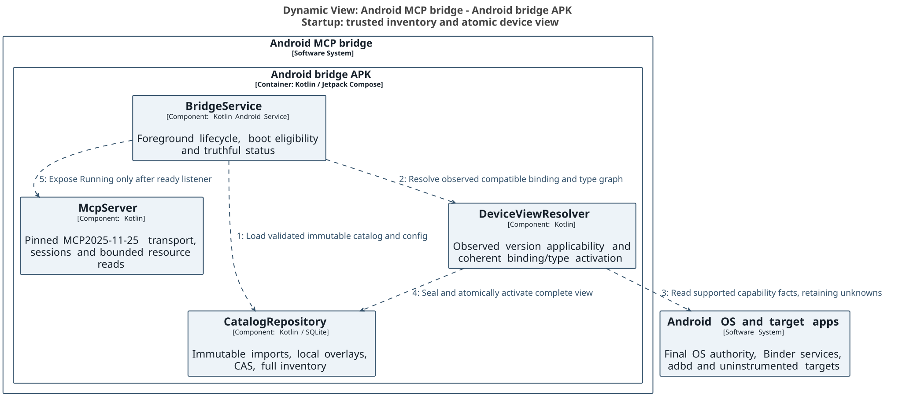

The authoritative C4 model is architecture/workspace.dsl. Code-level detail uses the linked local Structurizr image views and inline PlantUML definitions in architecture/code-diagrams.md.

## Generic Binder invocation and codecs

Generated tools and binding.invoke use the same canonical dispatch planner and binding.invoke policy identity. They select a binding/type graph from the active resolved view, then require a verified wire contract before marshalling. The wire registry pins endpoint/descriptor, relevant interface/OEM version/hash evidence, actual transaction code, flags/one-way semantics, request/response codec schema and handle ownership constraints. Support generated proxies or schema-driven codecs only when the complete contract is proven. Source AIDL alone does not establish generated transaction codes, runtime class resolution, parcel layout or backend authority.

The generic engine validates typed arguments and exact target constraints, bounds parcel sizes, nesting, arrays, file/handle lifetimes and output, then passes the immutable plan through policy/Ask/admission. Admission rechecks catalog, resolved-view and capability epochs alongside policy and backend identity. Marshal only the admitted plan; transact through IBinderTransport; decode and validate output against the pinned graph before release. Binder death, cancellation after dispatch and uncertain outcomes never trigger automatic write replay. These are architecture responsibilities and reference contracts, not a deployed Binder engine in this phase.

Known raw transactions must decode to the same binding/schema and satisfy binding.invoke plus restrictive binder.transact rules. When schema/codec proof is missing, typed invocation stays unsupported; an explicitly authorized raw low-level operation remains a separate broad service authority with closed connection/descriptor/code/flag/handle bounds. A raw grant cannot substitute for a known binding grant. Android's actual authority still decides whether the transaction can execute. No target application must embed instrumentation for generic ADB screen/tap control; optional Avalonia Android Runtime/Protocol stays a separate adapter, not desktop Server/Kestrel.


## Atomic activation, invalidation and refresh

Capture facts under a capability epoch; build the entire binding/type result set privately against pinned catalog and overlay generations. Validate complete inventory membership, variant identities and type dependencies before sealing. Activate one immutable snapshot pointer in a single transaction only if catalog, profile/target/device identity, capability epoch and expected view generation still match. A failed build/CAS retains the previous snapshot as historical evidence; it never exposes a partial mixture. Snapshot IDs/ETags and pagination cursors bind the complete view and generation. An available row cannot depend on an unavailable, unknown or mismatched required type in that same view.

Startup, reconnect/device replacement, boot/session or Android-user change, OS/build/OEM update, SDK extension/Mainline/module change, supported interface version/hash or reachability change, backend capability change and catalog/type/overlay publication invalidate affected active views and pending approvals. Mark the view stale immediately; no new device call may use it. Keep the full catalog accessible and distinguish Resolving/Stale from MCP listener health and ADB connection health. Refresh from supported backend events, startup/reconnect and explicit owner requests; this introduces no app-specific monitoring scheduler. Where a platform cannot notify a change, revalidate the relevant observations at call admission rather than treating cached availability as timeless authority. Existing live permission/policy checks remain mandatory and separate.

The executable device resolver/store is an offline reference using fixture observations, with no Android/HTTP service or real probes. The API contract accepts refresh requests for configured targets but never accepts a remote caller's asserted facts or availability as authority. Current-view reads return a small header/status; entries are paginated at the administration API maximum500, pinned to the complete immutable snapshot. The full snapshot payload is internal storage/reference data, not one unbounded HTTP response. The existing immutable import/local override/CAS contract remains in force; user edits cannot manufacture observed device evidence. Namespace/package file re-sharding remains a proposal.

## Source projection, capture epoch and storage contract

The executable producer now retains all versioned SDK-index records, including historical/future entries. A native current-target flag is used only for current annotation/JVM-equivalence lookup; it is never a claim about a running device or installed SDK extensions. The catalog projection keeps immutable source declarations intact while enriching derived registry entries with proven same-snapshot TypeReference IDs and versioned inventory variants. Each variant uses the shared dispatch contract digest and pins its containing/argument/return/structured-field type schemas. SDK lifecycle ranges and declared extension alternatives are source-backed; a standalone occurrence labeled37.2 emits platform_point:[37,2]. Matching that point is positive applicability evidence; older, newer or unknown minors remain unknown with PLATFORM_APPLICABILITY_UNPROVEN. A source point never fabricates a removed bound. Conflicting explicit since/sdk0 evidence is quarantined with its raw lifecycle metadata. Unknown or ambiguous types/lifetimes remain visible, and a proven version exclusion remains unavailable even when another schema fact is unknown. The complete registry_inventory is exported with a versioned manifest and independently reconciled against Entry hashes, source evidence, type hashes and stream bytes; absent or partial legacy inventories cannot initialize a startup view.

Facts are captured with capability_epoch and observed_at. The resolver rejects epoch relabeling; publication also verifies the exact facts hash, scope and current epoch. A non-authoritative positive module/interface observation remains unknown. Malformed intervals are quarantined with APPLICABILITY_MALFORMED without discarding unrelated inventory. Every available root/type graph has graph_digest over the sorted transitive root/type(entry_id,contract_hash) closure; publication recomputes it. The final schema_hash is SHA256 of canonical {schema_format:closure3, contract_hash:C, graph_digest:G}. A dependent type change therefore invalidates prior binding/schema grants without recursive hash cycles. Raw lifecycle/annotation header text stays in provenance and does not affect the semantic type digest. This is schema identity, not proof of a Binder codec or permission.

Catalog inventory DeviceResolution2.1.0 adds explicit point evidence. Resolved DeviceView3.0.0 requires the inventory digest, base contract_hash, transitive graph_digest and final schema_hash; it supersedes earlier unimplemented resolved drafts. Older draft snapshots remain historical and cannot be activated silently. Entry1.1 and catalog storage1.2 remain separate contracts; OpenAPI specification version is1.4.0. Offline generated aliases can consume the fresh trusted-store view and use exactly the selected generic schema and graph digest; the complete inventory remains discoverable. They remain default-deny and unavailable for execution until live authority and verified wire/codec contracts pass the shared admission gate.

The executable configuration DDL stores immutable facts, staged/sealed device_views and device_view_entries, a scoped generation/epoch/catalog/overlay CAS pointer and append-only invalidation reasons. A catalog-pinned inventory_sha256 and expected_inventory_count reject substituted and partial views. The digest hashes the complete canonical sorted inventory JSONL, including variant identities. The trusted loader checks this digest before sealing immutable inventory sets/members. Publication recomputes resolution from the pinned inventory and exact facts, rejecting altered membership, selected contracts, dependencies or states. SQLite also checks complete membership and selected base-contract/type pins. Core SQLite does not supply SHA256; content hashing belongs to the checked loader. The strong dv2 status ETag includes the inventory digest as well as scope/generation/epoch/catalog/overlay pins. SQLite JSON/normalized columns agree; active/pinned snapshots cannot be collected. binding_availability is a read-only fresh projection, not an independent cache authority. Versioned binding_wire_contracts stores interface version/hash, transaction code, flags/oneway and codec/proof evidence separately from existence. device_view_storage is an offline transaction reference; Android collectors, Binder execution, HTTP/MCP service deployment and actual OS permission grants remain runtime integration gates.

## Effective overlays, semantic identity and bounded execution

The startup coordinator uses effective_device_inventory to capture the selected immutable registry and all local overlays in one read transaction. Full inventory includes local additions and tombstones as well as suppressed/conflicting rows. Catalog exposure state is separate from version existence and per-client grants: suppressing a type does not claim it ceased to exist, but known typed dispatch through that type is denied. New local entries without imported applicability evidence remain unknown. Overridden fields update the enclosing structured type contract and dependent schema closure. Capture pins registry/overlay generations, local revisions and canonical effective document hashes; generation changes invalidate the view. Generated aliases and generic/known-raw plans use the same selected schema, type graph and current effective metadata. A stale metadata/document pin rejects even when a metadata-only edit leaves the semantic schema hash unchanged.

Semantic contract format3 includes normalized type parameters, declared supertypes, parameter directions, known wire type annotations, inherited oneway and HIDL result types. Type-reference proof prose, source revisions and raw lifecycle headers stay outside semantic shape hashes. Unknown syntax, generic instantiation, imports and wire layouts remain explicit. Missing or unknown Entry.kind cannot be guessed into an invocable binding. Structured fields/enumerants and type nodes remain in inventory, with method aliases generated only for actual binding kinds.

The full offline Python checkpoint projected/resolved 799,527 historical008 entries using fixture37.2 facts: 432,590 available and366,937 unknown, including392,959 bindings and39,631 types with positive applicability evidence. This is neither an observed device nor a new catalog publication. Resolution/validation took565.6seconds and the whole desktop probe peaked at4.30GiB; it does not meet the headless runtime memory targets below. The preserved checkpoint predates the subsequent format3/overlay delta. Runtime design therefore uses indexed SQLite staging and bounded batches rather than materializing all documents: evaluate version variants, maintain available dependency adjacency and reverse worklists, traverse coherent type closures with bounded scratch storage, stream canonical hash input, then seal and activate the complete snapshot. The executable DDL includes device_type_edges and reverse indexes. UI/listener health remains separate from resolving readiness; no call is admitted through a partial/stale view. Android latency/memory measurements remain a release gate.

## Requirement and acceptance traceability

| ID | Requirement and acceptance | Evidence |
| --- | --- | --- |
| FR-DEV-01 / AC-DEV-01 | Startup resolves bindings and types for the running platform major/minor; unavailable/unknown entities remain in full inventory | DeviceResolution2.1.0 / DeviceView3.0.0, full producer/Entry/inventory/resolver/SQLite fixtures and genuine-index lifecycle audit |
| FR-DEV-02 / AC-DEV-02 | Extension/module/OEM/interface facts refine availability without API-level guesses or permission conflation | Collector contract; extension alternatives, module/OEM, interface hash/denial fixtures |
| TR-DEV-01 / AC-DEV-03 | One coherent type graph; missing/ambiguous/removed required types cannot yield an available binding; recursive types supported | Resolver dependency, schema mismatch, ambiguity and cycle fixtures |
| TR-DEV-02 / AC-DEV-04 | Atomic complete activation and generation/epoch CAS; no partial view; stale/cross-target snapshots reject | Executable device_view_storage SQLite CAS/invalidation/count/type-graph fixtures; sealed view tables and fresh projections |
| FR-BIND-01 / AC-BIND-01 | Generic Binder engine uses proven wire/codec contracts and the shared canonical policy plan; unknown wire stays unsupported | Existing policy/known-raw fixtures plus wire-contract planning specification |
| TR-DEV-03 / AC-DEV-05 | Relevant capability/catalog changes invalidate and refresh the view; availability never grants OS or client authority | Event/invalidation contract and permission-separation fixtures |

Retain every current requirement: Kotlin server and Compose UI (superseding the earlier Avalonia12/.NET UI choice), SQLite configuration/client mapping and logging, persistent headless MCP, optional boot and truthful AppBar/status, separate ADB health, paired same-device ADB and host loopback forwarding, on-demand screen/tap, optional Android RemoteControl, all-source inventory/provenance, CRUD/local overrides and future compatibility. No deployment, device/security change or source-corpus completeness claim is made by these additions. Historical full-project review012 was NOT_READY overall93/80; the separate013 design review was91/88 and predates the latest ARC/C4/documentation changes. It verified the prior artifact fixes and found point-applicability/membership defects plus lower-severity parser/contract gaps. The corrected candidate now has explicit point evidence, digest-pinned membership and transitive schema identity; these later changes require fresh independent review; no98/98 agreement is claimed.


## Architecture diagram

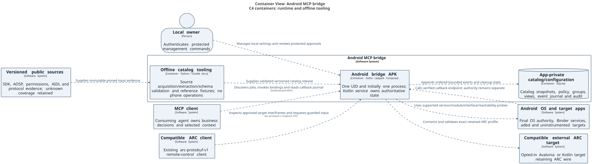

The generated registry exposes the declared binding surface. Every invocation shares policy; ADB supplies generic screen state and taps, and Avalonia runtime is optional.

Editable source follows.


## Request and approval sequence

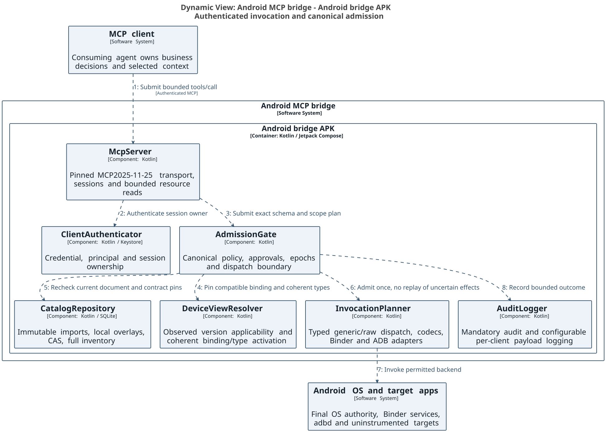

The local owner approves immutable Ask requests. Logging is optional and bounded; mandatory admission audit precedes dispatch.

Editable source follows.


## Remediation contract precedence

This revision addresses the recovered design/contract findings; the source-coverage finding remains open and is tracked in the latest ledger. Stable source-signature IDs are shared across imported occurrences and local overrides; registry schema/permission changes are revisions, not new random identities. No universal OEM/private introspection is promised: unsupported declarations and schemas remain discoverable with evidence and reasons. Catalog metadata is distinct from OS authority and MCP grants. `catalog/API-CONTRACT.md` defines all CRUD states, CAS and cursor rules; `catalog/bridge-config.sql` makes configuration invariants executable; `catalog/tooling/policy_reference.py` and `dispatch_manifest.py` provide offline contract fixtures, not a running bridge. Current diagrams use the shared C4 model and local Structurizr/PlantUML SVG export workflow with Gradle validation.

The catalog SQL and bridge-config.sql can coexist in the same app-private SQLite database; the offline catalog may also be distributed as an immutable standalone file. A serving administration service must use one transactional database for active registry, overlays, policy epochs and audit/outbox, avoiding cross-database atomicity claims. registry_entries stores immutable (registry_id, entry_id) variants; effective_entries selects only active_registry. Publication switches that pointer and increments registry_generation atomically. Raw unknown calls consult explicit client_raw_grants keyed by connection/descriptor and bounded transaction codes/flags, with ordinary binding grants unable to widen that authority.


The raw grant DDL is client_raw_grants(client_id, connection_id, descriptor, code_min, code_max, flags_mask, contract_hash, effect, constraints_json, row_version). constraints_json is scope-only (allowed_targets, allowed_handles, allowed_displays, max_items); connection, descriptor, inclusive code range, flags mask, contract hash and effect are authoritative SQL columns. Empty scope sets deny, and there is no implicit wildcard. Resolve known transactions before checking raw grants: a raw grant can never substitute for a known binding rule. Unknown raw access is a broad authority with explicitly limited observability; ask/allow is available only within every stated bound.


## Canonical permission entry points and retained unknown metadata

Generated per-binding MCP tool names and binding.invoke share the single policy tool_id `binding.invoke`. The protocol alias name is stored separately in tool_binding_aliases.alias_name; tools/client_tool_rules represent the shared policy entry point, not hundreds of thousands of independent shadow permission rows. Editing a generated alias in the UI edits its canonical client_binding_rules row. Convenience wrappers have their own restrictive entry-point rules in addition to every required binding grant. A known binder.transact call must also satisfy binding.invoke and its canonical binding rules, then the extra binder.transact restriction; unknown raw calls use their separate explicit raw grants and binder.transact rule. Equal route constraints produce equal decisions; an extra route-specific restriction can only narrow access.

PermissionExpression accepts only known op values. Future x- properties on known nodes are retained; an unrecognized semantic node is quarantined as a known unknown wrapper with reason plus exact parsed JSON value in x-raw-node (and required_semantics as appropriate), never interpreted as permission-free. Original imported bytes remain in versioned evidence. Unsupported major versions stay unsupported for invocation.

settings.brightness.get reports the actual observed signed32-bit rawValue without clamping, plus withinDocumentedRange and the cited documentedRange1..255. An out-of-range observation (including0 on a differing device) is returned with an anomaly flag, rather than fabricated as a valid documented setting or rejected by the output range. The write policy remains bounded to the documented range with default16..240; no automatic mode change is implied.

Native availability uses the reserved target_key platform:local; app/runtime targets must exist in target_app_profiles. Audit retention is a separate authenticated local-owner maintenance transaction: set bridge_config.audit_retention_authorized=1, perform bounded retention deletes, append maintenance audit evidence, reset the flag to0 before commit. Startup resets a stale flag before admitting calls. No remote catalog or MCP device endpoint can enable maintenance or issue SQL. Optional client-log purge remains separate from mandatory audit retention.


permission_reader.read is the offline future semantic-node reader: unknown operators become validated unknown wrappers with x-raw-node, preserving the parsed JSON value; original lexical bytes remain in immutable source/import evidence. Known malformed ASTs are rejected. Generated extractor AST validation remains strict. No extension/raw node is interpreted as authority. Runtime/HTTP reader integration remains a release gate for bridge implementation.

Offline catalog source occurrences are occurrences(binding_id,source_id,line), joined to binding_declarations at the same key. The separate bridge-config.sql projection is binding_occurrences(binding_id,source_id,locator,record_hash,provenance_json): its locator is `line:<positive physical source line>` for an imported declaration, record_hash is that declaration's record_sha256, and provenance_json retains the source evidence. This projection shares IDs and never replaces the immutable catalog occurrences. External annotation_evidence uses its own source_id/locator key. Every new owner CRUD mutation persists its reason in append-only entry_history_reasons(entry_id,revision,reason), in the same transaction as entry_history; HistoryEvent joins and returns it. Legacy/system events without supplied justification omit the optional reason rather than fabricate one.


One protocol alias may require multiple canonical bindings. tool_binding_aliases stores one row per (alias_name,binding_id), while all rows sharing an alias_name must use one policy tool_id. Generated binding aliases share binding.invoke; convenience plans additionally require every referenced binding grant and their own restrictive entry-point rule. The alias constraint never replaces per-binding or OS authority checks.


## Device capacity and latency acceptance budgets

These are engineering acceptance targets, not claimed measurements. The reference deployment profile is64-bit API level35 (Android15) or later with8GiB RAM and128GB storage. Broader support must meet the same budgets and all platform gates. The measured release010 reference SQLite catalog is10,276,548,608 bytes (about9.57GiB), SHA-256 3eb7a2d1ae0fdeeb2743aa1814fe3bf9d2ac5f167d3dec1bde3ac900c0497eb7; evidence/catalog-size-release010.json identifies the owner final manifest hash and own stable file-size check. It contains44,397 imported sources in that frozen checkpoint; this does not establish global coverage. The newer inventory projection and derived device views may increase storage, so preflight uses actual active/incoming bytes and configured view quotas rather than this historical reference size. Raw source archives and JSON audit exports stay off-device. Keep the entire admitted inventory, never a curated subset to meet a budget.

Before accepting an atomic catalog replacement, require additional free space >= incoming_catalog_bytes + bounded_staging_scratch_bytes + remaining_configured_log_and_config_quota +1GiB safety reserve. Conservatively budget scratch at incoming_catalog_bytes. With an existing active catalog of the same release010 reference size, this requires at least21GiB additional free space plus the configured quota; the total peak catalog footprint, including that already allocated active copy, rounds up to30GiB plus the quota. Do not count the existing active file twice when comparing against reported free space. Retain the previous immutable catalog until validation and pointer publication succeed; insufficient space yields CATALOG_CAPACITY_REQUIRED and no partial publication. Bridge health reports catalog readiness separately from listener and ADB health.

The headless service target is <=256MiB idle RSS and <=384MiB peak excluding OS-owned graphics buffers, SQLite page cache <=32MiB, one bounded on-demand capture at a time, and no preload of all catalog documents. All-bindings UI lists use indexed queries and virtualization: default100 entries per page, hard maximum1000 through application query interfaces over local SQLite; the administration API remains capped at500 per request. Device targets: p95 <=150ms for a metadata page/query, <=25ms for local policy lookup, <=250ms for an owner permission commit, and <=2s to first management view. Backend/ADB/network dispatch latency is measured separately and never hidden in the policy number.

Validate these budgets on each supported device/OS using the complete registry, cold/warm caches and the configured maximum client/rule/log quotas before claiming runtime readiness. Budget failures block that device profile or publication; they do not justify dropping inventory rows or claiming measured feasibility from host tests. No device benchmark or phone operation was performed in this deliverable phase.

Derived device views have a configured byte quota and bounded history. Pin snapshots used by admitted calls and live cursors; collect only unreferenced expired derived snapshots through trusted maintenance. Never delete immutable catalog/source or audit evidence for view-cache pressure. If a complete view cannot be staged within quota, retain the old snapshot as stale and report capacity failure; no partial activation. Package extension_level metadata is the SDK package's base extension metadata, not an observation of the running device.

## Catalog-driven callbacks and bounded event delivery

This extension records the user's callback and functional tool-group requirements. It is a design and catalog contract, with offline reference validation planned below; it does not claim a deployed subscription service or complete callback extraction. It preserves the complete inventory, startup device resolution, existing authority gates, Kotlin Compose management UI, headless service, SQLite configuration, ADB convenience operations and optional Android RemoteControl integration.

### Callback inventory and evidence

Every imported binding and type receives a callback-classification disposition: proven callback, candidate, proven non-callback, or unknown with a reason. The global index retains unclassified and unreachable records. Extract all source-declared callback interfaces, listener/delegate types and abstract callback classes, their inherited methods, and methods accepting or returning them. Binder one-way syntax proves call semantics; a name ending in Listener or Callback alone proves only a candidate. An ordinary synchronous Binder interface can also be a callback. Registration patterns inferred from names remain candidates until supported by signature, documentation, annotations, implementation direction or explicit reviewed source evidence. HIDL generates clauses describe RPC completion results and must not automatically become durable subscriptions.

Each versioned CallbackDescriptor records stable callback-type and method IDs; normalized type and method schema hashes; declaration/source locator and immutable import hash; platform, extension, module and interface applicability; role and confidence; argument direction and zero-based formal argument position; registration, replacement and cleanup binding IDs; and registration-token/receiver identity mapping. A relationship may be many-to-many or unresolved. Overloads use canonical IDs, never names alone. Registration/cleanup pair evidence must establish token ownership and argument mapping; unsupported, ambiguous and unknown cases remain searchable. No absent evidence is converted into an Android availability claim. Callback metadata follows immutable imports plus provenance-qualified local overrides, revisions, history and ETag/CAS rules used by other catalog entries. Overrides cannot manufacture runtime wire proof or Android authority.

The device-resolved view includes callback types and the coherent closure of event argument types, response types, registration results and cleanup arguments. Callback roles are independent from existence, reachability, verified codec/wire contract, OS authority and MCP client grants. The same canonical permission plan covers generated, generic and raw invocation, callback registration, event reception, local reply policy and cleanup. A generic raw transaction cannot bypass that plan by supplying a callback object as an opaque argument. Unknown callback ABI, return semantics, cleanup mapping or sender-verification requirements yield an explicit unsupported reason for registration; their source records remain in the inventory.

### Invocation and subscription lifecycle

The existing binding.invoke tool adds an optional callback_bindings array. Each item identifies the formal parameter position, CallbackDescriptor ID/revision/hash, selected callback method IDs, delivery policy, retention limits, lease, and a bounded local response policy when needed. Supplying arbitrary executable code, an external callback URL or an untyped Binder object is not supported. The resolved registration/cleanup/type/wire contracts and the client's current grants are checked before proxy creation. The backend validates the callback sender using its supported UID/endpoint capability checks; inability to establish the required sender boundary is explicit, not inferred from a client-supplied identity.

Registration is a bounded operation with one final tools/call response. The response includes registration outcome (active, failed or outcome_unknown), the ordinary invocation result, and subscription descriptors. An active descriptor contains subscription_id, stream_epoch, events_uri, initial application cursor, cancellation handle, lease expiry, effective buffer quotas and schema pins. The URI and handle are opaque locators, not bearer authority. Registration idempotency keys are scoped to client principal, credential epoch, target/user/backend epoch and exact contract hash; reuse with different arguments conflicts. If a device transaction may have executed but its reply is lost, persist outcome_unknown and do not blindly register again. Callbacks arriving during registration enter a provisional bounded journal and become visible only with an active registration; a failed or uncertain registration retains a restricted diagnostic disposition and cleanup obligation.

The persistent headless service owns CallbackBroker and the journal; closing the Compose activity does not stop it. Subscription records and retained events may survive transport reconnect and bridge restart. Android callback registrations generally do not survive bridge/device/backend death. Recovery marks those registrations orphaned, records the reason and attempts only verified cleanup/reconciliation; it does not claim a durable live Binder proxy or automatically replay a side-effecting registration. Lifecycle states are registering, active, cancelling, closed, orphaned and outcome_unknown. Every transition has a revision and reason. Terminal states cannot be silently reactivated; a new registration gets a new stream epoch/handle.

An explicit callback.cancel tool performs idempotent cancellation and verified unregister/dispose using the recorded token mapping. Its result distinguishes locally closed delivery from confirmed remote cleanup and cleanup_unknown. Binder death, target uninstall, device/backend epoch change, permission revocation and lease expiry invalidate delivery. Authorization is rechecked on reads and before event publication; revocation immediately suppresses payload access and queues least-privileged recorded cleanup. It never authorizes an arbitrary new operation on behalf of a revoked client. Transport disconnect alone is not cancellation. A configured lease/grace bounds disconnected retention; a client must explicitly renew within its authorized maximum. resources/unsubscribe stops resource-update hints only; it does not unregister the Android callback. Deactivating a tool group does not orphan subscriptions: the bootstrap cancel/status tools remain available.

### MCP2025-11-25 transport contract

The interoperable baseline uses standard MCP resources. The server advertises resources.subscribe support. The invocation result returns a resource link and events_uri such as android-callback://subscription-id/events. The client may subscribe to that exact URI with resources/subscribe. A coalescible notifications/resources/updated notification contains the URI only. The client then uses resources/read on the advertised URI template android-callback://subscription-id/events{?cursor,limit,max_bytes} to obtain a finite application/json journal page. The no-query URI returns bounded subscription status, retention cursors and a next-read URI; cursor-expanded URIs page history. A page contains events, next_cursor, has_more, oldest_retained_cursor, terminal state and any explicit loss range. The implementation validates and canonicalizes the URI, checks ownership, enforces fixed maxima, and never treats path/query values as SQL or file paths. Cursors bind subscription, stream epoch, principal/credential scope and retention revision; they are integrity-protected and opaque. An expired cursor returns cursor_expired with the available retention boundary, never a fabricated contiguous replay.

On StreamableHTTP, standard notifications can arrive on the client's GET SSE stream; on stdio they are ordinary MCP notification messages. A POST tools/call may use SSE while registration runs, then produces its single final JSON-RPC response and normally terminates that request stream. Callback events do not become additional final responses or indefinite progress updates. Clients lacking resource-subscription support can explicitly perform bounded reads; this is caller-driven retrieval, not a bridge business-monitoring scheduler. A resource link is not a promise that every MCP host automatically subscribes or inserts payloads into agent context.

Direct payload SSE is optional and disabled by default. A future implementation may expose a separately authenticated subscription stream, or a fully documented mutually negotiated experimental extension. It must advertise its exact transport, authorization, schema, limits and cancellation rules and retain the standard resource-read fallback. No custom method is represented as an MCP standard notification. The baseline requires no extension and does not depend on an LLM host implementing one.

Transport Last-Event-ID is an MCP stream-replay token, subject to session/stream routing and server retention; it is distinct from the callback application's journal cursor. Reconnecting transport may replay a resource-update hint but does not advance or acknowledge journal consumption. Client deduplication uses (subscription_id, stream_epoch, sequence), not the SSE event ID. Standard progress tokens stop with the original operation and are not used as permanent subscription channels. These are application patterns composed from the pinned standard, not new MCP guarantees. Sources: [MCP transports](https://modelcontextprotocol.io/specification/2025-11-25/basic/transports), [MCP resources](https://modelcontextprotocol.io/specification/2025-11-25/server/resources), [MCP tools](https://modelcontextprotocol.io/specification/2025-11-25/server/tools), [MCP progress](https://modelcontextprotocol.io/specification/2025-11-25/basic/utilities/progress).

### Event envelope, bounds and synchronous replies

Each accepted event has subscription_id, stream_epoch, a decimal-string sequence, event_id, callback method ID, immutable schema hash, registration correlation ID, observed UTC timestamp, monotonic capture offset and either typed payload, scoped payload-resource reference, or typed error. Sequence order is assigned atomically when appending within one subscription across concurrent Binder threads; it is not a claim about physical ordering across threads, callbacks or subscriptions. Replay is at-least-once for retained accepted journal events; Android source delivery and crashes before durable acceptance are not exactly-once guarantees. Source omissions and known loss ranges are exposed. No acknowledgement deletes another consumer's events; any explicit acknowledgement is consumer-scoped and retention still honors the shared bounded quota.

Default proposed limits are 256 events or1MiB per subscription (whichever comes first), 64KiB inline event, 64 events/128KiB per read, 10-minute journal retention, 5-minute renewable lease and a global per-client journal quota. These are configurable engineering defaults pending Android measurement, not published platform limits. Admission reserves space for terminal/loss metadata and applies the lower server/client quota. Payload-resource references consume the same quota and cannot bypass it. The default overflow policy closes delivery and reports buffer_overflow; optional drop_oldest/drop_newest is explicitly chosen and reports exact lost sequence ranges. Coalescing requires semantic evidence and opt-in, otherwise it can erase meaningful events. Oversized/unsupported payloads produce a bounded typed error or scoped resource, never silent truncation. Binder threads release native resources promptly; no producer waits for a remote consumer to drain the buffer. Disk-full marks durability_failed and closes the stream; it does not acknowledge a durable append. Reads and resource hints do not log payloads by default.

For return-valued synchronous callbacks, the reply path is local. Registration must select an allowlisted typed constant or bounded deterministic handler with method-specific evidence that the response is valid. It must also declare a monotonic deadline no longer than the verified caller allowance and an approved typed timeout/error/default policy. There is no universal safe default or universal Binder deadline. Unknown deadlines/default semantics or unbounded handlers mean unsupported_synchronous_reply. The event may still report the locally selected reply and reason after completion. A remote agent may update a future policy only by a separate authorized CAS mutation; no current synchronous call blocks on network, model inference, resource reads or agent approval. Void/one-way callbacks enqueue and return promptly; HIDL RPC completion adapters retain their finite call correlation and are not mislabeled as subscriptions.

SQLite stores subscription metadata/revisions, exact contract pins, lease state, journal records keyed by subscription/epoch/sequence, per-client quotas, cleanup obligations and bounded replay cursors. Event-journal persistence is functional data storage, distinct from configurable call logging. Both use app-private storage, owner-controlled retention and per-client disclosure. Logging can record correlation/size/errors without payload; sensitive payload logging requires that client's explicit configuration. No callback can execute an app-specific decision workflow in the bridge.

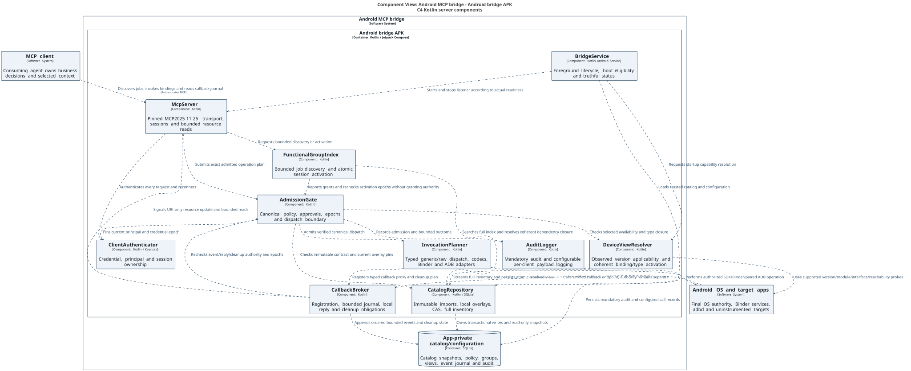

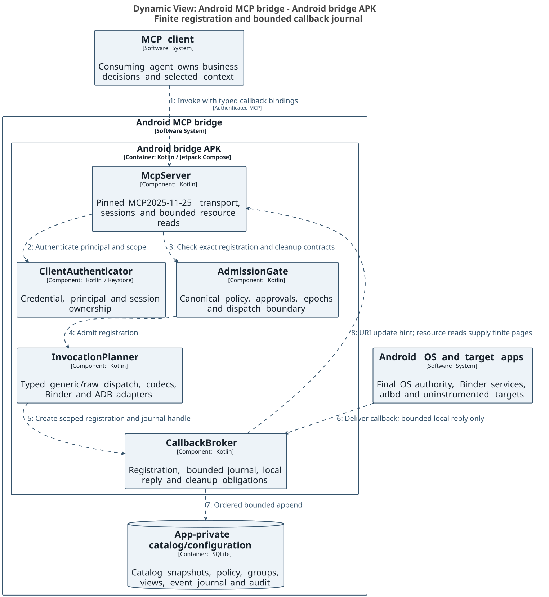

## Small functional tool groups and job-based discovery

The complete catalog remains available, but an agent starts with a small stable bootstrap tool set: android.groups.discover, android.groups.describe, android.groups.set_active, binding.invoke, callback.status, callback.cancel, bindings.search, bindings.list and bindings.get. This nine-tool set is the authoritative default tools/list surface; convenience operations are group-delivered. Generic invocation accepts canonical IDs and validates the exact contract. Full schema enumeration is an explicit bounded operation. The management UI provides functional groups, current activation, estimated context cost, required grants, availability reasons and per-client logging controls alongside the existing client configuration. Discovery can locate unknown/unavailable capabilities without granting access to their invocation or revealing another client's private overrides/configuration.

Groups represent a small coherent job capability, such as display brightness read/write, location subscription lifecycle, audio volume control, package metadata inspection or rendered-screen input. These are illustrative group shapes, not a curated allowlist or a claim that these source mappings are implemented. A group is neither one Java package nor an entire Android subsystem. Every entry has one or more provenance-qualified group memberships or an explicit unassigned reason and remains searchable by canonical ID/type/source. Shared types and permissions live in the global index, not duplicated as conflicting per-group definitions. Do not semantically re-shard the physical catalog as part of this design change.

FunctionalGroup records stable group_id, revision, content hash, title, bounded description, searchable labels, immutable import provenance and override lineage; canonical binding memberships; required type closure; dependencies and optional related groups; lifecycle invariants; and measured serialized descriptor bytes plus an explicitly labeled token estimate. Registration/unregistration/replacement and token/type dependencies form one atomic lifecycle unit. A group cannot advertise registration while hiding the required cleanup operation. Unknown cleanup remains visible and blocks activation of that unsafe registration unit. Large coherent units can stay generic-invoke-only with an oversize reason; they cannot be partially loaded to satisfy a context budget. Dependencies use immutable revisions/hashes, cycle validation and bounded closure; unresolved dependency metadata is explicit.

android.groups.discover accepts a task/job description, optional capability/backend/device constraints, availability and permission filters, maximum groups, maximum response bytes and optional estimated-token budget. The server deterministically searches normalized labels, descriptions, canonical symbols and source-derived functional annotations, then ranks stable ties by group ID. Optional semantic ranking may improve relevance only; the deterministic index remains usable without an LLM, and ranking never changes grants or device authority. Descriptions, user overrides and job text are untrusted data, never instructions executed by the bridge. The result returns ranked small summaries, IDs/revisions/hashes, relevant capability IDs, dependency counts, applicability/permission status with reasons and a scoped continuation cursor. It omits all full tool/type schemas. Bounded ranking is over the full index, not a preselected functional subset. Search bounds may stop work with an explicit partial-search flag and cursor; the response never claims exhaustive job suitability when a search was truncated.

For example, “observe location changes, then stop” can return a location-subscription group summary including register/unregister/callback lifecycle and location payload-type dependency. The agent describes that group for exact contracts, asks to activate the coherent unit within its budget, invokes registration, consumes its bounded resource journal and cancels. The bridge makes no travel, app-specific or timing decision. If permission is denied or applicability unknown, discovery reports that status and activation cannot grant the missing authority.

### Activation, concurrency and host compatibility

Interest/activation is scoped to authenticated client, credential epoch and MCP session. It is separate from per-client permission grants and from the device's resolved availability. android.groups.set_active submits the entire desired group-ID/revision/hash set plus expected view ETag and byte/token-estimate budgets. The transaction resolves dependencies and types, checks current catalog/device/policy epochs, serializes the proposed descriptors and atomically accepts the complete set or returns a conflict/budget/unknown-dependency error without partial activation. Deactivation uses the same CAS operation. Dynamic alias names use b.<first32hex(binding_id)>.<first24hex(schema_hash)> (59 ASCII characters, [A-Za-z0-9_.-]); full IDs/hashes remain in metadata and the canonical invocation mapping. Detect any prefix collision against full identities and refuse alias activation with generic-invoke fallback. Never reuse an alias for a different full contract. View cursors bind owner/session, activation revision, catalog/device/policy epochs and expiry. Foreign, stale or mismatched cursors are rejected. No client sees another session's activation or private mappings.

There are two explicit presentation modes. The default portable mode exposes only the stable bootstrap tools through tools/list; active groups supply bounded schema manifests for generic binding.invoke. This prevents bridge-side eager exposure of thousands of generated tools even if a host exhausts tools/list pagination. A host that supports an explicitly negotiated group-view feature may opt into dynamic aliases for its active groups. In that mode, tools/list enumerates exactly the current session's coherent activated aliases plus bootstrap tools, with bounded pages and a revision-scoped cursor. Changes emit the standard notifications/tools/list_changed when advertised. This custom session-view feature and its cache contract are documented as an opt-in application feature, not a standard MCP selective-context guarantee. Unknown hosts use portable mode.

Pagination alone cannot prevent an eager host fetching every page. list_changed support also does not guarantee that a host refreshes its cache or evicts old schemas from the model context. The bridge can bound its response sizes and exposed set; actual host context usage is a measured integration property. A client unable to apply dynamic changes retains bootstrap/generic-invoke mode and explicitly fetches only the required manifest pages. Token estimates are labeled with estimator/version and never treated as an exact host-model tokenizer budget. A strict UTF-8 serialized-byte maximum is enforced independently, including descriptions and dependency/type metadata; a single oversize unit is refused for alias loading.

Catalog import, override revision, group mapping edits, device/backend change and permission revocation invalidate the matching caches. In-flight calls pin their admitted complete contract/type/policy plan. A harmless activation view change alone does not invalidate an already admitted call or live callback handle; a contract, capability or authority change revalidates or rejects it with stale_contract/revoked/epoch_changed. No cached schema grants continuing authority. Subscriptions retain explicit cancellation/status through bootstrap even when their group is removed. Safe descriptor-only group changes may preserve handles when their exact registration, callback and cleanup pins are unchanged; incompatible changes require explicit cancellation/re-registration, not silent retargeting.

### Management, CRUD and component responsibilities

The catalog CRUD contract adds immutable imported CallbackDescriptor and FunctionalGroup resources, append-only evidence, separate local overlays and CAS history. GET/list support bounded filters and stable cursors. Owner-authenticated PUT/DELETE affects local mappings or tombstones; imported evidence is never rewritten. Deleting a referenced group mapping is rejected while an active view pins it or creates a new revision used only after explicit activation; existing evidence remains retrievable by revision. Activation is a session operation, not an import mutation. Client permission changes keep their existing independent grant API and immediately invalidate affected admission/cache epochs.

The Kotlin Compose UI presents a functional-group editor and searchable unassigned queue, source/default versus local override provenance, dependency and callback pair inspection, context budget previews, active session views and subscription status/cancellation. UI edits use the same CAS APIs. It distinguishes source evidence, device applicability, permission denial and current activation. The persistent service remains operational independently of this UI, retains its running indicator and separate MCP/ADB health, and applies existing Android foreground-service and boot limits.

| Component | Responsibility |
| --- | --- |
| ICallbackCatalogClassifier | Exhaustive disposition and evidence-qualified role/pair/type metadata; unknowns retained. |
| ICallbackAdmissionPlanner | Pin coherent registration/event/reply/cleanup contracts and apply canonical policy, OS and wire gates. |
| ICallbackProxyAdapter | Verify supported sender boundary, decode typed callbacks and provide bounded local synchronous replies. |
| ICallbackBroker / ISubscriptionJournal | Atomic ordered append, quotas, leases, replay, loss/terminal markers and cleanup obligations in the headless service. |
| IMcpCallbackResourceAdapter | Standard subscribe/update/read URI mapping, exact authorization and bounded pages; no custom standard notifications. |
| IFunctionalGroupIndex | Full-catalog searchable memberships/unassigned records and deterministic job ranking. |
| IGroupActivationPlanner | Complete dependency closure, serialized-byte budgeting and session-scoped CAS view activation. |
| IMcpToolViewAdapter | Stable bootstrap fallback; opt-in dynamic aliases and standard list_changed notification. |

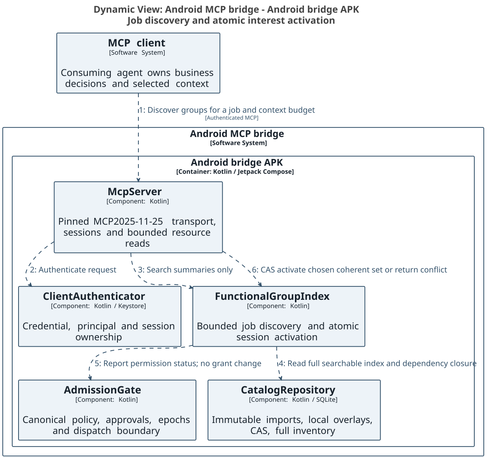

### Requirement and acceptance traceability

| Requirement | Technical contract | Acceptance criteria and offline verification |
| --- | --- | --- |
| FR-CB-01 identify all callbacks | TR-CB-01 exhaustive evidence-qualified dispositions, inherited methods, source/version pins, unresolved pair reasons | AC-CB-01 every input binding/type accounted for; overloaded/inherited/listener/Binder/HIDL completion fixtures preserve uncertain records without false classification. |
| FR-CB-02 invoke with callback bindings | TR-CB-02 typed parameter mapping and atomic admission; finite registration outcome and subscription descriptor | AC-CB-02 foreign descriptor/type/contract/target mismatch fails; uncertain registration is not duplicated; paired cleanup and type closure are tested. |
| FR-CB-03 consume bounded streaming events | TR-CB-03 standard resource journal protocol, application cursors, independent transport replay and quotas | AC-CB-03 finite page/read limits, replay/dedup, concurrent sequence allocation, cursor expiry, explicit gaps and overflow are tested; notification contains URI only. |
| FR-CB-04 safe callback lifecycle | TR-CB-04 cancel/death/revoke/disconnect/restart/lease semantics and bounded local synchronous policy | AC-CB-04 idempotent cancel, cleanup_unknown, revocation suppression, orphan recovery, deadline/default rejection and no remote synchronous reply are tested. |
| FR-GRP-01 small functional groups without catalog omission | TR-GRP-01 stable mappings/provenance and coherent lifecycle/type closure with searchable unassigned entries | AC-GRP-01 full membership accounting, callback-pair atomicity, dependency cycles, overrides and oversized-unit refusal fixtures. |
| FR-GRP-02 locate capabilities for a job | TR-GRP-02 deterministic bounded discovery plus optional ranking, summaries and scoped pagination | AC-GRP-02 stable ordering, byte limits, unknown/denied status, filters and cross-client cursor isolation; discovery cannot change grants. |
| FR-GRP-03 activate a bounded session view | TR-GRP-03 CAS/epochs, atomic set/dependency budget and portable bootstrap mode | AC-GRP-03 concurrent stale-CAS rejection, no partial activation, cached-schema revocation, handle continuity and static-host fallback fixtures. |
| FR-GRP-04 manageable mappings and visibility | TR-GRP-04 SQLite import/overlay/history and Compose group/subscription editors | AC-GRP-04 immutable imports, override history and ETag conflicts tested offline; actual Compose/MCP host behavior remains a future implementation acceptance gate. |

Validation status: these newly added requirements are not covered by the frozen round012 review. Latest full-project review012 remains overall93/80 NOT_READY. Separate design-only013 was91/88; it predates the internal ARC/C4/build/documentation revision and is not a current acceptance score. New callback/group contracts, producers, lifecycle reference fixtures and host interoperability require a fresh frozen review. The disclosed full-catalog semantic/coverage and bounded-memory resolution gaps remain open; this design update does not reclassify them as complete.

## Kotlin server and Jetpack Compose management UI

The user's latest language decisions supersede the original Avalonia12/.NET management-stack requirement: both the MCP server and management UI are Kotlin. Ship one Android APK, one application UID and initially one application process. A Kotlin started foreground BridgeService owns the server and all authoritative state; a Kotlin ComponentActivity hosts Jetpack Compose presentation. The activity binds to the already-started service through an unexported local Binder facade, never through an unauthenticated loopback admin endpoint. This same-process facade is not a new privilege boundary. There is no managed runtime, C# server, .NET UI or Kestrel requirement. Python extraction and offline reference models remain build/validation tooling, not delivered Kotlin server implementation.

BridgeService owns MCP initialization/transport/authentication, persistent listener and notification lifecycle, client policy/approval admission, catalog and SQLite transactions, version/type resolution, Binder/ADB adapters, callback journal/cleanup and functional discovery/activation. Only its repositories open the writable configuration database; the activity submits typed commands with expected revisions and observes immutable state. SQLite platform APIs and prepared statements provide the executable-DDL path; any alternative persistence layer must pass the same constraints, migrations and transactions. Do not assume an ORM automatically preserves trigger behavior. Catalog snapshots are read-only handles after validation; replacement uses the established staging/activation protocol.

The local facade exposes bounded operations for status, paginated catalog/group/subscription reads and authorized owner commands. It accepts no arbitrary SQL, reflection, raw object graph or universal service reference. The Compose ViewModel uses lifecycle-aware asynchronous state collection, and long work runs in service-owned coroutine scopes on bounded IO/worker executors. Activity destruction cancels observers and pending presentation work, not accepted server operations or the foreground service. Client disconnect/BindService disconnect yields reconnecting/stale UI state, not a false Running indication. The app does not equate possession of an in-process UI reference with authorization: owner-sensitive commands require the existing fresh authenticated owner approval bound to nonce, exact operation, expected revisions and expiry. Remote tool calls cannot submit that local approval capability. Same UID and same process are not evidence of physical touch or user intent; the remote-input quiescence and owner-authentication gates still apply.

Startup validates config migration, desired-state and keystore availability, obtains an eligible foreground-service start, begins its foreground notification within platform deadlines, loads trusted catalog/capability snapshots and admits only a ready device view. Listener bind/initialization determines Running. A bound activity alone does not start or preserve server readiness. Stop persists desired state first, closes admission, suppresses callback delivery, performs bounded recorded cleanup, closes transports/journals/storage and reports any uncertain remote outcomes before stopSelf; it cannot wait indefinitely for a device. Activity and notification Stop actions enter the same service command path. The service owns notification updates; the Compose AppBar renders the same state stream with separate MCP and ADB health. Optional boot/restart remains subject to all previously documented Android restrictions.

The Compose UI preserves client pairing, grants, logging controls, catalog CRUD/overrides/history, full inventory and permission fields, device availability, functional-group editor/job search, loaded-session budgets, subscriptions and cancellation, protected approvals, connection profiles and status. Config CAS commits atomically update storage, policy/cache epochs and a transactional outbox; the service publishes state and standard MCP change hints only after commit. Simultaneous activity and MCP catalog edits either commit against the expected revision or conflict, never silently overwrite. Pending owner approvals bind the exact server plan and are invalidated by relevant revision/identity changes. UI-side validation is a convenience; the server repeats authoritative validation.

Generic phone/app control remains the authorized ADB screen.state/input.tap path, independent of Compose internals. The bridge's ordinary Kotlin UI can be inspected/controlled by that same permitted rendered-screen path, subject to protected-owner-surface restrictions; a Compose semantics/test API is not exposed as a production remote-control bypass. SharpNinja.Avalonia.RemoteControl remains only an optional protocol-compatible external-target adapter for apps that deliberately embed its Android Runtime/Protocol. It is not a bridge UI dependency and requires no .NET runtime inside the Kotlin bridge. A Kotlin adapter would implement the pinned framing/protobuf protocol and target-authentication contract directly; if no verified implementation is present, report adapter_unsupported rather than imply cross-runtime method calls.

| Requirement | Kotlin ownership and acceptance |
| --- | --- |
| FR-KT-01 Kotlin MCP server | TR-KT-01 BridgeService owns transport, policy, storage, resolution and backends. AC-KT-01 architecture/build checks reject a managed/C# server host; Kotlin contract tests apply the same canonical policy and schema fixtures as offline tooling. |
| FR-KT-02 Kotlin management UI | TR-KT-02 Compose Activity/ViewModel uses a bounded unexported local facade. AC-KT-02 activity recreation/unbind does not stop admitted service work; direct SQL/unauthorized owner commands are rejected; UI shows stale/disconnected health truthfully. |
| FR-KT-03 coherent lifecycle/config | TR-KT-03 service coroutine and database ownership, post-commit state/outbox publication and bounded shutdown. AC-KT-03 concurrent CAS conflict, migration failure, delayed callback cleanup, start denial, process death and notification/AppBar transitions are verified in Kotlin/instrumentation acceptance tests. |
| FR-KT-04 preserve remote control | TR-KT-04 ADB generic control plus optional external protocol target. AC-KT-04 ordinary Compose screens work through approved generic input; protected approvals cannot be remotely granted; missing external adapter remains explicitly unsupported. |

These are new design decisions and acceptance plans, not a Kotlin application implemented by this task. The current deliverables remain design, catalog/schema/extractor tooling and offline executable references. Primary platform references: [Jetpack Compose](https://developer.android.com/compose), [started and bound services](https://developer.android.com/develop/background-work/services/bound-services), [Binder/AIDL threading](https://developer.android.com/develop/background-work/services/aidl).


## Internal Kotlin ARC compatibility port

The user explicitly requires porting Avalonia.RemoteControl internally to Kotlin while retaining ARC protocol compatibility. This supersedes the earlier external-adapter-only proposal. The Kotlin bridge includes a designed ArcEngine module and ComposeTargetAdapter; it does not depend on a managed Avalonia runtime. Existing compatible ARC clients remain the interoperability target. External Avalonia targets remain possible through the same pinned protocol client adapter. This task specifies the port and test contract; it does not claim the Kotlin port or Compose remote dispatcher is implemented.

### Pinned upstream and compatibility boundary

The inspected upstream is sharpninja/Avalonia.RemoteControl commit19792a52a13a3df342f90bab6b246b547e673919. The protocol and runtime/client source copies have individual SHA-256 hashes in the task's acquisition manifest. Protocol sources are [remote_control.proto](https://github.com/sharpninja/Avalonia.RemoteControl/blob/19792a52a13a3df342f90bab6b246b547e673919/src/Avalonia.RemoteControl.Protocol/Protos/remote_control.proto), [BridgeFrameCodec](https://github.com/sharpninja/Avalonia.RemoteControl/blob/19792a52a13a3df342f90bab6b246b547e673919/src/Avalonia.RemoteControl.Protocol/BridgeFrameCodec.cs), [request handler](https://github.com/sharpninja/Avalonia.RemoteControl/blob/19792a52a13a3df342f90bab6b246b547e673919/src/Avalonia.RemoteControl.Runtime/Bridge/RemoteControlBridgeRequestHandler.cs), [TCP listener](https://github.com/sharpninja/Avalonia.RemoteControl/blob/19792a52a13a3df342f90bab6b246b547e673919/src/Avalonia.RemoteControl.Runtime/Bridge/RemoteControlBridgeTcpListener.cs), and [official client](https://github.com/sharpninja/Avalonia.RemoteControl/blob/19792a52a13a3df342f90bab6b246b547e673919/src/Avalonia.RemoteControl.Client/Bridge/RemoteControlBridgeClient.cs). The portable design's arc-protocol-contract.json is a derived field/enum reference, not new protobuf definitions or an implemented port.

Retain marker bridgeProtocol=arc-protobuf-v1, protobuf package avalonia.remotecontrol.v1, protocol_version="1.0", all field numbers, scalar/repeated types, method/status enum numeric values and payload semantics. Do not rename the wire protocol to Kotlin, MCP or Compose. The gRPC service declaration shares payload messages but is not the Android ARC transport; implementing length-prefixed ARC does not imply a gRPC host. Kotlin package names may differ internally without changing protobuf descriptors. Generate the Kotlin/JVM-compatible protobuf model from the pinned schema in the implementation phase; any descriptor evolution is separately versioned/reviewed, not a silent field-number reuse.

### Exact framing and dispatch profile

Each frame is a four-byte signed32-bit big-endian payload length followed by precisely that many protobuf bytes. The inspected default maximum payload is8MiB. Reject negative lengths, configured maxima below1, oversized lengths and truncated prefix/payload before allocating unbounded memory. A zero-length protobuf payload is syntactically permitted by the codec but yields an empty envelope that fails protocol validation; it is not an authenticated request. A streaming decoder must retain partial prefix/payload and consume exactly one frame at a time without losing coalesced bytes. The complete-frame decoder rejects extra/trailing bytes; the stream reader treats them as the next frame. These are different APIs, not inconsistent acceptance rules.

BridgeRequest fields are protocol_version1:string, request_id2:string, method3:BridgeMethod, authorization4:string and payload5:bytes. BridgeResponse fields are protocol_version1:string, request_id2:string, status3:BridgeStatus, payload4:bytes, error_message5:string and end_of_stream6:bool. Authentication uses the request-envelope Bearer value, not HTTP headers on a TCP socket. Response request ID and version must match. Unknown protobuf fields are preserved by the chosen generated model on decode/re-encode; unknown enum values remain representable and unsupported methods fail without dispatch. Descriptors must not reinterpret unknown values as method0 or OK.

| BridgeMethod number | Payload / response | Inspected behavior to preserve |
| --- | --- | --- |
| 0 UNSPECIFIED | none | Unsupported. |
| 1 GET_CAPABILITIES | GetCapabilitiesRequest / GetCapabilitiesResponse | Authenticated unary; advertised flags reflect actual adapter support. |
| 2 GET_SNAPSHOT | GetSnapshotRequest / TreeSnapshot | Authenticated unary; typed current tree. |
| 3 WATCH_TREE | WatchTreeRequest / TreeUpdate | Repeated nonterminal response frames; terminal response closes stream. |
| 4 INVOKE_CLICK | InvokeClickRequest / CommandResult | Guarded target action; command failure distinct from transport failure. |
| 5 INVOKE_FOCUS | InvokeFocusRequest / CommandResult | Guarded focus action. |
| 6 SET_PROPERTY | SetPropertyRequest / CommandResult | Approved typed public property only; no arbitrary reflection. |
| 7 WATCH_LOGS | WatchLogsRequest / LogEntry | Filtered/redacted bounded logs with dropped_count. |
| 8 CANCEL | no dispatched payload in inspected handler | Reserved enum exists but handler has no Cancel case. Do not invent compatible remote-cancel RPC. |
| 9 WATCH_FRAMES | WatchFramesRequest / FrameUpdate | PNG frames with dimensions, root size, scale and timestamp. |
| 10 SEND_INPUT | SendInputRequest / CommandResult | Ordered input-event batch subject to policy and adapter support. |

BridgeStatus numbers remain0 UNSPECIFIED,1 OK,2 ERROR,3 UNAUTHENTICATED,4 UNAUTHORIZED,5 UNSUPPORTED,6 CANCELLED. A unary success/failure is end_of_stream=true; stream items usefalse, and a completed stream ends with a terminal response, possibly empty payload. The current listener reads one request per TCP connection; streaming is multiple responses for that request, not multiplexed requests. The official client cancels by cancellation/disposal of its socket. Method8 must return UNSUPPORTED in this compatibility profile. Closing ARC transport and cancelling an Android callback subscription are separate operations: the MCP callback broker retains its explicit lifecycle contract.

Tree and frame sequence fields are uint64, distinct from request IDs and callback-journal sequence/cursors. TreeNode preserves stable per-target IDs, parent IDs, type/name/automation identity, visible/enabled/focused flags, property metadata/classes and local/absolute bounds. Compose nodes expose truthful Compose semantics or a documented adapter identity, never pretend to be Avalonia Control objects. Properties unsupported by the Compose adapter remain unavailable/read-only with accurate capability/result; compatibility means the same wire/type meaning, not fabricated control-tree equivalence. Node IDs carry a target-generation boundary and stale IDs fail after root recreation.

Input retains enum values (pointer move1, press2, release3, wheel4, keydown5, keyup6, text7; mouse buttons unspecified0/left1/right2/middle3), root-relative DIP coordinates and event order. The Compose adapter converts DIP/root bounds and frame render_scale using the same captured root generation; it rejects nonfinite/out-of-root values, stale node/frame targets and unsupported key/property actions. Pointer/button/key state must be released on cancellation, root replacement, revocation and shutdown. It cannot claim universal Android input injection: generic phone input belongs to the separately authorized ADB backend. Frame streaming uses bounded PNG capture, preserves pixel/root dimensions and scale, redacts/excludes protected management surfaces and releases bitmap buffers. Upstream WatchFramesRequest.max_frames_per_second exists but the inspected handler parses and does not apply it; the port must not claim that field is an enforced upstream negotiated rate. Apply documented local server caps; any new guaranteed client rate semantics require a compatible reviewed profile.

### Transport, authorization and owner-control isolation

The inspected RemoteControlBridgeTcpListener uses loopback TCP NetworkStream without a TLS handshake. IsAdbTunnel is a configuration assertion, not encryption or proof that a socket was forwarded. Kotlin ArcTcpTransport therefore implements the same authenticated loopback plaintext ARC profile explicitly and is disabled until locally enabled. It does not label that profile TLS. The MCP HTTPS listener remains separate. A future authenticated secure tunnel can carry unchanged ARC bytes, but its negotiation, certificate/peer verification and client compatibility must be explicit. Do not expose plaintext ARC on a network interface or enable an unverified tunnel flag to bypass policy.

Marker schemaVersion="1", devicePort, token and bridgeProtocol retain their upstream discovery meanings. A marker is app-private, created only after successful bind and removed on stop. No secret token is placed in logs, public catalog or design examples. Debuggable run-as discovery and owner-authorized ADB forwarding are not promised for every release package. Kotlin clients reject an unknown marker protocol; missing protocol is handled only by the documented legacy gRPC selection policy, never guessed as ARC. Session state is local per connection/authenticated principal and credential/target epoch; ARCv1 has no new session token, replay cursor, multiplexing or TLS field. The supplied token maps to an independently configured ARC principal and exact target scope; it is not an MCP session ID, Android permission or local-owner approval.

The Kotlin ArcAuthorizationGate delegates all operation admission to the canonical bridge policy and checks target capability before the handler. Capabilities may be reduced by policy; mutation/frame/input flags never advertise an implemented capability that is absent. Recheck credential/policy/target epochs during long streams, terminate on revocation, and suppress protected content before capture/serialization. All ARC paths (including direct client input) share this gate with MCP-created ARC plans. The local Compose management approval flow is never exported as an ARC root. Entering protected pairing/grant/export/Ask screens quiesces ARC/ADB input and stream exposure, invalidates queued gestures and requires fresh owner authentication for the exact command. Arbitrary local apps cannot bind the unexported service or use a plain ARC token to approve grants.

### Port modules and class responsibilities

ArcProtocolModel preserves the pinned descriptor; ArcFrameCodec performs bounded incremental framing; ArcTcpTransport owns accepted sockets and cancellation; ArcCompatibilityProfile validates marker/version/status semantics; ArcAuthenticator resolves token to principal; ArcSessionRegistry owns per-connection epoch/state; ArcRequestHandler maps method IDs to typed ArcRuntime operations. ArcRuntime uses ArcAuthorizationGate, TargetAdapter, bounded stream buffers and AuditLogger. ComposeTargetAdapter implements tree/frame/action/input contracts using a protected, explicitly selected root through UiDispatcher; AdbPhoneBackend is a separate generic device adapter with different authority. ArcClientAdapter communicates with external compatible runtimes. None of these components impersonates an in-process Avalonia object or embeds a .NET server.

ComposeManagementViewModel uses the local OwnerCommandFacade for configuration, active roots, ARC status, client grants and logging. It is not the remote client and does not accept remote approval callbacks. Service shutdown stops ARC acceptance, terminates streams, releases pressed input state, removes markers and records unknown side-effect outcomes within a deadline. TCP disconnect does not automatically retry a click or property mutation. Bounded queue overflow terminates a frame/tree stream or reports the protocol-supported loss representation (logs have dropped_count); it never invents a new v1 wire field for unrepresented losses. Slow clients cannot block UI dispatch or allocate unbounded frame buffers.

### License, golden fixtures and acceptance

Upstream Directory.Build.props declares PackageLicenseExpression MIT and author/company Sharp Ninja. No LICENSE/COPYING/NOTICE root file was present in the pinned tree. Preserve source attribution, repository/commit identity and original notices in any copied/translated code. Before distribution, obtain/verify the authoritative MIT license text and applicable copyright notice and include them with the internal port, along with protobuf/runtime dependency notices. This is a distribution evidence gate, not a claim that an absent license file grants additional rights. This design bundle contains a derived contract description, not a redistributed upstream source archive or implemented port.

Before writing the Kotlin port, create immutable fixtures from the pinned official serializer/client/runtime: complete request/response frames for every method/status, default/empty/repeated values, UTF-8 and uint64 boundaries, unknown fields/enums and PNG/tree/input payloads. Record descriptor hash, source commit, fixture generator/version and exact bytes. Independently constructed design examples are reference vectors, not official cross-language pass evidence. Golden tests must decode official bytes in Kotlin and Kotlin bytes in official code, then compare normalized semantics and deterministic fixture bytes where specified; protobuf field ordering is not generally a semantic byte-equivalence guarantee.

| Requirement | Acceptance contract |
| --- | --- |
| FR-ARC-01 internal Kotlin port retaining ARC | TR-ARC-01 exact pinned protobuf/framing/profile and separate target adapters. AC-ARC-01 descriptor/tag/enum comparison, all method/status roundtrips and official-client/Kotlin-engine plus Kotlin-client/official-runtime interoperability pass before compatibility claim. |
| FR-ARC-02 robust transport lifecycle | TR-ARC-02 incremental bounded framing, one-request connection, terminal semantics and socket cancellation. AC-ARC-02 every prefix/payload fragmentation point, coalesced frames, negative/oversize/truncated/extra lengths, zero-length invalid envelope, unknown fields/enums, slow reader, cancellation and restart fixtures. |
| FR-ARC-03 truthful UI/frame/input port | TR-ARC-03 generation-pinned Compose tree/frame/DIP/action adapters, explicit unsupported operations and bounded local queues. AC-ARC-03 scale/root mapping, stale IDs, unsupported properties, button release, PNG bounds, log loss/filter/redaction and stream terminal frames match the declared profile. |
| FR-ARC-04 common policy and owner isolation | TR-ARC-04 per-principal auth/epoch gate on every method/stream; protected root exclusion and local approval only. AC-ARC-04 wrong/rotated token, denied control/frame/input, revocation during stream, foreign session/root, simultaneous clients and attempted remote self-approval all fail without effect or payload disclosure. |
| FR-ARC-05 preserve provenance and notices | TR-ARC-05 commit/descriptor/fixture hashes and verified license/attribution inventory. AC-ARC-05 distribution blocked until authoritative notices and third-party dependencies are verified; no Kotlin implementation or interoperability result is claimed by this document. |

The server and ARC class diagrams below describe the proposed Kotlin ownership and interfaces. They are implementation contracts, not existing classes asserted as delivered code.

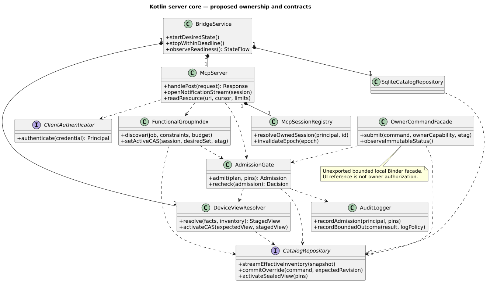

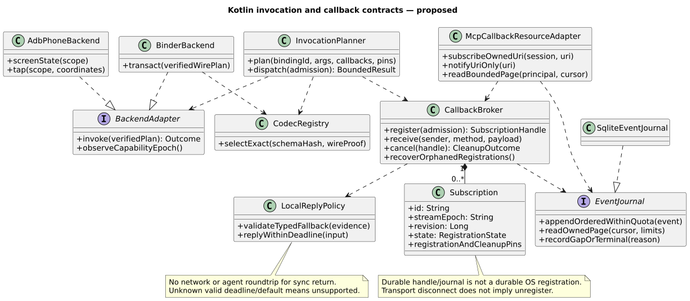

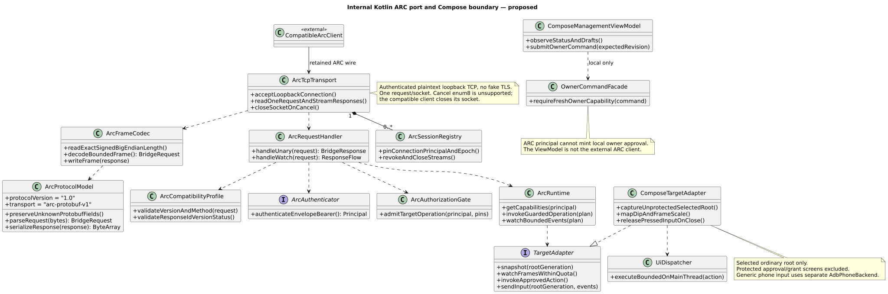


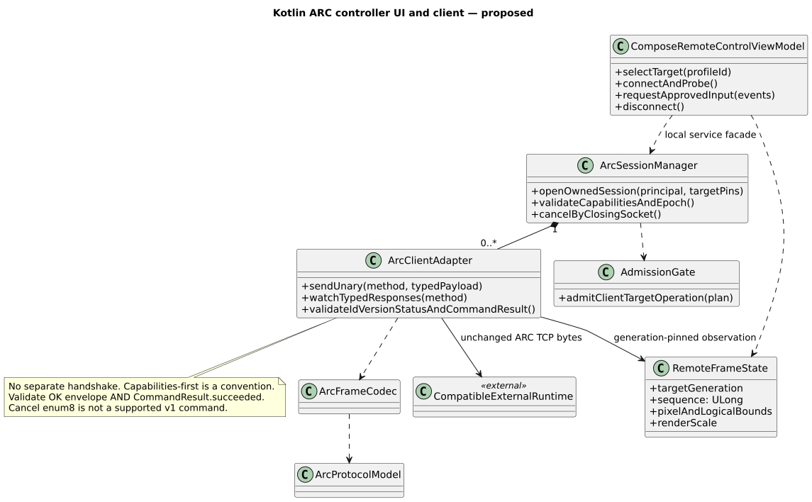

## C4 architecture source and documentation build

Markdown is canonical. SVG exports remain editable vector text with relative links; no raster replacement, Word dependency or public publishing is required. Current architecture uses C4 context, container, component, dynamic and deployment views from one Structurizr DSL model. A C4 container here represents the one Android APK/process and its datastore, not an invented separately deployed UI service. UI and server modules appear as components inside that APK. Code-level class detail uses Structurizr's documented image-view mechanism: editable inline PlantUML definitions in architecture/code-diagrams.md are rendered locally, then image views scope them to the corresponding C4 components. UML composition/multiplicity notation is explicit; these are proposed classes, not native Structurizr class objects or implemented code.

The full view set, source and reproducible build instructions are in [the architecture workspace](../architecture/workspace.dsl), [code-level definitions](../architecture/code-diagrams.md) and [build README](../README.md). Gradle8.14.3, existing Structurizr CLI2025.11.09 image digest, Java21 and PlantUML1.2025.10 are pinned. The local image is reused; no host software/settings are changed. The task-local bootstrap verifies the Gradle distribution SHA and records all tooling hashes. Once dependencies are cached, rendering runs with no network and no open listener. Native C4 definitions are exported by Structurizr to PlantUML, then rendered locally to SVG. Class detail is rendered locally and embedded as Structurizr image views. This is an export pipeline with its own layout, not a claim of pixel-identical browser-renderer output.

Real Gradle targets are validateArchitecture, generateArchitectureDiagrams, generateUiAssets, renderStoryboards, verifyDesignDocs and packageDesignDocs. They enforce input/output dependencies, complete expected view names, invalid-model failure, code-view presence, vector-text SVG output and Markdown link integrity. The package uses deterministic ZIP order/timestamps and includes its DSL, editable code blocks, vector screens/storyboards, Gradle wrapper and Kotlin DSL build scripts. Gradle wrapper distribution verification is mandatory; a clean machine needs the documented dependency bootstrap before offline use. Cached offline builds fail explicitly if dependencies are missing rather than silently accessing an online renderer.

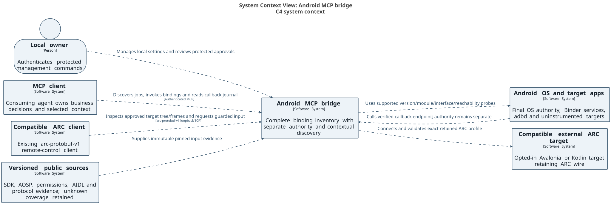


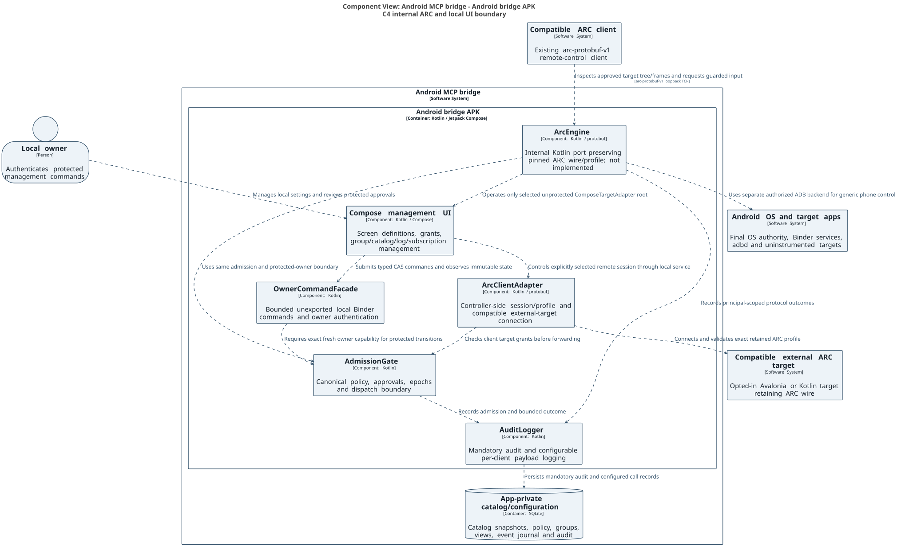

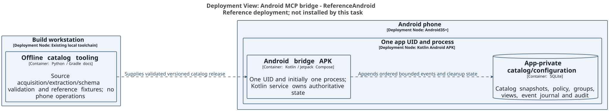

## Compose screen definitions and user storyboards

Screen definitions and storyboards are native SVG design assets, separate from C4 architecture dynamics. Ten screen specifications label controls, layouts, actions and important state variants for dashboard, clients/permissions, catalog, functional discovery/activation, callbacks, logs, ARC control, settings, protected owner approval and action-required recovery. Three ordered storyboards show callback discovery/activation/cancel, ARC connect/control/disconnect, and owner settings/CAS/start-error flows with alternate denied/error/cancel branches. They are not UML message sequences. The source assets and screen/state/requirement index are [here](ui-screens-and-storyboards.md).

The slideshow source is [Marp Markdown](../storyboards/storyboard.md), one ordered screen/action step per slide. The [self-contained HTML slideshow](storyboards.html) embeds the SVG assets and provides local navigation; no external hosting is used. Marp CLI4.2.3 and its integrity-locked package graph are task-local tooling. HTML is an optional local presentation of the canonical Markdown/SVG definitions; no live application behavior is implied.

| Requirement | Technical and acceptance contract |
| --- | --- |
| FR-DOC-01 C4 and Structurizr only for current architecture | TR-DOC-01 one DSL workspace and scoped image views for class detail. AC-DOC-01 real Structurizr validation/export passes; expected native/code views exist; class ownership matches the textual Kotlin/ARC design. |
| FR-DOC-02 Gradle build management | TR-DOC-02 pinned wrapper and Kotlin DSL targets with defined inputs/outputs/offline cache. AC-DOC-02 invalid model, missing SVG and broken Markdown link fail; a cached network-disabled build generates and packages all current artifacts. |
| FR-DOC-03 Markdown plus SVG documentation | TR-DOC-03 relative vector assets, editable DSL/code definitions and portable folder layout. AC-DOC-03 all relative links resolve and SVGs contain vector text rather than embedded raster; no obsolete renderer/source files are in the current package. |
| FR-UI-01 SVG screen definitions/storyboards | TR-UI-01 screen/state/control IDs and requirement mapping; ordered user actions with alternate branches. AC-UI-01 visual inspection covers normal/empty/denied/disconnected/error and protected-owner surfaces; actual Compose implementation/instrumentation remains pending. |
| FR-UI-02 text-based slideshow | TR-UI-02 pinned Marp Markdown source, SVG references and Gradle-rendered self-contained HTML. AC-UI-02 local navigation works, all13slides are present and the HTML has no external image/style dependencies. |

Current validation status: round013 reviewed the Kotlin/Compose callback/group design frozen before the internal ARC port, C4/Structurizr/Gradle and Markdown/SVG/storyboard changes. It cannot establish acceptance of this revision. A fresh complete design review is required. Existing full-project98/98 acceptance remains unmet; no design-only score is substituted for catalog/source completeness.


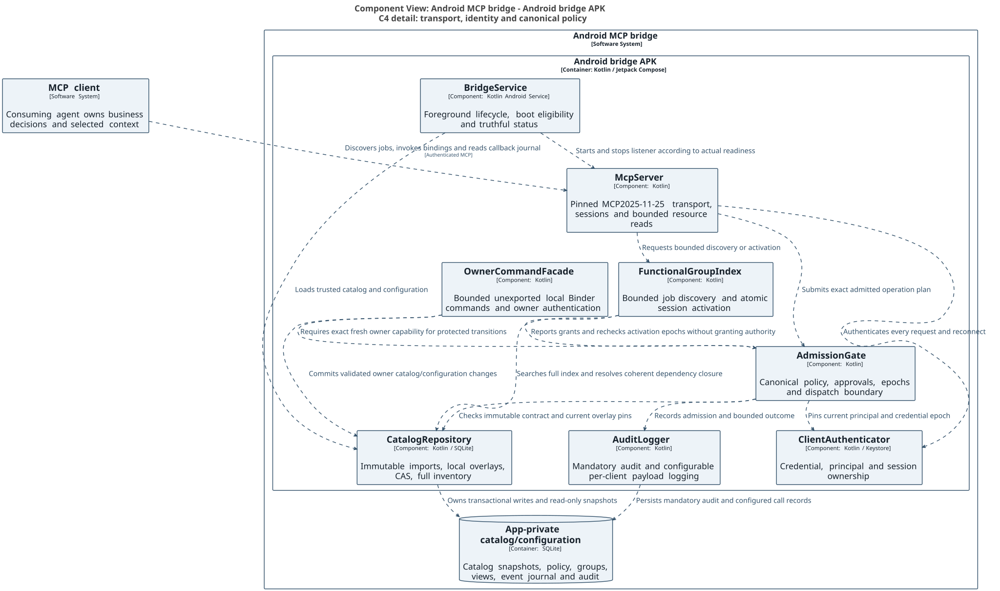

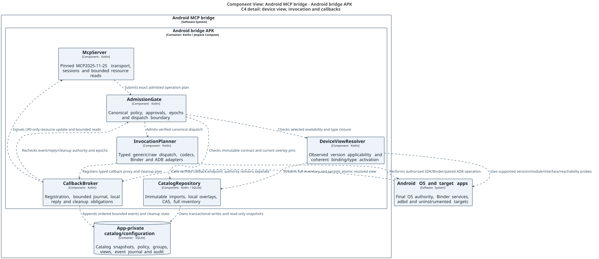


## ARC controller and target class detail

The controller ComposeRemoteControlViewModel uses the service-owned ArcSessionManager and ArcClientAdapter to communicate with a compatible external runtime. That controller UI is distinct from the protected local management ViewModel. The target-side ArcRequestHandler invokes ArcRuntime, ArcAuthorizationGate and a selected TargetAdapter. ComposeTargetAdapter owns a generation-aware TargetNodeRegistry and delegates bounded capture/input/property work to ArcFrameCapture, ArcInputDispatcher, ArcPropertyMutationService and UiDispatcher. ArcFrameStreamService and ArcLogStreamService recheck authority throughout their bounded streams. The five class views show these responsibilities separately to preserve readability. None is asserted as delivered Kotlin code.

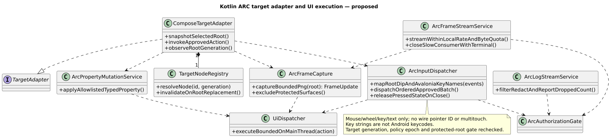

The retained input schema has no pointer IDs or multitouch; Avalonia key-name strings require explicit mapping rather than interpretation as Android keycodes. A transport-level OK response can contain CommandResult.succeeded=false; clients inspect both before reporting action success. Capabilities-first is a client convention, not an ARC handshake.

## Verified design mechanisms after round013

These mechanisms are normative for this revision and replace conflicting earlier wording. They are design contracts, not Kotlin implementation claims. The finding ledger retains all28 original findings, including the brightness claim refuted by the current official source.

## Callback object construction and reachability

CallbackDescriptor.materialization_strategy has closed values interface_dynamic_proxy, binder_generic_stub, prebuilt_adapter and unsupported_abstract_class. A public Java interface can use java.lang.reflect.Proxy with the exact source-proven interface list, declared methods and supported classloader. An AIDL callback uses a reviewed generic android.os.Binder subclass: attach/query the pinned descriptor, implement onTransact using the exact verified transaction IDs, flags and codecs, enforce interface tokens and sender UID/capability before handing off to the broker. Parcel/file-descriptor/Binder-handle lifetimes are bounded and released on every failure. This is not a universal AIDL compiler, non-SDK access bypass or arbitrary Binder-handle import.

An abstract callback class cannot use java.lang.reflect.Proxy. It is registration-unsupported with ABSTRACT_CLASS_NO_RUNTIME_SUBCLASS unless a reviewed prebuilt Kotlin/Java subclass adapter is shipped and its adapter ID/version/hash and supported callback methods are pinned. No runtime dex/bytecode generation or downloaded executable code is selected. The catalog still identifies every abstract callback and its unknown/unreachable variants. SDK/Java invocation resolves public members at admission through java.lang.reflect or supported MethodHandles from the exact pinned JVM signature; do not ship hundreds of thousands of per-member wrappers. R8 keep rules preserve only reviewed bridge adapters and reflective entry points. Non-SDK/access failures are explicit NON_SDK_BLOCKED/OS_UNAVAILABLE reasons, never silently retried through a stronger identity.

Permitted Binder-handle acquisition is (a) public bindService to an explicit exported component with package/signing identity verification, or (b) a handle returned by a documented public SDK handle-source method. Platform ServiceManager lookup and manager-private proxy fields are non-SDK; the ordinary app backend reports backend_unreachable:non_sdk instead of promising access. A separate ADB raw adapter may expose only reviewed fixed service-call operations supported by shell authority and its actual marshalling limits. That is not an app-UID IBinder handle, a generic verified Parcelable codec or permission to use hwbinder. Raw connection_id is either a real connection_profiles.profile_id or reserved platform:local; object handles pin that profile, user, target and backend epoch and cannot migrate between them. HIDL declarations and completion semantics remain inventory/classification. No ordinary app backend is assumed to access hwbinder; unsupported paths report backend_unreachable:hidl. A future separately reviewed privileged backend would require an explicit scope/design change, not an inferred owner grant.

## Startup reuse and bounded admission

A new boot invalidates old admission capabilities, process-local object handles and approvals. It does not require discarding a validated semantic selection cache. Reuse is allowed only if a fresh supported capability observation matches the cache's canonical semantic facts (platform/minor/extensions/build/OEM/module/interface identity and relevant availability), scope, inventory root, catalog/overlay generations, resolver/schema version and type-graph digest. Boot ID, observation time and transient handle IDs are excluded from that semantic key, but remain new runtime evidence. Verify the app-private cache seal against the Keystore-authenticated manifest, open the immutable generation and create a new view revision bound to the new boot/capability epoch; do not mutate/relabel the old view. File identity/generation and on-read page/document hashes detect stale/corrupt data; failure quarantines the cache and closes device admission. Root/full process compromise remains outside the stated trust guarantee. Every runtime permission/reachability/wire/handle check is fresh at dispatch regardless of cache reuse.

For the API level35 (Android15) or later, 8GiB/128GB reference profile and approximately800k-entry inventory, proposed unmeasured p95 acceptance targets are <=600seconds for cold complete indexed resolution and <=10seconds for warm validated semantic reuse. Resolve in bounded batches, SQLite staging and indexed reverse-type worklists: application scratch<=64MiB, SQLite page cache<=64MiB, total service peak<=384MiB and disk scratch<=incoming catalog size. A large dependency closure that exceeds a bound spills to validated SQLite worklists or fails explicitly; it is not silently cut. Recompute affected closures on capability change, and perform full cold rebuild when compatibility keys or dependency provenance are insufficient. While Resolving, only authenticated policy/status, callback.status/callback.cancel and bindings.search/list/get are admitted; discovery reports resolving applicability. Device-affecting calls return VIEW_RESOLVING. Progress and cancellation remain bounded; the listener may be ready while device admission is unavailable, with separate status fields. These targets need real Android benchmarks; the historical Python4.30GiB/565.6second probe does not satisfy them.

## Catalog delivery and management API ownership

Large catalog delivery uses an owner-selected Storage Access Framework content URI, not the256KiB JSON request body. BridgeService obtains the owner-granted read capability, preflights capacity, streams bounded copy chunks into a new app-private staging file, hashes the exact copied bytes and fsyncs before matching the independently trusted manifest size/SHA. Only then open the SQLite input read-only for schema/integrity/FK/content validation and atomic activation. Untrusted filenames, archive paths or SQL are never commands. A bounded expiring staged-local-handle identifies this verified copy; POST /v1/catalog/imports carries that handle plus expected pins/idempotency key. An ADB-pushed file is usable only when the owner exposes it through this same supported URI flow; the app does not assume access to /data/local/tmp or another UID's private directory. Abort/quarantine incomplete or mismatched copies and never activate them.

BridgeService owns the optional /v1/catalog administration route on the same authenticated loopback listener as /mcp, with separate route authorization. It is disabled by default and enabled only by fresh local owner action for a bounded maximum10-minute window. Owner-issued credentials.kind=admin are separate from kind=mcp; admin credentials are rejected by tools/call and ordinary MCP credentials are rejected by admin routes. Admin credential expiry cannot exceed the current management window, revocation closes active admin work before the commit boundary, and every import/mutation needs its exact owner authorization and CAS rules. The local Compose facade invokes the same application service without opening HTTP or minting an admin credential. No admin route is active merely because this design contains its specification. PUT/DELETE are the mutation family; no PATCH alias is defined.

## Callback/group table and operation contracts

These tables are additions to the service configuration model. Immutable version rows have append-only history and evidence; local override revisions remain separate from imported documents. Mandatory FK checking, unique indexes, scalar/check constraints and transactional publication follow the existing SQLite contract. JSON documents are schema-validated before commit; a CHECK on JSON text alone is insufficient. The executable migration/reference integration remains a phase deliverable to validate separately.

| Table / key | Required constraints and indexes |
| --- | --- |
| callback_descriptors PK(callback_id, revision) | revision>=1; type_id and schema_hash pinned to immutable catalog revision; role CHECK proven_callback/candidate/proven_non_callback/unknown; materialization_strategy CHECK the four closed values above; evidence and unknown_reason; immutable document hash. Unknown/candidate cannot become registrable merely by a name heuristic. |
| callback_methods PK(callback_id, revision, method_id) | FK descriptor revision RESTRICT; method/schema/type closure pins; direction and async/sync/completion classification; optional prebuilt adapter and local reply-policy evidence. |
| callback_bindings PK(registration_binding_id, callback_id, callback_revision, formal_position) | position>=0; FK descriptor; exact registration and cleanup IDs/schema pins; token/receiver/argument mapping plus proven/unknown relationship state; unknown cleanup rejects reliable registration. |
| functional_groups PK(group_id, revision) | revision>=1; stable content hash; description/labels, source provenance and override lineage; schema/estimator version; descriptor byte cost>=0. Unassigned entries are indexed independently, never dropped. |
| group_memberships PK(group_id, revision, binding_id) | FK group revision RESTRICT; canonical binding and selected contract revision; lifecycle_unit_id; full type/dependency closure through versioned group_dependencies and type pins. Reject unresolved/cyclic/oversize activation instead of selecting part of a lifecycle unit. |
| group_activations PK(client_id, credential_epoch, mcp_session_id, activation_revision) | FK clients RESTRICT; revision>=1; owner/session/credential scope, catalog/device/policy epochs, complete desired group-hash set, byte/token-estimate limits and immutable view ETag. Active pointer update CAS; no cross-client cursor/view reuse. |
| subscriptions PK(subscription_id) | client_id FK clients RESTRICT; credential_epoch; stream_epoch; revision>=1; state CHECK registering/active/cancelling/closed/orphaned/outcome_unknown; registration/cleanup/schema/type/wire pins; consumed registration-consent record; lease_expires_at and approved_max_expiry; event/byte/inline/read quotas>0; accepted/durable/loss cursors; cleanup outcome. Index(client_id,state,lease_expires_at). |
| subscription_events PK(subscription_id, stream_epoch, sequence) | FK subscription RESTRICT; positive64-bit sequence; method/schema/correlation/time; typed payload/resource/error discriminator; payload byte count>=0; immutable event digest. Index(subscription_id,stream_epoch,sequence). Sequence is encoded as a decimal string in JSON. |
| subscription_cleanup PK(subscription_id, cleanup_revision) | FK subscription; exact recorded cleanup capability/token mapping; state and last outcome, no arbitrary operation under revoked client authority. |

callback.status input is {subscription_id?:string, renew?:boolean=false, expected_revision?:positive_integer, requested_lease_seconds?:integer}. Without an ID it lists only the authenticated client's subscriptions with bounded cursor/limit and renew=false. A single result returns state, revision, lease expiry, quota/usage, oldest/newest retained cursors, cleanup status and sanitized reason. renew=true requires an owned active subscription, expected_revision CAS and a requested duration1..300seconds, capped by the client's max_lease, original registration's approved maximum expiry and current credential/contract validity. It cannot revive closed/orphaned/unknown registrations. Missing or stale revision conflicts without renewal; extending beyond original consent requires a new explicit admission/Ask decision. callback.status is not advertised universally read-only because renew mutates lease state. callback.cancel input {subscription_id, expected_revision?, cancellation_id} is owned and idempotent, suppresses future delivery and returns delivery_closed, cleanup_confirmed/cleanup_unknown and new revision; retries never repeat an uncertain side effect blindly.

Ask is consumed once for the exact registration, event/read scope and bounded lease, not for an unlimited conversation. Event publication/reads require the current rule to remain Ask or Allow, the consumed registration-consent record/pins/lease to remain valid and the client epoch to match. No new prompt is needed per event/read. Deny, revoked credential or expired consent immediately suppresses payload and queues recorded cleanup. A renewal cannot expand that original approved scope. Pending ordinary approvals still die on restart; persisted registration consent is a consumed bounded record, not a reusable owner approval for new calls. Restart marks OS registrations orphaned while retained journal access remains subject to the still-valid explicit read consent and current policy.

Binder callback threads copy bounded typed data into a bounded broker accept queue and return promptly; synchronous local reply selection never waits for SQLite. The accept queue counts against both per-subscription and client quotas, with proposed queue cap128events/256KiB within the existing total quotas. A single worker assigns commit order and batches at most64events or16ms of queue age per transaction using synchronous=FULL, preserving security-relevant storage policy. An event becomes replayable only after commit; precommit crash loss is disclosed, and durable cursors never acknowledge uncommitted events. Async queue order is acceptance order across threads, not physical source causality. Overflow and disk failure follow the explicit loss/terminal policy; no writer wait leaks back onto Binder threads. No global SQLite durability downgrade is introduced.

The base no-query events_uri returns a bounded status document with state, oldest/newest retained cursors and the exact next-read URI template; it does not repeatedly return an old first page. Expanded cursor URIs page history. Transport SSE replay defaults to nondurable; this does not remove the separately retained application journal. Every initialized StreamableHTTP session is assigned Mcp-Session-Id, and post-initialize requests without it receive400; ordinary GET/POST/DELETE/reconnect authenticate and enforce that scope. Session expiry requires reinitialization; same-principal journal reattachment is explicit and never transfers a live callback to another principal.

## Pairing, owner authentication and boot lifecycle

Pairing uses a separate POST /pair route on the same listener, outside MCP tools and open only during a local owner's bounded pairing window. It requires the paired_tls profile: the agent pins the server fingerprint supplied through the owner-visible local QR/channel before sending any proof; reduced_http rejects pairing. A one-use server nonce plus agent nonce, fingerprint and exact proposed label hash are length-prefixed into HMAC-SHA256 under the random bootstrap secret with domain pair-v1. The secret itself is never sent. Nonces expire after60seconds, are single-use and rate-limited; the response returns the new bearer once over the pinned TLS channel. No secret/proof/credential goes to logs. Approval binds the proposed principal and fingerprint; an expired/conflicting window fails without creating an active client. This is an explicit protocol design, not an implemented cryptographic handshake claim.

Fresh local owner authentication uses Android BiometricPrompt with BIOMETRIC_STRONG or DEVICE_CREDENTIAL on the reference API35+ profile. Pairing, credential reveal/rotation, grants, admin enablement and sensitive export require a successful prompt within30seconds, bound to a single nonce, exact command, revision/target scope and current foreground activity. Ask policy may require the same mechanism by profile, with timeout/missing UI denying. If device authentication is unavailable, sensitive owner transitions remain blocked; the bridge does not weaken the profile or change device security settings. Every remote input/capture path is quiesced before protected surfaces appear and remains excluded until completion/dismissal.

The unexported boot receiver is directBootAware and handles LOCKED_BOOT_COMPLETED only to read the minimal nonsecret device-protected mirror and record Waiting for unlock; it performs no network, catalog migration or credential-encrypted access there. BOOT_COMPLETED/ACTION_USER_UNLOCKED reconciles the mirror against credential-encrypted desired state and requests an eligible foreground-service start. An inconsistent mirror defaults off. The selected candidate foreground-service type is specialUse with a truthful declared subtype describing the local authorized MCP binding gateway; eligibility, platform prerequisites and distribution review are release gates, not presumed approval. No connectedDevice/dataSync label is used unless the actual product behavior qualifies; unsupported start remains explicit.

Wireless-debugging endpoint discovery uses supported NsdManager/mDNS service discovery for _adb-tls-pairing._tcp and _adb-tls-connect._tcp when visible in the authorized network environment, with owner-entered host:port fallback. Same-device discovery can fail on an OEM/network and must remain an explicit state. Discovered names/ports are untrusted until TLS peer identity matches the paired ADB profile. Never scan arbitrary ports or trust a stale endpoint after boot/toggle/network change.

screen.state caps inline PNG bytes at2MiB before base64 and total JSON result at3MiB; oversized capture is explicitly downscaled with the image-to-display transform or returned as a scoped bounded resource, never silently cropped. Fixed reviewed display-selecting screencap/input variants route a captured display consistently; unsupported per-display routing is explicit. input.tap validates display ID, rotation, capture/transform freshness and bounds against the admitted target. No automatic recapture/tap or replay of an uncertain gesture is implied.

## Named Kotlin HTTP evaluation target

The evaluation candidate is official MCP Kotlin SDK0.15.0, commit76b8e7d63aac39fe41e03684e3b91a6c3724a8da, with the Ktor CIO server engine as the pure-JVM hosting candidate. The official SDK source documents StreamableHTTP integration; Ktor separately documents CIO. Neither is Android or exact2025-11-25 conformance proof. Pin the candidate's compatible Ktor/Kotlin dependency graph during the implementation spike; test initialization/session/header/SSE/resource behavior against the pinned wire baseline and reject/patch incompatible behavior rather than upgrade protocol silently. Paired HTTPS needs a verified TLS-capable Android engine/tunnel adapter; CIO support alone is not evidence of the required server TLS profile. Until that gate passes, do not ship a sensitive cleartext fallback.

LoopbackHost is the Kotlin interface owning bind/start/stop/readiness, exact listener identity and TLS configuration, Host/Origin checks, credential extraction,256KiB request/nesting limits, authenticated session routing and bounded SSE queues. McpServer owns protocol semantics above it. No engine decides authorization. The local package's Gradle build generates documentation only, not this application or SDK integration. Sources: [official SDK candidate](https://github.com/modelcontextprotocol/kotlin-sdk/tree/76b8e7d63aac39fe41e03684e3b91a6c3724a8da), [Ktor server engines](https://ktor.io/docs/server-engines.html).


The pinned official Settings.System reference states brightness is “between 1 (minimum) and 255 (maximum)” ([S15](https://developer.android.com/reference/android/provider/Settings.System#SCREEN_BRIGHTNESS)). This exact primary-source wording was rechecked for F-13; a reviewer's recollection of0..255 does not override it. Actual raw reads still return any observed signed32-bit value with the documented-range flag; the16..240 default write policy is a separate design restriction.

The opt-in dynamic group view uses initialization experimental capability android.bridge.toolGroups.v1 with requested mode dynamic_aliases and a server-confirmed matching capability; absent/mismatched agreement stays portable. The server additionally advertises standard tools.listChanged only when it will emit notifications/tools/list_changed. This application extension does not promise host context eviction.

# 19 Acceptance tests and delivery sequence

Build mock first, then prove the Android boundary. Passing policy tests alone does not establish compatibility, permissions, lifecycle reliability or store eligibility. Every gate produces retained test evidence and a pinned dependency manifest; there is no implementation claim in this proposal.

| Test area | Acceptance evidence |
| --- | --- |
| Policy properties | Unknown client/tool/schema, empty scopes and unknown constraint keys deny. Global deny dominates. Ask never widens scope. Output fields and pagination remain constrained. |
| Approval binding | Changing any argument, target, output field, credential epoch, policy revision or schema invalidates approval. Concurrent double use admits once. Expiry survives clock rollback; restart invalidates all approvals. |
| Authorization races | Barrier tests race Apply/Revoke with admission and SSE emission. No request admitted after the revocation commit uses old authority. In flight outcomes are labeled accurately. |
| Identity and transport | Spoofed clientInfo or package header cannot choose another principal. Missing auth, cross client session IDs, hostile Origin/Host, reconnect and oversized JSON are rejected. |
| Endpoint identity | A fake listener on the old port cannot obtain a credential in the preferred paired TLS profile. Compatibility clients and any lower assurance mode are explicitly documented. |
| SQLite durability | Constraint failures roll back all rule changes. Conflict edits never overwrite silently. Crash injection covers migration, policy commit, admission and outbox delivery; no permissive fallback. |
| Android integration | Release build invokes actual public API and a test AIDL service. Test runtime permission denial/revocation, WRITE_SETTINGS loss, brightness mode races, sensor cleanup, service death, signer/version change and Keystore invalidation. |
| Lifecycle | Test rotation, activity recreation, backgrounding, process kill, force stop, reboot, device lock and approved foreground service mode across supported Android versions and vendor devices. |
| UI accessibility | Phone and tablet, large text, screen reader and keyboard navigation work. Deny/Ask/Allow remains distinct from OS status. Dirty drafts, conflicts, revocation and expiry are understandable. |
| Privacy and performance | Automated secret canaries never appear in logs/exports. Limits stop queue growth. Measure request overhead, DB contention, memory and battery before setting service level targets. |


## Delivery sequence and exit criteria

1. Compatibility spike: prove Kotlin Android service and Compose release build, persistent/boot service, HTTP host, MCP baseline, SQLite, Keystore and full-source registry generation. Exit with supported device/client matrix and exact pinned versions.

1. Security core: implement policy shared by generated/generic/raw paths, marshalling, handle ownership, approvals, transactional edits and fake adapters. Exit with deterministic race and property tests passing.

1. Vertical slice: pair one MCP client and a self-ADB profile, read screen.state and issue one authorized input.tap against a test app. Verify image coordinates, stale-reference rejection, direct mode, unknown outcomes and configured Allow versus Ask.

1. Complete generic capabilities: validate settings/files/sensors and optional partner AIDL, per-client logging, external-host forwarding and any enabled Avalonia runtime adapter. Exit after restore, lifecycle and security gates; app-specific workflows remain outside the bridge.


# 20 Decisions and source references


## Decisions and remaining implementation gates

| Decision | Recommended starting point |
| --- | --- |
| Exposed surface | Complete declared SDK/AIDL/protocol inventory with generated and generic invocation; screen.state/input.tap and native wrappers are conveniences, not a curated limit. |
| Client authentication | Manual paired bearer profile for compatible on device agents; preferred pinned loopback TLS. Add standards based authorization only when required by target clients. |
| Runtime availability | Persistent foreground MCP service independent of UI, optional boot start, truthful AppBar/status notification, restart recovery and explicit OS-blocked states. |
| Android support floor | Set after compatibility spike and intended device inventory. Test real supported devices; do not infer support from successful desktop tests. |
| Privacy level | Local minimal audit and disabled client restore. Decide whether sensitive scope identifiers require encrypted storage and exports. |
| Partner Binder integration | Native Binder needs a known contract. Arbitrary-app UI control uses authorized ADB; optional Avalonia.RemoteControl requires an instrumented target and extra integration gates. |


## Primary references

Platform facts were checked against the following primary documentation on 26 October 2026. References are linked by title. Numeric limits, project names, UI layouts and policy semantics in this document are proposed design choices, not vendor requirements.

[[S1] Jetpack Compose native Kotlin UI](https://developer.android.com/compose)

[[S2] Android SQLite API](https://developer.android.com/reference/android/database/sqlite/SQLiteDatabase)

[[S3] Android foreground service types and prerequisites](https://developer.android.com/develop/background-work/services/fgs/service-types)

[[S4] MCP 2025 11 25 Streamable HTTP transport specification](https://modelcontextprotocol.io/specification/2025-11-25/basic/transports)

[[S5] MCP 2025 11 25 authorization specification](https://modelcontextprotocol.io/specification/2025-11-25/basic/authorization)

[[S6] Android security checklist and application permissions](https://developer.android.com/privacy-and-security/security-tips)

[[S7] Android foreground service background start restrictions](https://developer.android.com/develop/background-work/services/fgs/restrictions-bg-start)

[[S8] SQLite foreign key support and connection settings](https://www.sqlite.org/foreignkeys.html)

[[S9] SQLite write ahead logging and checkpointing](https://www.sqlite.org/wal.html)

[[S10] Android Keystore security properties](https://developer.android.com/privacy-and-security/keystore)

[[S11] SQLite online backup API](https://www.sqlite.org/backup.html)

[[S12] Android Contacts Provider overview](https://developer.android.com/identity/providers/contacts-provider)

[[S13] Android AIDL contracts and threading](https://developer.android.com/develop/background-work/services/aidl)

[[S14] Android backup and device transfer rules](https://developer.android.com/identity/data/autobackup)

[[S15] Android Settings System brightness and write permission](https://developer.android.com/reference/android/provider/Settings.System)

[[S16] Android sensors framework and lifecycle](https://developer.android.com/develop/sensors-and-location/sensors/sensors_overview)


# Integration source references

Additional sources for the authorized ADB and specialized Avalonia runtime designs. Upstream implementation details describe the inspected source, not an established compatibility guarantee for this bridge.

[[S17] LADB local Android Debug Bridge feasibility example](https://github.com/tytydraco/LADB)

[[S18] Android wireless debugging architecture and pairing](https://android.googlesource.com/platform/packages/modules/adb/+/HEAD/docs/dev/adb_wifi.md)

[[S19] AOSP adb command manual and forwarding](https://android.googlesource.com/platform/packages/modules/adb/+/HEAD/docs/user/adb.1.md)

[[S20] Avalonia RemoteControl Android bridge architecture](https://github.com/sharpninja/Avalonia.RemoteControl/blob/master/docs/architecture/android-bridge-transport.md)

[[S21] Android secure activity and capture protections](https://developer.android.com/security/fraud-prevention/activities)

[[S22] AOSP input shell command implementation](https://android.googlesource.com/platform/frameworks/base/+/master/services/core/java/com/android/server/input/InputShellCommand.java)

[[S23] Android debugger eligibility and setup](https://developer.android.com/studio/debug)

[[S24] AOSP run as command restrictions](https://android.googlesource.com/platform/system/core.git/+/refs/heads/master/run-as/run-as.cpp)

[[S25] Structurizr code-level image views](https://docs.structurizr.com/example/code-diagram)

[[S26] Android 15 foreground service changes](https://developer.android.com/about/versions/15/behavior-changes-15)

[[S27] Android notification runtime permission](https://developer.android.com/develop/ui/views/notifications/notification-permission)

[[S28] .NET Android Java binding metadata](https://learn.microsoft.com/en-us/dotnet/android/binding-libs/customizing-bindings/java-bindings-metadata)

[[S29] Android IBinder interface](https://developer.android.com/reference/android/os/IBinder)

[[S30] Stable AIDL version and hash](https://source.android.com/docs/core/architecture/aidl/stable-aidl)

[[S31] Android non SDK interface restrictions](https://developer.android.com/guide/app-compatibility/restrictions-non-sdk-interfaces)

[[S32] Android RequiresPermission annotation](https://developer.android.com/reference/androidx/annotation/RequiresPermission)

[[S33] AOSP AIDL permission annotation definitions](https://android.googlesource.com/platform/system/tools/aidl/+/b4c7f74eef3a44858749ea3400412c7f258fe476/aidl_language.cpp)

[[S34] AOSP AppOps design and permission interactions](https://android.googlesource.com/platform/frameworks/base/+/refs/heads/main/core/java/android/app/AppOps.md)

Diagrams are generated locally through Gradle from one Structurizr C4 workspace. The portable package includes editable DSL, inline PlantUML code-level definitions, SVG exports and build pins. No public diagram renderer or cloud upload is used.


Current decisions: server and UI are Kotlin/Compose; internal ARC retains arc-protobuf-v1/wire1.0; callback materialization is interface proxy/generic Binder stub/reviewed prebuilt adapter with unsupported abstract classes retained; portable nine-tool bootstrap is default, aliases require explicit group-view negotiation; specialUse is the selected foreground-service candidate with eligibility/distribution gates. Brightness source range remains1..255. C4/Structurizr and Gradle/Markdown/SVG/Marp supersede earlier renderer/document-stack decisions. [S25] supports the documented code-view workflow.
