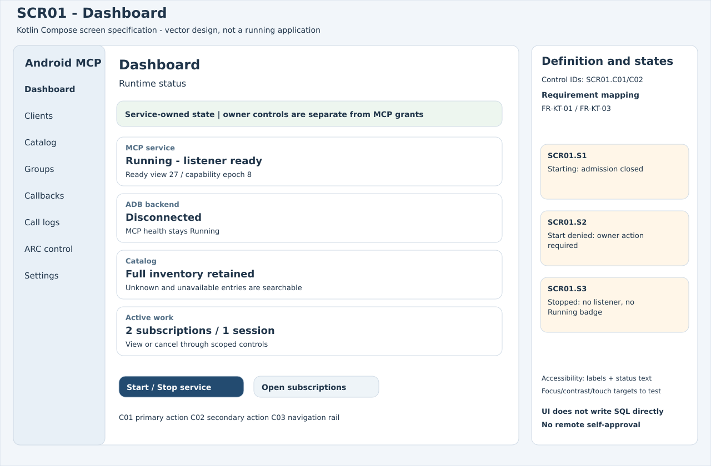
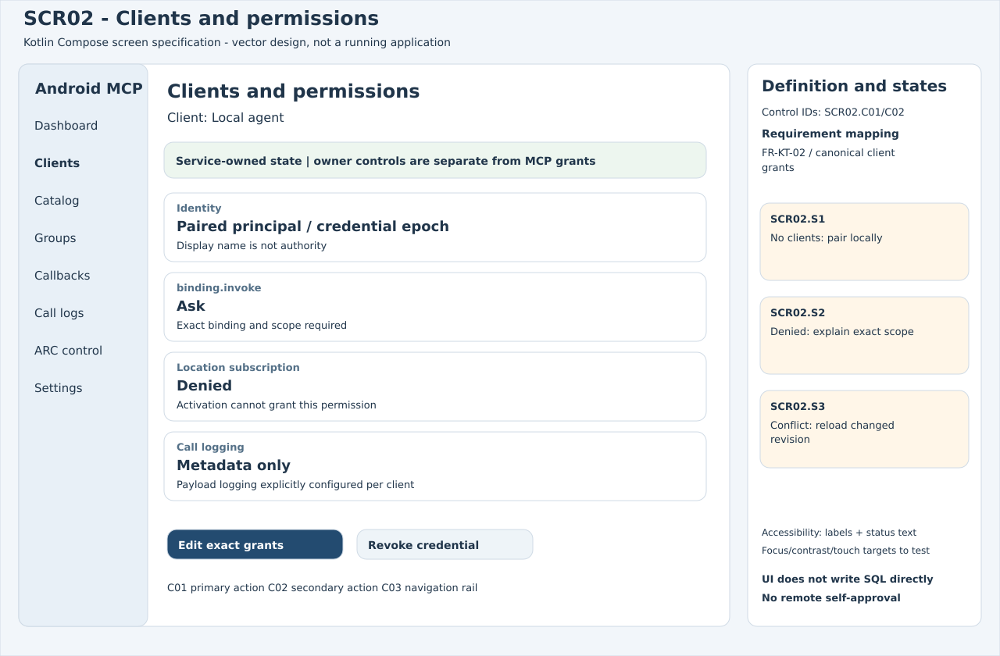
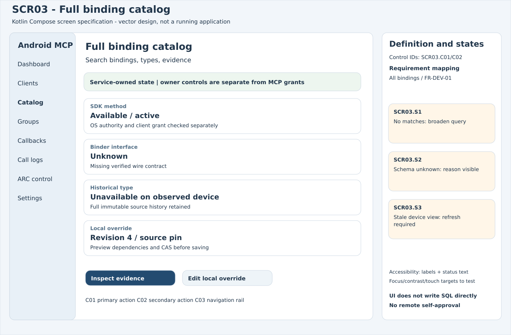
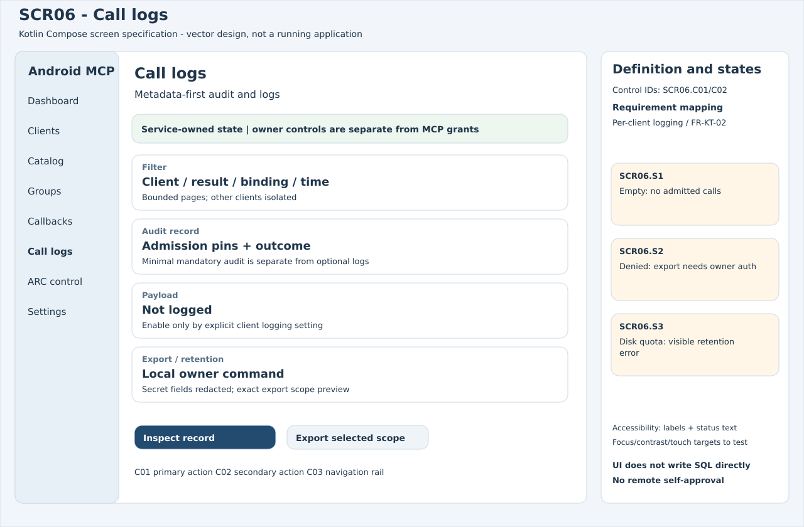
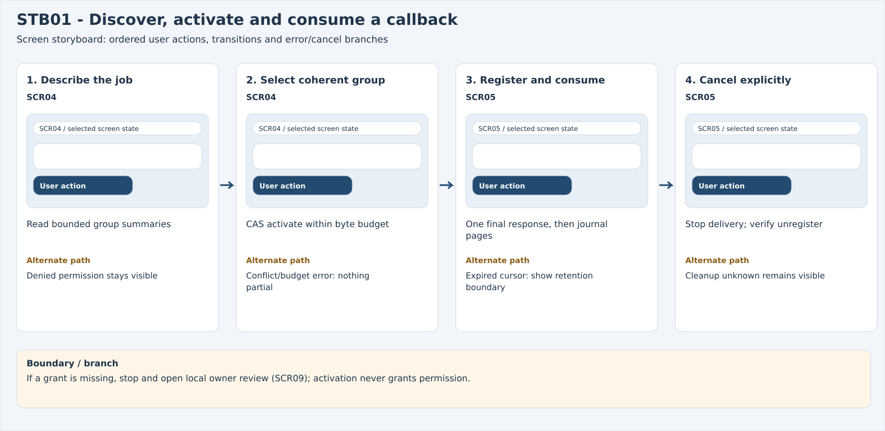
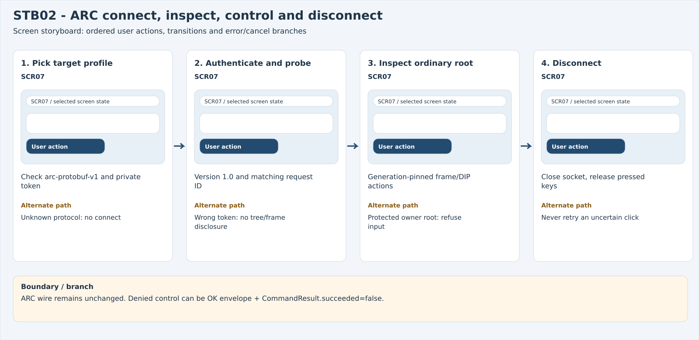
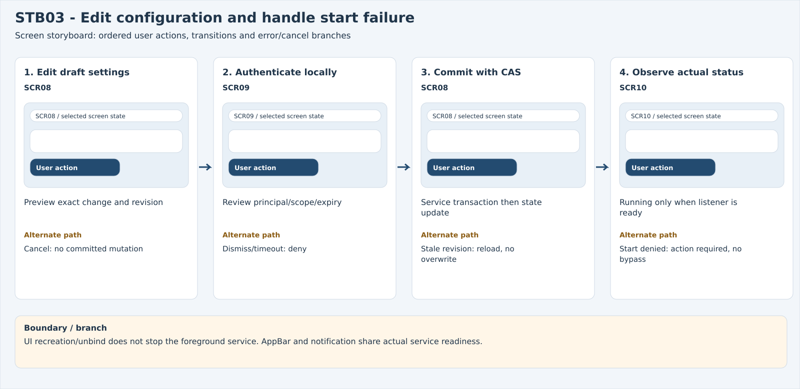

# Kotlin Compose screen definitions and storyboards

Editable vector specifications; no actual Android UI implementation or device observations. Reference layout is an adaptive large-window Compose management surface; narrow-window navigation collapses to a drawer/single pane, with the same controls/state IDs. Minimum48dp touch targets, accessibility traversal, rotation and text scaling remain implementation acceptance gates.

## SCR01 — Dashboard

FR-KT-01 / FR-KT-03. Controls C01/C02 are the primary/secondary actions, C03 is navigation. State S1/S2/S3 variants are defined in the right annotation panel.

## SCR02 — Clients and permissions

FR-KT-02 / canonical client grants. Controls C01/C02 are the primary/secondary actions, C03 is navigation. State S1/S2/S3 variants are defined in the right annotation panel.

## SCR03 — Full binding catalog

All bindings / FR-DEV-01. Controls C01/C02 are the primary/secondary actions, C03 is navigation. State S1/S2/S3 variants are defined in the right annotation panel.

## SCR04 — Groups for a job

FR-GRP-01 / 02 / 03. Controls C01/C02 are the primary/secondary actions, C03 is navigation. State S1/S2/S3 variants are defined in the right annotation panel.

## SCR05 — Callback subscriptions

FR-CB-01 / 02 / 03 / 04. Controls C01/C02 are the primary/secondary actions, C03 is navigation. State S1/S2/S3 variants are defined in the right annotation panel.

## SCR06 — Call logs

Per-client logging / FR-KT-02. Controls C01/C02 are the primary/secondary actions, C03 is navigation. State S1/S2/S3 variants are defined in the right annotation panel.

## SCR07 — ARC session and control

FR-ARC-01 / 02 / 03 / 04. Controls C01/C02 are the primary/secondary actions, C03 is navigation. State S1/S2/S3 variants are defined in the right annotation panel.

## SCR08 — Settings and backends

FR-KT-03 / persistent service / ADB. Controls C01/C02 are the primary/secondary actions, C03 is navigation. State S1/S2/S3 variants are defined in the right annotation panel.

## SCR09 — Protected owner approval

FR-ARC-04 / canonical Ask approval. Controls C01/C02 are the primary/secondary actions, C03 is navigation. State S1/S2/S3 variants are defined in the right annotation panel.

## SCR10 — Action required

FR-KT-03 / no fabricated readiness. Controls C01/C02 are the primary/secondary actions, C03 is navigation. State S1/S2/S3 variants are defined in the right annotation panel.

## STB01 — Discover, activate and consume a callback

If a grant is missing, stop and open local owner review (SCR09); activation never grants permission.

## STB02 — ARC connect, inspect, control and disconnect

ARC wire remains unchanged. Denied control can be OK envelope + CommandResult.succeeded=false.

## STB03 — Edit configuration and handle start failure

UI recreation/unbind does not stop the foreground service. AppBar and notification share actual service readiness.

[Editable Marp deck](../storyboards/storyboard.md) · [Self-contained HTML slideshow](storyboards.html)
