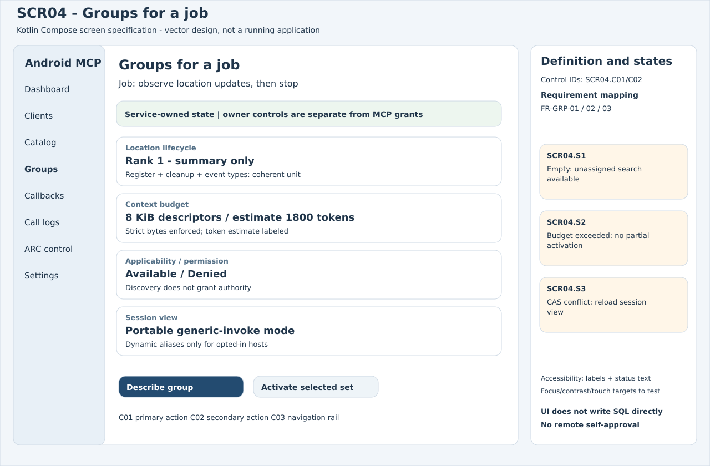
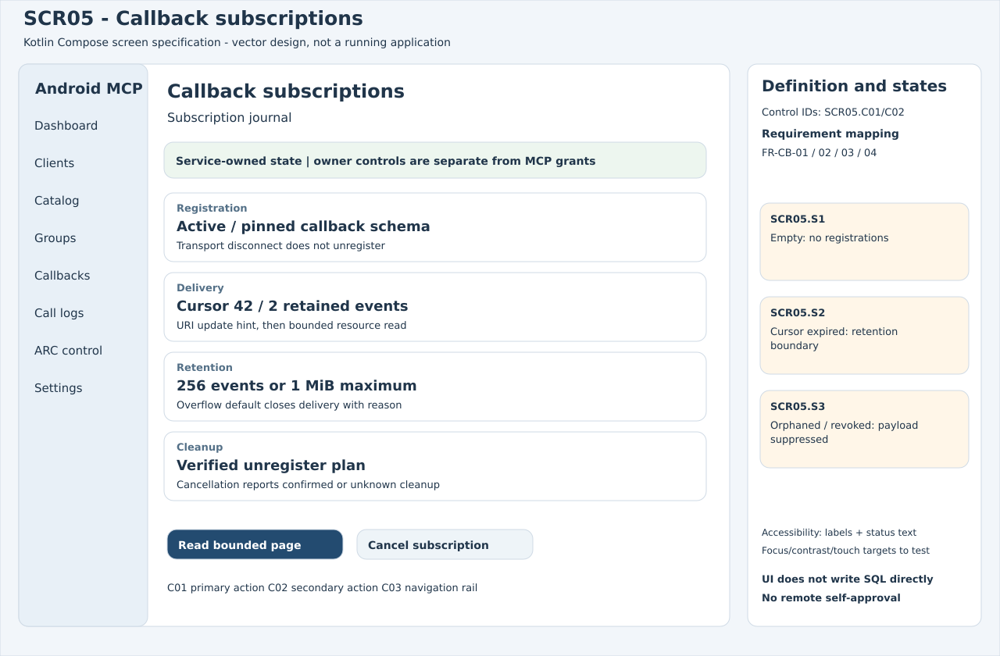
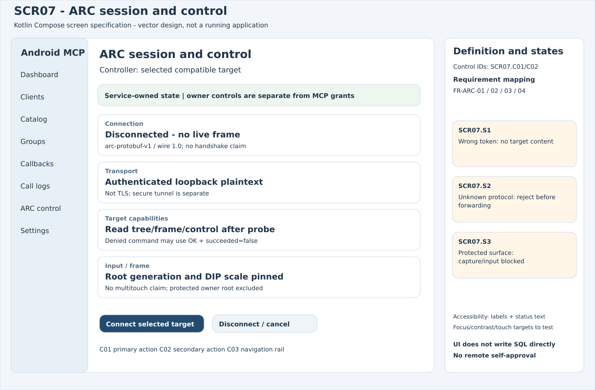
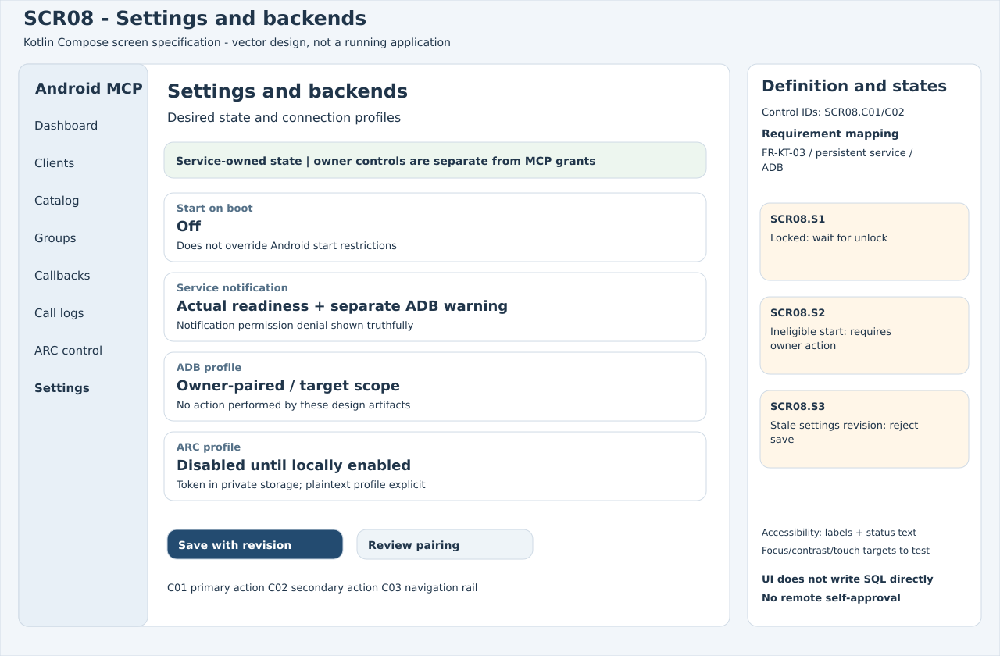
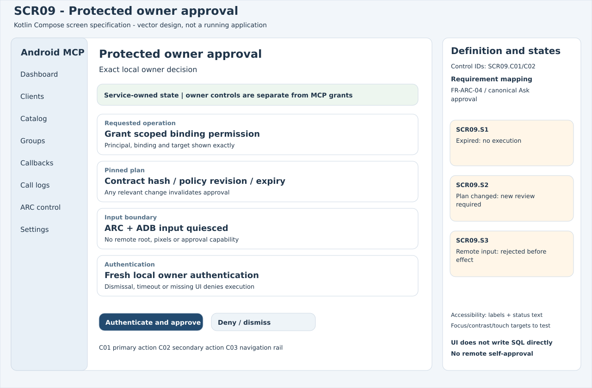

# Android MCP UI storyboards

Kotlin Compose screen/state specifications.

Design only — no application or device operations.

---

# STB01 · 1. Describe the job

SCR04 · Read bounded group summaries

**Alternate:** Denied permission stays visible

---

# STB01 · 2. Select coherent group

SCR04 · CAS activate within byte budget

**Alternate:** Conflict/budget error: nothing partial

---

# STB01 · 3. Register and consume

SCR05 · One final response, then journal pages

**Alternate:** Expired cursor: show retention boundary

---

# STB01 · 4. Cancel explicitly

SCR05 · Stop delivery; verify unregister

**Alternate:** Cleanup unknown remains visible

---

# STB02 · 1. Pick target profile

SCR07 · Check arc-protobuf-v1 and private token

**Alternate:** Unknown protocol: no connect

---

# STB02 · 2. Authenticate and probe

SCR07 · Version 1.0 and matching request ID

**Alternate:** Wrong token: no tree/frame disclosure

---

# STB02 · 3. Inspect ordinary root

SCR07 · Generation-pinned frame/DIP actions

**Alternate:** Protected owner root: refuse input

---

# STB02 · 4. Disconnect

SCR07 · Close socket, release pressed keys

**Alternate:** Never retry an uncertain click

---

# STB03 · 1. Edit draft settings

SCR08 · Preview exact change and revision

**Alternate:** Cancel: no committed mutation

---

# STB03 · 2. Authenticate locally

SCR09 · Review principal/scope/expiry

**Alternate:** Dismiss/timeout: deny

---

# STB03 · 3. Commit with CAS

SCR08 · Service transaction then state update

**Alternate:** Stale revision: reload, no overwrite

---

# STB03 · 4. Observe actual status

SCR10 · Running only when listener is ready

**Alternate:** Start denied: action required, no bypass
