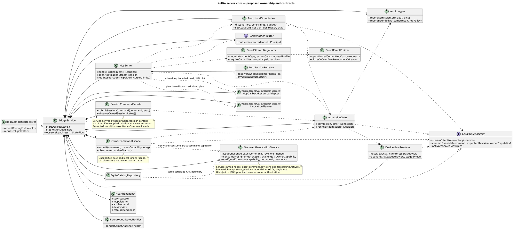
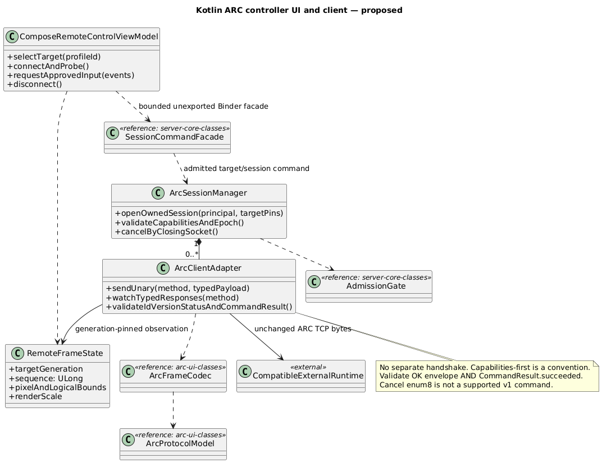

# C4 code-level detail, using UML class notation

Structurizr has no native class view. These editable inline PlantUML definitions are rendered locally and referenced by image views in workspace.dsl. They are proposed Kotlin classes/interfaces, not implemented Android code. Composition diamonds denote owned lifetime; dashed arrows denote dependency, and quoted labels denote multiplicity. Each block identifies its scoped C4 component. Member lists show selected responsibilities, not every Kotlin member. A reference stub explicitly names its authoritative view; realizations inherit the full interface contract. Local epochs/generations are bridge metadata unless the pinned proto has the corresponding field.

## server-core-classes — bridge.app.transport and server ownership

## arc-controller-classes — bridge.app.arcController and local Compose controller UI

## server-execution-classes — bridge.app.invoke and bridge.app.callbacks

```plantuml
@startuml
!pragma layout smetana
skinparam defaultFontName DejaVu Sans
skinparam classAttributeIconSize 0
skinparam shadowing false
skinparam backgroundColor white
title Kotlin invocation and callback contracts — proposed
class InvocationPlanner {
  +plan(bindingId, args, callbacks, pins)
  +dispatch(admission): BoundedResult
}
interface BackendAdapter {
  +invoke(verifiedPlan): Outcome
  +observeCapabilityEpoch()
}
class BinderBackend {
  +invoke(verifiedPlan): Outcome
  +observeCapabilityEpoch()
  +transact(verifiedWirePlan)
}
class AdbPhoneBackend {
  +invoke(verifiedPlan): Outcome
  +observeCapabilityEpoch()
  +screenState(scope)
  +tap(scope, coordinates)
}
class AdbConnectionManager {
  +connectVerifiedPairedProfile(profile): ConnectionOrReason
  +observeHealthAndEpoch()
  +closeBoundedCollectors()
}
class BinderHandleProvider {
  +acquireVerifiedAccessProfile(descriptor): BinderOrReason
}
class WireContractVerifier {
  +verifyPinnedSchemaAndBackendEvidence(plan): VerifiedWirePlanOrReason
}
AdbPhoneBackend "1" *-- "1" AdbConnectionManager
BinderBackend ..> BinderHandleProvider
BinderBackend ..> WireContractVerifier
note bottom of AdbConnectionManager
Owns paired ADB identity, encrypted key, endpoint/TLS verification,
pair/connect discovery and bounded reconnect/unsupported reasons.
No unauthenticated5555 or universal OEM access fallback.
end note
note bottom of WireContractVerifier
Trusted exact generated/imported codec proof plus current backend pins.
A caller JSON flag, source descriptor or API level is not wire proof.
Unsupported acquisition/codec remains explicit.
end note
class CodecRegistry {
  +selectExact(schemaHash, wireProof)
}
class SdkBindingBackend {
  +preflight(plan): SupportedOrReason
  +dispatch(admission): BoundedResult
}
SdkBindingBackend ..|> BackendAdapter
class CallbackBroker {
  +register(admission): SubscriptionHandle
  +receive(sender, method, payload)
  +cancel(handle): CleanupOutcome
  +recoverOrphanedRegistrations()
  +onCalleeDied(token)
}
class Subscription {
  +id: String
  +streamEpoch: String
  +revision: Long
  +state: RegistrationState
  +cleanupDisposition: CleanupDisposition
  +registrationAndCleanupPins
}
class DirectEventEmitter <<reference: server-core-classes>>
DirectEventEmitter ..> EventJournal : committed events only; same quotas and read authority
interface EventJournal {
  +appendOrderedWithinQuota(event)
  +readOwnedPage(cursor, limits)
  +recordGapOrTerminal(reason)
}
class SqliteEventJournal
class LocalReplyPolicy {
  +validateTypedFallback(evidence)
  +replyWithinDeadline(input)
}
class McpCallbackResourceAdapter {
  +subscribeOwnedUri(session, uri)
  +notifyUriOnly(uri)
  +readBoundedPage(principal, uri, cursor, limits)
}
InvocationPlanner ..> BackendAdapter
InvocationPlanner ..> CodecRegistry
InvocationPlanner ..> CallbackBroker
BinderBackend ..|> BackendAdapter
AdbPhoneBackend ..|> BackendAdapter
BinderBackend ..> CodecRegistry
class BridgeService <<reference: server-core-classes>>
BridgeService "1" *-- "1" CallbackBroker
BridgeService "1" *-- "1" SqliteEventJournal
BridgeService "1" *-- "1" CodecRegistry
BridgeService "1" *-- "1" BinderBackend
BridgeService "1" *-- "1" AdbPhoneBackend
CallbackBroker "1" *-- "0..*" Subscription
CallbackBroker ..> EventJournal
CallbackBroker ..> LocalReplyPolicy
SqliteEventJournal ..|> EventJournal
McpCallbackResourceAdapter ..> CallbackBroker
McpCallbackResourceAdapter ..> EventJournal
note bottom of LocalReplyPolicy
No network or agent roundtrip for sync return.
Unknown valid deadline/default means unsupported.
end note
note bottom of Subscription
Durable handle/journal is not a durable OS registration.
Transport disconnect does not imply unregister.
end note
@enduml
```

## arc-ui-classes — bridge.app.arc, bridge.app.ui and ownerCommands

```plantuml
@startuml
!pragma layout smetana
skinparam defaultFontName DejaVu Sans
skinparam classAttributeIconSize 0
skinparam shadowing false
skinparam backgroundColor white
title Internal Kotlin ARC port and Compose boundary — proposed
class CompatibleArcClient <<external>>
class ArcTcpTransport {
  +acceptLoopbackConnection()
  +readOneRequestAndStreamResponses()
  +closeOnPeerDisconnectOrServerRevocation()
}
class ArcFrameCodec {
  +readExactSignedBigEndianLength()
  +decodeBoundedFrame(): BridgeRequest
  +writeFrame(response)
}
class ArcProtocolModel {
  +protocolVersion = "1.0"
  +transport = "arc-protobuf-v1"
  +preserveUnknownProtobufFields()
  +parseRequest(bytes): BridgeRequest
  +serializeResponse(response): ByteArray
}
class ArcCompatibilityProfile {
  +validateVersionAndMethod(request)
  +validateResponseIdVersionStatus()
}
class ArcRequestHandler {
  +handleUnary(request): BridgeResponse
  +handleWatch(request): ResponseFlow
}
class ArcSessionRegistry {
  +pinConnectionPrincipalAndEpoch()
  +revokeAndCloseStreams()
}
interface ArcAuthenticator {
  +authenticateEnvelopeBearer(): Principal
}
class ArcAuthorizationGate {
  +admitTargetOperation(principal, pins)
}
class ArcRuntime {
  +getCapabilities(principal)
  +invokeGuardedOperation(plan)
  +watchBoundedEvents(plan)
}
interface TargetAdapter {
  +snapshot(rootGeneration)
  +watchFramesWithinQuota()
  +invokeApprovedAction()
  +sendInput(rootGeneration, events)
}
class ComposeTargetAdapter <<reference: arc-target-classes>>
class UiDispatcher {
  +executeBoundedOnMainThread(action)
}
class ComposeManagementViewModel {
  +observeStatusAndDrafts()
  +submitOwnerCommand(expectedRevision)
}
class OwnerCommandFacade <<reference: server-core-classes>>
class AdmissionGate <<reference: server-core-classes>>
ArcAuthorizationGate ..> AdmissionGate : delegates admission / recheck; no parallel authority
CompatibleArcClient --> ArcTcpTransport : retained ARC wire
ArcTcpTransport "1" *-- "1" ArcSessionRegistry
class ArcConnectionSession {
  +principalAndCredentialEpoch
  +boundedResponseDeadline
  +closeAndReleaseOwnedInput()
}
ArcSessionRegistry "1" *-- "0..*" ArcConnectionSession
ArcTcpTransport ..> ArcFrameCodec
ArcFrameCodec ..> ArcProtocolModel
ArcTcpTransport ..> ArcRequestHandler
ArcRequestHandler ..> ArcAuthenticator
ArcRequestHandler ..> ArcCompatibilityProfile
ArcRequestHandler ..> ArcAuthorizationGate
ArcRequestHandler ..> ArcRuntime
ArcRuntime ..> TargetAdapter
ComposeTargetAdapter ..|> TargetAdapter
ComposeTargetAdapter ..> UiDispatcher
ComposeManagementViewModel ..> OwnerCommandFacade : local only
note right of ArcTcpTransport
Authenticated plaintext loopback TCP, no fake TLS.
One request/socket. Received Cancel8 returns UNSUPPORTED then closes.
The controller cancels a watch by closing its own watch socket.
end note
note bottom of ComposeTargetAdapter
Selected ordinary root only.
Protected approval/grant screens excluded.
Generic phone input uses separate AdbPhoneBackend.
end note
note bottom of OwnerCommandFacade
ARC principal cannot mint local owner approval.
The ViewModel is not the external ARC client.
end note
@enduml
```

## arc-target-classes — bridge.app.arc target/runtime adapter detail

```plantuml
@startuml
!pragma layout smetana
skinparam defaultFontName DejaVu Sans
skinparam classAttributeIconSize 0
skinparam shadowing false
skinparam backgroundColor white
title Kotlin ARC target adapter and UI execution — proposed
interface TargetAdapter <<reference: arc-ui-classes>>
class ComposeTargetAdapter {
  +snapshot(rootGeneration)
  +watchFramesWithinQuota()
  +invokeApprovedAction()
  +sendInput(rootGeneration, events)
  +observeRootGeneration()
  +excludeProtectedSelectedRoot()
}
class TargetNodeRegistry {
  +resolveNode(id, generation)
  +invalidateOnRootReplacement()
}
class ArcFrameCapture {
  +captureBoundedPng(root): FrameUpdate
  +rejectInvalidOrProtectedRoot(rootGeneration)
}
class ArcFrameStreamService {
  +streamWithinLocalRateAndByteQuota()
  +tryTerminalWithinWriteDeadlineElseCloseSocket()
}
class ArcInputDispatcher {
  +mapRootDipAndAvaloniaKeyNames(events)
  +dispatchOrderedApprovedBatch()
  +releasePressedStateOnClose()
}
class ArcPropertyMutationService {
  +applyAllowlistedTypedProperty()
}
class ArcLogStreamService {
  +filterRedactAndReportDroppedCount()
}
class UiDispatcher {
  +executeBoundedOnMainThread(action)
}
class ArcAuthorizationGate <<reference: arc-ui-classes>>
class ArcConnectionSession <<reference: arc-ui-classes>>
ArcConnectionSession "1" *-- "0..1" ArcInputDispatcher
ArcConnectionSession "1" *-- "0..1" ArcFrameStreamService
ArcConnectionSession "1" *-- "0..1" ArcLogStreamService
note bottom of ArcConnectionSession
Per-connection input state/streams; close releases owned pressed state.
UiDispatcher and selected-root adapter are service singletons.
end note
ComposeTargetAdapter ..|> TargetAdapter
ComposeTargetAdapter "1" *-- "1" TargetNodeRegistry
ComposeTargetAdapter ..> ArcFrameCapture
ComposeTargetAdapter ..> ArcInputDispatcher
ComposeTargetAdapter ..> ArcPropertyMutationService
ArcFrameStreamService ..> ArcFrameCapture
ArcFrameCapture ..> UiDispatcher
ArcInputDispatcher ..> UiDispatcher
ArcPropertyMutationService ..> UiDispatcher
ComposeTargetAdapter ..> ArcFrameStreamService : opens admitted per-connection stream
class ArcRuntime <<reference: arc-ui-classes>>
ArcRuntime ..> ArcLogStreamService : opens admitted filtered stream
ArcPropertyMutationService ..> ArcAuthorizationGate
ArcInputDispatcher ..> ArcAuthorizationGate
ArcFrameStreamService ..> ArcAuthorizationGate
ArcLogStreamService ..> ArcAuthorizationGate
note bottom of ArcInputDispatcher
Mouse/wheel/key/text only; no wire pointer ID or multitouch.
Key strings are not Android keycodes.
Target generation, policy epoch and protected-root gate rechecked.
end note
@enduml
```

