# Kotlin Compose SVG screen definitions and storyboards

Canonical editable sources are `ui-svg/`; Gradle copies them to `docs/screens/`. Edit source SVG and its manifest together. Reference units map to Compose dp; action/navigation bounds are48dp. Narrow windows use the same IDs in a single pane. These are screen definitions, not an implemented UI.

## SCR01 — Dashboard

FR-KT-01 / FR-KT-03. SCR01.C01 = Start / Stop service; C02 = Open subscriptions; C03 = navigation. SCR09 is modal with navigation locked. SCR02.S1 offers Pair locally -> SCR11. States S1–S3 are explicit alternatives; S0 is the pictured example. SCR07.C04 is input, enabled only in the connected and authorized state.

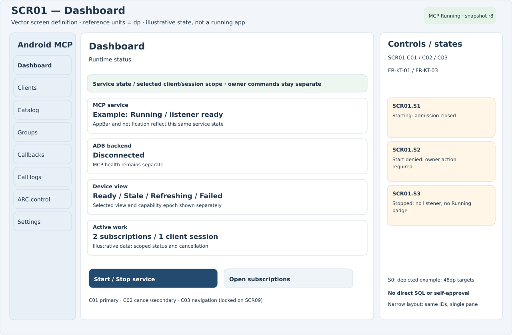

## SCR02 — Clients and permissions

FR-KT-02 / canonical client grants. SCR02.C01 = Edit exact grants; C02 = Revoke credential; C03 = navigation. SCR09 is modal with navigation locked. SCR02.S1 offers Pair locally -> SCR11. States S1–S3 are explicit alternatives; S0 is the pictured example. SCR07.C04 is input, enabled only in the connected and authorized state.

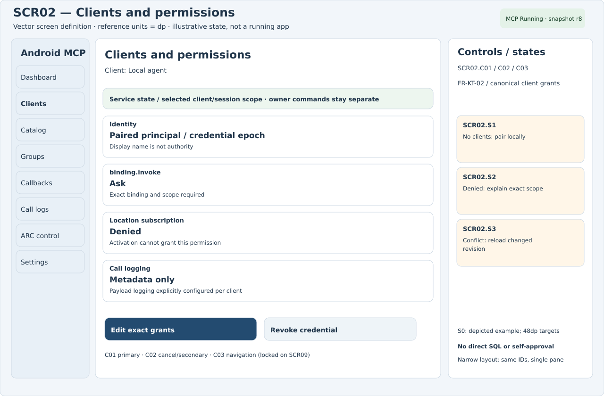

## SCR03 — Full binding catalog

All bindings / FR-DEV-01. SCR03.C01 = Inspect evidence; C02 = Edit local override; C03 = navigation. SCR09 is modal with navigation locked. SCR02.S1 offers Pair locally -> SCR11. States S1–S3 are explicit alternatives; S0 is the pictured example. SCR07.C04 is input, enabled only in the connected and authorized state.

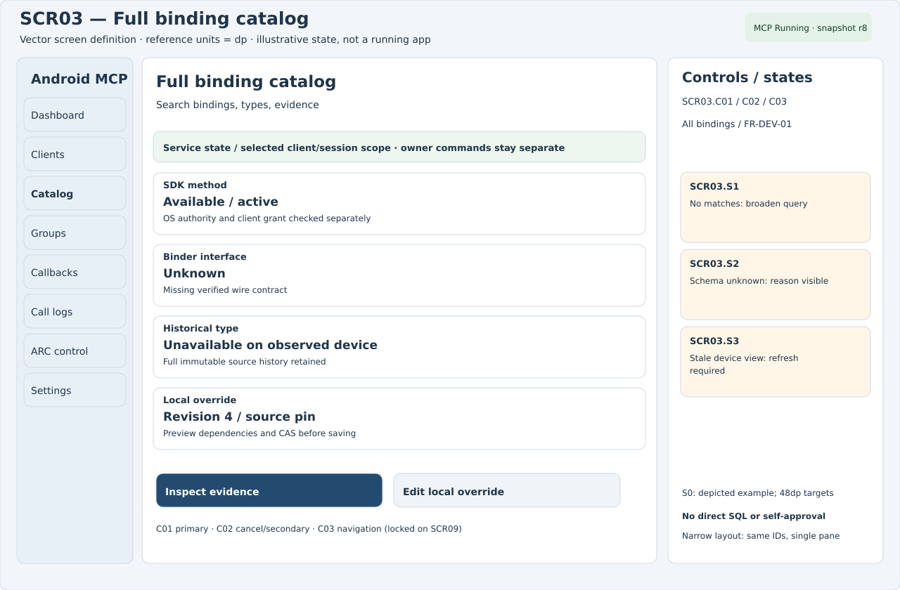

## SCR04 — Groups for a job

FR-GRP-01 / 02 / 03. SCR04.C01 = Inspect group summary; C02 = Save group mapping; C03 = navigation. SCR09 is modal with navigation locked. SCR02.S1 offers Pair locally -> SCR11. States S1–S3 are explicit alternatives; S0 is the pictured example. SCR07.C04 is input, enabled only in the connected and authorized state.

## SCR05 — Callback subscriptions

FR-CB-01 / 02 / 03 / 04. SCR05.C01 = Inspect bounded status; C02 = Cancel via owner review; C03 = navigation. SCR09 is modal with navigation locked. SCR02.S1 offers Pair locally -> SCR11. States S1–S4 are explicit alternatives; S0 is the pictured example. SCR07.C04 is input, enabled only in the connected and authorized state.

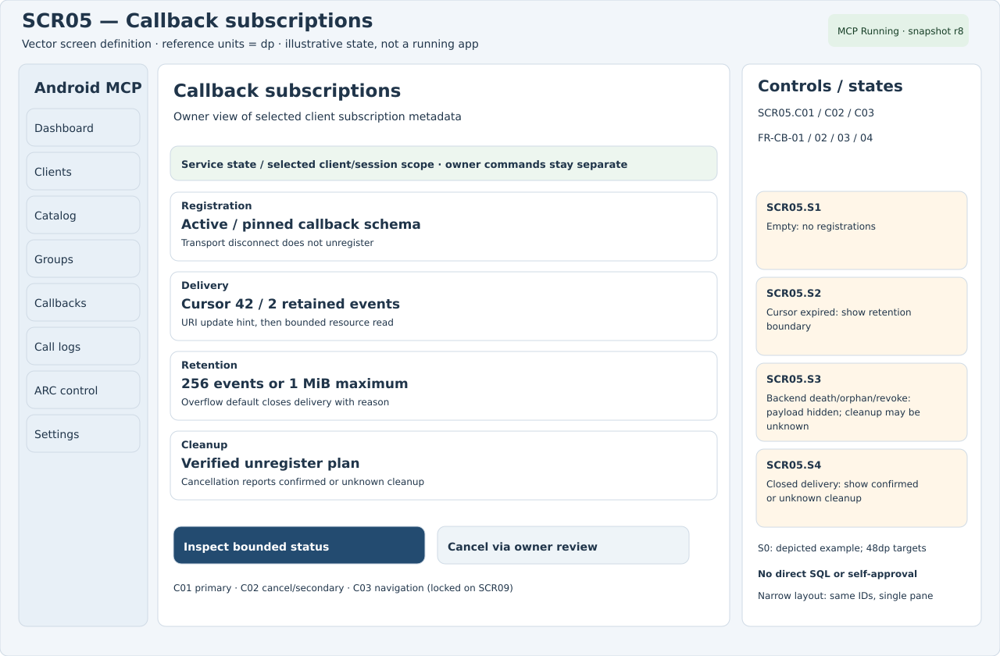

## SCR06 — Call logs

Per-client logging / FR-KT-02. SCR06.C01 = Inspect record; C02 = Export selected scope; C03 = navigation. SCR09 is modal with navigation locked. SCR02.S1 offers Pair locally -> SCR11. States S1–S3 are explicit alternatives; S0 is the pictured example. SCR07.C04 is input, enabled only in the connected and authorized state.

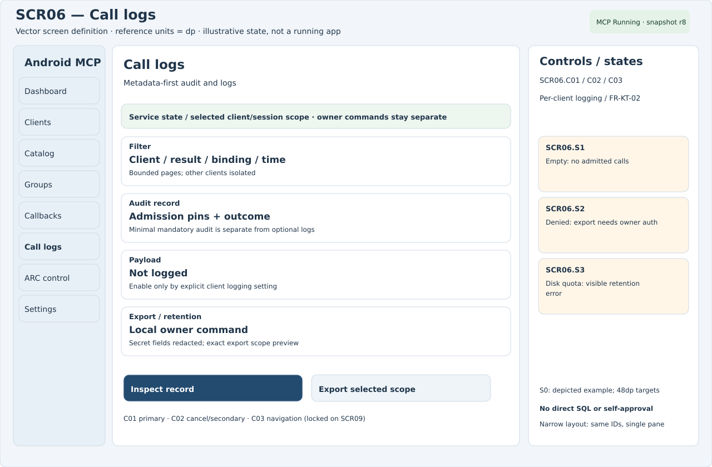

## SCR07 — ARC session and control

FR-ARC-01 / 02 / 03 / 04. SCR07.C01 = Connect selected target; C02 = Disconnect / cancel; C03 = navigation. SCR09 is modal with navigation locked. SCR02.S1 offers Pair locally -> SCR11. States S1–S4 are explicit alternatives; S0 is the pictured example. SCR07.C04 is input, enabled only in the connected and authorized state.

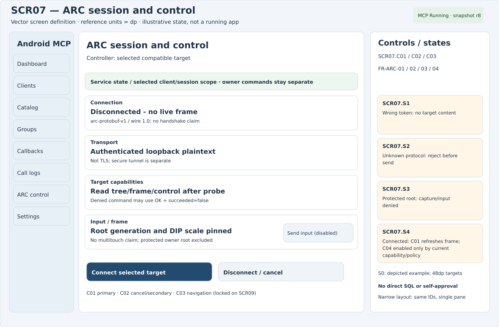

## SCR08 — Settings and backends

FR-KT-03 / persistent service / ADB. SCR08.C01 = Save with revision; C02 = Review pairing; C03 = navigation. SCR09 is modal with navigation locked. SCR02.S1 offers Pair locally -> SCR11. States S1–S3 are explicit alternatives; S0 is the pictured example. SCR07.C04 is input, enabled only in the connected and authorized state.

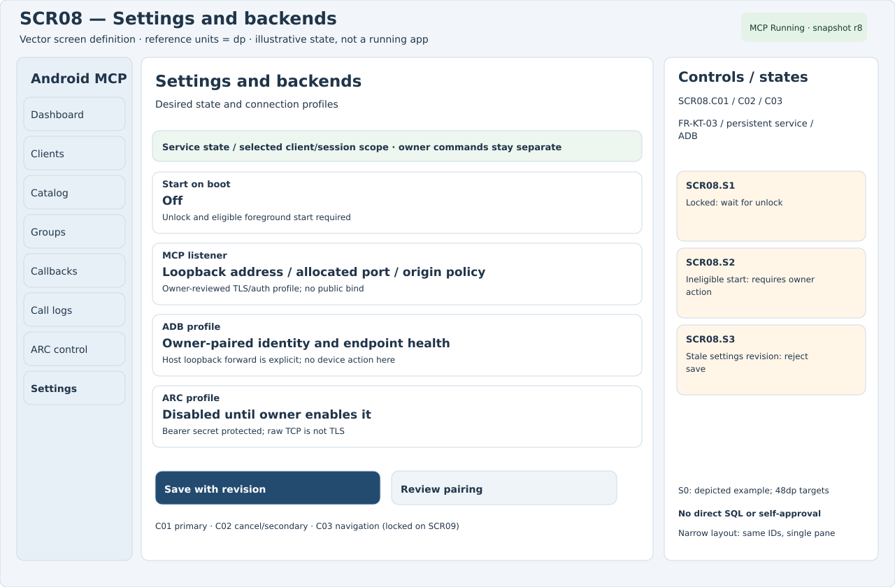

## SCR09 — Protected owner approval

FR-ARC-04 / canonical Ask approval. SCR09.C01 = Authenticate and approve; C02 = Deny / dismiss; C03 = navigation. SCR09 is modal with navigation locked. SCR02.S1 offers Pair locally -> SCR11. States S1–S3 are explicit alternatives; S0 is the pictured example. SCR07.C04 is input, enabled only in the connected and authorized state.

## SCR10 — Action required

FR-KT-03 / no fabricated readiness. SCR10.C01 = Review prerequisites; C02 = Return to dashboard; C03 = navigation. SCR09 is modal with navigation locked. SCR02.S1 offers Pair locally -> SCR11. States S1–S3 are explicit alternatives; S0 is the pictured example. SCR07.C04 is input, enabled only in the connected and authorized state.

## SCR11 — Client pairing

FR-KT-02 / canonical client identity. SCR11.C01 = Generate pairing challenge; C02 = Cancel pairing; C03 = navigation. SCR09 is modal with navigation locked. SCR02.S1 offers Pair locally -> SCR11. States S1–S3 are explicit alternatives; S0 is the pictured example. SCR07.C04 is input, enabled only in the connected and authorized state.

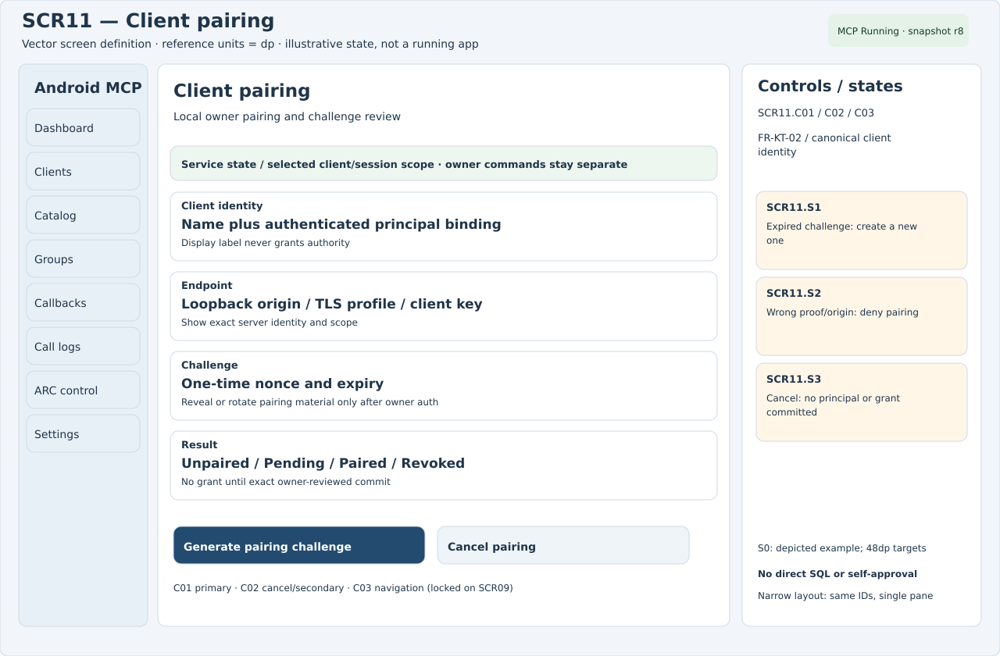

## STB01 — Inspect an agent session and stop a callback

The agent owns MCP discovery/activation/registration/resource reads. The owner UI observes scoped metadata; administrative cancellation uses protected owner authority, not client impersonation.

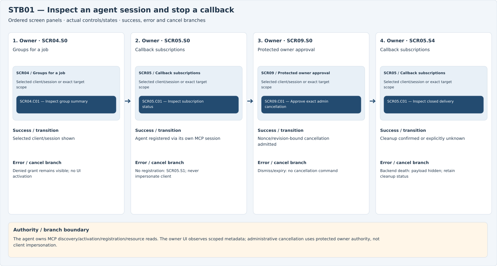

## STB02 — ARC connect, inspect, control and disconnect

Existing ARC v1 bytes remain unchanged. Target operation controls are capability/policy gated; protected local owner surfaces are never an ARC root.

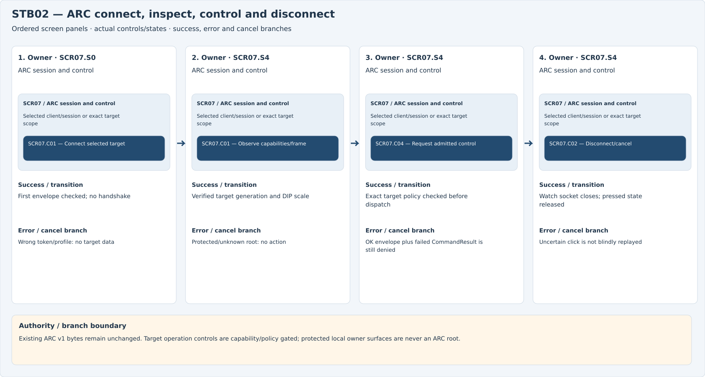

## STB03 — Edit configuration and observe real startup

SCR01 is the success surface; SCR10 is the failure branch. UI recreation never implies foreground-service shutdown.

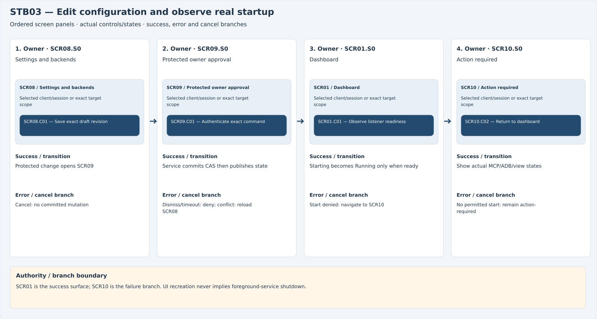

## STB04 — Pair, review grants and revoke a client

SCR02.S1 routes Pair locally to SCR11. Grant edits and revocation use the exact owner flow; display names or group interests grant nothing.

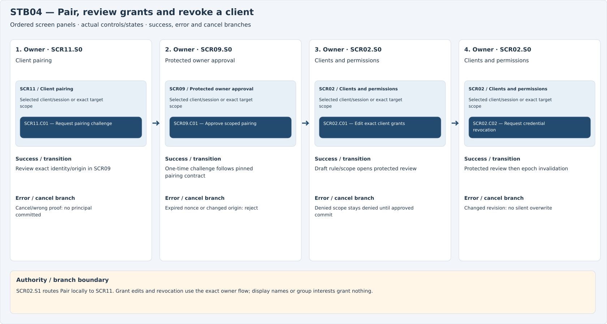

## STB05 — Override catalog metadata and export logs

Local overrides cannot manufacture imported availability or grants. Export is owner-scoped, redacted and separate from mandatory audit retention.

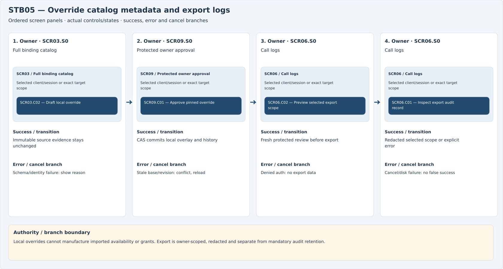

[Editable Marp deck](../storyboards/storyboard.md) · [Self-contained slideshow](storyboards.html)

Every SCRxx.STATUS chip is a read-only AppBar projection of the same HealthSnapshot revision as the Android foreground notification; it is not an approval control. SCR05.S3/S4 show target death, lease expiry, orphan/revoke and confirmed versus unknown cleanup. Screen/card values are illustrative, not a running application.
