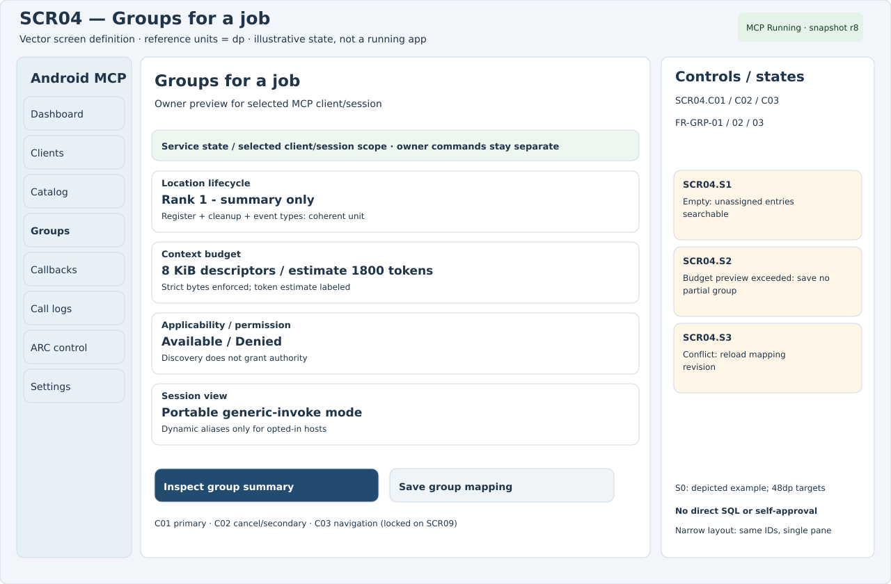
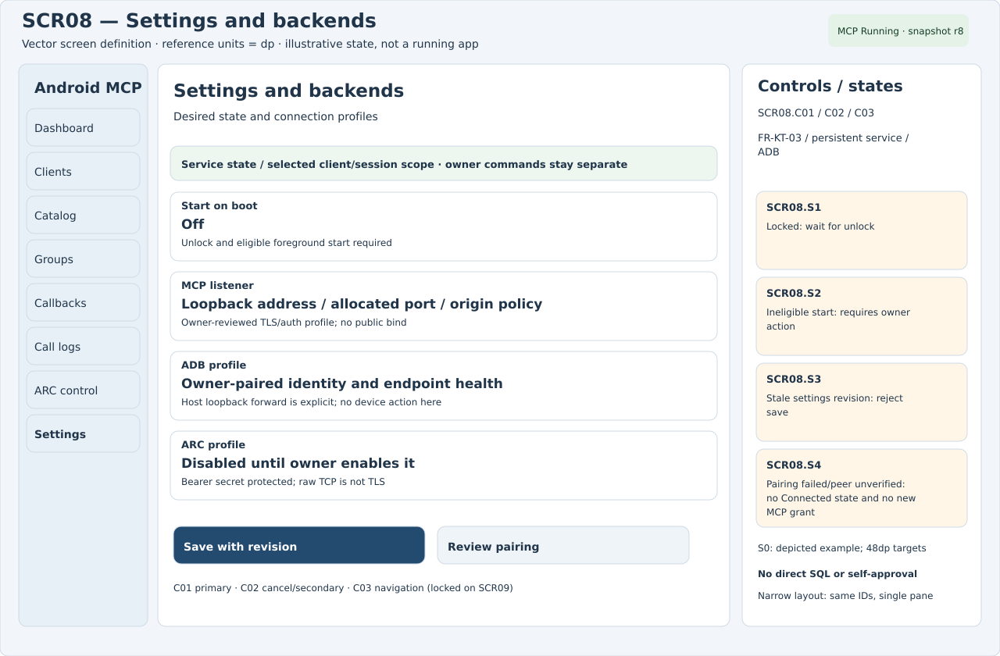
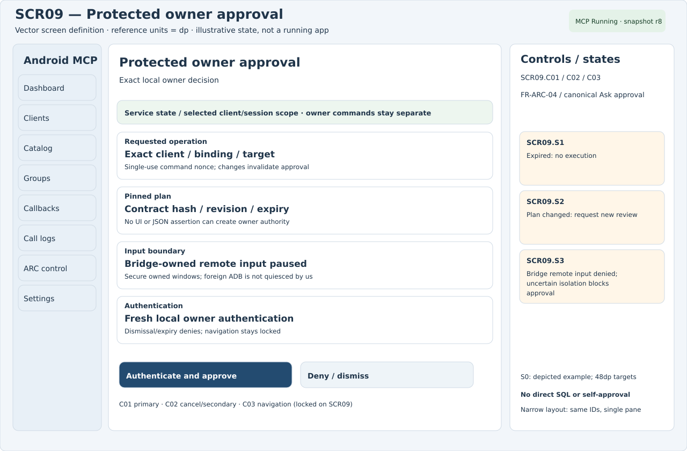
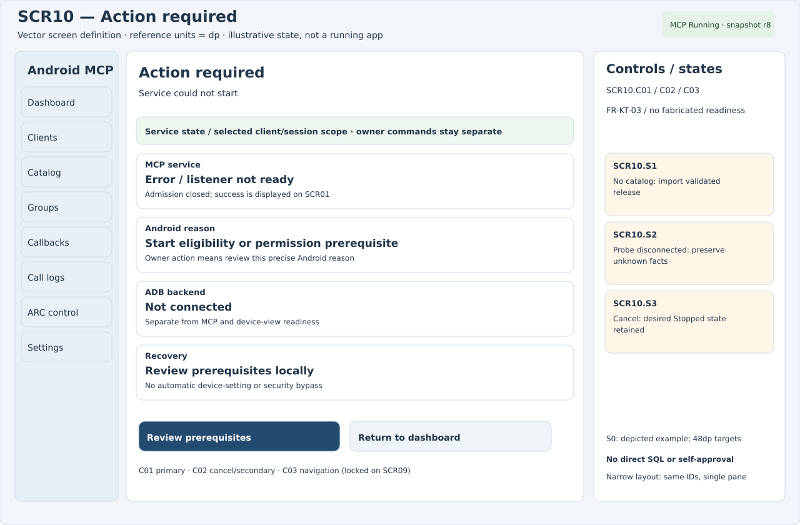
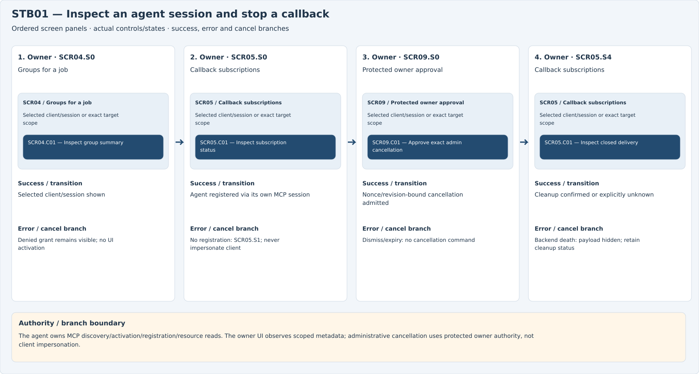
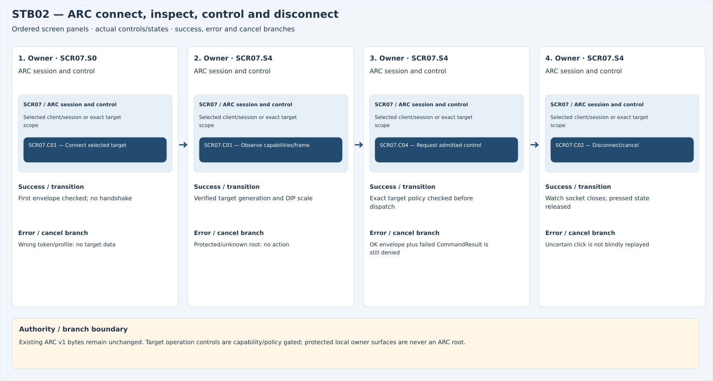
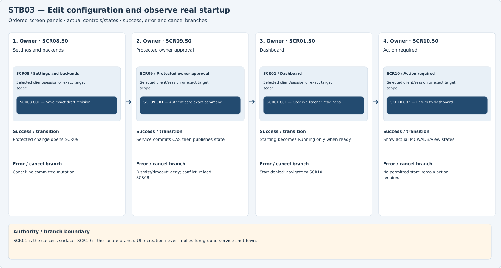
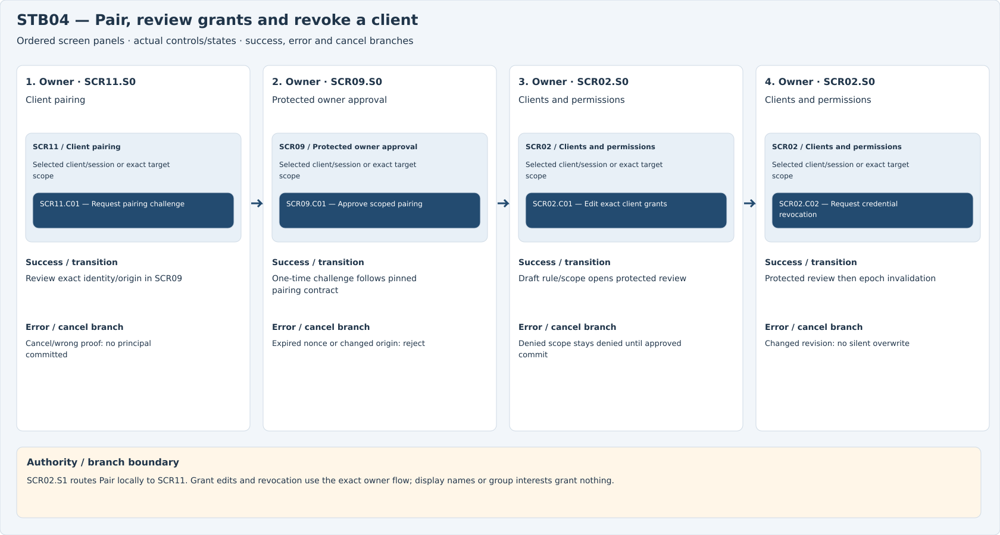
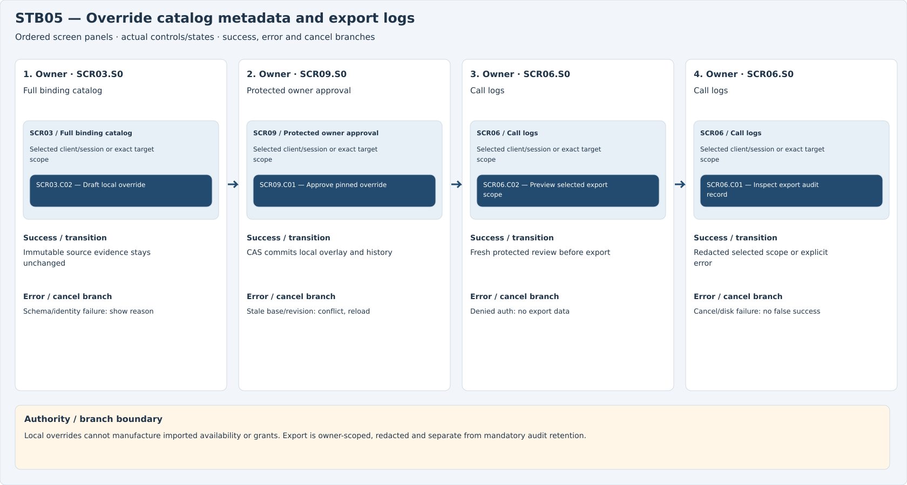
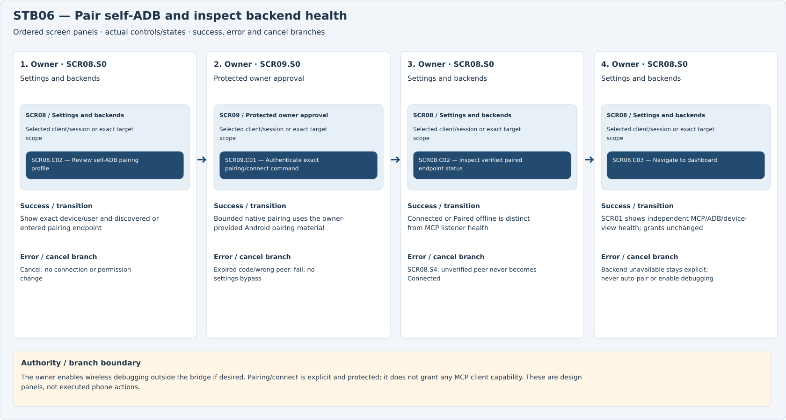

# Kotlin Compose SVG screen definitions and storyboards

Canonical source is ui-svg; Gradle copies identical bytes to docs/screens. Reference units are dp with48dp action/navigation targets. These are editable design specifications, not a running app. The shared SCRxx.STATUS AppBar chip and Android notification use the same HealthSnapshot revision.

## SCR01 — Dashboard

FR-KT-01 / FR-KT-03.

`SCR01.C01` Start / Stop service | `SCR01.C02` Open subscriptions | `SCR01.C03` Navigation; locked for SCR09

Alternatives: `SCR01.S0`: Depicted normal/example state; `SCR01.S1`: Starting: admission closed; `SCR01.S2`: Start denied: owner action required; `SCR01.S3`: Stopped: no listener, no Running badge.

## SCR02 — Clients and permissions

FR-KT-02 / canonical client grants.

`SCR02.C01` Edit exact grants | `SCR02.C02` Revoke credential | `SCR02.C03` Navigation; locked for SCR09

Alternatives: `SCR02.S0`: Depicted normal/example state; `SCR02.S1`: No clients: pair locally; `SCR02.S2`: Denied: explain exact scope; `SCR02.S3`: Conflict: reload changed revision.

The empty-client Pair action routes locally to SCR11; a display label is not a principal.

## SCR03 — Full binding catalog

All bindings / FR-DEV-01.

`SCR03.C01` Inspect evidence | `SCR03.C02` Edit local override | `SCR03.C03` Navigation; locked for SCR09

Alternatives: `SCR03.S0`: Depicted normal/example state; `SCR03.S1`: No matches: broaden query; `SCR03.S2`: Schema unknown: reason visible; `SCR03.S3`: Stale device view: refresh required.

## SCR04 — Groups for a job

FR-GRP-01 / 02 / 03.

`SCR04.C01` Inspect group summary | `SCR04.C02` Save group mapping | `SCR04.C03` Navigation; locked for SCR09

Alternatives: `SCR04.S0`: Depicted normal/example state; `SCR04.S1`: Empty: unassigned entries searchable; `SCR04.S2`: Budget preview exceeded: save no partial group; `SCR04.S3`: Conflict: reload mapping revision.

## SCR05 — Callback subscriptions

FR-CB-01 / 02 / 03 / 04.

`SCR05.C01` Inspect bounded status | `SCR05.C02` Cancel via owner review | `SCR05.C03` Navigation; locked for SCR09

Alternatives: `SCR05.S0`: Depicted normal/example state; `SCR05.S1`: Empty: no registrations; `SCR05.S2`: Cursor expired: show retention boundary; `SCR05.S3`: Backend death/orphan/revoke: payload hidden; cleanup may be unknown; `SCR05.S4`: Closed delivery: show confirmed or unknown cleanup.

## SCR06 — Call logs

Per-client logging / FR-KT-02.

`SCR06.C01` Inspect record | `SCR06.C02` Export selected scope | `SCR06.C03` Navigation; locked for SCR09

Alternatives: `SCR06.S0`: Depicted normal/example state; `SCR06.S1`: Empty: no admitted calls; `SCR06.S2`: Denied: export needs owner auth; `SCR06.S3`: Disk quota: visible retention error.

## SCR07 — ARC session and control

FR-ARC-01 / 02 / 03 / 04.

`SCR07.C01` Connect selected target | `SCR07.C02` Disconnect / cancel | `SCR07.C03` Navigation; locked for SCR09 | `SCR07.C04` Send typed input; disabled unless connected capability/policy permits

Alternatives: `SCR07.S0`: Depicted normal/example state; `SCR07.S1`: Wrong token: no target content; `SCR07.S2`: Unknown protocol: reject before send; `SCR07.S3`: Protected root: capture/input denied; `SCR07.S4`: Connected: C01 refreshes frame; C04 enabled only by current capability/policy.

## SCR08 — Settings and backends

FR-KT-03 / persistent service / ADB.

`SCR08.C01` Save with revision | `SCR08.C02` Review pairing | `SCR08.C03` Navigation; locked for SCR09

Alternatives: `SCR08.S0`: Depicted normal/example state; `SCR08.S1`: Locked: wait for unlock; `SCR08.S2`: Ineligible start: requires owner action; `SCR08.S3`: Stale settings revision: reject save; `SCR08.S4`: Pairing failed/peer unverified: no Connected state and no new MCP grant.

## SCR09 — Protected owner approval

FR-ARC-04 / canonical Ask approval.

`SCR09.C01` Authenticate and approve | `SCR09.C02` Deny / dismiss | `SCR09.C03` Navigation; locked for SCR09

Alternatives: `SCR09.S0`: Depicted normal/example state; `SCR09.S1`: Expired: no execution; `SCR09.S2`: Plan changed: request new review; `SCR09.S3`: Bridge remote input denied; uncertain isolation blocks approval.

Protected modal: navigation locked; fresh owner proof binds the exact command and revisions.

## SCR10 — Action required

FR-KT-03 / no fabricated readiness.

`SCR10.C01` Review prerequisites | `SCR10.C02` Return to dashboard | `SCR10.C03` Navigation; locked for SCR09

Alternatives: `SCR10.S0`: Depicted normal/example state; `SCR10.S1`: No catalog: import validated release; `SCR10.S2`: Probe disconnected: preserve unknown facts; `SCR10.S3`: Cancel: desired Stopped state retained.

## SCR11 — Client pairing

FR-KT-02 / canonical client identity.

`SCR11.C01` Generate pairing challenge | `SCR11.C02` Cancel pairing | `SCR11.C03` Navigation; locked for SCR09

Alternatives: `SCR11.S0`: Depicted normal/example state; `SCR11.S1`: Expired challenge: create a new one; `SCR11.S2`: Wrong proof/origin: deny pairing; `SCR11.S3`: Cancel: no principal or grant committed.

## STB01 — Inspect an agent session and stop a callback

The agent owns MCP discovery/activation/registration/resource reads. The owner UI observes scoped metadata; administrative cancellation uses protected owner authority, not client impersonation.

## STB02 — ARC connect, inspect, control and disconnect

Existing ARC v1 bytes remain unchanged. Target operation controls are capability/policy gated; protected local owner surfaces are never an ARC root.

## STB03 — Edit configuration and observe real startup

SCR01 is the success surface; SCR10 is the failure branch. UI recreation never implies foreground-service shutdown.

## STB04 — Pair, review grants and revoke a client

SCR02.S1 routes Pair locally to SCR11. Grant edits and revocation use the exact owner flow; display names or group interests grant nothing.

## STB05 — Override catalog metadata and export logs

Local overrides cannot manufacture imported availability or grants. Export is owner-scoped, redacted and separate from mandatory audit retention.

## STB06 — Pair self-ADB and inspect backend health

The owner enables wireless debugging outside the bridge if desired. Pairing/connect is explicit and protected; it does not grant any MCP client capability. These are design panels, not executed phone actions.

[Editable Marp deck](../storyboards/storyboard.md) · [Self-contained slideshow](storyboards.html)
